# Codevember

Expériences de creative coding, publiées sur [drschizzo.github.io/Codevember](https://drschizzo.github.io/Codevember/).

## Ce qui relie les scènes

Chaque scène raconte une transformation qui revient à son point de départ : la glace fond puis regèle, le verre se brise puis se refond, le paysage se creuse puis la lame le regarnit, la soie se dévide d'une lanterne et s'enroule sur l'autre. La boucle parfaite n'est pas seulement une contrainte technique : c'est ce que les scènes ont en commun.

## Comment ces scènes sont faites : la skill `codevember-scene`

Depuis Fold, chaque projet part d'un simple thème donné à [Claude Code](https://claude.com/claude-code) (« fais-moi un projet sur l'érosion »). Le dépôt contient une *skill*, [`.claude/skills/codevember-scene`](.claude/skills/codevember-scene/SKILL.md), que l'agent charge de lui-même sur ce genre de demande et qui le conduit seul du thème à la livraison : concept, simulation, rendu, boucle, interface, tests, documentation et carte de l'accueil. Le résultat est le plus souvent bon du premier coup, à quelques retouches près.

Utilisation, dans un clone du dépôt ouvert dans Claude Code :

```
/codevember-scene les marées
```

ou simplement « un nouveau projet Codevember sur les marées ». L'agent annonce son concept en quelques lignes et avance sans interrompre, sauf thème vraiment ambigu.

Ce que contient la skill :

| Fichier | Rôle |
| --- | --- |
| `SKILL.md` | Vingt-cinq exigences qui définissent la famille : vingt pour qu'une scène soit juste (un geste lisible sans légende, un vrai cœur de calcul, une boucle parfaite par construction, des causes visibles, rien qui flotte ni se traverse, des scènes vraiment variées) et cinq pour qu'elle ait un regard (une liberté poétique, un auteur pris pour cible, l'épreuve de l'affiche) ; le déroulé en neuf étapes et les règles non négociables. |
| `references/concept.md` | Le **protocole d'idéation**, écrit avant tout code dans `<projet>/docs/concept.md` : cinq angles d'exploration, clichés nommés et écartés, au moins huit pistes notées sur six critères, puis six épreuves (crédibilité, variété, ambition, déclinaison, scénario, références). |
| `references/*.md` | Boucle et caméra, direction artistique, rendu, architecture, interface, performance et mobile, vérification, documentation, et les pièges three.js WebGPU / TSL déjà rencontrés. |
| `scripts/scaffold.mjs` | Pose un projet qui tourne tout de suite : le gabarit propre au thème, qui importe les modules communs de [`shared/`](shared/README.md) (hasard à graine, mobile, écran de chargement, export MP4, chaîne d'image, studio HDR, quarante finitions). |
| `scripts/planche.py` | Toutes les captures de la collection côte à côte, avec leurs mesures (valeur, amplitude, part d'ambre) : un nouveau projet ne refait pas une image déjà vue. Avec `--dossier`, la même mesure sur les humeurs d'un seul projet. |
| `scripts/sink.py` | Collecteur local des images et des mesures que la scène lui envoie : planches, films image par image, posemètre, aussi à la racine (`tools/sink.py`). |

La skill garde la mémoire des critiques. Chaque remarque de l'utilisateur qui porte sur une catégorie de défauts (une pièce qui flotte, des humeurs qui ne sont que des teintes, des familles qui bougent toutes pareil, des tests verts pendant que l'écran montre une interpénétration) y devient une règle, une épreuve ou un test, avec l'exemple qui l'a fait naître. Le projet suivant ne refait pas l'erreur.

Explication détaillée, avec schémas : [la page de l'atelier](https://drschizzo.github.io/Codevember/skill/) ([source](skill/index.html)).

## Organisation du dépôt

Un dossier par scène, sans étape de construction : des modules ES servis tels quels, three.js par `importmap`.

| Dossier | Contenu |
| --- | --- |
| `<scène>/` | ce qui est propre au thème : recette, simulation, scène, panneau, tests, documentation |
| [`shared/`](shared/README.md) | ce que les scènes ont en commun, une seule fois : chaîne d'image, matériaux, studio HDR, écran de chargement, export, hasard à graine, feuille de style |
| `tools/` | collecteur d'images, contrôle de cohérence, non-régression du rendu |
| `home/` | vignettes de l'accueil, style et outils des pages « défis techniques » |

```bash
npm test          # les invariants de toutes les scènes (node --test, sans navigateur)
npm run check     # cohérence : versions, livrables de chaque scène, imports
npm run serve     # le site entier sur http://localhost:8120/
npm run new -- marees "Marées" "le sous-titre"   # échafaude une scène
```

Un changement dans `shared/` touche toutes les scènes : [`tools/regress.html`](tools/regress.html) rend chaque scène à taille et phases fixes avant et après, et `tools/regress.py` compare les deux séries au bruit propre de chaque rendu. Les tests et le contrôle de cohérence tournent avant chaque publication.

## [Bolt](bolt/)

Une tempête dans une tasse de thé. Une tasse fume sur une nappe ; la vapeur s'accumule en un nuage gros comme deux poings, qui bourgeonne, s'étale en enclume et fonce. Un traceur en sort et descend par bonds en se ramifiant, une aigrette monte de la cuillère, et la foudre tombe : la tasse jette son ombre sur la table, le nuage devient une lanterne. Puis il pleut dans la tasse, le nuage se vide et le thé retrouve son niveau. La scène ne prend qu'une liberté, l'échelle. Côté technique : éclair calculé par claquage diélectrique (Niemeyer, Pietronero et Wiesmann, dans la forme rapide de Kim et al.), en quatre familles liées au récipient (coup au but sur la cuillère d'une tasse, ascendant depuis le couvercle d'une théière, araignée sous le nuage puis sur un verre, fourchu sur le thé d'un bol) ; chaque segment connaît son instant de naissance et sa distance au sol, d'où le traceur, l'onde de l'arc en retour, les réamorçages et la rémanence en perles ; nuage volumique à base plate et enclume, marché dans la chaîne d'image et éclairé de l'intérieur par le canal ; eau conservée à chaque instant (nuage, pluie en vol, thé), ce qui referme la boucle ; dix récipients tournés, sept décors ; boucle parfaite exportable en MP4.

[Démo en ligne](https://drschizzo.github.io/Codevember/bolt/) · [version légère](https://drschizzo.github.io/Codevember/bolt/?mobile=1) · [documentation](bolt/README.md) · [concept](bolt/docs/concept.md)

[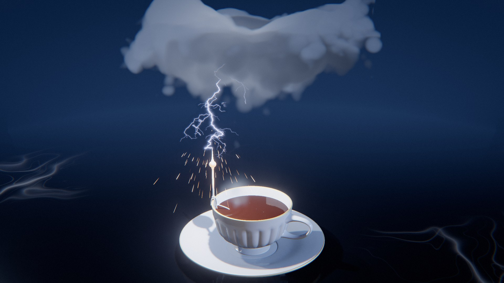](https://drschizzo.github.io/Codevember/bolt/)

## [Cocoon](cocoon/)

La lumière filée. Deux lanternes-cocons pendent aux bras d'un fléau. Un seul ruban de soie quitte l'une, qui se dévide et libère sa lampe, passe sur le fléau et s'enroule sur la cage nue de l'autre, qui se referme sur sa lumière jusqu'à n'être plus qu'une lueur ; puis le fléau fait un demi-tour et les échange, et le fil coule toujours dans le même sens. Le thème appelle une créature, et la chair est ce que le temps réel rend le plus mal : on ne montre que la soie et la lumière. Côté technique : chemins d'enroulement exacts sur la cage (géodésiques de Clairaut, motifs qui se referment après N circuits, cerclage, boucles en huit du ver à soie), ruban de fils ronds déposé sur une carte de hauteur sans aucune traversée (vérifié par un banc et son témoin négatif), paroi qui garde l'instant de passage des quatre premiers fils de chaque direction et filtre la lumière des lampes sur les murs, l'autre lanterne et la brume ; fils rendus en rubans à normale et profondeur de cylindre, reflets de Marschner et lueur à travers les couches ; ailette de rouet dont la cinématique est déduite du fil ; quatre familles, sept formes de cage, huit fils, sept décors ; boucle parfaite exportable en MP4.

[Démo en ligne](https://drschizzo.github.io/Codevember/cocoon/) · [version légère](https://drschizzo.github.io/Codevember/cocoon/?mobile=1) · [documentation](cocoon/README.md) · [concept](cocoon/docs/concept.md)

[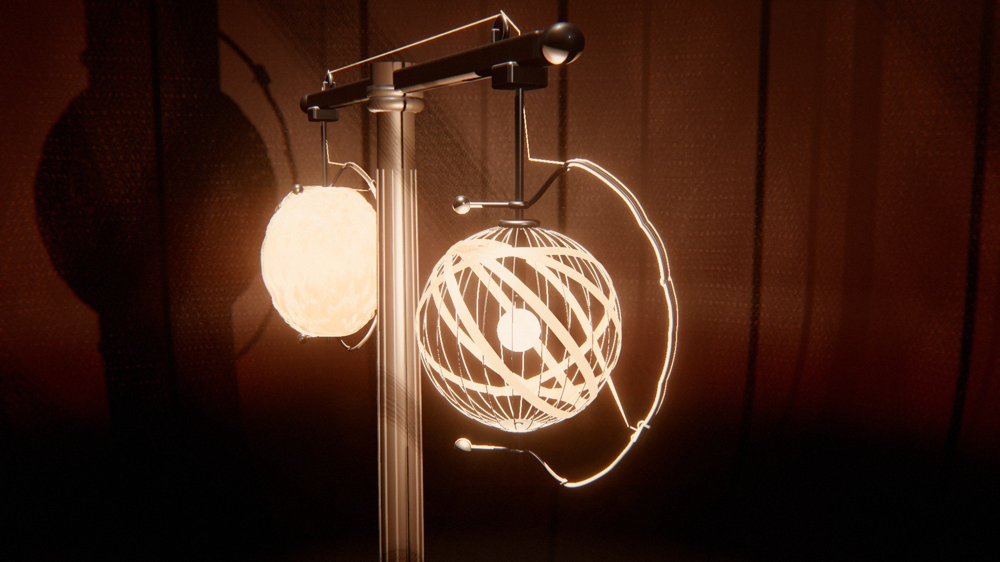](https://drschizzo.github.io/Codevember/cocoon/)

## [Erosion](erosion/)

Un paysage d'une heure. Une table à érosion de laboratoire : un bac de sable stratifié, incliné, dans un cadre d'aluminium et d'acrylique. L'eau arrive — la pluie tombe d'un simulateur, une boîte d'alimentation déborde, un lac se remplit derrière une digue, une guillotine abaisse le niveau de base — et creuse en une demi-minute un paysage entier : des ravines qui remontent dans un plateau, un canyon qui s'incise dans les strates et un delta qui s'ouvre dans le lac, une brèche qui s'élargit en accélérant, des terrasses emboîtées. L'eau se retire, le sable pâlit des crêtes vers les creux, puis un portique repasse le bac avec une lame-gabarit qui pousse le sable des deltas vers les canyons et rend la surface de départ. Côté technique : eau peu profonde par tuyaux virtuels avec frottement de Manning, transport de sédiments conservatif (le sable suit les flux d'eau), capacité de Meyer-Peter–Müller au-dessus du seuil de Shields, dépôt par vitesse de chute, effondrement des talus humides et immergés, strates parallèles au gabarit et de duretés différentes ; 18 000 pas simulés sur le GPU sous l'écran de chargement (qui dessine le relief en train de se creuser), enregistrés en 64 états du relief et 128 de l'eau, relus et interpolés à chaque image ; un seul maillage pour le sable et l'eau, l'eau en vernis à sa propre normale ; quatre familles, sept décors ; boucle parfaite exportable en MP4.

[Démo en ligne](https://drschizzo.github.io/Codevember/erosion/) · [version légère](https://drschizzo.github.io/Codevember/erosion/?mobile=1) · [documentation](erosion/README.md) · [concept](erosion/docs/concept.md)

[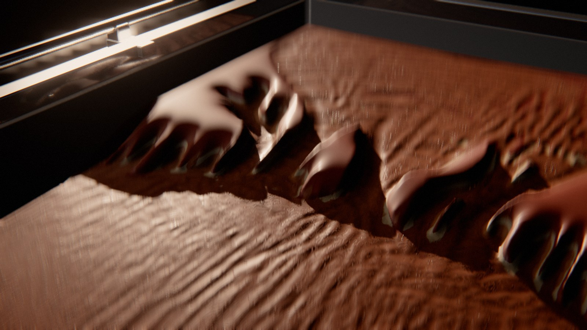](https://drschizzo.github.io/Codevember/erosion/)

## [Pendulum](pendulum/)

L'équilibre renversé. Une chaîne de pendules pend, immobile. La machine qui la porte se met en mouvement : un chariot qui donne des à-coups sur son rail, un bras de Furuta qui pivote autour de sa colonne, un acrobate motorisé au seul coude ou un volant d'inertie qui s'emballe. La chaîne n'a aucun moteur dans ses articulations. Elle balance pourtant de plus en plus haut, se dresse d'un coup de fouet et reste debout, à l'envers, immobile. Puis elle se replie dans une autre figure et revient pendre. Côté technique : dynamique exacte d'une chaîne plane sous-actionnée (une coordonnée imposée, les forces du moteur éliminées par projection) ; redressements trouvés comme des problèmes aux deux bouts par tir multiple et SQP (Graichen et al., Glück et al.) ; départs à chaud et continuation depuis une bibliothèque pour la chaîne triple ; grand tour pour un maillon seul ; boucle faite d'équilibres et ralenti de caméra rapide en forme fermée ; banc des contacts sur les vraies pièces ; quatre familles, huit décors (dont une chronophotographie à la Marey et une pose longue à la Berenice Abbott, où une lampe au bout de la chaîne écrit sa trajectoire en rouge) ; écran de chargement qui dessine le solveur en train de refermer ses raccords ; boucle parfaite exportable en MP4.

[Démo en ligne](https://drschizzo.github.io/Codevember/pendulum/) · [version légère](https://drschizzo.github.io/Codevember/pendulum/?mobile=1) · [documentation](pendulum/README.md) · [concept](pendulum/docs/concept.md)

[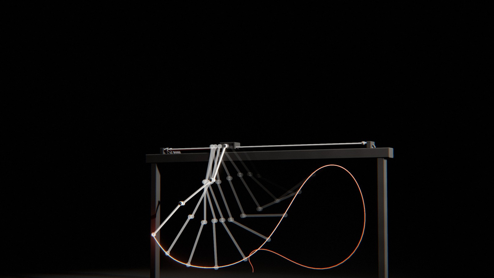](https://drschizzo.github.io/Codevember/pendulum/)

## [Kelp](kelp/)

Le ressac. Une caméra à hublot-dôme filme au ras d'un platier rocheux (granit rose, basalte, craie, ardoise, grès), moitié au-dessus, moitié au-dessous de l'eau. Une série de trois vagues arrive du large. La mer se retire et couche les laminaires sur la roche. Chaque vague les soulève et les peigne vers la côte à l'instant où son front les atteint, puis le retrait les recouche dans l'autre sens. La troisième recouvre la caméra, et dans l'eau laiteuse de bulles la forêt est debout. La mer est simulée par les équations de Saint-Venant 1D, avec la reconstruction hydrostatique d'Audusse et des flux HLL : ressauts, front mouillé-sec, bord générant-absorbant, écume et bulles transportées, enveloppe de séchage de la roche. Les laminaires sont des chaînes XPBD (poussée d'Archimède, traînée de Morison implicite, masse ajoutée, contacts entre rubans épais, inextensibilité exacte). La boucle est une orbite périodique refermée par deux passages sous le même forçage. Le brouillard d'eau est compté pour chaque pixel sur la partie immergée de son rayon, depuis le dôme. Quatre familles (digitée, cochayuyo, palmier de mer, boa), six humeurs, écran de chargement qui simule la mer de la graine en coupe, boucle parfaite exportable en MP4.

[Démo en ligne](https://drschizzo.github.io/Codevember/kelp/) · [version légère](https://drschizzo.github.io/Codevember/kelp/?mobile=1) · [documentation](kelp/README.md) · [concept](kelp/docs/concept.md)

[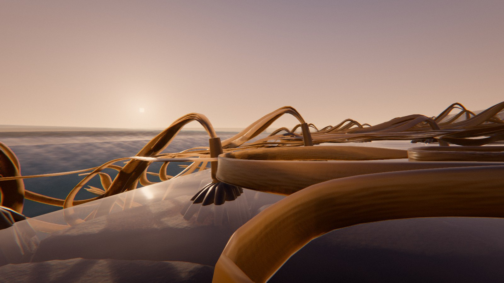](https://drschizzo.github.io/Codevember/kelp/)

## [Spore](spore/)

Le relais. Sur du bois mort (flotté, carbonisé, pourri, échauffé, débité), une génération de myxomycètes passe en une boucle. Une poussière de spores se pose et germe en gouttelettes jaunes qui fusionnent en un plasmodium. La nappe s'étend en éventail et se creuse derrière son front en veines qui battent. À l'aube, les veines se vident dans des perles, qui se dressent en une forêt de sporanges, mûrissent, sèchent, puis s'ouvrent au souffle. Le filet d'*Arcyria* se détend, les colonnes de *Stemonitis* fument, le réseau d'*Hemitrichia* devient fruit et mousse, le péridium iridescent de *Lamproderma* s'écaille, les élatères de *Trichia* jaillissent en houppe et le coussin de *Lycogala* souffle à chaque rafale. Le nuage est une vraie fumée, simulée en 3D (Stable Fluids, couche limite, tourbillons, chute de Stokes, dépôt sur le bois) et rendue en volume. Il s'envole, dérive et se pose, et la caméra le suit jusqu'au site suivant, où les spores germent à leur tour. La boucle est donc une translation : le bois et les sites se répètent de L en L. Ce que la scène calcule : front de germination par distance de Dijkstra anisotrope à seize voisins ; réseau adaptatif de Tero (Kirchhoff par gradient conjugué, Poiseuille) ; perles qui reçoivent exactement le volume des veines (Plateau-Rayleigh le long des veines) ; sporanges usinés repliés en perles puis fléchis en poutres encastrées ; nuage simulé dont la poussière déposée et les grains sont les germinations suivantes ; bois cuit périodique ; six familles, six décors, trois supports (bûche, branche, rameau) ; écran de chargement qui fait pousser le réseau de la graine ; boucle parfaite exportable en MP4.

[Démo en ligne](https://drschizzo.github.io/Codevember/spore/) · [version légère](https://drschizzo.github.io/Codevember/spore/?mobile=1) · [documentation](spore/README.md) · [concept](spore/docs/concept.md)

[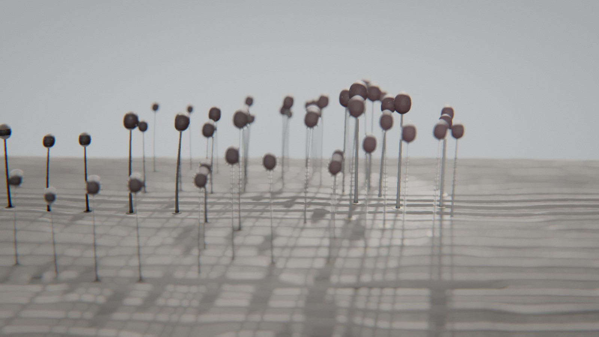](https://drschizzo.github.io/Codevember/spore/)

## [Mirage](mirage/)

L'objet qui n'est pas là. Un mirascope : deux coupes d'argent poli posées l'une sur l'autre, chaque sommet au foyer de l'autre, celle du haut percée. Ce qu'on met au fond flotte, net et en relief, dans l'ouverture. C'est une image réelle, faite de rayons qui se croisent dans le vide, tournée d'un demi-tour. Ici, ce qu'on met au fond est un autre mirascope, vingt fois plus petit, et au fond de celui-ci un plus petit encore. Une coupe s'ouvre dans le couvercle, face à la caméra, comme sur une maquette de musée, et montre dans le même cadre le vrai petit posé au fond et son image qui flotte au-dessus de l'ouverture. Elle se referme pendant que la caméra plonge dans l'image, jusqu'au niveau suivant. Lancer de rayons au pixel en TSL (intersections rayon–paraboloïde sous forme stable), emboîté d'un niveau à l'autre : un repère par niveau, tourné d'un demi-tour, où le même calcul recommence. La coupe en éventail va de 0 à 45°, tranches peintes en rouge. Le raccord entre deux niveaux est ajusté pixel à pixel par Nelder–Mead, puis fondu par un morphing d'une seconde. Image d'un point en f + h, vérifiée par des tests ; petit sous 11,5 mm pour que son image passe entière par l'ouverture ; cinq familles (les décors du dôme : argent guilloché, cloisonné, laque et or, cuivre martelé, nacre), quatre décors de pièce ; écran de chargement qui trace les rayons du petit jusqu'à son image ; boucle parfaite exportable en MP4.

[Démo en ligne](https://drschizzo.github.io/Codevember/mirage/) · [version légère](https://drschizzo.github.io/Codevember/mirage/?mobile=1) · [documentation](mirage/README.md) · [concept](mirage/docs/concept.md)

[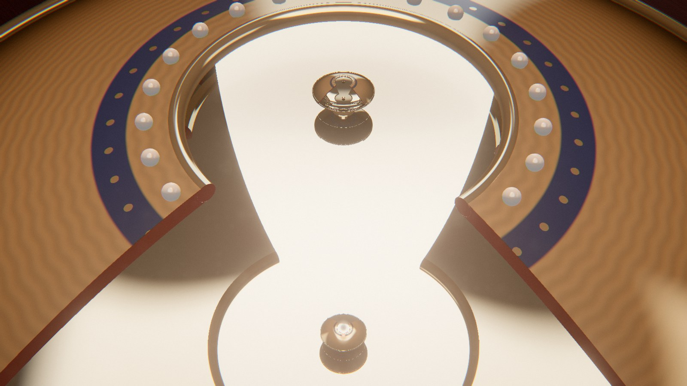](https://drschizzo.github.io/Codevember/mirage/)

## [Tension](tension/)

Ce qui tient ne pousse pas. Des sculptures de tenségrité, des barres d'acier qui ne se touchent pas, tenues en l'air par des câbles, avancent sur un sol nu sans roue ni pied : de petits treuils enroulent leurs propres câbles. Le Culbute, un prisme à six barres, se penche jusqu'à basculer (au ralenti de caméra rapide). La Chenille fait courir une onde de contraction sur ses patins à écailles. Le Cerceau, une roue de vélo, laisse tomber son moyeu vers l'avant et roule après lui. La mécanique : forme d'équilibre trouvée par relaxation (la torsion π/2 − π/n du prisme) ; dynamique XPBD à câbles unilatéraux ; contact et frottement anisotrope ; amortissement structural des modes mous ; culbutes trouvées par simulation et rejouées par les symétries du prisme ; cycle limite refermé par point fixe ; câbles mous en arc de longueur exacte ; sol invariant par le pas ; trois familles, sept décors ; écran de chargement qui tend la structure puis dessine la chronophotographie du pas ; boucle parfaite exportable en MP4.

[Démo en ligne](https://drschizzo.github.io/Codevember/tension/) · [version légère](https://drschizzo.github.io/Codevember/tension/?mobile=1) · [documentation](tension/README.md) · [concept](tension/docs/concept.md)

[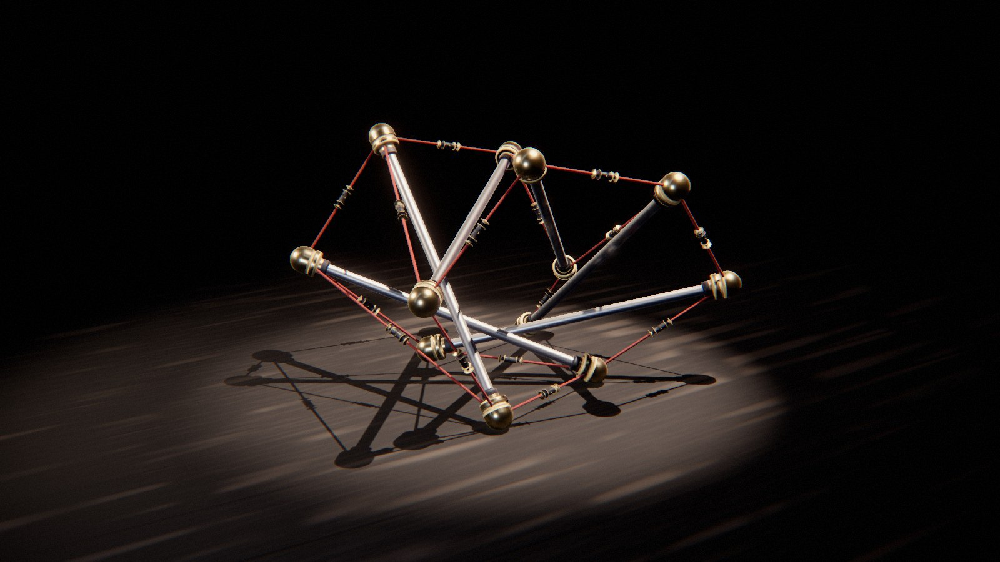](https://drschizzo.github.io/Codevember/tension/)

## [Labyrinth](labyrinth/)

Le dédale qu’on retourne. On ne marche pas dans ce labyrinthe, on le tourne. Un automate de noyer, de marbre ou de laque incline un plateau de quelques degrés par deux manivelles et deux bielles, ou fait pivoter un disque dressé par une courroie. La gravité conduit une bille de 12 mm à travers les couloirs. Elle roule, bute au fond d’une impasse, chute d’un couloir à l’autre, saute d’anneau en anneau et trouve la sortie. Une rigole ou une poche de noria la rend à l’entrée. Les techniques : labyrinthes tirés uniformément parmi les arbres couvrants (algorithme de Wilson) sur des grilles carrées et polaires ; bille qui roule sans glisser sur un plan incliné ou tournant (équation de Weltner) ; film du Plateau piloté le long du chemin ; rotations du Cadran et de la Roue trouvées par une recherche en largeur sur des rotations simulées ; trois familles, six décors ; écran de chargement qui rejoue le calcul ; boucle parfaite exportable en MP4.

[Démo en ligne](https://drschizzo.github.io/Codevember/labyrinth/) · [version légère](https://drschizzo.github.io/Codevember/labyrinth/?mobile=1) · [documentation](labyrinth/README.md) · [concept](labyrinth/docs/concept.md)

[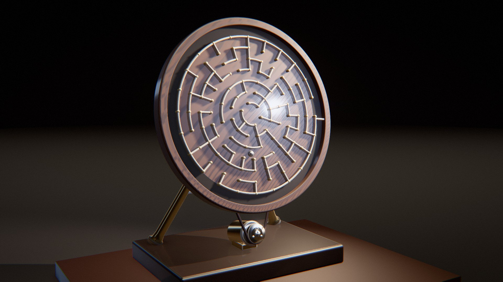](https://drschizzo.github.io/Codevember/labyrinth/)

## [Feather](feather/)

La plume en tuyau. Dans le plumage d’un oiseau, une plume nouvelle pousse roulée dans sa gaine de kératine et chasse l’ancienne, qui glisse sur le dos et tombe. La gaine s’effrite de la pointe vers la base. Les deux moitiés du tube s’ouvrent comme un livre et deviennent les vexilles, sans s’étirer. Les barbes, d’abord libres, s’agrafent l’une à l’autre et le motif (barres, chevrons, taches, ocelle) apparaît en entier. La plume se couche dans sa rangée, s’use, et la suivante la chasse. La croissance suit le collier du follicule d’après Prum et Williamson (hélices des crêtes de barbes, déroulement isométrique). Le motif est déposé rangée par rangée par une réaction-diffusion activateur-inhibiteur sur l’anneau du collier. Les barbes sont posées dans le vertex shader, et le plumage est fait de tuiles qui ne se traversent pas. Quatre familles (le vexille qui s’ouvre et s’agrafe, l’ocelle du paon, la houppe du duvet, la cascade de l’autruche), douze oiseaux, sept décors, boucle parfaite exportable en MP4.

[Démo en ligne](https://drschizzo.github.io/Codevember/feather/) · [version légère](https://drschizzo.github.io/Codevember/feather/?mobile=1) · [documentation](feather/README.md) · [concept](feather/docs/concept.md)

[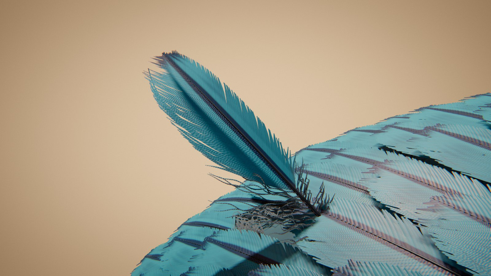](https://drschizzo.github.io/Codevember/feather/)

## [Rust](rust/)

La remise à nu. Une pièce de métal est construite comme une vraie, avec ses centaines de rivets et ses boulons à six pans : un nœud de treillis riveté, une vanne sur sa tuyauterie, une roue motrice de locomotive ou une porte étanche de navire. Elle rouille sous les averses d’une saison en accéléré. La rouille naît au pied des rivets et dans les angles, là où l’eau reste, s’étend de proche en proche sur les plats, coule en traînées, puis s’épaissit en croûte qui cloque et s’écaille. Une machine se met ensuite en place et la décape en temps réel. Ce peut être un portique laser qui balaie la pièce rangée après rangée dans une gerbe d’étincelles, une sableuse dont le cône de grenaille descend en hélice sur la pièce qui tourne, ou un palan qui la plonge dans une fosse d’électrolyse et la ressort ruisselante. Et la rouille revient. La corrosion atmosphérique est calculée sur la géométrie (temps d’humectation, concavité, ciel visible, stagnation, front géodésique, ruissellement). La loi de dose et la stratification de la rouille sont dans le shader, et l’instant de décapage de chaque machine est en forme fermée. Six décors, boucle parfaite exportable en MP4.

[Démo en ligne](https://drschizzo.github.io/Codevember/rust/) · [version légère](https://drschizzo.github.io/Codevember/rust/?mobile=1) · [documentation](rust/README.md) · [concept](rust/docs/concept.md)

[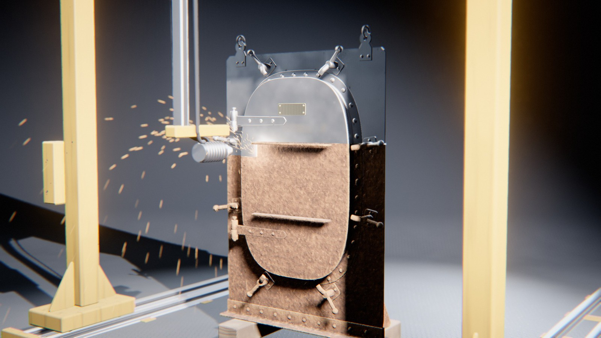](https://drschizzo.github.io/Codevember/rust/)

## [Caustic](caustic/)

Le foyer des ondes. Une cuve d’eau est vue de côté, à travers sa vitre, éclairée par le soleil ou une lampe à arc. Sur le pourtour, des plongeurs poussent des ondes, qu’on voit au fond comme des anneaux de lumière qui accourent vers le centre. À l’instant où elles se rejoignent, la surface prend exactement la forme d’une lentille et la caustique se résout en un dessin pendant une seconde de caméra rapide : une diatomée, un oursin, une méduse, une rosace, un capitule ou un radiolaire. Puis le dessin se défait en anneaux qui repartent. Les lentilles sont calculées par transport optimal (équation de Monge-Ampère, méthode de Benamou-Froese-Oberman) et loi de Snell. Les ondes de capillarité-gravité exactes sont propagées par FFT sur le GPU : la convergence est la dispersion lue à l’envers, comme dans un miroir à retournement temporel. La caustique est faite par déformation de maillage en trois longueurs d’onde, avec des rideaux de lumière dans l’eau. Trois familles (le foyer qui dessine, le cristal de Faraday sous stroboscope, l’allée de tourbillons de Kármán), sept décors, boucle parfaite exportable en MP4.

[Démo en ligne](https://drschizzo.github.io/Codevember/caustic/) · [version légère](https://drschizzo.github.io/Codevember/caustic/?mobile=1) · [documentation](caustic/README.md) · [concept](caustic/docs/concept.md)

[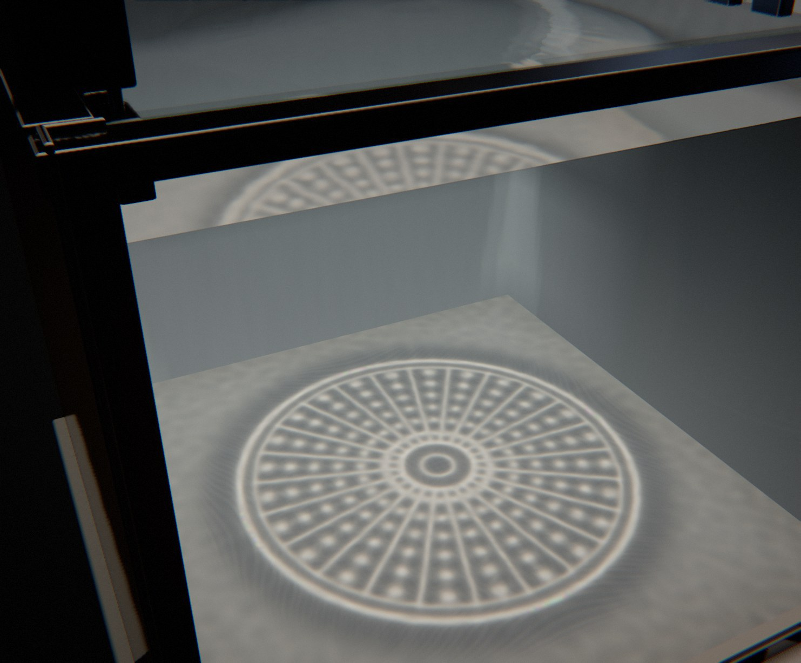](https://drschizzo.github.io/Codevember/caustic/)

## [Melt](melt/)

Le bain de bismuth. Dans un bain de bismuth fondu, lisse comme un miroir, le métal se retire et découvre des cristaux en trémie : des cubes aux faces creusées en escaliers, parce que leurs arêtes poussent plus vite que le milieu des faces. À l’air, le métal s’oxyde aussitôt, du haut vers le bas, et les couleurs apparaissent : or, magenta, bleu, vert. Elles ne sont pas peintes : c’est l’interférence de la lumière dans la couche d’oxyde (réflectance d’Airy d’une couche de Bi₂O₃ sur le métal, à six longueurs d’onde), dont l’épaisseur suit le temps passé à l’air. Puis le métal chaud remonte : une bande de couleurs court devant lui, les arêtes s’arrondissent, les gradins se comblent, un coin cède et tombe dans le bain, des gouttes d’argent perlent, et la peau d’oxyde de chaque cristal englouti reste un instant à la surface, puis se fend en écailles irisées. Rien n’est précalculé : la scène est un lancer de rayons en temps réel. Quatre studios, trois ports de cristal, quatre gammes d’oxyde, quatre cadrages ; boucle parfaite exportable en MP4.

[Démo en ligne](https://drschizzo.github.io/Codevember/melt/) · [version légère](https://drschizzo.github.io/Codevember/melt/?mobile=1) · [documentation](melt/README.md) · [concept](melt/docs/concept.md)

[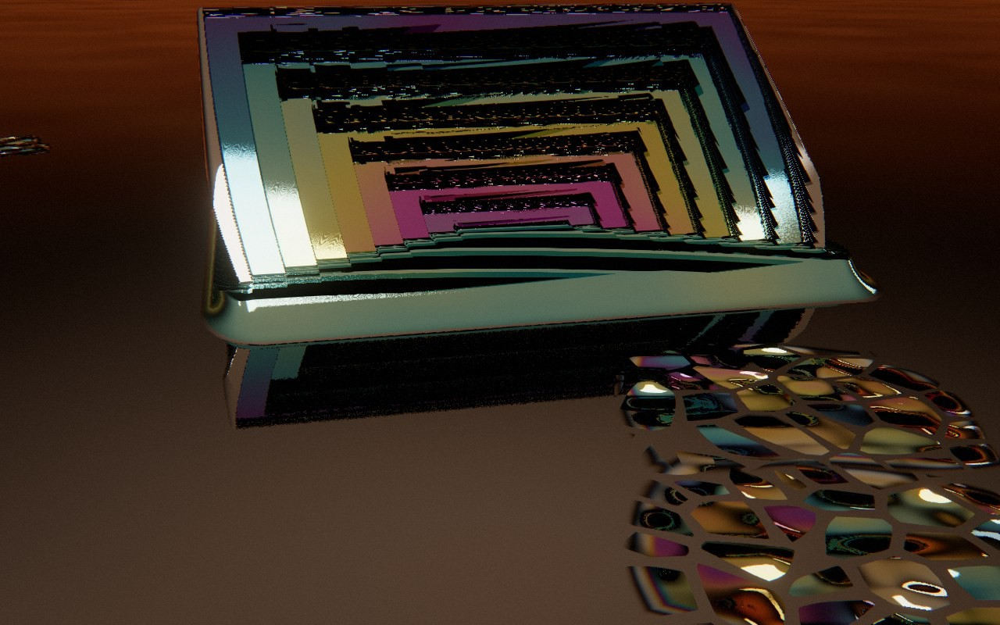](https://drschizzo.github.io/Codevember/melt/)

## [Moss](moss/)

La reviviscence. Une année de mousse sur sa pierre, en accéléré. À la sécheresse, il n’en reste que des îlots bruns dans les fissures. Les averses passent en bandes, la roche fonce et les îlots reverdissent d’un coup. Pendant les pluies, la mousse se propage en coussins denses : un voile vert de protonéma, puis des dômes de rosettes serrées qui se rejoignent. La sécheresse la fait reculer dans ses refuges. Le modèle : propagation de Fisher-KPP forcée par les saisons et intégrée jusqu’à son orbite périodique ; coussins en dômes dont les tiges suivent la normale ; roches (granit, calcaire, grès) et écorces procédurales cuites dans un worker et appliquées en déplacement et en normal map ; lichens aréolés ; quatre familles, six décors ; boucle parfaite exportable en MP4.

[Démo en ligne](https://drschizzo.github.io/Codevember/moss/) · [version légère](https://drschizzo.github.io/Codevember/moss/?mobile=1) · [documentation](moss/README.md) · [concept](moss/docs/concept.md)

[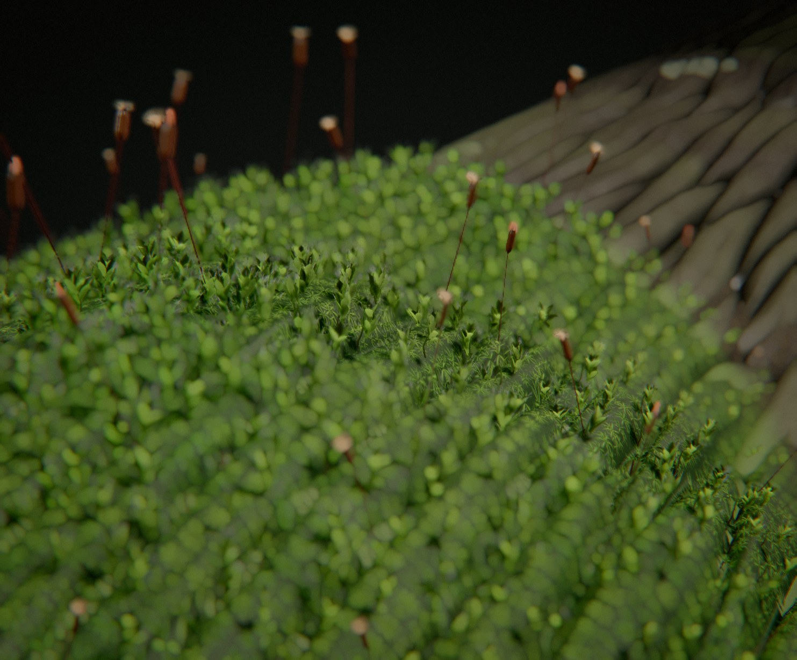](https://drschizzo.github.io/Codevember/moss/)

## [Tangle](tangle/)

Le tour de trop. Un banc d’essai de torsion, pièce de cabinet de physique. Un moteur tourne le mandrin et la corde qui pend dessous se tord : sa rayure s’enroule en hélice. Au seuil de Greenhill, elle flambe d’un coup en une boucle qui s’enroule sur elle-même en torsade (un plectonème) et remonte le balancier. La came du compte-tours écarte alors la barre. Le balancier, libéré, tourne, la torsade se déroule et la corde revient droite. Trois cycles en crescendo (la rayure seule, une boucle, la torsade), trois familles (le cordon qui se tord en torsade, la paire dont les brins se commettent en hélice, la spirale peu tendue qui se love d’un bout à l’autre), une corde toujours vermillon filmée en plan serré. La simulation : tiges de Cosserat intégrées par XPBD à petits pas ; contacts ; enlacement conservé (Lk = Tw + Wr, vérifié par des tests) ; came calculée d’après le plan ; sept décors ; scènes procédurales à partir d’une graine ; boucle parfaite exportable en MP4.

[Démo en ligne](https://drschizzo.github.io/Codevember/tangle/) · [version légère](https://drschizzo.github.io/Codevember/tangle/?mobile=1) · [documentation](tangle/README.md) · [concept](tangle/docs/concept.md)

[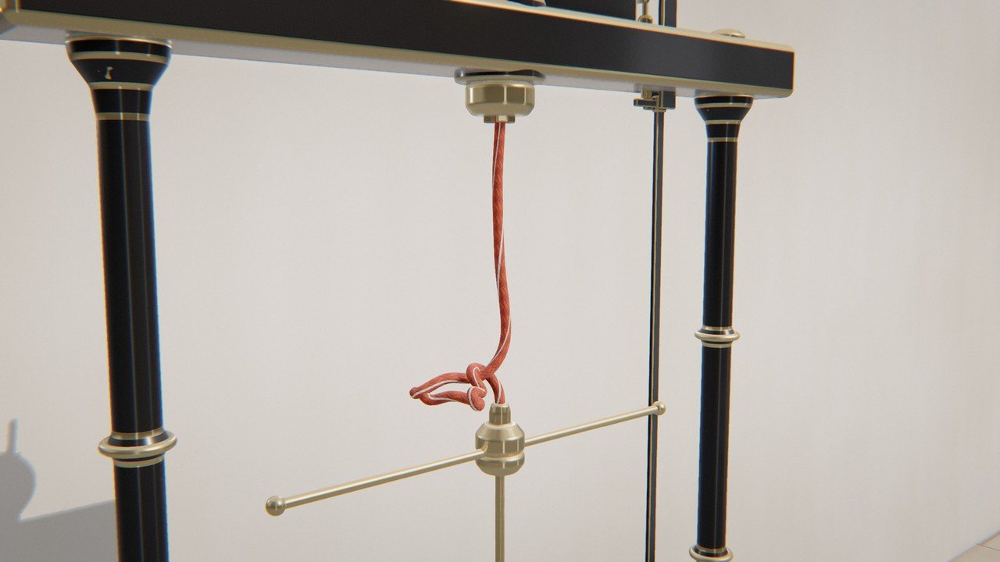](https://drschizzo.github.io/Codevember/tangle/)

## [Fold](fold/)

La feuille qui se replie. Des plantes sensibles au toucher, dans leur pot, sous une cloche, dans une caisse de Ward ou sur une paillasse. Une goutte grossit au toit de verre ou au bec d’une burette, tombe et frappe une feuille. Toute la feuille se ferme, la vague partant du point d’impact. À la fin, un marteau de laboratoire frappe le pot et toute la plante se ferme, de bas en haut, puis tout se rouvre en accéléré. Quatre familles, quatre plis : la sensitive ferme ses folioles en peigne et laisse tomber ses pétioles, le Biophytum les rabat vers le bas, le trèfle plie ses trois folioles en deux et les laisse retomber comme un parapluie, la dionée claque ses deux lobes ciliés. Le calcul : propagation du signal sur le graphe vasculaire ; pli rigide sans interpénétration vérifié par des tests ; contact exact de chaque cause ; limbes épais et translucides ; sept décors ; scènes procédurales à partir d’une graine ; boucle parfaite exportable en MP4.

[Démo en ligne](https://drschizzo.github.io/Codevember/fold/) · [version légère](https://drschizzo.github.io/Codevember/fold/?mobile=1) · [documentation](fold/README.md) · [concept](fold/docs/concept.md)

[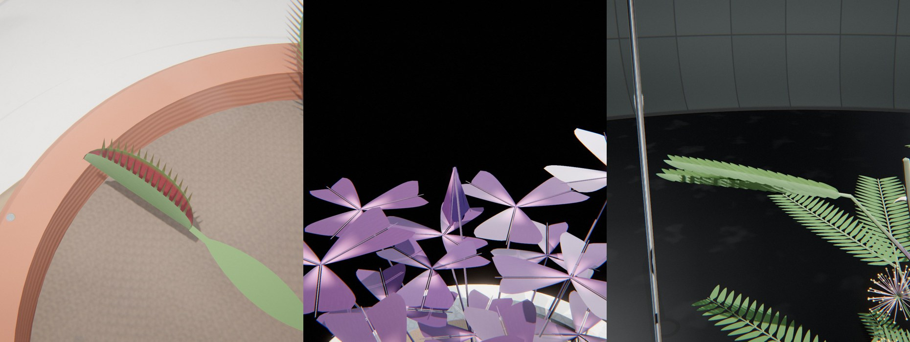](https://drschizzo.github.io/Codevember/fold/)

## [Shatter](shatter/)

Le verre brisé, refondu, soufflé, brisé. D’un bain de verre en fusion monte une pièce de verrier (verre à pied, carafe à anse et bouchon, amphore, flacon…), côtelée, torse ou festonnée, parfois filigranée. Elle refroidit, puis une machine la brise : pendule à bille d’acier, haut-parleur, marteau de percussion, chalumeau. La scène est filmée en caméra rapide : les éclats tombent sous une gravité vraie, se couchent sur la sole, puis fondent en bain pour la pièce suivante. Fracture exacte dans une métrique propre à chaque déclencheur, physique analytique dans les shaders, sept décors (atelier et son four, stroboscope, laboratoire, plein soleil, lumière noire, cathédrale, givre), scènes procédurales à partir d’une graine, boucle parfaite exportable en MP4.

[Démo en ligne](https://drschizzo.github.io/Codevember/shatter/) · [version légère](https://drschizzo.github.io/Codevember/shatter/?mobile=1) · [documentation](shatter/README.md) · [concept](shatter/docs/concept.md)

[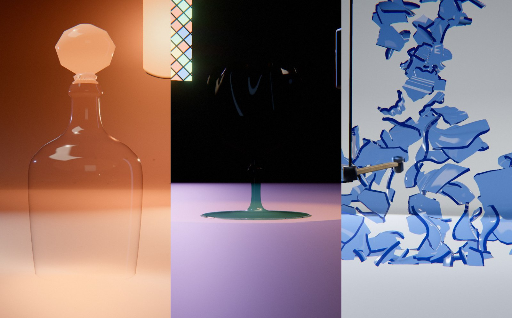](https://drschizzo.github.io/Codevember/shatter/)

## [Membrane](membrane/)

L’éclosion sans fin. Un solide géométrique dort dans une membrane translucide et vascularisée. Son armature se déploie (sépales, lames, mâchoires, baleines, épingles, polyèdre) et tend la membrane jusqu’à la déchirure. Cette déchirure est simulée : lèvres qui s’enroulent, filaments qui claquent, lambeaux qui se retroussent. La caméra plonge vers l’œuf suivant. Diffusion sous la surface, scènes procédurales à partir d’une graine, matériaux physiques (three.js WebGPU / TSL), boucle parfaite exportable en MP4.

[Démo en ligne](https://drschizzo.github.io/Codevember/membrane/) · [version légère](https://drschizzo.github.io/Codevember/membrane/?mobile=1) (appareils peu puissants : téléphones, tablettes, portables modestes) · [documentation](membrane/README.md)

[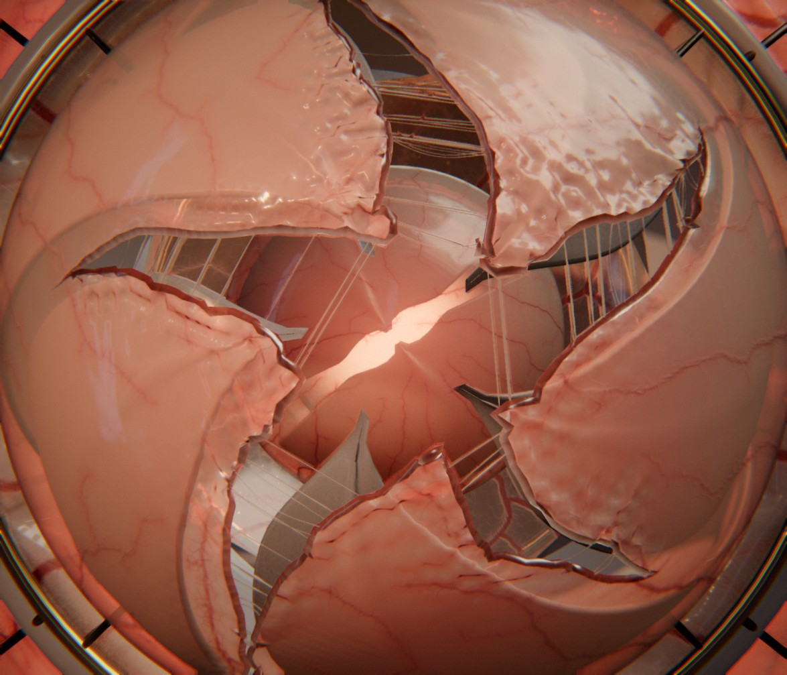](https://drschizzo.github.io/Codevember/membrane/)

## [Tesseract](tesseract/)

Le cabinet replié : un écrin de huit cubes posé à plat en patron se replie dans une quatrième direction pour former un hypercube. Puis la caméra y entre : l’œil 4D se pose sur l’hypersphère, le cube du centre devient une pièce, et chaque rotation 4D devient un voyage d’une pièce à la suivante, à travers des parois qui s’ajourent, jusqu’à revenir au point de départ. Scènes procédurales à partir d’une graine, matériaux physiques (three.js WebGPU / TSL), boucle parfaite exportable en MP4, et des aides pour suivre le pliage : fantôme de la forme pliée, liserés des faces appariées, profondeur 4D en couleur, analogie 3D.

[Démo en ligne](https://drschizzo.github.io/Codevember/tesseract/) · [version légère](https://drschizzo.github.io/Codevember/tesseract/?mobile=1) (appareils peu puissants : téléphones, tablettes, portables modestes) · [documentation](tesseract/README.md)

[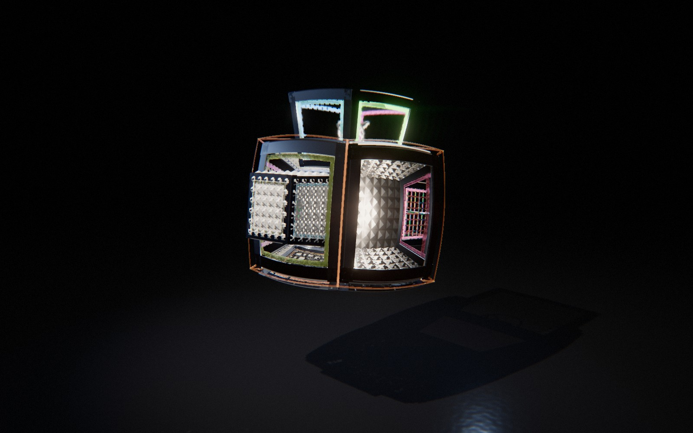](https://drschizzo.github.io/Codevember/tesseract/)

## [Hollow](hollow/)

Une plongée sans fond dans des coquilles creuses emboîtées : alvéoles, fentes, surfaces minimales, géode. Elles sont générées de façon procédurale à partir d’une graine, rendues en matériaux physiques (three.js WebGPU / TSL) et animées en boucle parfaite, exportable en MP4.

[Démo en ligne](https://drschizzo.github.io/Codevember/hollow/) · [version légère](https://drschizzo.github.io/Codevember/hollow/?mobile=1) (appareils peu puissants : téléphones, tablettes, portables modestes) · [documentation](hollow/README.md)

[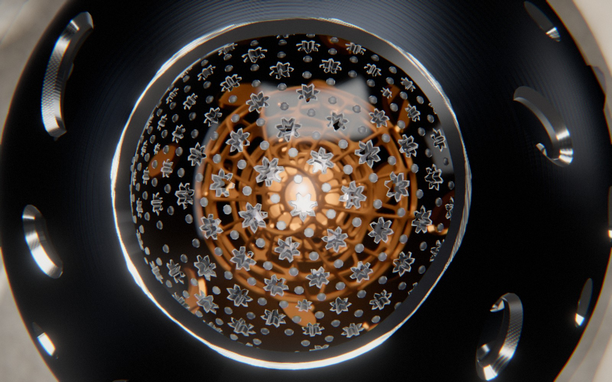](https://drschizzo.github.io/Codevember/hollow/)

## [Orrery](planetaire_v2/) (Planétaire v2)

Un planétaire qui calcule des ciels qui n'existent pas encore. Chaque graine lance, sous les yeux, la recherche de chorégraphies du problème à N corps : N masses égales sur une même courbe, solutions exactes des équations de Newton. Elle conçoit par le calcul les machines qui les tracent (trains d'engrenages aux rapports exacts, étages sans collision, galets dans des sillons gravés), selon quatre archétypes : horlogerie, planétaire classique, atelier, astrolabe. Puis elle met la scène en abîme. Chaque astre est une boule de verre qui contient la même scène, où la caméra plonge sans fin, en boucle parfaite. Le mouvement qui fait tourner le plateau est visible et fonctionnel : barillet, rouage, échappement et balancier, ou machine à vapeur, volant, courroies et régulateur. Six humeurs, rendu physique (three.js WebGPU / TSL), export MP4.

[Démo en ligne](https://drschizzo.github.io/Codevember/planetaire_v2/) · [version légère](https://drschizzo.github.io/Codevember/planetaire_v2/?mobile=1) · [documentation](planetaire_v2/README.md)

[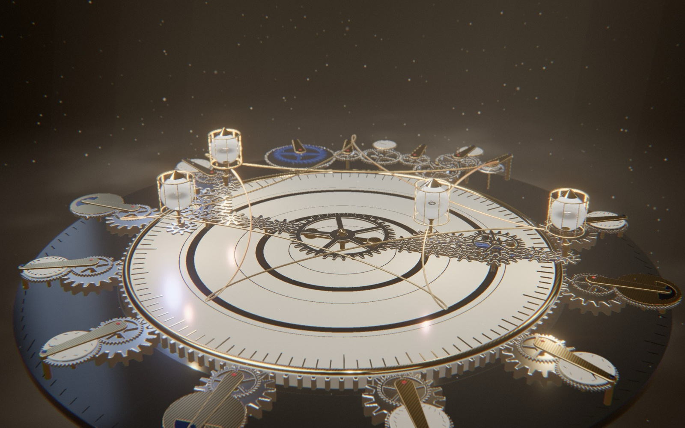](https://drschizzo.github.io/Codevember/planetaire_v2/)

## [Planétaire](planetaire/)

La vie d’un système planétaire, du nuage à la supernova, simulée sur GPU (WebGPU, three.js TSL) et présentée comme portée par un planétaire en laiton. Chaque grain de poussière conserve son rayon de naissance, qui détermine sa couleur ; le disque peut être sonifié comme un vinyle.

[Démo en ligne](https://drschizzo.github.io/Codevember/planetaire/) · [documentation](planetaire/README.md)

[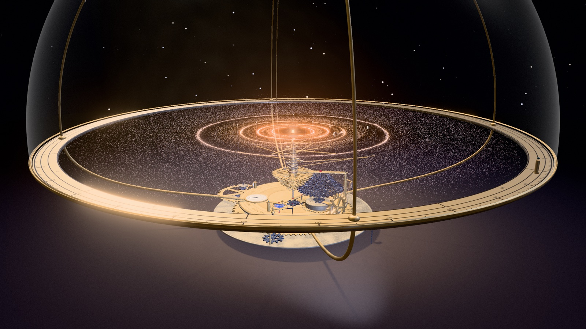](https://drschizzo.github.io/Codevember/planetaire/)

## Déploiement

Le site est publié par GitHub Actions (`.github/workflows/pages.yml`) à chaque push sur `main`.
