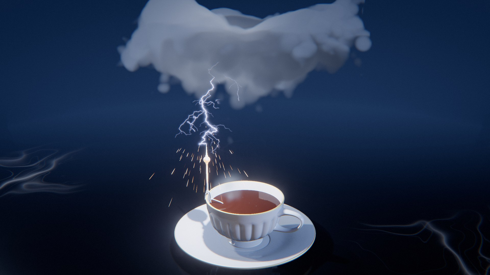

# Bolt

*une tempête dans une tasse de thé*

Une tasse de thé fume sur une table. La vapeur monte, s'étale à une certaine hauteur et s'y accumule en un nuage gros comme deux poings, qui fonce. Un traceur en sort, descend par bonds en se ramifiant, et la foudre tombe sur la pointe d'un thermoplongeur pincé au bord de la tasse. La chaleur descend la tige, la résistance rougit sous le thé, qui bout. Il pleut dans la tasse, la pluie grésille sur le métal encore chaud, et le thé se remet à fumer. La boucle est parfaite par construction : l'eau partie en vapeur revient en pluie, et le niveau du thé retrouve exactement sa marque.



La scène prend une seule liberté, l'échelle : un orage entier tient au-dessus d'une tasse. Tout le reste suit ce qu'on sait de la foudre. Le concept et les pistes écartées sont dans [docs/concept.md](docs/concept.md), les défis techniques dans [explainer.html](explainer.html).

## Utilisation

```bash
python3 .claude/serve.py 8210 bolt    # depuis la racine du dépôt
# puis http://localhost:8210/
```

| Touche | Effet |
| --- | --- |
| N | nouvelle scène (nouvelle graine) |
| Espace | pause / lecture |
| ← → | avancer ou reculer d'un pas |
| H | masquer l'interface |
| F | plein écran |

| Paramètre d'URL | Effet |
| --- | --- |
| `?seed=…` | la scène (une graine = une scène) |
| `#r=…` | une scène retouchée, partagée par « Copier le lien » |
| `?mobile=1` / `?mobile=0` | version allégée imposée / interdite |
| `?ui=0` | sans panneau |
| `?debug` | outils dans `window.bolt` (`shot`, `send`, `sheet`, `go`, `film`, `meter`, `poster`, `bench`, `seam`…) |
| `?sink=8123` | port du collecteur d'images (`tools/sink.py`) |

Le panneau règle tout ce que tire la recette : humeur, famille et forme du récipient, matières, nuage, éclair (η, pointes actives, tremblé, instants et intensités des arcs), caméra, lumière. Les retouches qui changent la géométrie ou l'arbre de l'éclair relancent le calcul sous l'écran de chargement.

## Principe

### Le film

Une seule horloge, `src/film.js`. Tout ce que montre la boucle se lit dans `stateAt(film, u)` en fonction de la phase u ∈ [0, 1).

| u | Temps | Convention |
| --- | --- | --- |
| 0,93 – 0,36 | la vapeur repart de la tasse, monte, s'étale et remplit le nuage (de part et d'autre du raccord) | accéléré ; simulation relue |
| 0,22 – 0,385 | le nuage se charge et fonce, des lueurs le traversent | accéléré |
| 0,385 – 0,50 | le traceur descend en neuf bonds de plus en plus rapides, hésite à 86 % de sa course (l'aigrette monte), puis saute | caméra rapide |
| 0,50 | la jonction : l'arc en retour, l'image brûlée, les étincelles | |
| 0,50 – 0,62 | la chaleur descend le métal (0,85 s), la machine rougit, le thé bout et lâche une bouffée ; réamorçages, canal en perles | ralenti léger |
| 0,62 – 0,90 | l'averse rend l'eau au récipient et grésille sur le métal chaud ; le nuage s'effiloche | temps réel |

Le traceur occupe 2,8 s d'une boucle de 24 s (il en occupait 6,2 : trop long pour un trait fin). Le temps gagné est allé à ce qui suit la jonction.

Le scénario de la boucle tient en une phrase : la foudre chauffe la machine, la machine fait bouillir le thé, le thé fait la vapeur, la vapeur fait le nuage, le nuage fait la foudre. Chaque maillon se voit. `heatAt` donne la chaleur laissée par l'arc : elle retombe lentement, vaut encore 0,28 quand la vapeur repart et s'annule exactement avant la foudre suivante. Les bouffées de vapeur (`puffs`) font le raccord : une au choc, puis le grésillement de la pluie, puis un relais d'une seconde jusqu'à ce que la colonne simulée reparte.

### Les machines

Ce que la foudre touche a un rôle. Chaque récipient a sa machine à chauffer le thé (`src/gen/vessels.js`) :

| Machine | Récipient | Ce qu'on voit |
| --- | --- | --- |
| **thermoplongeur à paratonnerre** | tasse, verre | un mât à boule de laiton pincé sur la lèvre, une jambe le long de la paroi, une résistance en hélice dans le thé ; son anneau rouge se lit à travers le liquide |
| **réchaud à spirale** | théière boule | un tambour bas sur trois pieds, une spirale d'Archimède au fond, un bras et un mât à côté de la panse ; la spirale éclaire la table |
| **brasero** | tetsubin | une vasque de fonte, un lit de cendre, 34 braises, un trépied ; la foudre tombe sur l'arceau |
| **pierres chaudes** | bol | deux à quatre galets posés au fond, qui dépassent du thé ; un arc par pierre |

Chaque sommet de la machine porte sa place sur le chemin de la chaleur (attribut `heat` : s, nature, grain) : s = 0 à la pointe, 1 au bout de la résistance. Le shader en tire l'émission : le front de chaleur atteint le sommet à `s × 0,85 s` ; le métal mince rougit au passage et refroidit en 0,6 s, la résistance, les braises et les pierres gardent la chaleur du film. Les bouffées sortent du bec quand le récipient est fermé.

### La boucle

L'eau se conserve. Le cycle de l'eau commence à u = 0,93 (`TIMES.cycle`), quand la vapeur repart ; les courbes se lisent dans la phase du cycle `v = (u − 0,93) mod 1`. Si `up(v)` est l'eau montée (vapeur et nuage), `out(v)` l'eau partie en pluie et `landed(v)` l'eau arrivée dans la tasse (la même courbe que `out`, retardée du temps de chute, 0,42 s), alors

```
nuage = up − out        pluie en vol = out − landed        niveau du thé = −(nuage + pluie en vol)
```

Les trois courbes sont des « smootherstep ». À la fin du cycle, toute l'eau montée est retombée : le nuage est vide, rien n'est en vol, le niveau est à sa marque, et le cycle suivant repart de cet état. Le raccord du film (u = 0) tombe au milieu de la montée de la vapeur, où rien ne distingue u = 0 de u = 1. La dérive du bruit du nuage et la montée de la vapeur font un nombre entier de périodes par boucle. L'arbre de l'éclair est calculé une fois, sa lecture ne dépend que de l'avancement du traceur `a(u)` et du temps `τ(u)` écoulé depuis la jonction.

### L'horloge lente

Le traceur est filmé à la caméra rapide : pendant ce temps, la vapeur et les bourgeons du nuage, qui bougent à l'échelle de la seconde, doivent être presque arrêtés. Ils ne lisent pas la phase u mais `clockAt(u)`, une horloge dont la vitesse vaut `1 − 0,94·B(u)`, où B passe de 0 à 1 à l'entrée du traceur et revient à 0 à la jonction. Son intégrale est en forme fermée et ramenée à 1 sur la boucle. Pendant tout le traceur, la vapeur ne monte que de 1 % d'un tour, à 6 % de sa vitesse normale.

### L'éclair

`src/gen/dbm.js` : le modèle de claquage diélectrique de Niemeyer, Pietronero et Wiesmann (1984), dans la forme rapide de Kim, Sweeney, Shelley et Lin (2007). La décharge est un agrégat de sites d'un réseau cubique. À chaque pas, un site candidat (un voisin de l'agrégat) est tiré avec la probabilité

```
p_i ∝ Φ_i^η        Φ_i = (1 − β)·n(φ_i) + β·n(g_i)        φ_i = Σ_j (1 − R / r_ij)
```

φ est le potentiel que l'agrégat impose au candidat (R : une demi-maille) ; il repousse la croissance loin de ce qui existe déjà, ce qui fait les branches. g est l'attracteur : la distance à la pointe visée, où l'écart horizontal pèse de plus en plus à mesure que le traceur descend (un entonnoir). n(·) ramène chaque potentiel sur [0, 1] parmi les candidats. η va de 2,4 (touffu) à 4,2 (filiforme), β vaut 0,42 à 0,5. Trois règles donnent l'allure d'un traceur plutôt que d'un agrégat : seules les pointes nées dans les 26 à 40 derniers sites poussent ; un traceur ne rebrousse pas chemin (jamais vers le haut s'il descend) ; il ne fait pas plus de deux pas horizontaux d'affilée. Les sites sont décalés par un hachage et chaque arête est subdivisée en trois avec un tremblé de 10 à 17 % de sa longueur.

Quatre familles, une par famille de récipient :

| Éclair | Récipient | Mouvement |
| --- | --- | --- |
| **coup au but** | tasse | un arbre renversé descend de la base du nuage ; une aigrette monte de la pointe du mât ; un seul canal |
| **ascendant** | théière | l'arbre pousse vers le haut depuis la pointe du mât (ou l'arceau du tetsubin) et s'épanouit sous le nuage ; tout l'arbre s'allume |
| **araignée** | verre à thé | la décharge rampe d'abord à l'horizontale dans la base du nuage (130 sites), puis un fil tombe sur le mât |
| **fourchu** | bol | le traceur vise une pierre ; chaque arc suivant emprunte la branche la plus proche d'une autre pierre (1 à 3), prolongée jusqu'à elle par son traceur de réamorçage |

Chaque nœud de l'arbre porte son instant de naissance `tb` (en avancement du traceur : 1 à la jonction), sa distance au sol `s` le long du canal, le masque des arcs dont il fait partie et sa grosseur. `src/scene/lightning.js` en tire la luminosité de chaque segment dans le vertex shader : pointe blanche du traceur qui s'éteint en quelques bonds (elle se rallume à chaque bond), onde de l'arc en retour qui atteint le segment à `t_j + s / v` (v = 11 unités par seconde de film), traceur de réamorçage qui redescend le canal en 0,07 s, branches qui meurent en 0,09 s, rémanence en perles. Le trait a trois couches : un cœur très fin, une gaine violette en exponentielle, une lueur d'air large et faible. Un profil gaussien large saturait en un boudin blanc ; c'est le halo de la chaîne d'image qui dit l'éclat, pas la largeur du trait.

Le choc se lit ailleurs que sur le canal : l'exposition monte de 85 % le temps d'une impulsion puis l'iris se referme de 30 % et se rouvre en une seconde (`expo`) ; le mur, que les lampes n'atteignent pas, prend la couleur de l'éclair ; des étincelles balistiques partent du point touché à chaque arc ; des gouttes jaillissent du thé quand la chaleur atteint la résistance ; le pied de la caméra reçoit un à-coup amorti en un quart de seconde.

### La vapeur et le nuage : un seul fluide simulé

`src/gen/plume.js`. La vapeur et le nuage ne sont pas deux objets : c'est le même traceur, transporté par un écoulement simulé. Un panache chaud axisymétrique (équations de Boussinesq, coordonnées (r, z)) monte de la surface du thé dans un air en deux couches, neutre jusqu'au niveau de condensation (z = 1), stablement stratifié au-dessus (Γ = 22), sous un plafond fermé.

```
∂u/∂t + (u·∇)u = −∇p + b ẑ      ∇·u = 0
∂b/∂t + (u·∇)b = −Γ(z) w         (b : flottabilité)
∂s/∂t + (u·∇)s = 0               (s : la vapeur condensée, ce qu'on voit)
```

Un air chauffé à b s'arrête là où l'air ambiant a sa densité, vers z ≈ 1 + b/Γ. La source chauffe de plus en plus fort (de 0,3 à 2,15 fois sa valeur de base) et bat par bouffées (6 à 10) : les premières s'étalent à la base du nuage, les suivantes plus haut, les dernières sous le plafond. Le nuage est la vapeur accumulée. À la fin la source faiblit de 82 % et la colonne n'est plus qu'un filet.

Le schéma est celui de Stam (« stable fluids ») : advection semi-lagrangienne, projection par 36 passes de Gauss-Seidel sur le laplacien cylindrique, et un mélange turbulent (viscosité de tourbillon, 0,2) sans lequel le jet reste laminaire et perce le plafond. La grille fait 64 × 56 à 88 cellules de 0,025 ; 576 pas, enregistrés en 72 images de 8 bits (la racine carrée du traceur). Le calcul prend 1,3 à 1,6 s dans un worker, sous l'écran de chargement.

`src/scene/cloud.js` relit ces images dans une texture 3D (r, z, temps) ; l'interpolation trilinéaire fait l'interpolation dans le temps. Le rendu est une marche de rayon dans la chaîne d'image, en deux domaines pour un même champ : la colonne (12 pas) et le nuage (32 pas, 14 en mobile). Les deux marches ont le même coefficient d'extinction ; la légèreté de la colonne est dans la densité, continue en hauteur (un coefficient différent de part et d'autre faisait une ligne à la couture). La simulation est lisse et axisymétrique ; le rendu lui rend son désordre sans toucher à sa dynamique. Lue telle quelle, elle donnait un palet à cratère : le plan du nuage est donc lobé (trois harmoniques de l'azimut, phases tirées de la graine), son sommet bourgeonne (les dômes d'un Worley de basse fréquence soulèvent la lecture), son cœur lit la couronne, et la colonne serpente. Les coordonnées de lecture sont déformées par un bruit qui dérive (les volutes), puis le champ sert d'enveloppe à une érosion par deux échelles de Worley inversé (les bourgeons, d'après Schneider, 2015), plus forte dans la colonne, sur le pourtour et pendant l'averse. Sous z = 1 le traceur n'est visible qu'à 30 % : la base du nuage est plate. L'éclairage prend deux prélèvements allégés vers la lampe (loi de Beer), une « poudre » qui éteint les voiles minces, et six sources ponctuelles à l'intérieur : le canal de l'éclair et les lueurs de la charge.

Pour une théière, la source est au bec : l'axe du panache va du bec à l'aplomb du nuage.

## Génération

- `src/recipe.js` : graine → recette JSON. Un flux de hasard par famille de tirages (`vessel`, `accord`, `camera`, `light`, `bolt`, `cloud`, `film`). `layout(R, meta)` place le nuage, la racine et la cible de l'éclair à partir de ce que le récipient construit dit de lui (son point le plus haut, la surface du thé, ses obstacles).
- `src/gen/vessels.js` : dix variantes en quatre familles, chacune avec sa machine. **Tasse** (tulipe, litron, à pied) avec soucoupe, **théière** (boule, tetsubin), **verre à thé** (droit, évasé), **bol** (chawan, à pied, assiette creuse). Un profil externe en Catmull-Rom, une paroi d'épaisseur constante, une lèvre roulée, un pied annulaire ; puis les pièces rapportées, balayées le long d'une courbe de Bézier. L'anse est un ruban (plus large qu'épais) qui s'évase en collerette à chaque attache, comme une patte écrasée à la barbotine : elle quitte la paroi le long de sa normale et s'y raccorde par un congé, au fond d'une gorge s'il y a des godrons. Le bec naît de la panse de la même façon. Les godrons (16 à 32) sont des lobes bombés séparés par des gorges à arête vive (profil |sin|^0,85, douze sommets par lobe, normales prises sur le maillage) ; ils meurent sous un jonc en relief, et la face interne les suit pour que la paroi garde son épaisseur. La soucoupe a un pied, un fond plat, un bassin courbe, une aile et un bord roulé (1,6 cm de haut pour 16 cm). La tasse à pied a un piédouche de 12 % de sa hauteur.
- `src/gen/worker.js` : récipient, éclair, panache et volume de bruit sont calculés dans un worker. Un éclair demande 2 à 30 ms pour 80 à 440 sites (moyennes mesurées sur 300 graines : coup au but 119 sites, ascendant 300, araignée 238, fourchu 83).

## Matériaux

Les matières viennent du catalogue commun (`shared/finishes.js`), retouchées dans `recipe.js`. Chaque humeur a trois ou quatre accords composés à la main `[récipient, métal, support, thé]`, filtrés selon la variante (un verre est en verre, un tetsubin en fonte).

- **Machines** : le métal de l'accord (argent, vermeil, inox, fonte) pour le mât, le réchaud et le brasero ; galet gris et charbon pour ce qui rougit.
- **Récipients** : porcelaine à filet d'or ou de platine (la lèvre est le rôle « tranche »), biscuit, céladon craquelé, tenmoku, bleu céleste, tôle émaillée, céramique noire, fonte, laque vermillon, verre.
- **Métal** : argent, vermeil, inox, fonte.
- **Supports** : sept matières écrites pour eux dans `src/scene/table.js`, dans le repère du monde, chacune avec un relief à plusieurs échelles. **Lin** : armure toile de 2,5 fils au millimètre, fils irréguliers à deux grosseurs (les « flammes », visibles de loin), plis de repassage, ondulations d'une nappe posée. **Velours** : poil couché par endroits, qui change le lustre. **Marbre** (blanc ou noir) : nuages de fond, veines en bruit « en crête » (1 − |n| à la puissance 34 à 60 : à 11, c'étaient des rubans flous qu'on prenait pour de la fumée sous un nuage) lu à travers une déformation, interrompues par un masque. **Zinc** : oxydation en plaques, brossage, rayures courtes, ronds de verre. **Laque** (rouge ou noire) : peau d'orange, traces de polissage, poussières d'or. **Natte** : joncs de 1,1 mm pincés tous les 15 mm, pincement alterné. **Ardoise** : feuillets en marches, mica. Le volume de bruit commun est périodique (4 cellules) : chaque fil, jonc ou trait de brosse le lit à un décalage tiré de son rang, sinon le motif se répète tous les quatre fils. Chaque détail s'efface avant la fréquence du pixel. La table n'évalue que la lampe et l'éclair, et se relève en gorge loin derrière pour se fondre dans le mur par la brume : pas d'horizon.
- **Thé** : une surface qui ride (`liquidMaterial` dans `src/scene/stage.js`) : un anneau part de chaque impact d'arc à 0,55 unité par seconde, la pluie fait ses ronds sur une grille de cellules, le thé bout autour de la résistance, et ce qui rougit sous lui (l'hélice, les pierres) l'éclaire de l'intérieur.

## Scène

Sept humeurs, chacune un décor :

| Humeur | Support, mur | Lumière | Valeur | Cadrage |
| --- | --- | --- | --- | --- |
| **Cinq heures** | lin, mur gris-bleu | fenêtre de côté, ciel couvert | claire | de face, plongée de 20° |
| **Plaque sensible** | velours noir, pas de mur | contre-jour seul ; noir et blanc, d'après les *Lightning Fields* de Sugimoto | très sombre | frontal, plongée de 17° |
| **Comptoir** | zinc | plafonnier | moyenne | plongée |
| **Céladon** | natte tressée | zénithale diffuse, brouillard | très claire | trois-quarts |
| **Laque** | plateau de laque rouge, mur noir | latérale rasante | sombre | large, plongée de 18° |
| **Heure bleue** | marbre, mur de crépuscule | lueur de ciel froide | moyenne-sombre | frontal, plongée de 19° |
| **Sèvres** | marbre blanc, mur rose | boîte à lumière haute | haute | trois-quarts |

Trois lumières, créées une fois : la lampe de l'humeur (ombres), son contre-jour, et l'éclair. (Une quatrième, pour la lueur de la machine, coûtait 2 ms sur la table plein écran : le métal émet, le thé s'éclaire dans son propre shader, et la table évalue à la main la lueur du réchaud, une source ponctuelle sans ombre.) L'éclair est un projecteur à ombres placé sur le canal, au tiers bas, toujours au-dessus du récipient : c'est lui qui jette l'ombre de la tasse sur la nappe à la jonction. Sa position est la moyenne des canaux pondérée par leurs impulsions, elle glisse d'un arc à l'autre sans sauter.

La caméra est sur pied (`cameraAt`) et plonge assez pour qu'on voie la surface du thé, où la suite se joue. Elle s'approche de 5 à 9 % pendant la charge et le traceur ; après la jonction elle descend vers la machine (10 à 14 % plus près, la cible abaissée), puis recule pendant l'averse, avec un balancement d'une période par boucle.

Deux pièges de three.js rencontrés ici : dans une passe plein écran, `cameraPosition` et `cameraWorldMatrix` désignent la caméra du quad, pas celle de la scène (elle est passée par des uniformes) ; et `getViewPosition` suppose une profondeur OpenGL, ce qui sous-estime la distance de moitié en WebGPU. `src/render/post.js` est une variante locale de la chaîne commune, d'une ligne : la brume reçoit la couleur de la scène et rend la couleur vue à travers le nuage, qui absorbe autant qu'il diffuse.

## Tests

```bash
node --test 'bolt/test/*.test.mjs'    # 34 tests
```

- **Panache** : déterministe ; la tête ne redescend pas pendant la montée et atteint la base en moins d'un tiers du film ; la masse au-dessus du niveau de condensation ne fait que croître et pèse à la fin plus de six fois la colonne ; la colonne finit en filet.
- **Film** : l'état à u = 1 est l'état à u = 0 ; nuage + pluie en vol + thé = 0 à 1e-12 près sur 2 400 instants ; le nuage ne fait que croître puis que se vider ; la pluie ne commence qu'après le dernier arc ; la caméra reste sous 25°/s et 1,5 u/s² à 120 i/s ; l'horloge lente ne recule jamais, fait un tour par boucle et reste sous 8 % de sa vitesse normale pendant le traceur ; la relecture du panache ne saute que là où tout est effacé (4 800 instants) ; la chaleur de la foudre est encore là quand la vapeur repart et retombée avant l'arc suivant.
- **Éclair** (80 graines) : un arbre à une racine ; l'écart entre le traceur et l'aigrette est nul à la jonction et positif juste avant ; l'arc touche la vraie géométrie (la pointe du mât, l'arceau, une pierre du bol — jamais deux arcs sur la même pierre) ; aucun point des segments dessinés n'est dans le récipient ni sous la table ; sur un canal, la naissance suit le sens de la marche.
- **Récipients** : ni NaN ni normale non unitaire ; chaque récipient a sa machine et la pointe est le point le plus haut ; le chemin de la chaleur part de la pointe (s = 0) et finit dans ce qui rougit, sans passer par le corps du récipient ; tous les sommets de la résistance sont dans le thé, hors de la paroi et au-dessus du fond ; chaque pierre dépasse du thé et tient dans le bol ; le thé est sous la lèvre ; les attaches de l'anse sont dans la paroi et l'anse reste à plus de 1,5 mm de la soucoupe.
- **Recette** : déterminisme, JSON pur, chaque humeur, famille et variante tirée sur 400 graines, matière compatible avec la variante, accords d'au moins trois familles de matières.

Bancs : `tools/try.mjs` (recette → récipient → éclair sur N graines), `tools/bolt-view.mjs`, `tools/vessel-view.mjs` et `tools/plume-view.mjs` (planches de contrôle avec PIL).

## Performances mesurées

Sur un portable Apple Silicon, panneau de navigateur intégré, qualité Haute, 1920 × 1080 (2 Mpx), à l'instant de l'arc, après la passe de direction artistique : 11,8 ms (Comptoir, tetsubin), 12,2 ms (Cinq heures, tasse), 13,3 ms (Sèvres, tasse), 14,6 ms (Laque, théière), 15,5 ms (Céladon, bol) ; deux scènes dépassent le budget de 16 ms : Plaque sensible avec un bol (17,0 ms) et la scène d'ouverture, Heure bleue sur marbre noir (17,7 à 18,1 ms sur la boucle, contre 15,1 avant la passe). La cause de ce surcoût n'est pas isolée : la caméra plus plongeante agrandit le nuage et la table réfléchissante à l'écran. Raccord de boucle : écart de pose 1·10⁻⁹ (`seam`). Aucune erreur de pipeline sur neuf scènes.

## Version mobile

`?mobile=1` : nuage en 14 pas sans prélèvement vers la lampe, colonne en 6 pas, 90 gouttes au lieu de 420, une seule échelle de ronds de pluie, carte d'ombre de l'éclair en 1 024, chaîne d'image allégée commune. 5,2 ms par image à 1280 × 720 sur la même machine. Non vérifié sur un téléphone réel.
