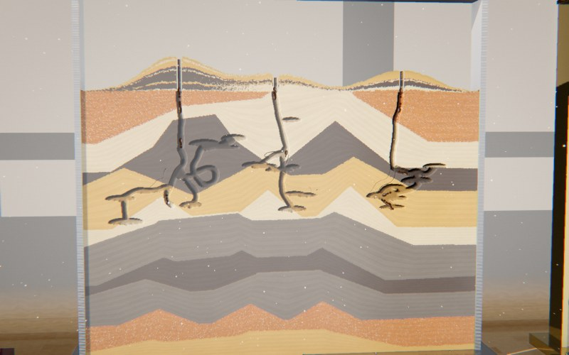

# Burrow

*la coupe vivante.* Sur une longue table, devant de hautes portes-fenêtres, une étagère de tranches de sable stratifié prises entre deux verres. La caméra la longe lentement. Chaque tranche entre dans le champ par la droite, neuve : des couches de sable de couleurs différentes, à peine ondulées. En passant, elle se creuse : des fourmis, vues comme dans un film en accéléré, descendent au front de leurs galeries et remontent avec leur boulette, qu'elles lâchent autour de l'entrée. Le tas grandit. Quand la tranche sort à gauche, son réseau est achevé, et son tumulus est rayé de toutes les couches du dessous, empilées à l'envers : le sable du fond, creusé en dernier, en fait la peau.

Rendu physique en three.js (WebGPU, TSL). La scène est entièrement procédurale : une graine produit une étagère. La démarche est dans [docs/concept.md](docs/concept.md) : l'exploration du thème, les pistes notées, puis le premier essai refusé (un sablier de gallium dans un gel : « un mini labyrinthe qui change de couleur ») et la coupe vivante qui l'a remplacé, validée sur une image fixe avant toute simulation.

## Utilisation

| Touche | Action |
| --- | --- |
| N | nouvelle scène (nouvelle graine) |
| Espace | pause / lecture |
| ← / → | avancer ou reculer dans la boucle |
| H | masquer l'interface |
| F | plein écran |

Paramètres d'URL : `?seed=…`, `#r=…` (scène retouchée, « Copier le lien »), `?ui=0`, `?mobile=1` / `?mobile=0`, `?debug` (outils dans `window.burrow` : `shot`, `send`, `sheet(['graine:humeur', …], phases)`, `meter`, `bench`, `seam`, `run`), `?sink=` (adresse du collecteur d'images).

Le panneau règle l'humeur (nouvelle scène de la même graine), la durée de la boucle, la caméra (champ, distance, hauteur, azimut, balancement, caméra libre), le soleil (couleur, force, azimut, hauteur) et le ciel, et tout le rendu. Export MP4 image par image (éventuellement accumulé) et PNG.

## Principe

**La liberté :** des fourmilières de laboratoire rangées comme des livres, chacune lancée un peu après sa voisine ; la caméra avance à la vitesse du temps, si bien que chaque tranche se creuse en traversant le champ. Tout le reste est exact : le sable creusé est le sable du tas, grain pour grain.

**La boucle** est une translation : trois tranches différentes se répètent au pas `L` (4 unités, 40 cm), la caméra avance de `3·L` par boucle, et l'âge d'une tranche ne dépend que de sa place à l'écran :

  s(p) = clamp((1,2 − p) / 2,4, 0, 1), p = (x_tranche − x_caméra) / L

À u = 1, chaque tranche a pris la place et l'âge de celle qui la précédait de trois rangs, qui est la même. La table, le mur et les fenêtres sont invariants par translation d'un pas ; l'ombre du soleil est recalée sur une grille de texels choisie pour que la période en compte un nombre entier (raccord mesuré : 1e-8).

**Le scénario**, sans légende : la tranche neuve à droite (des couches intactes) ; au centre, des taches brun-rouge qui courent dans des galeries qui s'allongent, des grains qui tombent sur un tas autour de chaque entrée ; à gauche, le réseau fini et les tumulus rayés. On lit la cause (les fourmis), l'effet (les galeries) et la conservation (le tas rayé des couleurs du fond) d'un seul regard, dans l'ordre où la caméra les montre.

## Génération (`src/gen/`, dans un worker)

- **Strates** (`slab.js`) : grille de cellules de 0,4 mm (800 × 725). Quatre motifs, un par tranche, trois par étagère : *lits* (6 à 8 couches à peine ondulées, légèrement inclinées) ; *sablier* (9 à 12 couches en montagnes, comme une bouteille de sable coloré versé à l'entonnoir, pics qui dérivent d'une couche à l'autre) ; *dunes* (rides dissymétriques, flanc doux et flanc raide) ; *éventail* (couches qui s'épaississent d'un côté). Une couche ne s'amincit jamais sous 1,2 mm. Chaque tranche a son ordre de couleurs, sans deux voisines pareilles ; lamines fines dans chaque couche.
- **Creuseurs** : des fourmis (sept tranches sur dix) ou des vers. Les vers creusent plus fin (1,3 mm), plus long, en serpentant, sans chambres ; leurs turricules tombent à la bouche et font de petits cônes.
- **Galeries** : une à trois entrées (trois ou quatre pour les vers), une densité propre à la tranche. Trois sortes de galeries : des puits qui descendent, des branches (trois générations), de longues galeries d'étage presque horizontales. Des chambres, parfois en grappe de deux ou trois. Des boucles : une branche qui rencontre une galerie plus ancienne de la même entrée s'y raccorde et s'arrête, et le réseau devient un maillage. Un budget par entrée (62 000 cellules en tout) garde le tumulus sous le cadre. Chaque galerie est une marche à courbure aléatoire (bruit de virage amorti), rappelée vers le bas et loin des bords, de rayon 2,2 mm ; branches en route, chambres à plancher plat et voûte, creusées du centre vers le bord. Chaque cellule garde l'instant où elle est creusée, sur l'horloge de son entrée : toutes les entrées creusent en même temps.
- **Tumulus** : chaque cellule creusée, dans l'ordre, remonte et tombe près de la bouche (distance gaussienne), puis roule tant que la pente l'y oblige ; sur une pente douce, une boulette de sable humide s'arrête souvent où elle tombe (talus aléatoire : profil arrondi, bosselé). Chaque grain garde la couche d'où il vient et l'instant de son dépôt. La bouche reste ouverte : c'est une galerie contre le verre entre les deux flancs.
- **Textures** (`slabtex.js`) : couche, lamine, instant de creusement, profondeur finale de la voûte (distance au sable intact, chanfrein 3-4), instant d'apparition. Le shader dessine n'importe quel âge sans recalcul.
- **Réseau des fourmis** : les points de l'axe des galeries, avec leur instant et leur parent vers l'entrée ; les points de chute sur le tas.

## Scène

- **La tranche** (`scene/slab.js`) : un maillage d'un sommet par cellule, déplacé vers l'arrière par la profondeur de la galerie à l'âge s (un grain arraché s'enfonce en un court instant). La lumière entre vraiment dans les tunnels et y porte ombre. Au-dessus du sable, le dessus du tas fuit vers le verre du fond. Le sable est fait de grains : cellules de Voronoï à la taille du sable de la couche (fin 0,24 mm, moyen 0,35, gros 0,55, et au plus un gravier de 1,3 mm aux galets de toutes les couleurs du jeu), chacun tiré d'un mélange de minéraux (84 % de la couleur du sable, du quartz, des grains sombres, un peu d'un autre sable), avec un dôme et des joints. Un grain prend le sable de la couche où tombe son centre, à une petite dérive près : les frontières sont grenues. Chaque sable a aussi une nature : sable ordinaire, verre pilé (éclats purs, à facettes, plus clairs vers leur bord, très brillants), billes de verre (dômes marqués, reflet net), nacre (paillettes irisées dont la teinte suit l'inclinaison). Deux jeux en vivent : « joaillier » (grenat, olivine, obsidienne, corail, quartz, magnétite, améthyste, citrine) et « verre de mer ». Certains sables ont des paillettes de mica, qui penchent au hasard et accrochent le soleil. Les déblais frais sont humides, plus sombres, et pâlissent en séchant. À distance, quand les grains passent sous le pixel, des lamines et des marbrures de tassement (à l'échelle du centimètre) gardent la matière vivante. L'indice de couleur est lu au plus proche, sans mélange aux frontières.
- **Les fourmis** (`scene/ants.js`) : par entrée, six fourmis de 9 mm (abdomen, thorax, tête, un reflet sur le dos), lentes (neuf allers-retours sur la vie de la tranche) et qui font halte à la bouche et au front, où elles grattent ; elles descendent le long du réseau jusqu'au front (le dernier point creusé), remontent, vont lâcher leur boulette au point de chute du grain creusé à cet instant, et reviennent. Tout est fonction de l'âge.
- **Le sol et le mur** (`scene/room.js`) : des matières calculées dans le repère du monde, qui se répètent exactement tous les 12 m (la longueur d'une boucle) : parquet (lames décalées, fil, joints), dalles de pierre, zinc à joints debout, granito ; un plâtre pour le mur. Le volume de bruit commun (période 4) est lu à l'échelle f/3, f entier.
- **Les poussières** (`scene/dust.js`) : 1 400 grains de poussière qui dérivent lentement (un nombre entier d'oscillations par boucle) et ne s'allument que dans les faisceaux des portes-fenêtres (le même test que les ombres : remonter vers le soleil jusqu'au mur des fenêtres).
- **La caméra** glisse le long de l'étagère et respire : elle s'approche et recule doucement, monte et descend un peu, une fois par tranche. La profondeur de champ de la chaîne d'image est coupée par défaut : elle traînait les galeries en copies grises.
- **Les verres** ne montrent que leurs reflets : les portes-fenêtres derrière la caméra, peintes dans le studio de la pièce, y posent de légers rectangles clairs.
- **La pièce** (`scene/stage.js`) : une table raccordée au mur par une gorge ; de hautes portes-fenêtres hors champ, une par tranche, décalées de la projection du soleil pour que chaque tranche soit entière dans sa tache ; les trumeaux dessinent leur rythme sur le mur du fond. Quatre emplacements suffisent à remplir le champ ; chacun prend, à chaque image, la tranche, l'âge et le cadre de sa place (fer noirci, laiton, laque vermillon, acier brossé, laque noire). La nappe de sable ne porte pas d'ombre dans la carte du soleil : sa silhouette (tumulus, galeries) se lisait sur le mur comme un bug. Un bloc simple du corps de sable, en retrait, porte l'ombre de la tranche sur la table et le mur. L'ombre propre des galeries est calculée dans le shader : on remonte vers le soleil dans la carte de profondeur (huit pas de 4 mm) ; si le sable intact coupe le rayon, le point est à l'ombre.

## Humeurs et sables

Six humeurs, chacune un décor (sol et mur) et une lumière : **Rebord** (parquet blond, plâtre gris perle, soleil franc, d'après Hammershøi), **Nord** (dalles d'ardoise, ciel blanc, soleil faible), **Hiver** (parquet gris délavé, soleil bas, rebond bleu), **Cabinet** (parquet sombre, fond noir, la tache de la fenêtre seule), **Midi** (granito, blanc sur blanc, soleil haut), **Vert-de-gris** (zinc, lumière verdie). Quatre jeux de sables, de vraies teintes : ocres (Roussillon), littoral (magnétite, coquillages, glauconie), volcan (scorie, cendre, soufre), désert.

## Tests

`node --test burrow/test/recipe.test.mjs` (12 tests) : recette déterministe et JSON pur ; chaque humeur tirée ; le tumulus contient exactement le sable creusé (au grain près) ; la peau du tas vient de plus bas que son cœur (couches inversées) ; aucun grain du tas n'est posé sous un grain plus ancien ; les galeries restent dans le sable et toutes les entrées creusent en même temps ; l'âge d'une tranche ne recule jamais en avançant ; le soleil vient de devant et d'en haut, et la fenêtre est plus large que la tranche ; chaque motif donne des couches ordonnées, sans voisines de même couleur ; une étagère montre trois motifs différents ; un ver enlève moins de sable qu'une fourmilière ; les pas des motifs du sol divisent la boucle.

## Performances mesurées

70 images/s en lecture à 1804 × 1530 (2,8 Mpx, qualité Haute) ; 7 à 9 ms par image en 1920 × 1080 selon la charge de la machine. Ce qui l'a ramené de 16,5 ms : un sommet pour 2 × 2 cellules (la normale vient de la texture, au pixel) ; la cellule lue une seule fois par pixel pour le masque, l'occlusion et la couleur ; la normale du relief sur la profondeur brute (4 lectures au lieu de 28) ; plus de fuite en profondeur du dessus du tas. L'occlusion ambiante prend 8 échantillons (sous l'anticrénelage temporel). La tranche coûte encore ses 9 cellules de Voronoï et les 5 pas de son ombre propre.

## Version mobile

`?mobile=1` : réglages allégés communs (chaîne d'image réduite, résolution dynamique, 60 i/s plafonnés). Non vérifiée sur un appareil.

## Limites connues

- Le rendu reste un peu moins saturé que le dessin de l'écran de chargement (la lumière et l'étalonnage AgX adoucissent les couleurs).
- La bouche qui traverse un tumulus se lit comme un étroit couloir clair.
- Version mobile non vérifiée sur un téléphone.
