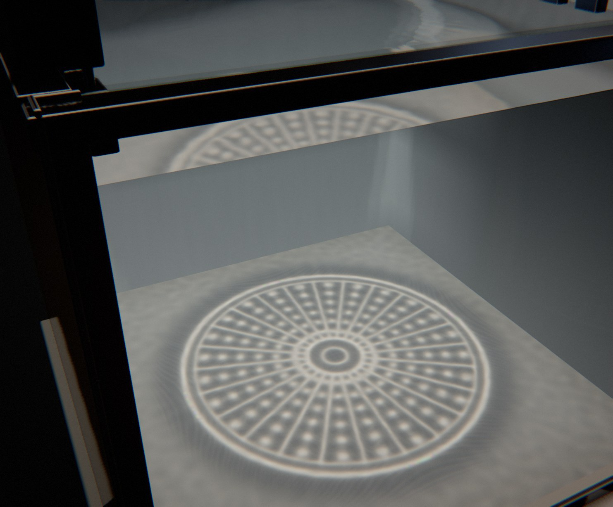

# Caustic

*le foyer des ondes.* Une cuve d'eau vue de côté, à travers sa vitre. Sur le pourtour, des plongeurs poussent des ondes. On les voit au fond comme des anneaux de lumière qui accourent vers le centre en se resserrant. À l'instant où ils se rejoignent, la surface prend exactement la forme d'une lentille calculée, et la lumière au fond se résout en un **dessin** (une diatomée, un oursin, une méduse, une rosace, un capitule de tournesol, un radiolaire), net et lumineux pendant une seconde de caméra rapide. Puis il se défait en anneaux qui repartent vers les bords, où les plongeurs les absorbent.

Rendu physique en three.js (WebGPU, TSL). La scène est entièrement procédurale : une graine produit une scène. La démarche est dans [docs/concept.md](docs/concept.md) : le thème exploré sous six angles (la physique des catastrophes optiques, les cuves à ondes et les bassins à houle, Hockney et les rideaux de lumière, le vocabulaire, les cycles, la lumière), les clichés écartés (le fond de piscine qui ondule au hasard, la cardioïde dans la tasse, le cristal qui jette des arcs-en-ciel), dix pistes notées, les épreuves de crédibilité, de variété et d'ambition, les photographies de référence.

« Caustique » désigne d'abord un effet de rendu : les traits brillants que la lumière dessine au fond d'une piscine. Ici l'effet devient le sujet, et ce qu'on regarde, c'est la lumière qui se rassemble. *Kaustikos*, « qui brûle » : le foyer est à la fois le point où la lumière converge et l'âtre.

## Utilisation

| Touche | Action |
| --- | --- |
| N | nouvelle scène (nouvelle graine) |
| Espace | pause / lecture |
| ← / → | avancer ou reculer dans la boucle |
| H | masquer l'interface |
| F | plein écran |

Sur écran tactile : une touche met en pause, deux touches tirent une nouvelle scène, un appui long masque l'interface.

Paramètres d'URL : `?seed=…`, `#r=…` (scène retouchée, « Copier le lien »), `?family=…` (foyer, faraday, karman), `?mood=…` (lagon, chambre, thermes, doree, nocturne, atelier, stroboscope), `?ui=0`, `?mobile=1` / `?mobile=0`, `?debug` (outils dans `window.caustic` : `shot(phase)`, `send(nom)`, `strip(phases)`, `sheet(graines, phases)` (une graine peut s'écrire `graine:humeur:famille`), `sendRT(cible)`, `meter()`, `meters(graines)`, `bench()`, `seam()`, `run()`).

Le panneau règle la famille et l'humeur (nouvelle scène de la même graine) et la durée. Le groupe « geste » règle la série de dessins et l'orientation de chacun, la vitesse du film et le ralenti de la caméra rapide, la course des plongeurs ; pour Faraday, les réseaux, le nombre d'onde, l'amplitude et les battements du stroboscope ; pour Kármán, les tourbillons, le courant et les fossettes. Viennent ensuite l'eau (turbidité, ride de fond), la lumière (éclairement, température, taille angulaire de la source, qui fixe la finesse des filets, studio, fond, exposition), la caméra et le rendu. Export MP4 image par image (éventuellement accumulé) et PNG.

## Principe : la lumière se rassemble

Une surface d'eau bosselée agit comme une lentille : là où elle se bombe, elle concentre la lumière du soleil en traits brillants sur le fond. Le programme calcule la bosse qui dessine une image choisie, puis l'onde qui, en se propageant, prendra exactement cette forme à un instant donné.

### Le geste et la boucle (famille Foyer)

Une boucle de 36 s montre **trois dessins**, une série en crescendo (le premier simple, le troisième le plus riche). Pour chacun :

| part du créneau | ce qu'on voit | cause visible | loi | temps |
| --- | --- | --- | --- | --- |
| 0 – 0,15 | eau presque calme, un frisson au fond ; la caméra regarde la surface et les plongeurs | — | ride de fond | réel × 0,4 |
| 0,15 – 0,4 | les plongeurs plongent, en une vague qui court le long des parois ; des fronts de lumière entrent par les bords | les plongeurs, qui suivent l'eau à leur place | ondes de capillarité-gravité, dispersion exacte | réel × 0,4 ; la caméra descend vers le fond |
| 0,4 – 0,6 | les anneaux se fondent, le dessin se forme et tient | la rencontre des fronts | retournement temporel ; réfraction de Snell | caméra rapide : ralenti jusqu'à × 0,006 |
| 0,6 – 0,85 | le dessin se défait en anneaux qui repartent | la propagation | idem, amortissement visqueux 2νk² | retour au réel × 0,4 ; la caméra remonte |
| 0,85 – 1 | les plongeurs absorbent ; calme | les plongeurs | — | — |

La hauteur de la surface est une somme exacte d'ondes linéaires :

h(x, t) = h_calme(x, t) + Σⱼ Wⱼ · F⁻¹[ Ĥⱼ(k) · cos(ω(k) τⱼ) · e^{−2νk²|τⱼ|} ]

Ĥⱼ est le spectre de la lentille du dessin j, et ω² = (gk + σk³/ρ) tanh(kH) la relation de dispersion des ondes de capillarité-gravité (la vitesse de chaque onde selon sa longueur). τⱼ est le **temps physique** de l'événement, compté depuis l'instant du dessin. Il vient d'une seule horloge (`src/timeline.js`) dont la vitesse descend à la caméra rapide autour de chaque dessin et dont l'intégrale est en forme fermée. Wⱼ est la fenêtre de l'événement (les plongeurs émettent puis absorbent). Comme cos est pair, l'onde à −τ est l'onde à +τ : la convergence est la dispersion lue à l'envers. C'est le principe du miroir à retournement temporel (Fink ; Bacot *et al.*, *Nature Physics* 2016, sur des ondes d'eau). La ride de fond est faite d'ondes progressives dont chaque fréquence est arrondie à un multiple entier de 2π/T_physique (écart < 0,1 %).

La boucle est parfaite par construction. Chaque τⱼ ne dépend que de (u − uⱼ) mod 1, Wⱼ est nulle aux bords de son créneau, la ride de fond est périodique et la caméra est une fonction périodique de u. Un test le vérifie (temps physique monotone, états identiques à u = 0 et u = 1, calme au raccord).

### Le cœur : dessiner avec une surface d'eau

1. **La cible** (`src/gen/motifs.js`) : des formes de Haeckel dessinées à la règle. Diatomées centriques (côtes, aréoles, secteurs), tests d'oursins et dollars des sables (ambulacres en paires de pores, tubercules, disque apical), méduses vues du dessus (canaux radiaires, gonades en fer à cheval, bulbes), rosaces de cercles entrelacés, capitules de Vogel, radiolaires (treillis concentriques, épines). Hors du disque du dessin, la lumière ne bouge pas (densité 1). Dedans, elle quitte le fond (32 %) pour se rassembler sur les traits, et la lumière totale est conservée exactement.
2. **Le transport optimal** (`src/gen/transport.js`) : l'application T = ∇u qui envoie la lumière uniforme de la lentille sur le dessin résout l'équation de Monge-Ampère μ = ν(∇u)·det D²u. La méthode est celle de Benamou, Froese et Oberman (2010) : comme (Δu)² = (u_xx − u_yy)² + 4u_xy² + 4 det D²u, on itère Δu⁽ⁿ⁺¹⁾ = √[(u_xx − u_yy)² + 4u_xy² + 4f], soit une équation de Poisson par itération, résolue par FFT (extension impaire). Il faut 30 à 40 itérations sur une grille de 256² pour un résidu relatif < 0,2 %, ~2,7 s dans un worker. Les trois dessins se calculent en parallèle, et l'écran de chargement montre leur grille se déformer jusqu'à concentrer la lumière.
3. **La lentille** (`src/gen/lens.js`) : la loi de Snell donne en chaque point la normale qui envoie la lumière où T le demande (n ∥ n₁·i − n₂·t), pour la vraie source (soleil oblique ou lampe proche). Les pentes s'intègrent en hauteur (Poisson, moindres carrés) sur une grille deux fois plus grande, dont les bords tombent hors de la cuve. Pentes de 0,13 à 0,24, flèche de 12 à 17 mm : une surface d'eau plausible.
4. **L'onde** : la hauteur est posée sur la grille du domaine des ondes (1024², 1,2 m de côté) et transformée (FFT). On obtient l'état initial Ĥ(k) d'une onde à vitesse nulle, qui convergera puis divergera par sa propre dispersion.
5. **Sur le GPU, à chaque image** (`src/scene/waves.js`, WGSL brut sur le périphérique de three.js). Le spectre de l'instant est assemblé : les dessins, la ride de fond, et le spectre des pentes i·k·Ŝ, qui donne ∂h/∂x et ∂h/∂z d'une seule transformée complexe. La FFT inverse se fait en deux passes (lignes, colonnes), chacune en mémoire partagée : un groupe de travail par ligne, les dix étapes de Cooley-Tukey entre deux barrières. Le champ (h, ∂h/∂x, ∂h/∂z) est écrit dans un tampon que three.js lit directement.
6. **La caustique** (`src/scene/caustics.js`) : un maillage couvre la surface (un sommet par point de la grille, 262 144 sommets). Le vertex shader suit le rayon de chaque sommet (incidence, réfraction de Snell par la normale de la surface, trajet jusqu'au fond) et pose le sommet là où il arrive. Chaque triangle porte la lumière qu'il a reçue et l'étale sur son aire d'arrivée : plus il s'est resserré, plus il éclaire. Le rapport des aires se lit au pixel par les dérivées écran de la position de départ (exact pour des triangles plats), et les nappes qui se recouvrent s'additionnent. Les plis de la caustique sont les lignes où les triangles se retournent. Trois longueurs d'onde (630, 545, 465 nm), chacune avec l'indice de l'eau de Quan et Fry, bordent les plis de franges colorées. S'y ajoutent l'absorption de l'eau sur le trajet (Pope et Fry), le facteur de Fresnel à l'entrée, l'ombre du rebord de la cuve et du poteau, puis un flou à la **taille angulaire de la source**. Le disque du soleil fait 0,53°. La recette des humeurs ensoleillées prend 0,0047 rad (le demi-diamètre), et le flou s'étale sur H·tan(0,0047), soit ~2 mm à 45 cm sous l'eau ; une lampe dépolie donne un réseau plus doux. Huit coupes à des profondeurs intermédiaires, rangées dans un atlas, donnent la lumière dans le volume.

Vérifié dans Node (`tools/event.mjs`, `test/core.test.mjs`) : la caustique calculée sur le processeur à τ = 0 redessine la cible (corrélation > 0,8), le dessin a du contraste au foyer, l'onde à −τ est l'onde à +τ (au bit près).

### Trois familles, trois gestes

- **Foyer** : des anneaux de lumière convergent des bords vers le centre, s'y résolvent en un dessin, puis divergent, en un mouvement radial de respiration. Un batteur de plongeurs occupe trois parois (la face vitrée reste dégagée). Chaque coin de plongeur suit la hauteur de l'eau à sa place, lue dans le même tampon que la caustique, si bien que la cause et l'effet coïncident par construction.
- **Faraday** : rien ne voyage. La cuve est secouée verticalement (volant à excentrique, ressorts). Au-dessus du seuil, un réseau d'ondes stationnaires à Ω/2 naît au centre et s'étend comme un cristal qui croît (carrés, hexagones, ou quasi-cristal à 8, 10, 12 branches). Un second réseau naît sur un bord et l'envahit, puis le forçage retombe et tout s'éteint. Le stroboscope, légèrement désaccordé, montre l'onde battre lentement : le réseau de points de lumière et son complémentaire alternent (un nombre entier de battements par boucle).
- **Kármán** : dans un canal, l'eau passe autour d'un poteau poli. Des tourbillons alternés s'en détachent à période fixe (un nombre entier par boucle) et défilent vers le déversoir. Chacun creuse la surface (profil de Lamb-Oseen) et projette au fond un disque noir cerclé de lumière, les « ombres de tourbillon » d'un fond de piscine. Le poteau porte son ombre.

## Matériaux et lumière

Le fond n'est éclairé que par la caustique : la lumière directe n'y arrive qu'à travers la surface. Sa matière donne l'échelle : sable blanc (grains de 0,7 mm, grains sombres), chaux (pores, coups de taloche), faïence (carreaux de 3 cm, joints de 1,8 mm, nuance par carreau), travertin (lits et pores), ardoise (feuillets, micas), émail, papier (fibres).

Les parois intérieures (moellons de travertin à joints, ardoise verte, tôle peinte, émail) reçoivent deux lumières. La première est le **rebond du fond éclairé** : la vraie lumière du fond, réduite et adoucie (128², σ ≈ 3 cm), lue en cinq points devant la paroi à des distances proportionnelles à la hauteur. Le bas d'une paroi s'allume face à la tache de soleil et reste sombre face à l'ombre. La seconde est la **caustique directe**, quand la lumière réfractée les frappe de biais (éclairement horizontal de la coupe à cette profondeur × |t·n|/|t_y|).

**La surface de l'eau** se rend par un lancer de rayon analytique. Vue d'en haut, elle montre le reflet du studio et le scintillement de la source pondérés par Fresnel, et le fond (ou une paroi) vu à travers les vagues, réfracté. Vue d'en dessous (à travers la vitre), c'est un miroir de réflexion totale au-delà de 48,6° qui renvoie le fond, avec la fenêtre de Snell où brille la source. **Le volume d'eau** diffuse la lumière des coupes (fonction de phase de Henyey-Greenstein, extinction par longueur d'onde) : ce sont les rideaux de lumière. La vitre (12 mm) reflète le studio selon Fresnel, et ses chants sont verts.

Les appareils sont des pièces à trois finitions (face, intérieur, tranche) aux F0 mesurés : cornières d'acier noirci, de laiton brossé ou d'acier brossé, plongeurs et vérins, volant et moteur, poteau chromé. Une seule lampe porte des ombres : le soleil, lointain, ou une lampe à arc proche.

## Les humeurs (une humeur = un décor)

| Humeur | Décor | Lumière | Valeur | Cadrage |
| --- | --- | --- | --- | --- |
| **Lagon** | cuve émaillée, sable blanc | soleil haut, filets nets et frangés | très claire | plongée |
| **Chambre noire** | cuve à bâti d'acier noirci, fond de chaux, pièce noire | lampe à arc ponctuelle au-dessus | très sombre, contrastée | rasant |
| **Thermes** | bassin de moellons de travertin, fond de faïence | soleil d'une verrière, un peu diffusé | moyenne, douce | trois-quarts |
| **Heure dorée** | aquarium à bâti de laiton, fond de travertin, parois d'ardoise | soleil bas et chaud, ombre du rebord | chaude, contre-jour | rasant |
| **Nocturne** | cuve d'acier, fond d'ardoise | lune froide | sombre, froide | plongée |
| **Atelier** | cuve émaillée sous un projecteur | lampe proche | moyenne | trois-quarts |
| **Stroboscope** (Faraday) | cuve d'acier sur l'excitateur, fond de papier | stroboscope blanc | sombre, image figée | plongée |

## Scène et caméra

Les plongeurs sont laqués vermillon, le fil rouge de la collection : c'est d'eux que part le geste ; le cylindre de Kármán aussi. (Une humeur « Planche », vue d'en haut à longue focale, a été essayée puis retirée : le dessin remplissait l'image, mais on ne voyait plus que c'est de l'eau qui se déforme, et la scène refaisait l'écran de chargement.)

La caméra est hors de la cuve, devant la vitre, à hauteur de l'eau ou un peu au-dessus. Les rayons qui passent sous la ligne d'eau voient le fond à travers la vitre, ceux qui passent au-dessus voient la surface d'en haut : c'est la coupe d'un aquarium. Ses mouvements suivent l'histoire. Entre deux dessins, elle regarde la surface et les plongeurs (la cause) ; quand les ondes convergent, elle descend vers le fond et s'avance un peu (l'effet) ; puis elle remonte. Pointes < 25°/s, accélération bornée image par image (test à 120 i/s).

## Tests

`node --test 'caustic/test/*.test.mjs'` : indice de l'eau et dispersion ; Snell (la normale calculée fait la déviation demandée), Fresnel, réflexion totale ; vitesse de groupe minimale des ondes de capillarité-gravité (≈ 18 cm/s) ; FFT et solveurs de Poisson ; transport optimal sur toutes les séries (convergence, conservation de la lumière, corrélation de la lumière poussée avec la cible) ; lentille (pentes < 0,3, rien ne bouge hors du dessin, contraste au foyer) ; retournement temporel ; horloge (monotone, ralenti et τ = 0 au dessin, raccord) ; caméra (périodique, vitesse et accélération) ; Faraday et Kármán périodiques ; la lentille tient dans la cuve pour toutes les humeurs ; recette (déterminisme, JSON, familles, humeurs et séries tirées, décors tous différents, lampes presque blanches).

## Performances mesurées

Graine c41 (Atelier), 1483 × 1228 (1,8 Mpx), qualité Haute, boucle arrêtée (`bench()`, 30 rendus d'affilée) :

| Poste | Temps |
| --- | --- |
| Image complète, au dessin (u = 0,5) | 9,1 ms |
| Image complète, entre deux dessins (u = 0) | 8,8 ms |
| dont ondes (assemblage du spectre, deux FFT 1024², champ) + caustique (3 × 262 144 sommets) + huit coupes + flous | 2,3 ms |
| Graine 5z6vio (Heure dorée), image complète, après l'éclairage des parois | 5,9 ms |
| Version mobile (`?mobile=1`, 1050 × 870) | 2,0 ms |

Chargement d'une scène Foyer : ~6 s (trois transports optimaux en parallèle dans les workers, ~2,7 s chacun, puis compilation sous l'écran de chargement). Aucune pipeline compilée après le chargement sur une boucle entière (vérifié). Raccord de la boucle < 2·10⁻⁹. Export MP4 essayé (640 × 360, 24 i/s).

## Version mobile

`?mobile=1` ou écran tactile : grille des ondes 512² au lieu de 1024² (les dessins sont plus doux), caustique en une seule longueur d'onde (sans franges colorées) sur une texture de 512², quatre coupes au lieu de huit, volume en 12 pas, chaîne d'image allégée (une passe, FXAA, sans occlusion ni réflexions d'écran). 2 ms par image mesurées.

## Ce qui n'est pas vérifié

La fluidité en lecture directe (le panneau du navigateur était masqué pendant la mise au point : les images ont été rendues une à une), un téléphone réel, un export long ou accumulé.
