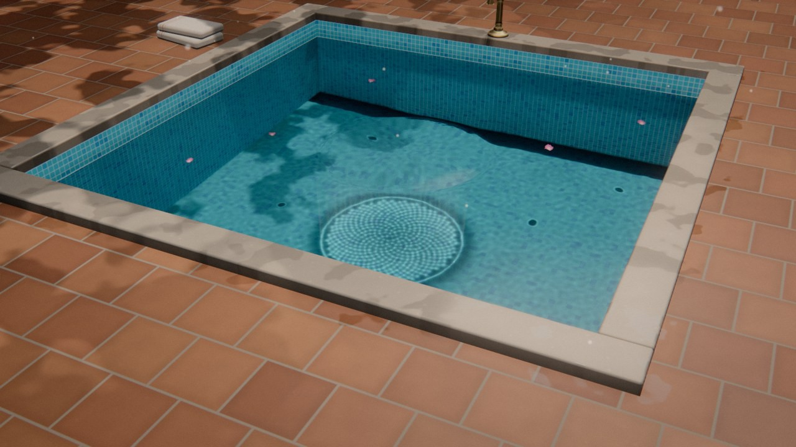

# Caustic

*le foyer des ondes.* Un bassin au soleil, vu de trois quarts. Des ondes accourent des bords vers un point en se resserrant ; on les voit au fond comme des anneaux de lumière. À l'instant où elles se rejoignent, la surface prend exactement la forme d'une lentille calculée, et la lumière au fond se résout en un **dessin** (une diatomée, un oursin, une méduse, une rosace, un capitule de tournesol, un radiolaire). Puis il se défait en anneaux qui repartent vers les bords. L'eau ne se fige jamais : le film ralentit seulement un peu quand le dessin se forme.

Rendu physique en three.js (WebGPU, TSL). La scène est entièrement procédurale : une graine produit une scène. La démarche est dans [docs/concept.md](docs/concept.md) : le thème exploré sous six angles (la physique des catastrophes optiques, les cuves à ondes et les bassins à houle, Hockney et les rideaux de lumière, le vocabulaire, les cycles, la lumière), les clichés écartés (le fond de piscine qui ondule au hasard, la cardioïde dans la tasse, le cristal qui jette des arcs-en-ciel), dix pistes notées, les épreuves de crédibilité, de variété et d'ambition, les photographies de référence.

« Caustique » désigne d'abord un effet de rendu : les traits brillants que la lumière dessine au fond d'une piscine. Ici l'effet devient le sujet, et ce qu'on regarde, c'est la lumière qui se rassemble. *Kaustikos*, « qui brûle » : le foyer est à la fois le point où la lumière converge et l'âtre.

## Utilisation

| Touche | Action |
| --- | --- |
| N | nouvelle scène (nouvelle graine) |
| Espace | pause / lecture |
| ← / → | avancer ou reculer dans la boucle |
| H | masquer l'interface |
| F | plein écran |

Sur écran tactile : une touche met en pause, deux touches tirent une nouvelle scène, un appui long masque l'interface.

Paramètres d'URL : `?seed=…`, `#r=…` (scène retouchée, « Copier le lien »), `?family=…` (foyer, faraday, karman), `?mood=…` (patio, lagon, chambre, thermes, doree, nocturne, atelier, stroboscope), `?ui=0`, `?mobile=1` / `?mobile=0`, `?debug` (outils dans `window.caustic` : `shot(phase)`, `send(nom)`, `strip(phases)`, `sheet(graines, phases)` (une graine peut s'écrire `graine:humeur:famille`), `sendRT(cible)`, `meter()`, `meters(graines)`, `bench()`, `seam()`, `run()`).

Le panneau règle la famille et l'humeur (nouvelle scène de la même graine) et la durée. Le groupe « geste » règle la série de dessins et l'orientation de chacun, la vitesse du film et le ralentissement au dessin ; pour Faraday, les réseaux, le nombre d'onde, l'amplitude et les battements du stroboscope ; pour Kármán, les tourbillons, le courant et les fossettes. Viennent ensuite l'eau (turbidité, ride de fond), la lumière (éclairement, température, taille angulaire de la source, qui fixe la finesse des filets, studio, fond, exposition), la caméra et le rendu. Export MP4 image par image (éventuellement accumulé) et PNG.

## Principe : la lumière se rassemble

Une surface d'eau bosselée agit comme une lentille : là où elle se bombe, elle concentre la lumière du soleil en traits brillants sur le fond. Le programme calcule la bosse qui dessine une image choisie, puis l'onde qui, en se propageant, prendra exactement cette forme à un instant donné.

### Le geste et la boucle (famille Foyer)

Une boucle de 36 s montre **trois dessins**, une série en crescendo (le premier simple, le troisième le plus riche). Pour chacun :

| part du créneau | ce qu'on voit | cause visible | loi | temps |
| --- | --- | --- | --- | --- |
| 0 – 0,15 | eau presque calme, un frisson au fond | — | ride de fond | réel × 0,4 |
| 0,15 – 0,4 | des fronts de lumière entrent par les bords et se resserrent | — (la scène ne montre plus de batteur : voir « Ce qui a été abandonné ») | ondes de capillarité-gravité, dispersion exacte | réel × 0,4 ; la caméra s'avance |
| 0,4 – 0,6 | les anneaux se fondent, le dessin se forme et tient | la rencontre des fronts | retournement temporel ; réfraction de Snell | léger ralentissement, jusqu'à × 0,15 |
| 0,6 – 0,85 | le dessin se défait en anneaux qui repartent | la propagation | idem, amortissement visqueux 2νk² | retour au réel × 0,4 ; la caméra recule |
| 0,85 – 1 | calme | — | — | — |

La hauteur de la surface est une somme exacte d'ondes linéaires :

h(x, t) = h_calme(x, t) + Σⱼ Wⱼ · F⁻¹[ Ĥⱼ(k) · cos(ω(k) τⱼ) · e^{−2νk²|τⱼ|} ]

Ĥⱼ est le spectre de la lentille du dessin j, et ω² = (gk + σk³/ρ) tanh(kH) la relation de dispersion des ondes de capillarité-gravité (la vitesse de chaque onde selon sa longueur). τⱼ est le **temps physique** de l'événement, compté depuis l'instant du dessin. Il vient d'une seule horloge (`src/timeline.js`) dont la vitesse descend à la caméra rapide autour de chaque dessin et dont l'intégrale est en forme fermée. Wⱼ est la fenêtre de l'événement (les plongeurs émettent puis absorbent). Comme cos est pair, l'onde à −τ est l'onde à +τ : la convergence est la dispersion lue à l'envers. C'est le principe du miroir à retournement temporel (Fink ; Bacot *et al.*, *Nature Physics* 2016, sur des ondes d'eau). La ride de fond est faite d'ondes progressives dont chaque fréquence est arrondie à un multiple entier de 2π/T_physique (écart < 0,1 %).

La boucle est parfaite par construction. Chaque τⱼ ne dépend que de (u − uⱼ) mod 1, Wⱼ est nulle aux bords de son créneau, la ride de fond est périodique et la caméra est une fonction périodique de u. Un test le vérifie (temps physique monotone, états identiques à u = 0 et u = 1, calme au raccord).

### Le cœur : dessiner avec une surface d'eau

1. **La cible** (`src/gen/motifs.js`) : des formes de Haeckel dessinées à la règle. Diatomées centriques (côtes, aréoles, secteurs), tests d'oursins et dollars des sables (ambulacres en paires de pores, tubercules, disque apical), méduses vues du dessus (canaux radiaires, gonades en fer à cheval, bulbes), rosaces de cercles entrelacés, capitules de Vogel, radiolaires (treillis concentriques, épines). Hors du disque du dessin, la lumière ne bouge pas (densité 1). Dedans, elle quitte le fond (32 %) pour se rassembler sur les traits, et la lumière totale est conservée exactement.
2. **Le transport optimal** (`src/gen/transport.js`) : l'application T = ∇u qui envoie la lumière uniforme de la lentille sur le dessin résout l'équation de Monge-Ampère μ = ν(∇u)·det D²u. La méthode est celle de Benamou, Froese et Oberman (2010) : comme (Δu)² = (u_xx − u_yy)² + 4u_xy² + 4 det D²u, on itère Δu⁽ⁿ⁺¹⁾ = √[(u_xx − u_yy)² + 4u_xy² + 4f], soit une équation de Poisson par itération, résolue par FFT (extension impaire). Il faut 30 à 40 itérations sur une grille de 256² pour un résidu relatif < 0,2 %, ~2,7 s dans un worker. Les trois dessins se calculent en parallèle, et l'écran de chargement montre leur grille se déformer jusqu'à concentrer la lumière.
3. **La lentille** (`src/gen/lens.js`) : la loi de Snell donne en chaque point la normale qui envoie la lumière où T le demande (n ∥ n₁·i − n₂·t), pour la vraie source (soleil oblique ou lampe proche). Les pentes s'intègrent en hauteur (Poisson, moindres carrés) sur une grille deux fois plus grande, dont les bords tombent hors de la cuve. Pentes de 0,13 à 0,24, flèche de 12 à 17 mm : une surface d'eau plausible.
4. **L'onde** : la hauteur est posée sur la grille du domaine des ondes (1024², 1,2 m de côté) et transformée (FFT). On obtient l'état initial Ĥ(k) d'une onde à vitesse nulle, qui convergera puis divergera par sa propre dispersion.
5. **Sur le GPU, à chaque image** (`src/scene/waves.js`, WGSL brut sur le périphérique de three.js). Le spectre de l'instant est assemblé : les dessins, la ride de fond, et le spectre des pentes i·k·Ŝ, qui donne ∂h/∂x et ∂h/∂z d'une seule transformée complexe. La FFT inverse se fait en deux passes (lignes, colonnes), chacune en mémoire partagée : un groupe de travail par ligne, les dix étapes de Cooley-Tukey entre deux barrières. Le champ (h, ∂h/∂x, ∂h/∂z) est écrit dans un tampon que three.js lit directement.
6. **La caustique** (`src/scene/caustics.js`) : un maillage couvre la surface (un sommet par point de la grille, 262 144 sommets). Le vertex shader suit le rayon de chaque sommet (incidence, réfraction de Snell par la normale de la surface, trajet jusqu'au fond) et pose le sommet là où il arrive. Chaque triangle porte la lumière qu'il a reçue et l'étale sur son aire d'arrivée : plus il s'est resserré, plus il éclaire. Le rapport des aires se lit au pixel par les dérivées écran de la position de départ (exact pour des triangles plats), et les nappes qui se recouvrent s'additionnent. Les plis de la caustique sont les lignes où les triangles se retournent. Trois longueurs d'onde (630, 545, 465 nm), chacune avec l'indice de l'eau de Quan et Fry, bordent les plis de franges colorées. S'y ajoutent l'absorption de l'eau sur le trajet (Pope et Fry), le facteur de Fresnel à l'entrée, l'ombre du rebord de la cuve et du poteau, puis un flou à la **taille angulaire de la source**. Le disque du soleil fait 0,53°. La recette des humeurs ensoleillées prend 0,0047 rad (le demi-diamètre), et le flou s'étale sur H·tan(0,0047), soit ~2 mm à 45 cm sous l'eau ; une lampe dépolie donne un réseau plus doux. Huit coupes à des profondeurs intermédiaires, rangées dans un atlas, donnent la lumière dans le volume.

Vérifié dans Node (`test/core.test.mjs`) : la lumière poussée par le transport optimal reproduit la cible (corrélation > 0,8, toutes les séries) ; la caustique calculée sur le processeur à τ = 0 a du contraste (écart-type relatif > 0,4) ; l'onde à −τ est l'onde à +τ (à 10⁻¹² près). `tools/event.mjs` écrit la planche d'un dessin (caustique au fond à plusieurs instants).

### Trois familles, trois gestes

- **Foyer** : des anneaux de lumière convergent des bords vers un point, s'y résolvent en un dessin, puis divergent.
- **Faraday** : rien ne voyage. Un réseau d'ondes stationnaires naît au centre et s'étend comme un cristal qui croît (carrés, hexagones, ou quasi-cristal à 8, 10, 12 branches) ; un second réseau naît sur un bord et l'envahit, puis tout s'éteint.
- **Kármán** : l'eau passe autour d'un cylindre d'acier satiné, tenu dans le courant par un pont de laiton posé sur la margelle. Des tourbillons alternés s'en détachent à période fixe et défilent. Chacun creuse la surface (profil de Lamb-Oseen) et projette au fond un disque sombre, les « ombres de tourbillon » d'un fond de piscine. Sous l'eau, le cylindre reflète le fond.

## Le bassin (`src/scene/stage.js`)

Un bassin large et peu profond (1,1 m pour 45 cm d'eau au Foyer), creusé dans un sol, avec une margelle de pierre. Cette forme permet de le filmer de biais en voyant tout le fond.

**L'eau.** Le fond n'est éclairé que par la caustique : la lumière directe n'y arrive qu'à travers la surface. La surface se rend par un lancer de rayon analytique : reflet du ciel pondéré par Fresnel, et le fond ou une paroi vus à travers les vagues, réfractés, avec leur décor et la caustique fine. L'eau se colore comme celle d'un bassin plus profond (réglage par ambiance). Une ligne claire et une bande mouillée marquent le niveau sur les parois.

**Les rayons.** Un faisceau dans l'eau est la trace d'un trait brillant du fond. En douze points du trajet du regard, on relit donc la caustique du fond au pied du rayon de lumière qui passe par ce point. Le résultat est comprimé, pour qu'un trait dix fois plus brillant ne donne pas un rayon dix fois plus fort, et s'estompe en remontant : on obtient une lueur fine au-dessus du dessin, sans passe de rendu de plus.

**Les matières.** Sol, margelle et mur sont des matériaux physiques complets : un vernis là où c'est mouillé et sur la cire des tomettes, des arêtes adoucies qui accrochent la lumière, chaque carreau posé un rien de travers, une usure qui polit la pierre par endroits, un satiné sur la chaux. Hors de l'eau, chaque tesselle de pâte de verre renvoie le ciel selon son propre angle.

**Ce qui réchauffe la scène.**

- l'ombre d'un feuillage hors champ, qui découpe le soleil sur les dalles, les parois et le fond du bassin, et bouge à peine ;
- des feuilles ou des pétales qui flottent et suivent la hauteur de l'eau ; au fond, leur ombre est cernée d'un liseré clair ;
- des flaques au bord du bassin ;
- un mur de fond enduit à la chaux, teinté par ambiance ;
- un objet par ambiance : deux serviettes pliées le jour, une lanterne de laiton le soir et la nuit ;
- un bec de fontaine en laiton, d'une seule pièce, scellé au milieu de la margelle du fond (à sec : le calcul des ondes ne connaît pas de filet d'eau) ;
- un effet d'air discret : poussières qui s'allument dans les rais de soleil, vapeur sur l'eau des Thermes, brume basse la nuit.

## Les ambiances (une ambiance = un décor)

| Ambiance | Bassin | Sol et margelle | Lumière | Accessoires |
| --- | --- | --- | --- | --- |
| **Patio** | pâte de verre turquoise | tomettes cirées, margelle de calcaire | soleil de midi, feuillage | pétales, serviettes, bec de fontaine, mur ocre |
| **Lagon** | chaux blanche, eau très turquoise | marbre blanc | soleil haut, feuillage | feuilles, serviettes, mur blanc cassé |
| **Thermes** | travertin, eau verte | travertin | soleil plus bas, doux | vapeur, serviettes, bec de fontaine |
| **Heure dorée** | ardoise sombre | platelage de teck, margelle de calcaire | soleil bas et chaud, feuillage | feuilles d'automne, lanterne, mur terre cuite |
| **Nocturne** | pâte de verre bleu nuit | ardoise | lumière froide | lanterne, brume |
| **Chambre noire** | chaux blanche | ardoise | une lampe au-dessus de l'eau | lanterne, brume |
| **Atelier** | faïence blanche | marbre blanc | lampe | serviettes |
| **Stroboscope** (Faraday) | pâte de verre noire | ardoise | faisceau parallèle froid | — |

## Caméra

La caméra regarde le bassin de trois quarts, d'un peu plus haut que la margelle, et s'avance vers le dessin quand il se forme. Elle vise le centre du dessin, qui n'est pas celui du bassin quand la lumière arrive de biais (la lentille est d'un côté, son image de l'autre), et tient compte de la réfraction : pour que son axe tombe sur un point du fond, elle vise à la surface un point plus proche d'elle.

## Ce qui a été abandonné

La première version montrait une cuve de laboratoire vue de côté à travers sa vitre, avec un batteur de plongeurs sur le pourtour. Elle a été jugée trop technique et froide. Le bassin n'a plus de batteur : les ondes du Foyer n'ont donc plus de cause visible à l'écran. Écartés aussi en chemin : un fond de zellige à étoiles (il faisait décor de synthèse), des rayons lus dans les coupes floues de l'eau (un nuage laiteux), des rayons en traits nets (artificiels), des gouttes isolées sur la pierre (des pois), un filet d'eau au bec de fontaine (incohérent avec la caustique), la quasi-pause du film au moment du dessin.

## Tests

`node --test 'caustic/test/*.test.mjs'` : indice de l'eau et dispersion ; Snell (la normale calculée fait la déviation demandée), Fresnel, réflexion totale ; vitesse de groupe minimale des ondes de capillarité-gravité (≈ 18 cm/s) ; FFT et solveurs de Poisson ; transport optimal sur toutes les séries (convergence, conservation de la lumière, corrélation de la lumière poussée avec la cible) ; lentille (pentes < 0,3, rien ne bouge hors du dessin, contraste au foyer) ; retournement temporel ; horloge (monotone, ralenti et τ = 0 au dessin, raccord) ; caméra (périodique, vitesse et accélération) ; Faraday et Kármán périodiques ; la lentille tient dans la cuve pour toutes les humeurs ; recette (déterminisme, JSON, familles, humeurs et séries tirées, décors tous différents, lampes presque blanches).

## Performances mesurées

Graine c41 (Patio), 1280 × 720, qualité Haute, boucle arrêtée (`bench()`, 30 rendus d'affilée), panneau du navigateur masqué : ces mesures sont bruitées (deux mesures de suite ont donné 19 puis 17 ms).

| État de la scène | Temps par image |
| --- | --- |
| Bassin seul, pierre allégée | ≈ 8 ms |
| Avec les matières physiques, le feuillage, les feuilles | ≈ 11 ms |
| Avec les objets et les effets d'air (état livré) | 17 à 19 ms |
| État livré, matières physiques masquées | ≈ 12 ms |

Les matières physiques du sol, de la margelle et du mur coûtent environ 5 ms ; la hausse entre 11 et 17 ms n'est pas expliquée en entier. Aucune optimisation n'a été faite après ces mesures.

Chargement d'une scène Foyer : ~6 s (trois transports optimaux en parallèle dans les workers, puis compilation sous l'écran de chargement), mesuré sur l'ancienne cuve.

## Version mobile

`?mobile=1` ou écran tactile : grille des ondes 512² au lieu de 1024² (les dessins sont plus doux), caustique en une seule longueur d'onde (sans franges colorées) sur une texture de 512², quatre coupes au lieu de huit, volume en 12 pas, chaîne d'image allégée (une passe, FXAA, sans occlusion ni réflexions d'écran). 2 ms par image mesurées.

## Ce qui n'est pas vérifié

- La fluidité en lecture directe : le panneau du navigateur était masqué pendant la mise au point, les images ont été rendues une à une. Le rythme du ralentissement et le mouvement du feuillage, des poussières et de la vapeur n'ont été jugés que sur images fixes.
- Le cadrage centré sur le dessin : contrôlé à l'image sur deux graines seulement.
- Les ambiances autres que Patio et Nocturne avec leurs objets et leurs effets d'air.
- La version mobile et l'export, depuis le passage au bassin.
- Avec un bassin aussi large que le domaine des ondes, les ondes peuvent reboucler par les bords.
- Un téléphone réel.
