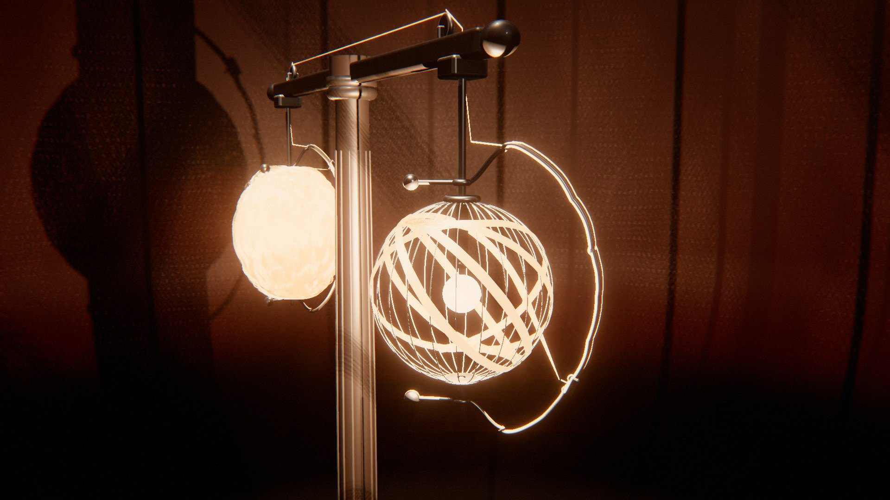

# Cocoon

*la lumière filée.* Deux lanternes-cocons pendent aux bras d'un fléau. Un seul ruban de soie quitte l'une, qui se dévide et libère sa lampe, passe sur le fléau et va s'enrouler sur la cage nue de l'autre, qui se referme sur sa lumière jusqu'à n'être plus qu'une lueur. Quand tout le fil est passé, le fléau fait un demi-tour : la lanterne pleine prend la place de la lanterne vide, et le film recommence. La boucle est parfaite par construction : les deux stations sont identiques, et le demi-tour les échange exactement.

Au début, à gauche, un cocon plein ne fait que luire ; à droite, une cage de fil autour d'une ampoule nue projette sur les murs l'ombre agrandie de ses côtes. L'ailette de droite se met à tourner, l'œil de porcelaine qu'elle porte conduit le ruban : quelques rubans espacés d'abord, puis des losanges, des cerclages ou des quartiers qui se resserrent, les faisceaux de lumière qui s'amincissent dans la brume, enfin la dernière fente qui se ferme. À gauche, c'est le même film à l'envers : les couches partent une à une, la lumière revient par les jours. Le fléau tourne, les ombres balaient la pièce, et tout recommence.

Rendu physique en three.js (WebGPU, TSL). La scène est entièrement procédurale : une graine produit une scène. La démarche est dans [docs/concept.md](docs/concept.md) : le thème exploré sous six angles, les clichés écartés, neuf pistes notées, les épreuves (crédibilité, variété, ambition, déclinaison, scénario, références).

**Pourquoi des lanternes et pas un ver à soie.** Le thème appelle une créature, et la chair (peau, cuticule humide, duvet, reptation) est ce que le temps réel rend le plus mal. Ce projet ne montre donc jamais de chair : il montre la soie et la lumière. Un fil est une courbe connue, son reflet satiné une loi connue (deux lobes décalés le long de la fibre, comme pour les cheveux) ; une lampe derrière une paroi de fils se lit par ce qu'elle projette. Le côté organique vient de ce que la soie fait d'elle-même : le lustre, la translucidité, le dessin des boucles en huit, les irrégularités du fil.

## Utilisation

| Touche | Action |
| --- | --- |
| N | nouvelle scène (nouvelle graine) |
| Espace | pause / lecture |
| ← / → | avancer ou reculer dans la boucle |
| H | masquer l'interface |
| F | plein écran |

Sur écran tactile : une touche met en pause, deux touches tirent une nouvelle scène, un appui long masque l'interface.

Paramètres d'URL : `?seed=…`, `#r=…` (scène retouchée, « Copier le lien »), `?mood=…` (`magnanerie`, `chambreNoire`, `heureBleue`, `filature`, `shoji`, `laque`, `brouillard`), `?family=…` (`losange`, `cerclage`, `huit`, `meridien`), `?ui=0`, `?mobile=1` / `?mobile=0`, `?debug` (outils dans `window.cocoon` : `shot(phase)`, `send(nom)`, `sheet(graines, phases)`, où une graine peut s'écrire `graine:humeur:famille`, `meter()`, `meters()`, `bench()`, `seam()`, `run()`).

Le panneau règle l'humeur et la famille (nouvelle scène de la même graine), la durée de la boucle ; le cocon (forme et rayon de la cage, côtes, rosaces, fils par ruban, diamètre du fil, réglages de la famille, fil et sa matière) ; l'appareil et le tempo (matières, accéléré de la fermeture, vitesse de la finition, dépassement de la relève) ; la caméra (champ, distance, hauteur, azimut, balancement, caméra libre) ; les lampes, la lumière de la pièce, le remplissage, les murs, la brume, le studio ; le rendu. Export MP4 image par image (éventuellement accumulé) et PNG.

## Principe : un fil qui passe d'un cocon à l'autre

**La boucle** est un échange par symétrie, lu sur une seule horloge u ∈ [0, 1) (`src/timeline.js`) :

| Temps | Part de la boucle | Ce qui se passe |
| --- | --- | --- |
| repos | 0 → 3 % | cocon plein à gauche, cage nue à droite |
| transfert | 3 → 79 % | le ruban passe de gauche à droite ; S, la part posée à droite, va de 0 à 1 |
| rangement | 79 → 82 % | les ailettes sont arrêtées à leur dernier angle |
| relève | 82 → 97 % | le fléau tourne de π autour de la colonne, avec un léger dépassement |
| repos | 97 → 100 % | l'image du début |

**La caméra** commence en plan moyen (les deux lanternes, le fléau), puis s'approche de face de la lanterne qui s'enroule pendant tout le transfert : l'œil, le brin libre et la paroi qui se ferme remplissent l'image, la lanterne qui se dévide reste au fond, dans le flou de la profondeur de champ. Elle recule pour la relève. Les derniers centimètres de ruban posés brillent un peu plus (la séricine fraîche) : le point de pose se lit en mouvement.

Les deux lanternes portent **le même chemin P** : celle de droite en montre la portion s ≤ S, celle de gauche la portion s ≤ 1 − S. Le fil est uniforme, il ne garde pas la mémoire de son sens ; la longueur se conserve (S_gauche + S_droite = 1 à chaque instant). La station de droite est tournée de π dans le fléau ; après la relève (fléau tourné de π), la station pleine occupe exactement la place et l'orientation de la station de gauche, son ailette au même angle. C'est un échange, pas un aller-retour : à chaque instant une lanterne se ferme pendant que l'autre s'ouvre, et le fil va toujours de gauche à droite.

**Le tempo** suit les régimes du chemin (armature, fermeture, finition) : la vitesse du ruban vaut 1 dans l'armature (on suit chaque passage de l'œil), 1,9 à 2,5 dans la fermeture (un accéléré d'atelier, assumé), 1,1 dans la finition, sur une boucle de 56 à 64 s, avec des raccords lissés, un départ et un arrêt sans à-coup (`makeProgram`). Le fléau tourne en π·s5(x) plus un dépassement qui retombe exactement sur π, vitesse nulle aux deux bouts (`beamAngle`).

## Génération (`src/gen/`, dans des Web Workers)

### La cage (`profile.js`)

Une surface de révolution autour de l'axe de la station : profil méridien (r, y) en abscisse curviligne σ, de pôle à pôle, avec y = −(H/2)·cos πt (une sphère est exacte). Sept formes : ovoïde, arachide (étranglée à la taille), fuseau, sphère, poire, capsule, double cône. Des côtes en fil de 1,6 mm (12 à 24) et deux rosaces polaires ; le fil ne descend pas sous le rayon des rosaces.

### Le chemin du ruban (`winding.js · buildPath`)

Un seul ruban continu, du premier au dernier point, écrit dans la carte (σ, φ) de la paroi puis rééchantillonné tous les 3 mm :

- **géodésiques de Clairaut** : un fil tendu sur une surface de révolution garde r·sin α = c (α, angle au méridien) ; la demi-géodésique φ(σ) = ∫ c / (r √(r² − c²)) dσ est intégrée avec la substitution σ = a + (b − a)(1 − cos πx)/2, qui rend l'intégrande fini aux rebroussements ;
- **fermeture d'un motif** : N circuits avec une avance Δ = 2π·p/N (p premier avec N, choisi près de 0,382·N : les losanges se subdivisent le plus régulièrement) ; un séjour le long du parallèle r = c, au pôle, comble l'écart entre l'avance naturelle 2·Δφ½ et Δ ;
- **cerclage** : hélice de pas égal à la largeur du ruban, dans la zone où la pente du méridien reste sous le frottement des côtes crantées ;
- **boucles en huit** : un balayage lent en hélice d'un pôle à l'autre (le corps du ver) et, en travers, une lemniscate de Gerono (la tête qui bat) ; le pas d'une boucle à l'autre vaut 2,6·w/k pour k couches par passage.

Les familles enchaînent ces chemins en régimes, si bien que le cocon change de forme en se fermant :

| Famille | Armature | Fermeture | Finition | Mouvement de l'appareil |
| --- | --- | --- | --- | --- |
| **Losange** | 7 à 9 circuits géodésiques larges (c ≈ 0,55 R) | une couche géodésique à c ≈ 0,3 R, motif p/N ≈ 0,382 | une couche presque polaire, un cerclage de taille | l'ailette tourne vite, l'œil va d'un pôle à l'autre |
| **Cerclage** | 4 à 6 circuits polaires (des côtes) | une hélice qui monte de bas en haut | renforts polaires | l'ailette tourne vite pendant que le chariot grimpe lentement |
| **Huit** | 3 circuits polaires (la bourre) | les boucles en huit | 4 circuits polaires | l'ailette suit le balayage, la filière bat en huit |
| **Méridien** | 3 circuits polaires | un enroulement polaire, ruban après ruban | une couche croisée à c ≈ 0,42 R | l'œil passe par-dessus les pôles, l'ailette avance d'un ruban par circuit |

### Le dépôt du fil (`winding.js · windCocoon`)

Le ruban (6 à 16 fils jointifs, de 1,1 à 1,9 mm, 4 à 6 fils pour le huit) se pose sur une **carte de hauteur** de la paroi (1 024 × 2 048 cellules, 0,2 à 0,5 mm). La carte part de la cage : entre deux côtes, le fil tendu fait une corde (la paroi est un prisme à facettes). Par tronçons de 16 points (8 pour le huit, qui se recroise vite) :

1. chaque fil lit le maximum de la carte sous son empreinte (sauf son propre dépôt récent), et s'y pose à un rayon au-dessus ;
2. sa hauteur est dilatée (± 2 points) puis lissée le long du fil, jamais sous la valeur lue : le fil enjambe un croisement un peu avant, il ne le traverse pas ;
3. il élève la carte de sa section ronde.

Deux fils ronds dont les axes sont à δ < d ne se traversent pas si leurs hauteurs diffèrent de √(d² − δ²) : c'est ce que vérifie le banc, sur 95 000 à 390 000 voisinages par cocon (`test/core.test.mjs`). Les pôles s'épaississent d'eux-mêmes, comme sur un vrai réservoir bobiné.

### La paroi comme filtre de lumière

Pendant le dépôt, chaque cellule garde **les instants s des quatre premiers fils** qui la couvrent (une texture RGBA32F de 2 048 × 1 024). La paroi à l'instant S laisse passer τ^n dans une direction, n = nombre de s_k < S, τ = transmission d'une épaisseur de fil (0,12 pour la soie noire, 0,42 pour la grège, 0,72 pour la fibre de verre, 0 pour le cuivre). Une table θ → σ (512 entrées) relie une direction issue de la lampe au point de la paroi qu'elle traverse. Cette seule table sert aux murs, à l'appareil, à l'autre lanterne, à la brume, et au double qui porte l'ombre du cocon.

### L'ailette et l'œil (`apparatus.js · eyeTable`)

L'ailette porte un rail qui épouse le cocon plein à 5 cm (une ailette de rouet). Le brin libre, tendu, va droit du point de pose à l'œil et quitte la paroi tangentiellement : l'œil est donc là où la tangente au ruban rencontre la surface du rail. L'azimut de l'ailette et la position du chariot sont ensuite lissés le long du chemin (l'ailette tourne d'un mouvement continu, ≤ 0,07 rad par 3 mm de fil) et ramenés sur le rail. Pour le huit, l'ailette suit le balayage lent et une filière, au bout du chariot, frôle la paroi et bat en huit. Le brin libre ne traverse la paroi (telle qu'elle est à cet instant) que moins de 1 % du temps.

## Les fils (`src/scene/threads.js`)

Chaque segment de fil est un ruban de deux triangles tourné vers la caméra, à normale cylindrique et à **profondeur de cylindre** (chaque pixel est écrit à la surface du fil : deux fils voisins vus en biais se recouvrent sans scintiller), jamais plus étroit que ~0,8 px. Le dépôt calcule un point tous les 3 mm ; le rendu n'en garde qu'un sur trois (9 mm : la flèche d'une corde de 9 mm sur la cage fait moins de 0,1 mm), avec la hauteur maximale des points supprimés, si bien que le fil enjambe les croisements comme un fil tendu, sans jamais s'y enfoncer. 35 000 à 100 000 segments par cocon, les mêmes pour les deux lanternes. Un segment recouvert, à tous ses points, par un fil posé après lui n'est plus dessiné à partir de cet instant (l'instant est calculé dans le worker, d'après la table de transmission) : il ne se voit plus. L'éclairage qui ne varie pas à l'échelle d'un segment est calculé par sommet. L'éclairage est écrit à la main (`outputNode`) : L'éclairage est écrit à la main (`outputNode`) :

- diffusion de Kajiya-Kay et deux lobes de Marschner décalés le long de la fibre : R, blanc et étroit ; TRT, teinté et plus large : le satin de la soie ;
- la lumière de la pièce sur la seule face du cocon tournée vers elle (le cocon se fait de l'ombre à lui-même) ;
- l'autre lampe, filtrée par sa propre paroi ;
- la lampe intérieure : directe sur les fils vus par les jours, et la **lueur**, filtrée par les n couches posées dessous (τ^n), diffusée vers l'avant à travers le fil, plus forte au bord du ruban ;
- chaque fil sa nuance, un grain le long du fil.

**Sous le pixel.** De loin, un fil fait moins d'un pixel. Les fils d'un ruban sont élargis de 12 % pour se recouvrir (les jours de 0,1 mm entre eux laissaient passer la lampe en points brillants), et le détail s'efface avec la taille du fil à l'écran : sous ~2 px, la normale cylindrique s'aplatit, les nuances fil à fil disparaissent et le reflet s'élargit. Sinon chaque fil scintille d'une image à l'autre. Les fils de la cage ont une rugosité d'au moins 0,45 pour la même raison.

Huit fils : soie grège, soie dorée (*Nephila*), tussah, yamamaï, soie noire, lin écru, fil de cuivre, fibre de verre.

## L'appareil (`src/gen/apparatus.js`, `src/scene/machine.js`)

Socle tourné en trois gradins, fût galbé à douze cannelures, chapiteau-palier ; fléau à congés, moyeu central, embouts en olive, paliers des stations, poulies à gorge sur leur chape ; par station : axe, rosaces polaires à bord roulé, côtes de la cage, douille, ampoule de verre et filament en boucle sur ses supports, bout d'arbre du palier bas ; ailette (rail qui épouse le cocon, bras, contrepoids, bagues), chariot à deux galets, œil de porcelaine ou d'agate, filière du huit. Cinq accords : laiton et noyer, acier bleui et buis, nickel et ébène, fonte laquée vert et laiton, fonte noire et laiton (le laiton jamais à la fois sur la structure et les ferrures).

Le ruban est visible de bout en bout : du point de pose à l'œil (les fils convergent), le long du rail jusqu'au palier haut, puis d'une poulie à l'autre sur le fléau.

## La lumière (`src/scene/lantern.js`, `src/scene/stage.js`)

Chaque lampe est une lumière ponctuelle **sans carte d'ombre** dont la couleur, en chaque point éclairé, est multipliée par la transmission de sa paroi (`LanternLightNode`). La table est lue en **bilinéaire** (au plus proche, elle dessinait sur les murs une grille de points carrés), sur deux prélèvements opposés dans un disque dont le rayon grandit avec la distance du point éclairé (la pénombre réelle d'un filament de quelques millimètres) et qui tourne à chaque pixel et à chaque image : l'anticrénelage temporel en fait un flou continu. Les autres ombres des lampes sont analytiques dans la même fonction : les côtes de la cage (des fils aux angles 2πk/n, vus sous l'angle de leur diamètre, avec la pénombre du filament), les rosaces polaires, et l'autre cocon (si le rayon traverse sa sphère, la lumière passe deux fois sa paroi, lue dans sa table). Deux cartes d'ombre cubiques coûtaient ~7 ms par image. La lumière de la pièce (fenêtre, ciel, verrière, douche, contre-jour) porte ses ombres ; les cocons y sont des doublures (une paroi lisse de 4 000 triangles masquée selon la transmission de la paroi) au lieu de leurs 150 000 rubans.

**Le dosage des lampes.** Une ampoule nue à 60 cm éclaire l'autre cocon environ six fois plus fort que la lumière de la pièce : la soie blanche y montait à 6–8 en scène linéaire, au-delà de l'épaule du tone mapping, et le dessin du ruban disparaissait dans le blanc. Comme un drapeau sur un plateau, les fils ne reçoivent en direct que 15 % des lampes (`lamp.thread`, réglable au panneau), le cordon le long du rail, sans paroi devant l'ampoule, encore six fois moins, et le métal de la station (côtes, ailette, chariot) 30 % (`NEAR_LAMP`). Les murs gardent la pleine lampe, donc les ombres des côtes. Au posemètre (`cocoon.meter`), la soie a maintenant une médiane de 1 à 1,5 dans toutes les humeurs.

**La brume** est une marche de rayon dans la passe d'image (14 pas, tramée et lissée par l'anticrénelage temporel) : à chaque pas, la lumière de chaque lampe filtrée par sa paroi, diffusée selon Henyey-Greenstein (g = 0,45). Chaque jour de la paroi y devient un faisceau ; quand le cocon se ferme, les faisceaux s'amincissent et disparaissent.

## Les décors

La pièce est un cyclorama de révolution (sol, gorge, mur) centré derrière l'appareil, assez près pour recevoir les ombres des lanternes.

| Humeur | Décor | Lumière | Valeur | Cadrage |
| --- | --- | --- | --- | --- |
| **Magnanerie** | plâtre blanchi, tomettes | grand jour latéral, lampes discrètes | très claire | plan moyen, un peu haut |
| **Chambre noire** | salle sombre, brume | les deux lampes seules, faisceaux | très sombre | à hauteur des lanternes |
| **Heure bleue** | grande baie, béton ciré | ciel froid à contre-jour, lampes chaudes | sombre, froide | trois quarts |
| **Filature** | béton gris | verrière zénithale dure | moyenne | plongée |
| **Shōji** | paravent de papier lumineux | contre-jour large et doux | claire derrière | presque frontal |
| **Laque** | laque rouge sombre, sol noir | douche étroite, lampes ambrées | sombre, chaude | gros plan |
| **Brouillard** | gris perle, brume dense | lumière diffuse, lampes dans la brume | moyenne, sans ombres | plan large |

## Tests

`node --test 'cocoon/test/*.test.mjs'` :

- géodésique : r·sin α = c le long de la demi-géodésique ;
- continuité du ruban (pas de saut de plus de 3,5 mm) ;
- **dépôt sans traversée** sur les quatre familles, à la grille de l'application (moins de 2 contacts douteux pour 10 000 voisinages contrôlés), et un témoin négatif (tous les fils à la même hauteur) que le banc voit échouer ;
- table de transmission : instants rangés, moins de 10 % de jours quand le cocon est plein ;
- ailette : rail à plus de 2,5 cm du cocon plein, rotation continue, brin libre dégagé ;
- horloge : transfert monotone, relève de 0 à π sans à-coup, raccord par échange, conservation du fil ;
- caméra : périodique, moins de 25 °/s, accélération bornée à 120 i/s ;
- recette : déterminisme, aller-retour JSON, chaque humeur, famille, forme et fil tirés ; accords (trois familles de matières, laiton en accent) ; lampes ≥ 3 300 K ; décors distincts.

## Performances

Mesuré dans le panneau de navigateur de l'application (GPU partagé avec l'affichage, pipelines chauds, 12 images d'affilée), qualité Haute, MSAA 4×, 1,5 Mpx :

| Graine, moment | Temps |
| --- | --- |
| ebc1m2 (Shōji, Losange, 13 fils par ruban), gros plan | 11,9 ms (52 ms avant optimisation) |
| ebc1m2, relève, plan large | 13,4 ms |
| ebc1m2, début de boucle | 13,3 ms |
| ebc1m2, version mobile, 1 Mpx | 5,2 à 6 ms |

Ce qui a compté, dans l'ordre : un segment rendu sur trois (les fils coûtaient 42 ms, surtout dans les sommets : 1,8 million de sommets éclairés trois fois) ; plus de cartes d'ombre cubiques pour les lampes (~7 ms) ; les doublures plutôt que les fils dans la carte d'ombre de la pièce (~4,5 ms) ; l'éclairage par sommet des fils ; les segments enfouis retirés ; la SSR seulement sur un sol brillant ; la GTAO à 8 échantillons. Le bobinage complet prend 1,4 à 2,2 s dans Node, sous l'écran de chargement.

**Anticrénelage.** MSAA 4× sur la passe de scène (2× en Standard), puis TRAA. Le MSAA lisse les arêtes et les fils fins dans chaque image, même quand l'anticrénelage temporel rejette son historique (ailette qui tourne, ruban qui se pose, caméra qui s'approche). La profondeur multi-échantillonnée n'étant lisible ni par le TRAA ni par la brume, la SSR ou le flou, tous lisent celle de la pré-passe. Les métaux élargissent leur reflet là où leur normale tourne vite d'un pixel à l'autre (Kaplanyan). Les fils ont des tangentes continues d'un segment à l'autre, et le nombre de couches sous chaque fil (qui règle sa lueur) est lissé le long du fil et interpolé : un compte entier qui sautait de segment en segment dessinait un camouflage. Les traînées anamorphiques et la poussière sur la lentille sont coupées (en quart de résolution, elles dessinaient des blocs carrés).

## Version mobile

`?mobile=1` (ou d'office sur téléphone et tablette) : grille de dépôt et table de transmission de 512 × 1 024, points tous les 4 mm, brume à 8 pas, chaîne d'image allégée (une passe, sans GTAO, SSR ni TRAA).
