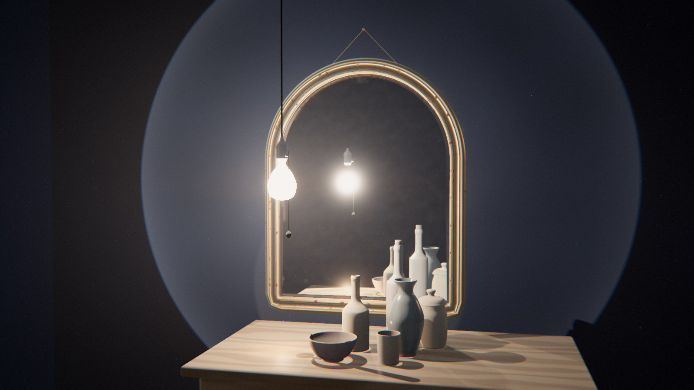

# Echo

*le miroir en retard*

Une pièce dans la pénombre : une nature morte sur une table, une ampoule pendue à sa douille à tirette, un miroir. Le cordon descend d'un coup, et une caméra impossible, quelque sept cents millions de fois plus lente que le réel, montre la lumière avancer. Une sphère sort de l'ampoule, allume la table à partir du point le plus proche, les vases du côté de la lampe, fait naître leurs ombres, atteint le mur, puis la glace. Dans le miroir, l'ampoule s'allume à son tour, en retard. Une seconde lumière revient de la glace, l'écho, et éclaire le revers des objets. La pièce reste allumée quelques secondes ; le cordon reprend son balancement là où le ralenti l'avait figé. Second coup de cordon : l'obscurité part de l'ampoule, la dernière lumière s'en va en coquille vers les murs, et le miroir garde l'ampoule allumée un instant après qu'elle s'est éteinte. La boucle est parfaite par construction : le film est une fonction de la phase, et à u = 0 comme à u = 1 la lampe est éteinte depuis assez longtemps pour que les deux fronts aient quitté la pièce, le cordon au repos, la caméra à la même pose.



La scène prend une seule liberté, le temps. Tout le reste suit la propagation de la lumière : elle avance à c, chaque écho a la longueur exacte de son chemin, et un point n'apparaît allumé que lorsque la lumière qu'il renvoie a eu le temps d'atteindre l'objectif, comme dans les femto-photographies de Velten et Raskar. Le concept et les pistes écartées sont dans [docs/concept.md](docs/concept.md), les défis techniques dans [explainer.html](explainer.html).

## Utilisation

```bash
python3 .claude/serve.py 8220 echo    # depuis la racine du dépôt
# puis http://localhost:8220/
```

| Touche | Effet |
| --- | --- |
| N | nouvelle scène (nouvelle graine) |
| Espace | pause / lecture |
| ← → | avancer ou reculer d'un pas |
| H | masquer l'interface |
| F | plein écran |

Sur écran tactile : une touche met en pause, deux touches tirent une nouvelle scène, un appui long masque l'interface.

| Paramètre d'URL | Effet |
| --- | --- |
| `?seed=…` | la scène (une graine = une scène) |
| `#r=…` | une scène retouchée, partagée par « Copier le lien » |
| `?mobile=1` / `?mobile=0` | version allégée imposée / interdite |
| `?ui=0` | sans panneau |
| `?debug` | outils dans `window.echo` (`shot`, `send`, `sheet`, `film`, `meter`, `poster`, `bench`, `seam`…) |

Le panneau règle l'humeur, le réflecteur, la durée de la boucle, la caméra (champ, distance, azimut, hauteur, glissement, avancée), l'ampoule (forme, couleur, intensité, douille, balancement du cordon), le cadre du miroir, la couleur et la surface de chaque vase, les murs, le sol, la table et la fenêtre hors champ. Puis le rendu (qualité, ombres, image, bloom et objectif, occlusion et reflets). L'export produit une boucle MP4 rendue image par image, éventuellement accumulée (8 à 64 passes), et une image PNG.

## Principe

### Le front

`src/film.js` donne la convention de temps. La vitesse du film v(u) vaut 1 en temps réel et 1/K au ralenti ; elle passe de l'une à l'autre par des rampes douces sur log v. Le temps physique est τ(u) = T ∫₀ᵘ v, tabulé en double précision (32 768 pas). Chaque événement (allumage, extinction) définit un rayon de front, la longueur de chemin parcourue par la lumière depuis qu'elle a quitté l'ampoule :

```
ρ(u) = c · (τ(u) − τ_événement)        borné à [−1, 60] m pour les flottants du GPU
```

Un point x reçoit la lumière d'un chemin de longueur L(x) (de la lampe à x, directement ou par un réflecteur). La caméra la voit quand ρ ≥ L(x) + |x − œil|. La part de lumière d'un chemin est donc

```
g = S(ρ_on − L − D) · (1 + 3 e^(−a/0,12 m)) − (même terme pour ρ_off)      a = ρ_on − L − D, D = |x − œil|, S : rampe de 2 cm
```

L'allumage commence par un éclair : la première lumière est quatre fois plus forte, et cet excès s'éteint sur 12 cm de chemin. Sur chaque surface, le front passe en anneau brillant puis la lumière s'établit ; dans la brume il dessine une coquille, et l'écho en ramène une seconde, depuis la glace. Sans lui, le front n'était qu'un fondu en disque qu'on ne lisait pas comme une propagation.

K est choisi pour que la lumière traverse la scène pendant le ralenti : le front avance à 0,30 à 0,54 m par seconde de film (K de 5,6·10⁸ à 9,9·10⁸ sur 200 graines). Le ralenti commence quand la première lumière est sur le point d'atteindre l'objectif (ρ = |ampoule − œil| − 12 cm) et finit quand le dernier point visible, direct, écho, rebond ou vu dans la glace, est allumé (ρ de 5 à 7 m). Pendant le ralenti, tout ce qui est matériel est figé (cordon, boule, poussière : ils lisent τ) ; seule la caméra continue de glisser (elle lit u).

| u | Temps | Convention |
| --- | --- | --- |
| 0 – 0,036 | nuit ; le cordon finit de se balancer | temps réel |
| 0,036 – 0,072 | le cordon est tiré (2,5 cm), le film ralentit | rampe |
| 0,072 – 0,40 | l'ampoule, la table, les vases, le mur, la glace, l'écho, les rebonds | ralenti |
| 0,40 – 0,53 | la pièce éclairée ; le cordon, relâché, remonte et se balance | temps réel |
| 0,53 – 0,566 | second tirage | rampe |
| 0,566 – 0,895 | l'obscurité avance ; la dernière lumière en coquille ; le reflet s'éteint en retard | ralenti |
| 0,925 – 1 | nuit | temps réel |

### Les échos

`src/gen/optics.js` (pur, testé contre des rayons lancés et réfléchis pas à pas) et sa traduction TSL `src/scene/paths.js`.

| Famille | Réflecteur | Chemin L(x) | Ce qu'on voit |
| --- | --- | --- | --- |
| **Trumeau** | glace au mur, cadre mouluré | \|x − s′\|, s′ symétrique de la lampe, si le segment s′ → x traverse la glace | une seconde sphère sort de la glace et éclaire les revers |
| **Psyché** | glace ovale ou cintrée sur pied, inclinée | idem, la glace orientée sur la bissectrice lampe / œil | idem, de côté ; le reflet de l'ampoule au centre de la glace |
| **Miroir ardent** | calotte d'ellipsoïde polie sur une fourche, foyers : l'ampoule et un point de la nappe | 2a − \|x − f₂\| avant le foyer, 2a + \|x − f₂\| après, dans le cône de la calotte | un cône de lumière qui se referme sur la nappe, une tache ardente, puis un cône qui en repart |
| **Boule à facettes** | 490 à 620 tesselles planes | \|x − s′ᶠ\|, s′ᶠ image de la lampe dans la facette dont la normale est la bissectrice de (x − B) et (s − B) | des pinceaux et des taches qui arrivent l'une après l'autre |

Chaque écho est une lumière de three.js dont le nœud multiplie la couleur, au point éclairé, par son ouverture et par g (`src/scene/lights.js`) : la glace est un projecteur placé en s′ avec ses ombres ; le foyer et les facettes récrivent la direction et l'atténuation de la lumière (une source ponctuelle en f₂ dont l'image a la taille du filament, 9 mm au grandissement |f₂M| / |f₁M| ; un miroir plan par facette). Deux rebonds diffus (la table sous la lampe, le mur au plus près) portent la couleur de leur surface et un chemin |v − s| + |x − v| : dans la Laque, cet écho diffus revient rose.

Le reflet n'a besoin de rien de plus. La glace est rendue par `reflector()` depuis la caméra symétrique ; dans ce rendu, `cameraPosition` est cette caméra virtuelle, et |x − œil′| vaut exactement |x − glace| + |glace − œil|. L'ampoule du miroir s'allume donc après la vraie, et s'éteint après elle.

La brume (`src/scene/haze.js`, option `haze` de la chaîne d'image commune) marche le long du rayon de vue (22 pas, 8 en mobile) et ajoute en chaque pas la lumière de chaque source à retard. Elle pèse surtout l'éclair (×1,6) et très peu la lumière établie (×0,18) : elle dessine les coquilles qui avancent, la sphère de l'ampoule et celle de la glace, le cône qui se referme, les pinceaux, sans voiler l'image. Elle n'a pas d'ombres.

## Génération

- `src/recipe.js` : graine → recette JSON ; un flux de tirage par famille (`mood`, `family`, `camera`, `light`, `mats`, `objects`, `film`, `place`).
- `src/gen/layout.js` : la mise en place. La table (1,15 à 1,4 m), la lampe (44 à 54 cm au-dessus du plateau), la nature morte (4 à 7 vases en grappe serrée, les plus hauts au fond, sans contact, hors de la perle du cordon), le réflecteur. Le trumeau est posé là où la droite œil → ampoule image traverse le mur ; la psyché est orientée sur la bissectrice ; le foyer du miroir ardent est sur la nappe, devant la nature morte, dans un couloir laissé libre. Puis la caméra est ajustée (`fitCamera`) : elle garde son azimut et sa hauteur, vise le centre de ce qui doit être à l'image (l'ampoule et sa douille, chaque vase, le réflecteur entier) et recule juste assez pour tout contenir avec 14 % de marge. Trumeau et caméra dépendent l'un de l'autre : trois allers-retours. Les glaces sont tirées plus souvent (trumeau 1,6, psyché 1,3, boule 0,9, ardent 0,7) : c'est là que l'écho se lit le mieux.
- `src/gen/build.js` : la géométrie, dans un worker (35 à 67 ms par scène). Vases tournés à paroi épaisse et lèvre en demi-rond (bouteille, cruche à anse et bec, pot à couvercle et bouton, bol, gobelet, vase, flacon ; bouchon de liège), table à ceinture et pieds tournés, fuselés ou en tréteaux, nappe à ourlet et retombée plissée, lambris à tables saillantes et cimaise, douille tournée et sa sortie de cordon, ampoule (poire, globe, tube, flamme) avec sa tige de verre, ses fils d'amenée et un filament en hélice de 22 spires, glace biseautée et cadre à moulure balayée le long du contour, psyché à montants tournés, patins et pivots, calotte d'ellipsoïde avec dos, bague, fourche et pied lesté, boule à tesselles chanfreinées et chaînette.

## Matériaux

`src/scene/surfaces.js` : douze matières écrites pour la pièce, au pixel, dans le repère du monde, à partir du volume de bruit commun. Lambris et badigeon (peau d'orange), plâtre, laque (vernis), velours (lustre), faïence et tomettes (carreaux bombés, joints en creux), bois (fil, cernes, planches et leurs joints ; sur le plateau, des ronds laissés par des verres et des pots), lin (armure de 420 fils au mètre, fils flammés), marbre (fond nuageux, veines « en crête » 1 − |n| à la puissance 44 et 18, lues à travers une déformation et interrompues), métal (laiton, nickel, argent terni), bakélite. Les cadres s'usent aux moulures saillantes : le bol rouge paraît sous la dorure, le bois sous le noir.

**Céramiques.** Un seul matériau pour tous les vases ; la couleur, la rugosité, l'émail et le centre du vase passent par des attributs. Rides de tournage au pas de 4 à 7 mm, d'amplitude variable ; émail dont l'épaisseur fait la couleur (plus sombre et plus saturé où il s'accumule), qui coule en traînées verticales, s'amasse en bourrelet au-dessus du pied, s'amincit sur la lèvre où la terre transparaît, et s'arrête à 1 cm du sol sur une ligne irrégulière : le pied est en terre nue et mate ; piqûres de fer ; craquelure sur un vase émaillé sur trois (Worley du volume de bruit : le Worley exact sur 27 cellules allongeait la compilation de dizaines de secondes). Les vases mats sont une peinture poudrée à la Morandi, marbrée, aux traces de pinceau horizontales, avec un velouté.

**La glace** est ancienne : le tain s'oxyde par plaques sur le dernier dixième du bord et en piqûres éparses, de la poussière s'est déposée sur le verre. Les deux sont éclairées par les lumières à retard : on voit le front passer sur la glace elle-même, et son reflet arriver ensuite.

## Scène

Sept humeurs, chacune un décor :

| Humeur | Murs, table | Lumière de nuit | Valeur | Cadrage |
| --- | --- | --- | --- | --- |
| **Strandgade** (d'après Hammershøi) | lambris gris perle, chêne ou nappe | fenêtre bleue hors champ | moyenne claire | assis, trois-quarts |
| **Lambris** (d'après Hammershøi) | boiseries vert-de-gris, noyer | crépuscule vert-gris ; ampoule à 3 300 K | moyenne sombre | trois-quarts, plongée |
| **Laque** | laque sang-de-bœuf, guéridon noir | nuit ; l'écho diffus est rose | sombre saturée | bas, assis |
| **Cabinet noir** | velours noir, marbre blanc | presque rien ; ampoule froide | très sombre | assis, trois-quarts |
| **Carrelage** | faïence blanche, zinc ou marbre | aube grise | claire | assis, plongée |
| **Atelier blanc** | plâtre blanc, pin brut | jour pâle ; ampoule à 6 500 K | très claire | trois-quarts, plongée |
| **Bleu de Prusse** | badigeon bleu, pin ou nappe | aube rose de l'autre côté | moyenne | assis, bas |

Sept lumières créées une fois dans un ordre fixe : la fenêtre (ombres), l'ampoule (ombres), la glace (ombres), le foyer, les facettes, deux rebonds. Une famille absente éteint les siennes. La caméra (`cameraAt`) est un plan fixe qui glisse sur un arc (± 1,4 à 2,9°) et avance de 3 à 6 % pendant les deux temps de lumière.

## Tests

```bash
node --test 'echo/test/*.test.mjs'    # 16 tests
```

- **Optique** : miroir plan, calotte elliptique et boule à facettes : la longueur de chaque chemin égale celle d'un rayon lancé depuis la lampe et réfléchi sur la vraie surface (1e-9 ; 500 rayons sur la calotte, avant et après le foyer), et la loi de la réflexion est vérifiée ; rien derrière la glace ni hors de son contour ; la porte est monotone et s'annule après l'extinction.
- **Film** : raccord à u = 1 (fronts, cordon, temps réel) ; les fronts n'ont jamais reculé pendant leur ralenti ; le cordon est figé au ralenti ; la perle est en bas quand la lumière part ; la caméra reste sous 25°/s et 0,5 m/s² à 120 i/s.
- **Recette** (400 graines) : déterminisme et aller-retour JSON ; chaque humeur et chaque famille tirées ; au moins trois vases, aucun contact, tous sur la table, aucun sous la perle ; pour chaque glace, le reflet de l'ampoule est dans la glace vu de l'œil ; le foyer ardent est sur la table, sans vase, et la calotte regarde ses deux foyers ; l'étendue des fronts est cohérente.

Bancs : `tools/curves.mjs` (les courbes du film), `tools/grid.py` (planches), `tools/art.html` (le dessin du chargement hors du worker).

## Performances mesurées

Portable Apple Silicon, panneau de navigateur intégré, qualité Haute, 1920 × 1080, graine d'ouverture (e29, Bleu de Prusse, trumeau) : 12,1 ms au passage de l'écho (u = 0,24) ; avant la passe sur l'éclair, les matières et la brume, 12,3 ms sur une autre graine. Raccord de boucle : écart de pose 2·10⁻⁷ (`seam`). 73 à 84 pipelines compilées sous l'écran de chargement ; avec le cache de shaders du navigateur, la scène est prête en 2 s (panneau visible). Les autres familles n'ont pas été chronométrées une à une.

## Version mobile

`?mobile=1` : brume en 8 pas, 2 000 grains de poussière au lieu de 4 500, miroir rendu à demi-résolution, chaîne d'image allégée commune. 4,1 ms par image sur la même machine (u = 0,24), sans erreur. Non vérifiée sur un téléphone réel.
