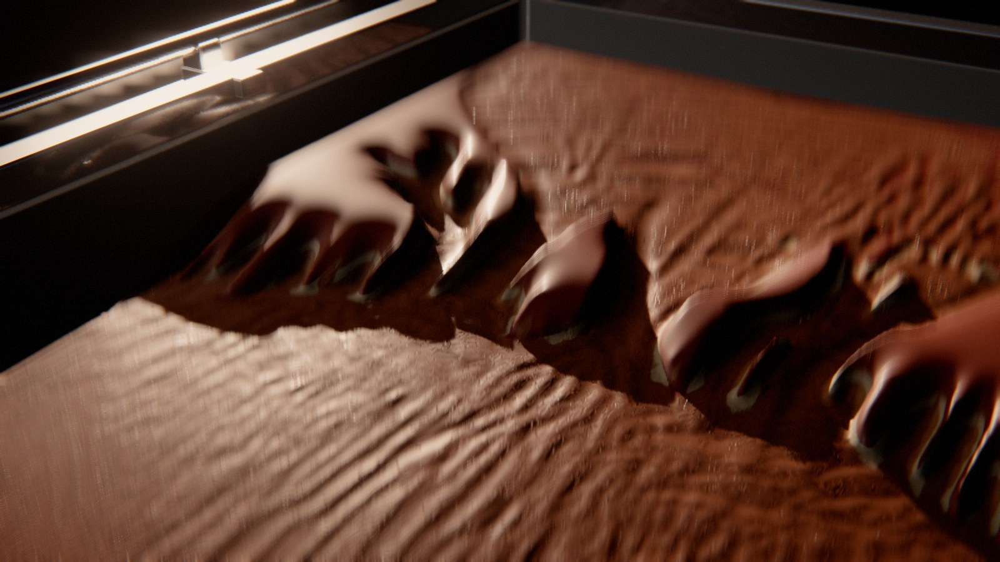

# Erosion

*un paysage d'une heure.* Une table à érosion de laboratoire : un bac de sable stratifié, incliné, où l'eau creuse en une heure (en accéléré) un paysage entier — ravines, canyons, terrasses, deltas — puis se retire ; le paysage sèche, et un portique repasse le sable avec une lame-gabarit qui le remet exactement dans son état de départ. La boucle est parfaite par construction : la simulation part de la surface du gabarit, et la lame réécrit cette même surface derrière elle.

Au début, le sable est neuf : une surface lisse, striée par la lame, dans un bac d'acrylique au travers duquel on voit ses couches. Puis l'eau arrive — la pluie tombe du simulateur, ou la boîte d'alimentation déborde et le flotteur du débitmètre monte, ou le lac aval se remplit. L'eau se fait un chemin, le chemin s'approfondit, se ramifie ou se déplace ; le sable arraché se dépose plus loin. Les berges, sapées, s'effondrent ; les couches dures font des corniches. L'eau se retire, le sable pâlit des crêtes vers les creux, et le paysage apparaît en entier dans la lumière rasante. Le portique roule vers l'aval, abaisse sa lame, et remonte en poussant un bourrelet de sable qui comble les canyons : derrière lui, le sable neuf.



Rendu physique en three.js (WebGPU, TSL). La scène est entièrement procédurale : une graine produit une scène. La démarche est dans [docs/concept.md](docs/concept.md) : le thème exploré sous six angles, les clichés écartés, neuf pistes notées, les épreuves (crédibilité, variété, ambition, déclinaison, scénario, références) — et pourquoi une table de laboratoire plutôt qu'un paysage géologique : la cause se montre, le temps est celui d'une expérience, et le laboratoire remet le bac à zéro.

## Utilisation

| Touche | Action |
| --- | --- |
| N | nouvelle scène (nouvelle graine) |
| Espace | pause / lecture |
| ← / → | avancer ou reculer dans la boucle |
| H | masquer l'interface |
| F | plein écran |

Sur écran tactile : une touche met en pause, deux touches tirent une nouvelle scène, un appui long masque l'interface.

Paramètres d'URL : `?seed=…`, `#r=…` (scène retouchée, « Copier le lien »), `?mood=…` (`laboratoire`, `finDeJour`, `rasante`, `cyclorama`, `verriere`, `contreJour`, `midi`), `?family=…` (`ravines`, `delta`, `recul`, `breche`), `?ui=0`, `?mobile=1` / `?mobile=0`, `?debug` (outils dans `window.erosion` : `shot(phase)`, `send(nom)`, `sheet(graines, phases)` — une graine peut s'écrire `graine:humeur:famille` —, `meter()`, `meters()`, `bench()`, `seam()`, `run()`).

Le panneau règle l'humeur et l'expérience (nouvelle scène de la même graine, simulation relancée), la durée de la boucle ; la caméra (champ, hauteur du vol, côté du bac, caméra libre) ; le sable (accord, stratigraphie, ton de chaque strate, des dépôts, de l'eau chargée) ; la lampe, l'appoint, le contre-jour, le studio, le fond ; le rendu. Export MP4 image par image (éventuellement accumulé) et PNG.

## Principe : une simulation hydraulique relue, une remise à zéro en forme fermée

**La boucle** est un cycle de transformations à un seul état, lu sur une seule horloge u ∈ [0, 1) (`src/timeline.js`) :

| u | Temps | Cause visible | Loi | Temps du film |
| --- | --- | --- | --- | --- |
| 0 – 0,05 | le sable neuf | — | — | — |
| 0,05 – 0,68 | l'expérience | la pluie, le débordement de la boîte (flotteur du débitmètre), la guillotine du déversoir | Saint-Venant, Meyer-Peter–Müller, talus | eau en temps réel, relief accéléré (MORFAC 30–50) |
| 0,66 – 0,80 | le séchage, le portique roule vers l'aval | (le sable pâlit) | frange capillaire | accéléré |
| 0,81 – 0,95 | la lame descend et remonte le bac | moteur, courroie, vérins | conservation de la masse (le bourrelet) | temps réel |
| 0,95 – 1 | la lame se lève, le portique rentre | — | — | — |

Le temps hydraulique T = S.T · (u − 0,05) / 0,63 : l'eau coule à sa vitesse (un peu ralentie : 25 s d'hydraulique sur 30 s de film), le relief change ×30 à ×50 plus vite (facteur d'accélération morphologique de Lesser et al. 2004, celui des modèles de Delft3D) — l'eau a l'air de couler normalement pendant que le paysage se fait en une demi-minute. À u = 0 la simulation n'a pas commencé : le relief est b₀. À u → 1, la lame est passée partout : le relief est b₀. Rien d'autre ne garde d'état.

### La simulation (`src/gen/sim.js` en référence, `src/scene/gpusim.js` sur le GPU)

Une grille de 512 × 256 cellules de 2,5 mm (bac utile de 1,28 × 0,64 m), sept passes de calcul par pas de 1,4 ms :

1. **Sources** : débit de la boîte d'alimentation (tache gaussienne sous la lèvre, ∑ = Q), pluie (bande en x), niveau imposé au déversoir (les deux dernières colonnes : l'eau au-dessus de la crête sort, le lac se remplit par l'aval quand la crête monte).
2. **Flux** : modèle des tuyaux virtuels (O'Brien et Hodgins 1995, Mei, Decaudin et Hu 2007) — chaque cellule accélère son flux vers chacune de ses quatre voisines par la différence de surface libre, freiné par le frottement de Manning (n = 0,022), borné pour ne jamais vider plus qu'elle ne contient.
3. **Transport** : le sédiment suit les flux d'eau eux-mêmes (une cellule cède la part de son sable que porte l'eau qui sort) : **conservatif**, contrairement à l'advection semi-lagrangienne habituelle, qui perdait ici la moitié du sable.
4. **Hauteur d'eau et vitesse** (la vitesse estimée avec une profondeur plancher de 0,8 mm : les lames minces n'ont pas de vitesse infinie).
5. **Arrachement et dépôt** : cisaillement au fond τ/ρg = n²v²/d^⅓ (robuste aux ondes du lac, contrairement à d·S), capacité de Meyer-Peter–Müller s_eq = K_c·(τ − τ_c)^1,5 au-dessus du seuil de Shields τ_c = θ_c(ρ_s/ρ − 1)D ; arrachement vers la capacité au taux K_s·(1 − dureté de la strate)·érodabilité, dépôt au taux w_s/d (vitesse de chute du sable fin, 2 cm/s : le sable tombe à l'embouchure et construit le delta) ; diffusion du lit mouillé (la charge de fond roule vers le bas des pentes, elle efface le bruit d'une cellule) ; mémoire de l'humidité et cumul du cisaillement sous une vraie lame d'eau, au-delà de 4 à 8 mm (les rides ; le ruissellement de la pluie n'en fait pas).
6. **Talus** (deux passes) : au-delà de l'angle de repos, la part en excès glisse vers les voisins plus bas — 62° pour le sable humide (cohésion capillaire : les berges tiennent droites), 30° sous l'eau (une berge sapée s'effondre).

Le **bac est rempli couche par couche**, chacune régalée par le même gabarit : les strates sont parallèles à la surface de départ. Une couche dure (dureté 0,6–0,8) s'arrache trois à cinq fois moins vite : corniches et terrasses. Un point du lit montre la couche de sa profondeur sous b₀ s'il n'a jamais été plus bas (`bmin`), sinon un dépôt frais (lamines obliques).

**Enregistrement** : 480 états du lit (b − b₀ en demi-flottant, 2 octets, 512 × 256, un état toutes les ~0,065 s de film), 96 de sa mémoire (le plus bas atteint, l'humidité et les rides) et 192 états de l'eau (surface libre, turbidité, vitesse, 256 × 128), soit ~245 Mo sur le GPU. Le lit est relu par une B-spline cubique dans le temps sur quatre états (fantômes réfléchis aux deux bouts : la courbe passe exactement par b₀ et par le relief final).

**Le « stop motion », ce qu'il était.** Mesuré image par image à 60 i/s, il avait deux causes, aucune dans l'interpolation :
- *le lit bouillonnait.* Le MORFAC multiplie par 30 à 50 les échanges de l'eau avec le lit : les vagues et les bouffées de sédiment, à la cadence de l'eau (période ~4 états, 0,2 s), faisaient osciller chaque cellule de ~0,17 mm, et un instantané tous les ~37 pas repliait en plus le tremblement pas à pas de la simulation à la cadence des états. Les cellules faisaient 8 fois plus de chemin que leur déplacement net ; l'œil lisait ce grouillement comme une animation image par image. Chaque état est maintenant la **moyenne des pas de son intervalle** (préfiltre : une somme ajoutée à la passe qui tourne déjà à chaque pas), puis, après la simulation, la suite des états est **filtrée passe-bas sans déphasage** (deux allers-retours d'un filtre exponentiel de 3 états, en place sur le GPU) : le lit n'a de sens qu'en moyenne sur quelques périodes de l'eau. Restent ~17 µm d'agitation et 98,6 % du creusement net ; chemin parcouru / déplacement net : 7,8 → 1,05 ; à-coups (accélération / vitesse par image) : 0,38 → 0,03.
- *la couleur sautait 3,4 fois par seconde.* Le plus bas atteint (qui décide strate ou dépôt) venait d'une mémoire enregistrée 96 fois, avec des minima que la courbe lissée n'atteignait jamais : à chaque état, la couleur basculait (variation d'une image à l'autre ×12). Il est maintenant **tiré de la courbe affichée elle-même** : une passe après la simulation en écrit le minimum courant tous les 5 états, la relecture le complète sur les segments parcourus depuis, aux mêmes instants — continu, sans état, exact au raccord. L'humidité et les rides sont relues en B-spline dans le temps, elles aussi.

(Une bascule par cellule à l'instant de son changement, essayée, faisait ressortir des cellules isolées en petits carrés.)

L'eau, elle, coule en temps réel : son front avançait de plusieurs cellules entre deux états, et toute interpolation qui mélange deux états le faisait s'effacer d'un côté pendant qu'il apparaissait de l'autre, en « stop motion ». Avec chaque état de l'eau, on enregistre donc, pour chaque cellule, **l'instant** où la surface libre a changé dans l'intervalle qui le précède et l'étalement de ce changement (8 bits chacun) ; une passe ajoutée à chaque pas de la simulation accumule Σ|Δ|, Σ t·|Δ| et Σ t²·|Δ|. À la relecture, un front qui arrive fait basculer chaque cellule à son instant, étalé au moins sur l'écart avec les voisines (le temps que met le front à franchir une cellule) : les bascules voisines se chevauchent et le front glisse à sa vitesse. Les vagues et les variations de débit, étalées sur tout l'intervalle, restent linéaires.

Sur les derniers 12 % de l'expérience, le relief accélère un peu puis s'arrête en douceur (sans cela il se figeait en pleine course), et l'eau qui reste (le lac derrière une digue, les flaques) s'infiltre dans le sable en ~3 s au lieu de disparaître d'un coup. La passe applique ensuite la lame et écrit trois `StorageTexture` lues par les matériaux (relief exact en flottants 32 bits, eau, normales filtrables).

Simulation complète d'une scène : 17 500 à 19 000 pas, **4 à 5,5 s** sur le GPU d'un Mac (panneau de navigateur visible), pendant lesquelles l'écran de chargement dessine le relief qui se creuse (aperçus 128 × 64 lus en asynchrone). La référence en JS, à résolution égale, prend ~8 ms par pas : 20 fois plus.

### Les familles (`src/gen/table.js`)

| Famille | Cause | Le geste |
| --- | --- | --- |
| **Ravines** | un simulateur de pluie (caisson à aiguilles oscillant, 1,4 m au-dessus du bac) | un plateau, un escarpement, un glacis : des rigoles naissent au pied de l'escarpement et **remontent** dans le plateau en se ramifiant (érosion régressive) ; les interfluves restent en lames |
| **Delta** | la boîte d'alimentation déborde (0,12 L/s) | le chenal pilote s'incise en canyon, le sable arraché construit un **éventail** dans le lac aval, couvert de dunes sous l'eau ; le panache de turbidité tourne |
| **Recul** | la guillotine du déversoir descend par crans | à chaque cran, une marche naît à l'embouchure et **remonte** la vallée : terrasses emboîtées |
| **Brèche** | un lac se remplit derrière une digue de sable | il déborde par l'échancrure, la brèche **s'élargit en accélérant**, le lac se vide en crue et creuse un canyon |

La forme de départ est celle que la lame peut dessiner : un programme de hauteur le long du bac Z(x) (pente, rupture et lac ; plateau, escarpement, glacis ; cuvette, digue, pente) et un profil en travers P(y) (le nez de la lame : un chenal pilote ou l'échancrure de la digue), plus la micro-topographie qu'elle laisse (ondulations de quelques dixièmes de mm et stries) — les germes des rigoles.

### Le gabarit (`src/scene/gpusim.js` · resolve)

La remise à zéro est une fonction fermée de la position de la lame x_L : derrière elle (x ≥ x_L), la surface b₀ ; devant, le relief enregistré, plus un bourrelet à l'angle de repos (33°) dont le volume est la matière poussée, V(x_L, y) = ∫_{x_L}^{aval} (b_fin − b₀) dx, lissé en travers sur 4 cm (le bourrelet s'étale le long de la lame). La lame part de l'aval, où le delta a déposé le sable, et remonte vers l'amont, où l'eau l'a pris : le bourrelet enfle sur les dépôts et se vide dans les canyons. Le bord bas de la lame est exactement b₀ (test : écart nul pendant tout le passage).

## Le sable et l'eau (`src/scene/sand.js`)

Un seul maillage (1 024 × 512 sommets), un seul matériau :
- **Relief** : le lit, évalué aux sommets par une passe de calcul (Hermite monotone moyenné le long des crêtes, voir plus bas), dans le vertex shader, la surface libre de l'eau par-dessus là où elle le recouvre ; la ligne d'eau est l'intersection d'une surface lisse (l'eau, demi-résolution) et du lit fin : elle est nette. Les normales viennent d'une texture filtrée en B-spline bicubique (quatre lectures bilinéaires, Sigg et Hadwiger) : une interpolation bilinéaire dessinait la grille sous la lumière rasante.
- **Grain** : de près, de vrais grains de ~0,28 mm (cellules de Voronoï à germes déplacés, hachage sans sinus) : chacun sa teinte, un relief en dôme, des pores entre eux, minéraux lourds sombres et quartz clairs ; des mottes de sable humide de 1 à 3 mm. (Des carrés de grille et un bruit très agrandi dessinaient une trame de tissu.)
- **Couleur** : la strate de la profondeur atteinte — à plat, lue en B-spline dans une texture filtrable (seuillée en bilinéaire, elle dessinait les marches de la grille aux contacts) ; sur une paroi, à la hauteur vraie du pixel sous la surface de départ (b₀ − y), si bien que les bancs se lisent en bandes sur les flancs des ravines. Contacts ondulés, voile de grains roulés qui mêle un peu les couches à plat (frontières adoucies au pixel, lamines internes), le dépôt (lamines obliques), la marbrure du tri des grains à trois échelles (4 cm, 1 cm, 4 mm, et 1,4 mm de près), les grains sombres (minéraux lourds) et clairs (quartz), effacés avant la fréquence du pixel.
- **Relief** : le lit en Hermite cubique monotone (pentes de Fritsch–Carlson) : il passe par les valeurs simulées, ne dépasse jamais et reste continu en pente. (Un Catmull-Rom dépassait aux berges ; borné, il aplatissait les crêtes en paliers aux arêtes alignées sur la grille ; une B-spline arrondissait chaque crête sur ~7 mm : les ravines avaient l'air de cire fondue.) **Les crêtes en escalier** : une crête oblique, à l'angle de talus, est faite de coins de cellules, et une interpolation séparable (en x, puis en y) est haute à chaque nœud de la crête et creuse un col entre deux — les arêtes se festonnaient en dents de scie au pas de la cellule, silhouettes et terminateurs compris. Le relief est donc **lissé le long des crêtes seulement**, jamais en travers : l'orientation vient du tenseur de structure (gradients pondérés sur 5 × 5 cellules, insensible au signe), à la cellule (pour les normales, l'occlusion et l'ombre portée), puis une passe de calcul évalue l'Hermite **aux sommets du maillage** (1 024 × 512) en le moyennant sur cinq points de la ligne de niveau (gaussienne de 0,7 cellule) : le feston disparaît, le profil en travers reste vif. Le sommet lit sa hauteur, le pixel la normale de la même surface (texture filtrable, B-spline bicubique) — interpolée par triangle, le terminateur d'une crête suivait les arêtes des triangles, toutes de même diagonale. La surface libre de l'eau est en B-spline, gradient analytique compris (en bilinéaire, ses cellules de 5 mm se voyaient en facettes dans les reflets). Le maillage déplacé donne sa pose précédente à three.js (`positionPrevious`) : sinon la vitesse vaut tout le relief, et le flou de mouvement comme l'anticrénelage temporel bavent sur tout le sable.
- **Relief fin** (perturbation de Mikkelsen) : rides de courant là où l'eau a longtemps coulé (cumul du cisaillement), crêtes en travers du bac, sinueuses, ~13 mm (la phase est prise sur un axe fixe : prise sur la pente locale, elle tournait en volutes), au profil asymétrique lisse (une marche dans le profil dessinait un trait noir le long de chaque crête) ; stries du gabarit sur le sable neuf ; grain.
- **Parois** : stries d'éboulement le long de la plus grande pente et lamines de la stratification en relief.
- **Pluie** : le sable se crible de cratères de gouttes (tailles et densité variées), effacés par le courant et par la lame ; chaque goutte, à l'impact, ouvre une petite couronne qui retombe en 60 ms ; les gouttes sont éclairées par les lampes (elles brillent à contre-jour), et ont une vraie vitesse pour le flou de mouvement.
- **Humidité** : le sable du bac est humide (de base) ; mouillé là où l'eau est passée (mémoire de 6 s hydrauliques), il fonce et se satine, sans vernis (un vernis faisait des falaises en chocolat) ; au séchage, il pâlit des crêtes vers les creux ; la lame laisse derrière elle du sable retourné, humide.
- **La nappe** : l'eau qui déborde de la lèvre de la boîte tombe en parabole sur le sable, parcourue de filets ; son opacité suit le débit.
- **L'eau** : une lame mince (ruissellement, moins de ~1 mm) reste du sable mouillé qui scintille ; au-delà, un vernis (clearcoat) à sa propre normale, plus chargée et plus opaque, avec des flocons d'écume entraînés là où l'eau va vite et peu profonde, des caustiques sur le fond là où une eau claire et peu profonde coule (une eau calme n'en fait pas), et un ménisque plus sombre à la ligne d'eau. Sa normale : le gradient de la surface libre et des rides entraînées par le courant (deux lectures du bruit advectées, décalées d'une demi-période, un nombre entier de cycles par boucle) ; sous elle, le fond est atténué (Beer-Lambert) et voilé par la turbidité, de la teinte du sable fin.
- **La coupe** : contre les parois d'acrylique, une bande verticale montre les strates du bac (et les dépôts au-dessus du plus bas atteint), jusqu'au lit courant.

## L'appareil (`src/gen/apparatus.js`, `src/scene/apparatus.js`)

Bac (fond, parois d'acrylique clair, profilés d'aluminium de 30 × 30, montants), piétement (quatre pieds de 40 × 40, traverses, pieds réglables, vérins de basculement à volant), boîte d'alimentation en inox avec sa goulotte en biseau, son robinet à volant et son débitmètre à flotteur, déversoir aval (caisson, glissières, guillotine à crémaillère et volant, tuyau de sortie), portique (deux rails ronds sur supports, chariots à galets, poutre de 60 × 30, moteur pas à pas, vérins de descente), lame-gabarit dont le bord bas est le profil en travers, simulateur de pluie (quatre montants, caisson à aiguilles).

**Le bâti s'efface devant le sable.** Le sujet est le relief ; l'appareil n'en est que la cause et le cadre. Châssis, rails, portique, caissons et lame sont laqués mats dans la valeur du lieu : l'albédo a est choisi pour que, sous la lampe et l'appoint de l'humeur (E lux), a · E / π rende à peu près la luminance du fond (un peu en dessous). Sur fond noir, l'appareil est un cadre sombre ; sur le cyclorama, un bâti blanc mat ; on le lit par sa forme, plus par des lignes vives. (En aluminium brut et inox satiné, les rails et les profilés étaient les tracés les plus contrastés de l'image, et la lame polie, garée, renvoyait la lampe en une barre blanche au fond du plan au ras du sable.) La paroi amont, face à ce plan, est un panneau peint plutôt qu'une vitre. **La lame reste dans le bac** : elle ne descend et ne pousse qu'entre les deux bouts du sable (1,5 mm de jeu contre la paroi amont et devant la guillotine) ; la goulotte de la boîte d'alimentation traverse la paroi par une fente et s'arrête à son nu ; levée, la lame est portée à niveau au-dessus de la boîte d'alimentation, des profilés et de la digue de la brèche ; les tiges des vérins vont du haut de la lame à l'intérieur de leur corps, pendu sous la poutre, quelle que soit la hauteur de la lame (elle suit la pente du gabarit, de 12 cm en amont à 5 cm en aval). Un test pose la lame à chaque instant de la boucle contre les pièces fixes. (Elle allait autrefois 3 cm au-delà de chaque bout, dans la paroi amont et la boîte d'alimentation, dans le caisson du déversoir : l'acrylique transparent le cachait.) Le portique, ses tiges et le châssis ne portent pas d'ombre sur le paysage (une barre d'ombre en travers du sable se lisait comme un défaut) ; seule la lame en porte, quand elle est au contact.

**Les ombres du sable** : le relief ne se projette pas dans la carte d'ombre. Étirée en lumière rasante sur tout le bac, elle dessinait des escaliers de plusieurs millimètres au bord des ombres, visibles en gros plan. L'ombre portée du relief est tracée sur la carte de hauteur, une fois par image dans la passe de calcul : depuis chaque cellule, vers la lampe principale, par pas d'une cellule puis de plus en plus longs, jusqu'à ~1 m. La pénombre suit la taille apparente de la lampe (soleil net, lampe plus douce). Le matériau du sable multiplie l'ombre de la carte (la lame) par cette ombre-là, lue en B-spline bicubique (en bilinéaire, le bord d'ombre dessinait la grille des cellules en gros plan), et le sable n'est plus dessiné dans la passe d'ombre (un million de sommets en moins).

## Les décors

Le fond est neutre ; chaque humeur se distingue par son lieu, sa lumière, sa valeur et son cadrage, et préfère certains sables.

| Humeur | Lieu | Lumière | Valeur | Sables |
| --- | --- | --- | --- | --- |
| Laboratoire | hall d'essais, murs gris moyen | grandes boîtes zénithales, lampe de biais | moyenne | limon, grès, ocres, glauconie |
| Fin de jour | atelier sombre, une grande fenêtre | soleil bas et dur, de biais arrière, 4 300 K | contrastée | grès, ocres, silice |
| Lampe rasante | pièce noire | une lampe au ras du sable, de côté | très sombre | grès, silice, glauconie, ocres |
| Cyclorama | cyclorama blanc | une lampe assez basse sur fond blanc, appoint léger | très claire | basalte, glauconie, grès |
| Verrière | sous une verrière, ciel couvert | ciel diffus mais orienté, un peu bleuté | moyenne | limon, glauconie, ocres |
| Contre-jour | fond noir | une lampe derrière le bac, face à la caméra : l'eau scintille | sombre | silice, limon, grès |
| Midi | dehors | soleil haut et dur | très claire | ocres, grès, silice |

Chaque humeur garde une lampe principale à moins de ~55° au-dessus du sable (Cyclorama, Verrière et Midi ont été abaissées) : le sujet est un relief de quelques millimètres, et sous une lumière zénithale il disparaissait.

Six sables (accords de quatre tons de strates, d'un ton de dépôt, de grains sombres et d'eau chargée) : silice et kaolin, grès rouge, basalte, ocres, limon, glauconie et craie ; quatre stratigraphies : lits fins réguliers, bancs durs et tendres, chapeau dur, sable uniforme. Les azimuts des lumières sont donnés pour une caméra d'un côté du bac et réfléchis quand elle vole de l'autre.

**Le découpage** (`src/camera.js`) : la boucle est filmée en six plans, montés cut et calés sur ce qui se passe dans le bac, chacun cadré sur l'endroit où l'eau travaille dans la famille.

| u | Plan | Ce qu'il montre |
| --- | --- | --- |
| 0,905 – 0,11 | ensemble (à cheval sur la boucle) | le bac en plongée (~45°), qui remplit le cadre, lent travelling avant ; la lame finit son passage, se lève et rentre ; l'eau arrive |
| 0,11 – 0,30 | au ras du sable | l'objectif dans le bac, à 3 cm du sable (et du lac), en aval, regard vers l'amont : la miniature devient un paysage (courte focale, grande profondeur de champ) |
| 0,30 – 0,47 | gros plan | une berge active de près (cadre de ~35 cm, soit ~140 cellules : plus près, on voyait l'interpolation du relief, pas le sable), longue focale, profondeur de champ réduite |
| 0,47 – 0,64 | carte | plongée presque verticale, lente rotation : le réseau se dessine pendant l'accéléré |
| 0,64 – 0,806 | séchage | le paysage entier en plongée haute et serrée, lumière rasante, panoramique lent ; le portique part vers l'aval |
| 0,806 – 0,905 | la lame | panoramique depuis le haut du bout amont : le portique arrive en aval, descend sa lame et remonte le bac vers nous ; le paysage s'efface d'un bout à l'autre, le bourrelet vient vers nous, la poutre reste derrière la lame. Raccord dans le mouvement avant que la poutre ne passe sous l'objectif (le plan d'ensemble montre la fin du passage) |

Pour la brèche, qui se fait tard (le lac doit d'abord se remplir), l'ordre change entre les mêmes raccords : la carte pendant le remplissage, le plan au ras du sable quand l'eau franchit l'échancrure, la macro quand la brèche s'élargit en crue.

Dans un plan, la caméra va d'une pose à l'autre à vitesse constante ; à chaque raccord, la chaîne d'image remet à zéro le flou de mouvement et l'historique de l'anticrénelage temporel, et le rendu accumulé n'ouvre jamais l'obturateur à cheval sur deux plans. Le panoramique sur la lame vise à hauteur constante (le profil du gabarit a des ruptures de pente). Dans chaque plan : pointe sous 25 °/s, accélération sous 1,5 m/s² (testées à 120 i/s).

## Tests

```bash
node --test 'erosion/test/*.test.mjs'
```

Vingt-six tests : le sable se conserve (ce qui manque est sorti par le déversoir) ; l'eau se conserve et reste positive, sans NaN ; la simulation est déterministe ; le delta creuse l'amont et comble le lac ; l'escarpement se creuse plus vite que le plateau ; la brèche entaille la digue ; strates et duretés ; la surface de départ est celle que dessine la lame ; raccord exact (l'état à u → 1 est celui de u = 0) ; la lame balaie tout le bac sans revenir en arrière, son bord bas est b₀ ; le séchage ne recule jamais ; à la fin de l'expérience, le relief s'arrête sans saut de vitesse et l'eau est infiltrée quand elle cesse d'être dessinée ; six plans de plus de 4 s, un raccord par plan ; dans chaque plan la caméra est lente ; elle passe au-dessus des parois, ou, au ras du sable, dans le bac loin des parois, au-dessus du sable de départ et du lac, portique garé ; jamais à moins de 12 cm d'un montant, d'un rail ou de la poutre ; la lame et ses tiges ne traversent jamais une paroi, la boîte d'alimentation, le déversoir ni les vérins ; la recette est déterministe et en JSON ; humeurs, familles, sables et stratigraphies tirés ; lampes presque blanches (le soleil couchant excepté) ; humeurs différentes par le lieu, la lumière et la valeur ; familles aux gestes distincts.

## Performances

Simulation d'une scène : 4 à 5,5 s sur le GPU (Mac, panneau de navigateur visible). Temps d'image mesuré dans le panneau de navigateur de l'application, qualité Haute, 1 920 × 1 080, graine k7 (delta, Fin de jour) : **14,8 ms** au début de l'expérience, **16,9 ms** au milieu (l'eau partout), **12,5 ms** pendant le passage de la lame. Le poste principal est le matériau du sable (bicubique au sommet, strates, eau) ; la GTAO de la chaîne d'image, qui refaisait une pré-passe de tout ce matériau, coûtait à elle seule 10 ms : elle est remplacée par une occlusion calculée sur la carte de hauteur (l'horizon dans 8 directions, une fois par image dans la passe de calcul), et la normale de l'eau n'est calculée qu'aux pixels mouillés (29 → 15 ms). Mémoire GPU de la simulation et de ses états : ~245 Mo.

Depuis le relief net, les grains et l'eau plus détaillée, le sable coûte davantage : mesuré à 2 400 × 1 350 (fenêtre de 1 600 × 900 en qualité Haute, densité 1,5), graine myr9bo, **19 ms** au ras du sable, **26 ms** en gros plan sur l'eau, **39 ms** quand le sable remplit tout le cadre (plongée) — dont ~31 ms pour le seul maillage du sable, la passe de calcul (relecture, normales, occlusion, ombre portée du relief) ne prenant que 0,4 ms. La résolution dynamique est donc active par défaut aussi sur ordinateur : elle vise 55 i/s et descend jusqu'à la moitié de la densité de base, l'anticrénelage temporel lissant la différence (réglage « Rendu », clé de stockage v6). Les grains de près et les caustiques ne sont évalués que là où ils se voient.

## Version mobile

Imposée par `?mobile=1`, ou choisie d'office sur téléphone : simulation à 256 × 128 (cellules de 5 mm, 240 états du lit, 48 de sa mémoire, 96 de l'eau, ~31 Mo), maillage du sable de 256 × 128 sommets, une lumière de moins, chaîne d'image allégée, résolution dynamique, 700 gouttes au lieu de 1 600. Non vérifiée sur un appareil réel.
