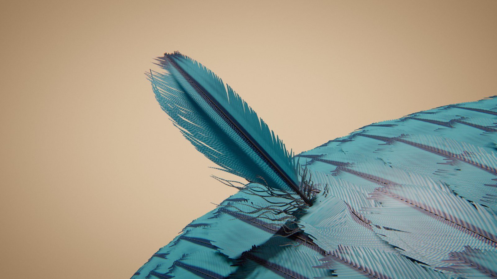

# Feather

*la plume en tuyau.* Une plume pousse dans le plumage d'un oiseau, roulée dans sa gaine ; la gaine s'effrite, la plume se déroule comme un livre qu'on ouvre, ses barbes s'agrafent l'une à l'autre et son motif apparaît ; elle se couche à sa place, s'use, et la suivante la chasse.

Au début, un gros plan sur un plumage : des plumes imbriquées comme des tuiles, et au centre une plume usée, aux pointes effrangées. Une pointe bleutée pousse sous elle, la soulève et la chasse du follicule ; elle glisse sur la pente du dos et tombe. La nouvelle plume monte, roulée dans un tube de kératine cireux. Puis la gaine sèche et s'effrite de la pointe vers la base : les barbes libérées s'écartent en pinceau, les deux moitiés du cylindre s'ouvrent et deviennent les deux vexilles, sans s'étirer ; les barbes, d'abord séparées par des jours, s'agrafent de proche en proche et le motif — barres, chevrons, taches, ocelle — se lit en entier. La plume se couche dans sa rangée, pâlit, s'effrange : c'est la plume usée du début.



Rendu physique en three.js (WebGPU, TSL). La scène est entièrement procédurale : une graine produit une scène. La démarche est dans [docs/concept.md](docs/concept.md) : le thème exploré sous six angles, les clichés écartés, neuf pistes notées, les épreuves (crédibilité, variété, ambition, déclinaison, échelle) et les révisions après les premiers rendus.

## Utilisation

| Touche | Action |
| --- | --- |
| N | nouvelle scène (nouvelle graine) |
| Espace | pause / lecture |
| ← / → | avancer ou reculer dans la boucle |
| H | masquer l'interface |
| F | plein écran |

Sur écran tactile : une touche met en pause, deux touches tirent une nouvelle scène, un appui long masque l'interface.

Paramètres d'URL : `?seed=…`, `#r=…` (scène retouchée, « Copier le lien »), `?ui=0`, `?mobile=1` / `?mobile=0`, `?debug` (outils dans `window.feather` : `shot(phase)`, `send(nom)`, `sheet(graines, phases)` — une graine peut s'écrire `graine:humeur:famille` —, `meter()`, `meters()`, `bench()`, `seam()`, `run()`).

Le panneau règle la famille, l'oiseau et l'humeur (nouvelle scène de la même graine), la durée ; la caméra ; la forme de la plume (longueur, largeur, asymétrie, angle et courbure des barbes, pointe, base duveteuse, densité, courbure du rachis) et le programme du motif ; les couleurs, l'irisation, le lustre et la translucidité ; les trois lampes, le studio, le fond et la brume ; le rendu. Export MP4 image par image (éventuellement accumulé) et PNG.

## Principe : une plume pousse roulée, puis se déroule

**La croissance dans le collier** (`src/gen/feather.js`, d'après Prum et Williamson 2001, *Theory of the growth and evolution of feather shape*). Une plume se forme dans le collier du follicule, un anneau de cellules : les crêtes des barbes naissent du côté postérieur et montent en hélice jusqu'au côté antérieur, où elles se soudent au rachis. La plume sort donc du follicule **roulée en tube**, dans une gaine ; la circonférence du tube est la largeur totale du vexille. Déroulé, le tube devient un plan ; les hélices deviennent les barbes droites, à leur angle au rachis.

**Le déroulement est une isométrie.** Une tranche du tube est un arc de longueur σ et de courbure κ = (1 − λ)/ρ, λ passant de 0 (roulé) à 1 (plan) :

  x = côté · sin(κσ)/κ,   z = −(1 − cos κσ)/κ + ρ(1 − λ)

La courbure change, la longueur d'arc non : chaque barbe se déroule sur un cylindre de courbure unique (son λ, lu à mi-hauteur) et garde sa longueur (vérifié à 0,2 % près par un test, la différence venant de l'échantillonnage). Le second terme centre le tube roulé sur l'axe du follicule : le rachis est sur sa génératrice dorsale et revient sur l'axe en s'ouvrant.

**Le motif est déposé pendant la croissance** (`src/gen/pattern.js`, d'après Prum et Williamson 2002, *Reaction-diffusion models of within-feather pigmentation patterning*). Une réaction-diffusion activateur-inhibiteur (Gierer-Meinhardt avec saturation) sur l'anneau du collier, périodique ; chaque instant dépose une rangée du plan déroulé, de la pointe vers la base — le temps devient la longueur. Une oscillation homogène dépose des **barres** ; un collier oblique (le rachis sort plus tard que le bord) les plie en **chevrons** ; une instabilité de Turing sur l'anneau, à production pulsée, des **rangées de taches** ; un Turing fin qui dérive, des **stries** ; une source au rachis, une **flammèche**. L'ocelle du paon, qui ne se lit qu'en deux dimensions, est un champ d'anneaux concentriques en forme fermée autour d'un centre sur le rachis.

**Le calendrier** — une seule horloge pour la plume, la caméra et la lumière (`SCHED`) :

| Temps (part de boucle) | Ce qu'on voit | Cause visible | Loi | Temps du film |
| --- | --- | --- | --- | --- |
| 0 – 0,075 | le tuyau sort sous l'ancienne plume, qui se soulève en couvercle sur sa pointe | la croissance (contact exact : la base de l'ancienne repose sur la pointe du tuyau) | la mue : la nouvelle plume chasse l'ancienne | accéléré |
| 0,075 – 0,15 | libérée, elle glisse sur le dos, au-dessus des rangées, et passe derrière la courbe du corps (retirée seulement là) | la gravité, la pente | glissement a = g(sin θ − μ cos θ), μ = 0,45, le long du méridien | ralenti ×8 (caméra rapide) |
| 0,15 – 0,40 | le tuyau finit de monter, roulé dans sa gaine | la croissance au collier | ~5 mm par jour | accéléré (semaines) |
| 0,34 – 0,60 | la gaine s'effrite, la plume se déroule de la pointe vers la base | la gaine sèche ; les barbes reprennent leur forme plane | isométrie, rebond élastique | accéléré |
| 0,37 – 0,70 | les barbes s'agrafent, du rachis vers le bord | crochets des barbules | front qui ne recule jamais | accéléré |
| 0,72 – 0,85 | la plume se couche dans sa rangée | rotation autour du follicule | — | accéléré |
| 0,86 – 1 | elle pâlit et s'effrange | le soleil, le frottement | abrasion des pointes, barbes décrochées | accéléré (mois) |

**La boucle.** Deux instances de la plume : la nouvelle, de pose P(u), et l'ancienne, dont la pose est celle de la nouvelle à u = 1, poussée puis chassée. À u = 0, la nouvelle est entièrement dans le follicule ; à u = 1, elle est couchée et usée, exactement comme l'ancienne à u = 0. L'image à u = 1 est l'image à u = 0, par construction.

## Les familles : quatre façons de sortir de sa gaine

| Famille | Mouvement | Oiseaux |
| --- | --- | --- |
| Vexille | le tube s'ouvre en livre, puis les barbes s'agrafent en surface continue | pigeon, effraie, geai, faisan, perdrix, corbeau, martin-pêcheur |
| Ocelle | un long tuyau ; les fils libres du bas s'écartent en fontaine et pendent, le disque de l'œil se déplie en haut | paon |
| Duvet | sans rachis : la gaine éclate, les barbes s'épanouissent en étoile tout autour et frisent en houppe | eider, cygne |
| Plume | barbes très longues, sans crochets : elles ne s'agrafent jamais et retombent en cascade | autruche, aigrette |

## La plume (`src/gen/feather.js`, `src/scene/feather.js`)

- **La gaine** s'effrite derrière le front de déroulement : elle est retirée de la géométrie elle-même (et donc de la carte d'ombre) au-delà de son bord tramé — un masque de fragment ne suffit pas, la passe d'ombre de three.js le réutilise sans les variables qu'il lit (la gaine y restait entière, puis disparaissait d'un bloc).
- **Construction** : calamus translucide (qui reste aux trois quarts dans le follicule), rachis effilé, deux vexilles asymétriques dont la base est duveteuse (barbes libres et frisées), barbes à arête (le ramus) bordées d'une frange de barbules, gaine de kératine cireuse aux crêtes hélicoïdales et à la pulpe sombre, pointe usée, motif déposé pendant la croissance, irisation.
- **Chaque barbe est un ruban à arête** : un gabarit de 22 segments sur 3 sommets, instancié par barbe (quatre vec4 par instance dans un tampon entrelacé), posé dans le vertex shader par la même formule qu'en JS (`barbPose`) ; la normale s'incline en travers (l'arête du ramus accroche un filet de lumière). La frange des barbules est un peigne tramé (lissé par l'anticrénelage temporel).
- **Libres puis agrafées** : une barbe libérée s'écarte de quelques degrés et ondule (des jours s'ouvrent entre les barbes) ; le front d'agrafage la ramène dans le plan. Les barbes sans crochets s'affaissent sous leur poids ; couchées, elles reposent sur la rangée du dessous.
- **Matière** : couleur du motif lue dans le plan déroulé, lustre de velours des barbules, translucidité (à contre-jour, le vexille s'allume et son motif se lit en ombre chinoise).
- **Couleur structurale** (paon, faisan, corbeau, pigeon, martin-pêcheur) : les barbules portent un empilement régulier de bâtonnets de mélanine qui réfléchit une longueur d'onde selon la loi de Bragg, λ = λ₀ √(1 − sin²θ / n²) avec n ≈ 2 ; la couleur est dans le reflet (couleur spéculaire et lustre), sur un fond pigmentaire sombre, et glisse vers le bleu quand on regarde en biais. λ₀ par oiseau (450 nm pour le corbeau, 535 pour le paon, 560 pour le faisan), par anneau dans l'œil du paon (452 au centre, 478, 505, 595 pour l'anneau bronze), et seulement sur les marques noires du faisan.

## Le plumage

Le corps est une sphère (le dos de l'oiseau) couverte de plumes voisines en rangées décalées, chacune une copie de la plume héroïne en gabarit grossier, couchée, soulevée de 0,1 rad au-dessus de la pente et roulée de 0,07 rad : les rangées se recouvrent comme des tuiles (on ne voit que le bout de chaque plume), les plumes d'une rangée comme des écailles. Le rayon du corps est de 2,8 à 3 longueurs de plume, les rangées sont espacées de 0,3 L (0,26 L pour le paon), deux cents plumes environ.

**Le contact.** Les plumes des rangées du dessus couvrent le follicule : le tuyau qui sort passe dessous, puis à travers. À chaque image, on exprime l'axe du tuyau dans le repère de chaque voisine (sa courbure comprise). Tant que la pointe est dessous, la voisine se **drape** sur elle : une tente juste assez haute pour passer au-dessus de la pointe et de son rayon. Quand la pointe perce la surface, la voisine se **fend** le long de ses barbes, comme une chevelure, progressivement (sur les 5 premiers millimètres de percée) et sur toute la longueur où le tuyau la longe ; elle retombe à moitié sur lui. Quand la plume se couche, la fente se referme et la voisine se drape sur elle ; une fois la plume couchée à sa place, plus aucun contact (comme au début de la boucle). Tout est continu dans le temps : poids qui s'éteignent avec la sortie de la voisine, l'arrivée à la peau, la rasance ; longueur sortie calculée à partir de la peau (et non en comptant des points échantillonnés) ; côté de la fente adouci sur 0,6 mm. Les voisines ne pivotent pas en bloc : seules leurs barbes bougent autour du contact (`contactPush`, la même formule en JS et dans le vertex shader). Près de la peau, la fente s'ouvre pleinement pendant la pousse (c'est là que la plume du dessus couvre le follicule) ; une barbe qui croise le tuyau pile en son milieu passe par-dessus. Deux tests : aucune barbe voisine ne reste dans le tuyau une fois la fente ouverte (hors la ligne de 0,15 mm au milieu de la fente), et, image par image à 60 i/s, aucune barbe voisine ne se déplace de plus de 1,5 mm (1,25 mm au plus mesuré) ; le contact est nul au raccord.

**Le sous-duvet.** Entre les plumes, la peau n'est jamais nue : des rosettes de duvet frisé, semées sans trame et couchées à plat (moins d'un millimètre d'épaisseur, pour rester sous les plumes), posées par la même formule que le duvet et cuites une fois dans un worker en un maillage statique. Le duvet, lui, pousse parmi les plumes de couverture de l'oiseau (des vexilles barrés pour l'eider, unis pour le cygne) et reste dressé en houppe : il tranche sur un plumage couché.

## Les décors

Le fond est neutre — un dégradé, une lueur à l'opposé de la caméra — ; chaque humeur se distingue par sa lumière, sa valeur et son cadrage. Les humeurs dont le fond a la valeur du plumage sont écartées pour chaque oiseau (la plume tranche sur son fond).

| Humeur | Fond | Lumière | Valeur | Cadrage |
| --- | --- | --- | --- | --- |
| Cabinet | crème | grande source douce au-dessus | très claire | plongée de trois quarts |
| Contre-jour | brun très sombre | soleil bas derrière la plume | sombre, liserés | ras |
| Fenêtre nord | gris bleuté | fenêtre latérale froide, douce | moyenne, froide | latéral |
| Plein soleil | ciel pâle | soleil haut et dur | claire, contrastée | plongée |
| Brume | gris perle | diffuse, sans direction | claire, faible contraste | moyen |
| Lanterne | noir chaud | petite source chaude, basse, de côté ; contre-jour froid | très sombre | rapproché, bas |
| Studio noir | noir | bande au-dessus, liseré | sombre, irisée | rapproché |

**La caméra** : un plan rapproché sur la face dorsale de la plume, qui suit sa partie sortie ; elle s'approche pendant le déroulement et glisse lentement dans un seul sens, puis recule quand la plume se couche ; trajectoire lissée (noyau gaussien périodique, σ = 0,7 s), pointe sous 25°/s.

## Écran de chargement

Le calcul lui-même : le motif de la plume de cette graine se dépose dans le collier, rangée après rangée, sur le vexille déroulé dont le contour et les barbes se dessinent ; une bande lumineuse — le collier — descend avec lui.

## Tests

```bash
node --test feather/test/*.test.mjs
```

Dix-huit tests : le déroulement est une isométrie ; le calendrier est monotone (croissance, front de déroulement, agrafage, courbure, pose, usure) ; la boucle se referme ; la base de l'ancienne plume repose exactement sur la pointe du tuyau qui la pousse et se soulève de plus de 5° ; les rangées du plumage se recouvrent sans se traverser ; le tuyau ne traverse aucune plume voisine (elles se fendent autour de lui, quatre graines × trois familles, pas de 0,02) ; les voisines bougent sans à-coup, image par image, et sont au repos au raccord ; l'ancienne plume ne saute pas quand elle se libère ; la plume ne passe jamais sous le plumage (points témoins à pas fixe, à tous les instants) ; la caméra est périodique, lente, sans à-coup ; le motif du collier est déterministe, non trivial et respecte sa couverture ; les quatre familles ont des gestes distincts ; recette déterministe et JSON ; familles, oiseaux et humeurs tirés ; humeurs différentes par la lumière et la valeur ; lampes presque blanches ; la plume tranche sur son fond.

## Performances

Génération d'une scène : 10 à 90 ms pour le motif du collier (réaction-diffusion 128 × 192), moins de 5 ms pour les tables de barbes, 50 à 100 ms pour le sous-duvet (dans des workers), 10 à 30 ms pour la trajectoire de caméra. Temps d'image mesuré dans le panneau de navigateur de l'application (GPU d'un Mac, panneau masqué), qualité Haute, 2 400 × 1 350 (3,2 Mpx), boucle arrêtée, 20 rendus :

| Graine | Famille, humeur | u = 0,55 | u = 0,3 |
| --- | --- | --- | --- |
| b7 (forcée) | vexille, contre-jour | 14,5 ms | 13,0 ms |
| d4 (forcée) | ocelle, studio noir | 11,4 ms | 11,3 ms |
| f6 (forcée) | plume, fenêtre nord | 11,4 ms | 11,1 ms |
| e5 (forcée) | duvet, lanterne | 17,0 ms | 17,5 ms |

Soit, ramené à 2 Mpx (le coût suit le nombre de pixels), 7 à 11 ms. Mobile (`?mobile=1`), 827 × 1 023 : 1,9 ms. Les postes les plus lourds sont les barbes des plumes voisines (près de 15 000 rubans, gabarit de 11 segments, pose calculée deux fois pour les vecteurs vitesse : elles bougent quand le tuyau les écarte), le sous-duvet (100 000 à 200 000 sommets, statiques) et les cartes d'ombre. Aucune compilation après le chargement : le nombre de pipelines ne change pas sur une boucle entière ; raccord de la boucle (`seam()`) sous 10⁻⁷.

## Version mobile

Imposée par `?mobile=1`, ou choisie d'office sur téléphone : 30 % de barbes en moins sur la plume héroïne, rubans de 12 segments (7 pour les voisines), plumage réduit aux rangées proches, motif en 96 × 144, une lumière de moins, chaîne d'image allégée (ni occlusion, ni anticrénelage temporel, ni flou de mouvement), résolution dynamique. Vérifiée dans le navigateur de l'application (console propre, 1,9 ms) ; pas sur un appareil réel.
