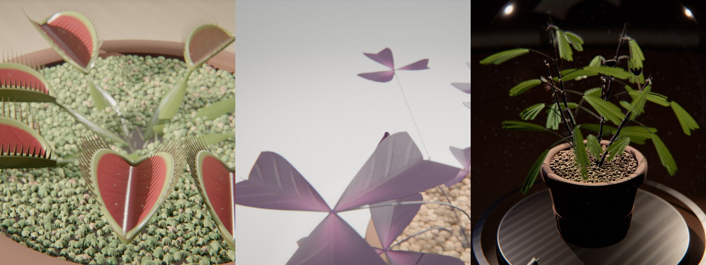

# Fold

*la feuille qui se replie.* Des plantes qui plient leurs feuilles quand on les touche.

Une plante dans son pot, sous une cloche, dans une caisse de Ward, sur une paillasse ou dans une coupe à bonsaï. Quatre familles plient chacune à leur manière. La **sensitive** (*Mimosa pudica*) ferme ses folioles par paires, en peigne, et laisse tomber ses pétioles. Le **Biophytum**, petit palmier sensitif, rabat ses folioles vers le bas. Le **trèfle** (*Oxalis*, vert ou pourpre) plie chacune de ses trois folioles en deux le long de sa nervure et les laisse retomber, comme un parapluie qui se ferme. La **dionée** claque ses deux lobes ciliés l'un contre l'autre en un cinquième de seconde.

Le film suit un scénario simple. Une goutte grossit au toit de verre (condensation) ou au bec d'une burette, tombe et frappe une feuille. La feuille touchée se ferme en entier, et elle seule, par une vague partie du point d'impact, puis se rouvre en accéléré. Une deuxième, une troisième goutte frappent d'autres feuilles. Pour finir, temps fort du film, un marteau de laboratoire frappe le pot et toute la plante se ferme, de bas en haut. Tout se rouvre et la boucle recommence, sans raccord visible. La dionée, qui ne réagit qu'aux contacts, reçoit trois gouttes sur trois pièges.



Rendu physique en three.js (WebGPU, TSL). La scène est entièrement procédurale : une graine (un code court) produit toujours la même scène. La démarche qui a conduit à ce concept est dans [docs/concept.md](docs/concept.md) : le thème « fold » exploré sous six angles, les clichés écartés (la grue en origami, la feuille froissée, le drapé, l'éventail), dix pistes notées, puis les trois épreuves (crédibilité, variété, ambition).

## Utilisation

| Touche | Action |
| --- | --- |
| N | nouvelle scène (nouvelle graine) |
| Espace | pause / lecture |
| ← / → | avancer ou reculer dans la boucle |
| H | masquer l'interface |
| F | plein écran |

Sur écran tactile : une touche met en pause, deux touches tirent une nouvelle scène, un appui long masque l'interface.

Paramètres d'URL : `?seed=…` (une scène), `#r=…` (une scène retouchée, produite par « Copier le lien »), `?ui=0` (sans panneau), `?mobile=1` / `?mobile=0` (version mobile imposée / interdite), `?debug` (outils dans `window.fold` : `shot(phase)`, `send(nom)`, `film(préfixe, instants, k)`, `eventPhase(k)`, `meter()`, `bench()`, `seam()`, `run()`).

Le panneau règle :
- **Scène** : décor, durée de la boucle, temps physique entre deux touchers, liste des touchers (goutte, marteau) ;
- **Caméra** : champ, distances du gros plan et du plan large, hauteur du regard, azimut, tours par boucle, balancement, caméra libre ;
- **Plante** : famille et port, graine de la plante, monture, teinte, saturation et clarté des feuilles, translucidité, couleur des fleurs ;
- **Matières** : table, pot, socle ou caisse, statif, marteau, bobine (finition, motif, couleurs, curseurs du modèle physique) ;
- **Lumière et fond** : lampe, contre-jours, lumière du lieu, studio HDR, lumière du fond, brume ;
- **Rendu**.

L'export produit une boucle MP4 (H.264) rendue image par image, éventuellement en rendu accumulé (8 à 64 passes), et une image PNG.

## Principe : un toucher, un pli, un retour

Chaque moment du film a une cause qu'on voit à l'écran et suit une loi physique. Seul le temps prend des libertés, comme au cinéma : temps réel pour la chute et la vague, caméra rapide (ralenti) au choc, accéléré pour ce qui dure des minutes. Le pulvinus, dont il est souvent question, est le petit renflement à la base d'une feuille ou d'une foliole : en se vidant de son eau (perte de turgescence), il la fait plier.

| Temps | Cause visible | Loi | Temps du film |
| --- | --- | --- | --- |
| la goutte grossit | condensation sur le toit de verre, ou burette | croissance à débit constant (rayon ∝ ∛t), détachement | accéléré (toit) ou réel (burette) |
| la goutte tombe | la gravité | chute libre, g vraie (98,1 u/s², 1 u = 10 cm) | réel |
| le choc | la goutte touche la foliole | contact calculé sur la vraie surface ; la foliole et la pinnule plient (oscillateurs amortis) ; éclaboussures balistiques | caméra rapide ×8, à partir du contact |
| le coup | le bras du marteau, tiré par l'électroaimant | accélération angulaire constante, contact de la tête avec le profil du pot, rebond, rappel | réel |
| la vague, le pli | le signal parti du point touché | propagation à vitesse finie sur le graphe vasculaire, atténuation, seuils | ralenti propre au pli : ×10 pour le claquement de la dionée, ×3 la sensitive, ×2,5 le Biophytum, ×2 le trèfle, ×1,8 la plante entière |
| la chute du pétiole | perte de turgescence du pulvinus primaire | la gravité : oscillateur sous-amorti (dépasse, rebondit, se pose) | réel |
| les perles s'évaporent, la terre sèche | évaporation | rayon en √(1 − t/T) | accéléré |
| la feuille se rouvre | le pulvinus se regonfle | sigmoïde lente (≈ 6 min) | accéléré (×110 à ×210) |

**La boucle.** Le film déroule un temps physique qui avance plus ou moins vite que l'horloge selon le moment. Ce temps τ(t) = ∫ dt / s(τ) dépend d'une lenteur s : 1 en temps réel, 8 juste après chaque contact, 1/V dans l'accéléré. Les trois régimes se raccordent en log par des fondus de 4 s physiques, et V est ajusté par dichotomie pour que le film dure exactement T. L'état de chaque pulvinus est f(τ) = max_k F(mod(τ − a_k, P)), où a_k est l'arrivée du signal du toucher k et P la durée physique de la boucle. F revient exactement à 0 avant P. Tout (gouttes, perles, marteau, terre humide, caméra) est fonction de τ mod P, et τ(t + T) = τ(t) + P : l'image à u = 1 est celle à u = 0, sans fondu.

## Les plantes (`src/gen/plant.js`)

**Les plis par famille.** La sensitive et le Biophytum plient des folioles entières autour de leur pulvinule (vers le haut, vers le bas). Le trèfle et la dionée plient des **demi-limbes** autour de la nervure (rotation d'axe fixe, vers le bas pour le trèfle, vers le haut pour le piège), et le trèfle laisse en plus retomber chaque foliole. Chaque famille a son tempo (`KINETICS_BY`) : la dionée claque en 0,2 s et reste fermée longtemps, le trèfle se plie en 1,6 s puis retombe en 2,6 s. Les rosettes (trèfle, dionée) partent du collet, sans tige ; les jeunes feuilles, au centre, sont plus dressées.

Ports de la sensitive : buissonnante, plantule, retombante (les tiges débordent de la lèvre du pot), en fleurs, en gousses, à deux pinnules, et *Biophytum* (un petit palmier dont les folioles se rabattent vers le bas). Les tiges sont intégrées pas à pas (tropisme, zigzag aux nœuds, rameaux), rouge brun à aiguillons recourbés. Feuilles alternes (phyllotaxie 2/5) avec stipules ; pétiole renflé à la base (pulvinus primaire) ; deux paires de pinnules digitées (pulvinus secondaires) ; 12 à 25 paires de folioles par pinnule, plus petites aux deux bouts, asymétriques, à nervure médiane excentrée ; pompons de 60 à 90 étamines roses à anthères jaunes ; gousses articulées à bords hérissés.

**Le pli.** Chaque foliole tourne autour de sa pulvinule : une rotation d'axe fixe (une charnière) de la pose ouverte à la pose fermée. Ouvertes, les folioles d'un même côté sont côte à côte dans le plan de la pinnule (largeur = 0,82 × pas × sin α). Fermées, elles se relèvent face à leur partenaire et s'écartent de l'axe d'un angle γ = 15° : deux folioles voisines sont alors dans des plans parallèles distants de pas × sin γ, comme les tuiles d'un toit. Toutes les folioles d'un côté ont le même repère, si bien qu'elles restent parallèles pendant tout le mouvement et ne se traversent jamais (vérifié par un test sur la nappe exacte, à 11 instants du pli).

**L'écartement.** Une feuille qui en touche une autre, ouverte ou fermée, tourne autour de sa tige (±15°, ±30°…), puis se raccourcit. Au pire, elle est retirée. L'affaissement permis de chaque pétiole (rebond compris, 22 %) est cherché par dichotomie sur la vraie géométrie, pour que la feuille fermée ne touche ni une autre feuille, ni une tige, une fleur, une gousse, ni la terre, le pot, la table, la vitre.

## Le signal (`src/physio.js`)

Le graphe vasculaire relie le collet, les points des tiges, les pulvinus primaires et secondaires et chaque paire de folioles, par des arêtes de longueur réelle. Dijkstra donne l'arrivée du signal en chaque nœud, à une vitesse propre à l'organe (tige 5,5 cm/s, pétiole 3, rachis 2), plus grande quand le signal est fort (v · (1 + 1,6 · max(0, A − ½))) : la vague ralentit en s'éteignant. L'amplitude décroît en exp(−ℓ/λ). Les pulvinules répondent au-dessus de 0,2, les pulvinus secondaires de 0,36, le primaire de 0,56. Une goutte ferme ainsi une pinnule, une feuille, parfois plusieurs, et le marteau toute la plante, de bas en haut. Un pétiole ne tombe qu'une fois ses folioles fermées, et se relève avant qu'elles ne se rouvrent.

## Les causes (`src/plan.js`, `src/effects.js`)

- **La goutte** (rayon 1,4 à 2 mm) tombe verticalement. Son centre, au contact, est à la hauteur où sa sphère touche pour la première fois un point de la surface de la plante (folioles, rachis, pétioles, tiges, fleurs), et la foliole qui porte ce point est celle qui est frappée. Au-dessus d'elle, la colonne est libre jusqu'à la source. Sous une cloche ou dans une caisse, elle se forme par condensation au toit. Sinon, elle naît au bec d'une burette tenue par un statif posé sur la table, sur le côté du regard. La burette goutte toujours au même endroit.
- **L'éclaboussure** : 5 à 9 perles balistiques dont la trajectoire ne frôle aucune partie de la plante ni les barreaux. Elles se posent sur la terre (tache humide qui sèche), la lèvre du pot, la soucoupe ou la table (perle qui s'évapore). La foliole frappée reste mouillée quelques minutes.
- **Le marteau** : un bras pivotant tiré par un électroaimant. L'angle du contact est celui où la surface de la tête touche le profil du pot (ou du socle de la cloche, ou du soubassement de la caisse), par dichotomie. Le pot tremble (rotation amortie autour de son pied).

## Matériaux

- **Le vrai pli** (trèfle, dionée) : le limbe est d'un seul tenant, et le vertex shader le plie autour de la nervure, une pliure en arc de cercle (demi-largeur 0,12) puis deux pans plans tournés de θ (`foldPoint`, même formule en JS pour les tests). La dionée claque par flambage : la courbure de ses lobes s'inverse en se fermant (`trapFlip`), et leurs bords se rejoignent sans se croiser.
- **Le sol** : un paillage posé grain par grain par empilement au contact (akadama, granules d'argile cuite piquées ; gravier de rivière, galets mouchetés et lustrés ; sphaigne vivante, en têtes étoilées, pour la dionée). Il porte et reçoit les ombres, et l'eau des éclaboussures l'assombrit.
- **Le pot de terre** : une pièce de potier, avec godrons (22 côtes en relief) sur le bas du corps, un filet en relief sous le bandeau, irrégularité du tournage, cartouche estampé. La matière est vieillie : coups de feu de la cuisson, efflorescences de sel près de la lèvre et du pied, voile d'algues au pied. Le marteau le frappe sur ce relief réel, à son azimut (`outerAt`).
- **Les pots** : profils tournés à coins adoucis (pied chanfreiné, bague moulurée, gradin, bandeau bombé, lèvre roulée ; cache-pot à pied annulaire et moulure d'épaule ; coupe à lèvre retournée).
- **Limbes** : chaque foliole, demi-foliole ou lobe est une lame épaisse à tranche arrondie (dessus, dessous, biseau en demi-rond aux normales calculées : la tranche accroche un filet de lumière), courbée (pointe qui s'incurve, bord du trèfle qui ondule, lobe de la dionée en cuvette). Matière : translucidité (SSS : ~10 % de lumière transmise, moins à travers les nervures, rien par la tranche), nervure médiane, nervures secondaires et réseau fin en relief (normale perturbée, en creux dessus, en saillie dessous), cuticule lustrée dessus, duvet dessous (sheen), dégradé de la base à la pointe. Le trèfle pourpre a une tache centrale et un lustre velouté. La dionée a l'intérieur rouge, plus sombre au centre, ponctué de glandes humides, lèvre jaune-vert, cils coniques décalés entre les deux lobes (ils s'entrecroisent). Mouillure de la feuille frappée.
- **Gouttes** : traitées en lentilles. Le fond est lu dans l'image à l'opposé de la normale (il apparaît renversé et grossi), un liseré sombre au bord (réflexion totale), les reflets nets des lampes et du studio par-dessus.
- **Verre** (cloche, caisse, burette) : une lame mince et claire, seulement ses reflets et une légère absorption, sans copie de l'image, avec des gouttelettes de condensation ; graduations de la burette.
- **Montures** : terre cuite (chamotte, cercles de tournage, efflorescences de sel), porcelaine craquelée, céladon, noyer, chêne, hinoki, bois grisé, fonte, laiton, cuivre de la bobine. Terre du pot : terreau, gravillons, mousse, taches humides.

## Les décors

| Décor | Fond, table, accessoires | Lumière | Valeur | Cadrage |
| --- | --- | --- | --- | --- |
| Serre | vitrages à petits bois, muret de briques chaulées, verdure floue ; bois grisé | soleil haut à contre-jour, ciel | claire | gros plan bas |
| Cabinet | boiseries de noyer moulurées ; bureau de noyer, caisse ou cloche | lampe de bureau basse, de côté | très sombre | légèrement plongeant |
| Planche | cyclorama blanc continu | grande source douce d'en haut | high key | plante entière |
| Laboratoire | carreaux de faïence vert d'eau ; paillasse noire, statif et burette | tube froid d'en haut | moyenne, froide | de profil sur la burette |
| Shōji | papier rétroéclairé sur kumiko ; planche de hinoki | grande source douce de côté | moyenne, douce | rapproché, horizontal |
| Nuit | mur bleu nuit, fenêtre de lune ; bois noirci | lune dure et froide, veilleuse | sombre | contre-plongée |
| Velours | velours noir | projecteur étroit, deux contre-jours | low key extrême | macro |

La lampe est presque blanche (4 800 à 7 600 K) ; sa carte d'ombre est resserrée sur la plante quelle que soit l'ouverture du faisceau (les folioles font 1,6 mm). Une « lumière du lieu » (hémisphère, sans ombre) éclaire le sol loin de la lampe dans les décors clairs. Le sol et le fond ne reçoivent que la lampe et le lieu : les contre-jours n'effacent pas les ombres.

**La caméra** fait un tour par boucle, toujours dans le même sens, lentement pendant les touchers et un peu plus vite entre eux. Le plan cherche le départ de ce tour pour lequel chaque toucher est vu sans obstacle, et place le marteau de profil à la caméra. Pour chaque toucher : un gros plan sur la cause (la goutte qui tombe, la tête du marteau), puis un recul doux (au plus 2,5 fois plus loin) sur ce qui se ferme, la feuille entière ou la plante entière. Trajectoire lissée (σ = 0,8 s), 7 à 11°/s en moyenne, pointes sous 25°/s (un test le vérifie), jamais dans la cloche ni la caisse (dans la caisse de Ward, on regarde par une vitre de côté, les montants hors du champ), jamais sous la table.

## Tests

```bash
node --test 'fold/test/*.test.mjs'
```

Vingt-sept tests : recette (déterminisme, JSON, décors, plantes, montures et matières tirés, matières citées qui existent, décors qui diffèrent par le fond, la lumière, la valeur et la table, lampes ≥ 4 700 K, touchers) ; plante (croissance déterministe ; deux folioles voisines ne se traversent à aucun instant du pli, sur la nappe exacte ; les deux moitiés du limbe du trèfle et de la dionée ne se traversent jamais ; aucune feuille n'en touche une autre ni un pétiole pendant le pli ; le pétiole tombe sans toucher la terre, le pot, ni une autre feuille, sur tous les points témoins) ; signal (arrivée croissante, amplitude décroissante) ; pulvinus (fermeture, tenue, réouverture, retour exact à 0) ; temps (temps réel juste avant le contact, ×1/8 juste après, accéléré pendant la réouverture) ; boucle (la pose de toute la plante à τ + P est celle à τ) ; caméra (périodique, < 30°/s, au-dessus de la table) ; boucle lisible (une goutte ferme toute la feuille touchée et elle seule, le marteau toute la plante, tout est rouvert avant le toucher suivant) ; caméra (pointe < 25°/s, et sur trois graines, ni à-coup ni intrusion) ; cause et effet (la goutte touche la surface fine de la plante au contact, à 0,6 mm près, et jamais avant ; la tête du marteau touche le profil au coup, à 1e-6 près, jamais avant, jamais au travers ensuite ; les perles volent sans rien traverser ; aucune goutte n'apparaît ni ne disparaît d'un coup ; les appareils sont posés à côté du pot, jamais dedans ni l'un sur l'autre).

## Performances

Mesuré dans le panneau de navigateur de l'application (GPU d'un Mac), qualité Haute, 1,8 Mpx : 7 à 10 ms par image (plante ouverte 9,8 ms, au contact d'une goutte 9,7 ms, pendant le coup 7,1 ms ; graine s0), pose des ~5 000 folioles sur le CPU et envoi au GPU compris. Une géométrie par organe, instanciée par attributs (un tampon entrelacé : matrice courante, matrice précédente pour les vitesses, quatre nombres) : un shader par organe. Génération de la plante, de son plan et de toute la géométrie dans un worker : 0,1 à 3 s selon la plante. Aucune compilation de shader après le chargement (vérifié sur une boucle entière).

## Version mobile

Choisie d'office sur téléphone ou tablette, imposée par `?mobile=1`, ou par la qualité « Mobile » du panneau. Gouttes sans copie de l'image (lentilles sombres et brillantes), une lumière de moins, cartes d'ombre en 1024 (les ombres des folioles s'adoucissent), chaîne d'image allégée (FXAA, sans SSR, sans occlusion ni flou de mouvement), résolution dynamique, 60 i/s au plus. Mesuré : 3,2 ms à 1,3 Mpx.
