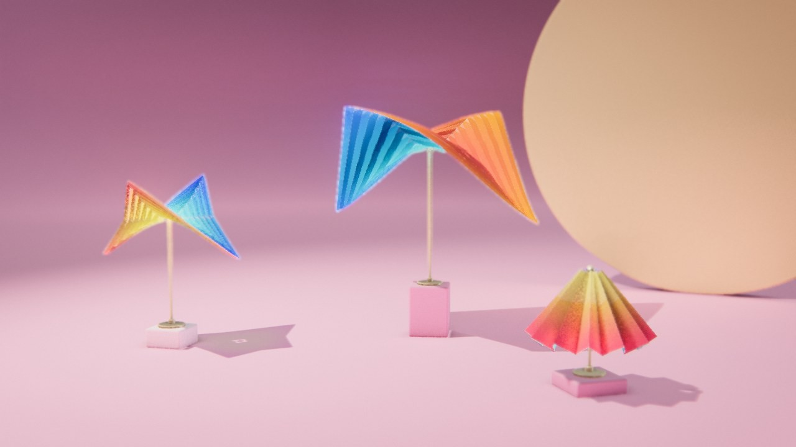

# Fold

*le papier qui se plie seul.* Des feuilles de papier bicolore se plient, basculent et se retournent en boucle.

Deux ou trois feuilles, chacune sur sa tige de laiton, devant un cyclorama de couleur vive, sous un projecteur de studio. Chaque feuille porte un patron de plis et une couleur par face. Ses plis se referment et la tordent en volume ; puis ils se rouvrent, la forme bascule dans son autre état, et les plis se referment.



Rendu physique en three.js (WebGPU, TSL). La scène est entièrement procédurale : une graine (un code court) produit toujours la même scène. La démarche est dans [docs/concept.md](docs/concept.md) ; la première version du projet (des plantes sensitives) est décrite dans [docs/concept-sensitive.md](docs/concept-sensitive.md).

## Utilisation

| Touche | Action |
| --- | --- |
| N | nouvelle scène (nouvelle graine) |
| Espace | pause / lecture |
| ← / → | avancer ou reculer dans la boucle |
| H | masquer l'interface |
| F | plein écran |

Sur écran tactile : une touche met en pause, deux touches tirent une nouvelle scène, un appui long masque l'interface.

Paramètres d'URL : `?seed=…` (une scène), `#r=…` (une scène retouchée, produite par « Copier le lien »), `?ui=0` (sans panneau), `?mobile=1` / `?mobile=0` (version mobile imposée / interdite), `?debug` (outils dans `window.fold`).

Le panneau règle l'accord de couleurs, le fond, le nombre de feuilles et le patron de chacune, la caméra, puis le rendu. L'export produit une boucle MP4 et une image PNG.

## Les patrons (`src/sim/fold.js`, `src/recipe.js`)

Un patron est un disque percé, maillé en anneaux concentriques cousus côté par côté ; le nombre de mailles d'un anneau croît avec son rayon, pour que toutes les mailles aient la même taille.

| Patron | Plis | Forme pliée |
| --- | --- | --- |
| Carré, hexagone, octogone | anneaux concentriques, montagne et vallée alternées, et diagonales | une selle : la moitié des coins monte, l'autre descend (trois et trois pour l'hexagone) |
| Spirale, rosace | carré ou octogone dont chaque anneau est un peu tourné : les diagonales s'enroulent | une selle vrillée |
| Étoile | carré aux côtés creusés | une selle à pointes |
| Ombrelle | plis rayonnants, montagne et vallée alternées | un cône plissé, qui se ferme comme un parapluie |
| Tour | quatre prismes hexagonaux empilés, une diagonale pliée et l'autre coupée par face | des étages qui claquent à plat un à un, puis se redressent (voir *La tour*) |

Une scène sur trois environ a une tour : elle est alors le sujet, au centre et en grand (1,6 à 1,8 m), et les feuilles se rangent autour. Elle est tirée à part : une graine sans tour garde exactement sa scène.

## Le pliage (`src/sim/fold.js`)

Chaque arête du maillage est une barre : elle garde sa longueur, car le papier ne s'étire pas. Chaque arête intérieure est une charnière, qui vise un angle : zéro dans un pan (le papier résiste à la flexion), ±θ sur une pliure. Les charnières sont des forces ; les barres sont des contraintes de longueur, projetées à chaque pas (Gauss-Seidel, quatre passes). Le pas de temps ne dépend donc que de la raideur des plis, et la forme converge en quelques milliers de pas (d'après le simulateur d'origami de Ghassaei et al., 2018, dont les barres sont des ressorts).

Personne ne donne sa forme à la feuille : quand les plis concentriques se referment, les anneaux raccourcissent en rayon mais pas en circonférence, et la feuille n'a pas d'autre issue que de flamber en selle.

**Le film.** Une selle a deux états : tels coins en haut, ou les autres. Le film d'une feuille est une bascule, et son geste est celui du papier, pas d'une étoffe :

1. la feuille est immobile ;
2. ses plis se rouvrent l'un après l'autre, du bord vers le centre ;
3. elle claque d'un coup dans son autre état (une force faible s'inverse net, renforcée le temps d'une pichenette, et l'amortissement tombe : la feuille vibre un instant) ;
4. ses plis se referment un à un, du centre vers le bord, et elle redevient immobile.

Les pans sont trois fois plus raides à la flexion que les pliures : la feuille plie sur ses plis et reste plane entre eux. Une ombrelle ouvre tous ses plis d'un seul geste, et sa bascule est un retournement.

**La boucle.** La fin d'une bascule est son début tourné d'un cran (et retourné haut en bas, pour une ombrelle). Le film d'une seule bascule suffit donc : la deuxième est la même, lue tournée, et après deux bascules la feuille est revenue sur elle-même. L'équilibre d'une feuille plissée dépend du chemin suivi : avant le film, la feuille est donc refermée exactement comme elle le sera à la fin d'une bascule. L'écart qui reste (de quelques millièmes à quelques centièmes du rayon) est fondu sur le dernier quart du film, et chaque image est moyennée sur les symétries de la selle. La boucle dure deux bascules, 14 secondes.

Le calcul se fait au chargement, dans des workers, une feuille par worker.

## La tour (`src/sim/fpori.js`, `src/sim/tower.js`, `src/scene/tower.js`)

D'après Liu et al., « Rigid-foldable cylindrical origami with tunable mechanical behaviors » (*Sci. Rep.* 14, 145, 2024). Un étage est un prisme hexagonal dont chaque face porte une diagonale pliée en vallée et l'autre coupée ; le centre de la face se dédouble, et la coupe s'ouvre en losange quand le dessus tourne et descend.

À α = 60° (la moitié de l'angle de l'hexagone), l'étage est **bistable**. Il tourne librement jusqu'à 60°, puis les deux triangles qui encadrent chaque arête verticale se referment l'un sur l'autre. Pour aller plus loin, le papier doit se tendre : une barrière d'énergie. À plat (120°), plus rien n'est tendu : un second état stable. Le modèle est celui de l'article : plateaux rigides, plis en barres élastiques, et les deux triangles pressés l'un contre l'autre au-delà du contact. Il retrouve ses résultats sans réglage : bistable à 60°, monostable à 54°, sans énergie à 45°.

**La dynamique.** Chaque étage suit son chemin de moindre énergie, paramétré par sa longueur (la hauteur, elle, a une dérivée infinie à plat) ; les plateaux ont une masse et une inertie de rotation, les étages des chiralités alternées. Le dessus est mené par une course qui descend, attend et remonte. Les étages tournent d'abord ensemble, se bloquent, puis claquent un à un, dans l'ordre de petites différences de raideur ; à la remontée, ils se redressent un à un, dans un autre ordre. Rien n'est écrit à la main. Deux cycles sont simulés, et seul le second est gardé : il commence là où le premier finit, la boucle raccorde.

Le film (l'état de chaque étage, image par image) est calculé par un worker, en même temps que les feuilles ; la pose en découle à chaque image, et la couleur que chaque pan renvoie sur ses voisins aussi.

## Le rendu (`src/scene/stage.js`)

- **Lecture du film.** Positions et normales de chaque image sont dans deux textures ; le vertex shader lit les deux images voisines et les interpole. Les sommets sont dédoublés le long des pliures : normales lisses dans un pan, vives sur un pli.
- **La couleur d'un pan sur l'autre.** Dans le creux d'un pli, un pan éclairé renvoie sa couleur sur le pan d'en face. Chaque sommet reçoit la lumière de huit voisins des pans adjacents (facteur de forme entre deux petits éléments de surface), recto et verso séparément.
- **Lumière indirecte.** Un rebond en espace écran (SSGI) : le sol teinte les socles, le papier teinte le sol.
- **Ombres colorées.** Le papier laisse passer un cinquième de la lumière, qui prend sa couleur : l'ombre d'une feuille n'est pas noire.
- **Le papier.** Une couleur dégradée par face, un grain fin qui accroche la lumière rasante, les pliures blanchies là où la fibre a été cassée, la tranche blanche au bord coupé, un peu de lumière transmise à contre-jour.
- **Le décor.** Un cyclorama sous la nappe d'un projecteur, un fond (disque, arche, paravent ou rien), des socles dans la valeur du sol.

Deux feuilles ne peuvent pas se toucher : chacune tient dans un cylindre de rayon égal à sa taille autour de sa tige, et la recette écarte ces cylindres.

## Tests

```bash
node --test fold/test/*.test.mjs
```

Recette déterministe et tous les choix tirés, feuilles écartées et au-dessus de leur socle, gradient de l'angle dièdre, maillage fermé et plis alternés, film qui bascule, raccord et symétrie exacts, papier qui ne s'étire pas. Pour la tour : bistable à 60° (et à 67,5° pour l'octogone), monostable à 54°, sans énergie à 45° ; pose symétrique et sans interpénétration ; tous les étages à plat au milieu de la boucle, déployés au bout, raccord exact ; une tour de temps en temps, et les autres graines inchangées.

## Limites

- Une feuille peut se traverser elle-même dans ses plis les plus serrés : le solveur ne gère pas les contacts.
- Le papier n'a pas d'épaisseur.
- Dans la tour, le papier tendu au-delà du contact s'étire de 3 à 5 % au lieu de gondoler.
- Le premier chargement prend une dizaine de secondes (le pliage de la grande feuille : une projection de Gauss-Seidel, séquentielle, que rien ne répartit entre les workers). Ensuite, la scène suivante (touche N) est préparée pendant qu'on regarde l'actuelle et s'affiche en deux secondes.
- Les plis en cercles (selle ronde, trèfle à trois bosses) sont dans le solveur mais pas dans les scènes : leur bascule ne retombe pas à coup sûr sur son point de départ.
