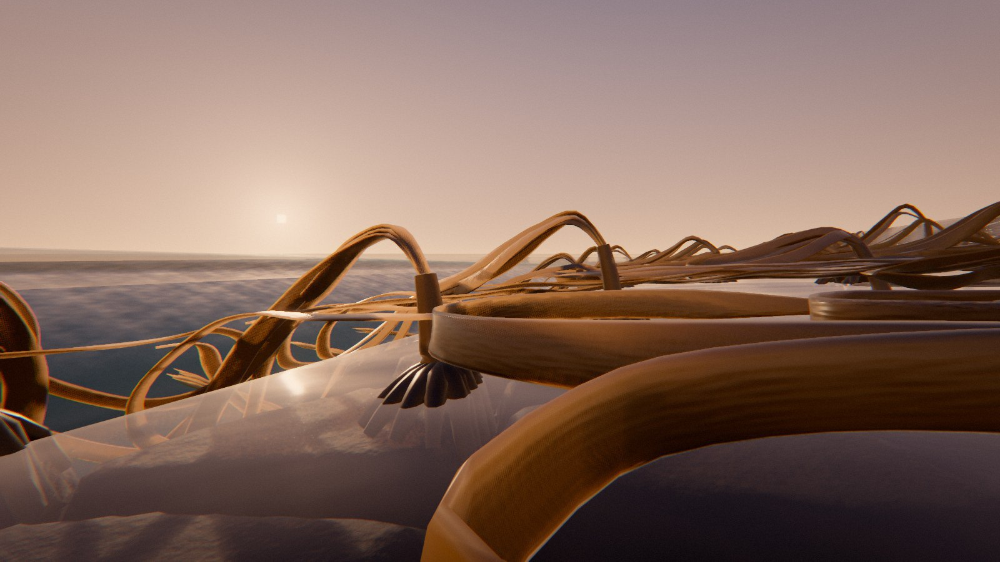

# Kelp

*le ressac.* Une caméra sous-marine à hublot en dôme est posée au ras d'un platier, une table de roche que la mer couvre et découvre. Elle filme moitié au-dessus, moitié au-dessous de l'eau. Une série de trois vagues arrive du large. La mer se retire d'abord et couche les laminaires (de grandes algues brunes en lanières) sur la roche. Chaque vague les soulève et les peigne vers la côte à l'instant où son front les atteint, puis le retrait les recouche dans l'autre sens. La troisième vague, la plus grande, recouvre la caméra : dans l'eau laiteuse de bulles, la forêt est debout.

Le platier est découvert. Les laminaires couchées vers le large luisent sur la roche, une eau mince ruisselle entre les crampons. Au loin à gauche, une vague se lève, déferle en écume et court sur le platier : chaque plante se soulève quand le front l'atteint, et toutes partent vers la droite. L'eau s'arrête, revient, et les lanières la suivent avant de retomber. Une seconde vague, plus grande, monte jusqu'au dôme. La ligne d'eau traverse l'image, et l'on voit en même temps les lames couchées à l'air et la frange debout dans l'eau. Puis la mer se retire très loin. La troisième vague nous recouvre, la forêt se dresse, se couche vers la côte, flotte, et le retrait l'entraîne. La ligne d'eau redescend, la roche pâlit en séchant.



Rendu physique en three.js (WebGPU, TSL). Tout est calculé : une graine produit une scène. La démarche (le thème exploré sous six angles, cinq clichés écartés, neuf pistes notées, les épreuves, les références) est dans [docs/concept.md](docs/concept.md). Les défis techniques, avec des démonstrations interactives, sont dans [explainer.html](explainer.html).

## Utilisation

| Touche | Action |
| --- | --- |
| N | nouvelle scène (nouvelle graine) |
| Espace | pause / lecture |
| ← / → | avancer ou reculer dans la boucle |
| H | masquer l'interface |
| F | plein écran |

Sur écran tactile : une touche met en pause, deux touches tirent une nouvelle scène, un appui long masque l'interface.

Paramètres d'URL : `?seed=…`, `?mood=…` (ploumanach, couchant, etretat, ardoise, midi, noctiluque, sugimoto), `?family=…` (digitata, durvillaea, postelsia, egregia), `#r=…` (scène retouchée, « Copier le lien »), `?ui=0`, `?mobile=1` / `?mobile=0`, `?debug` (outils dans `window.kelp` ; `&sink=port` choisit le collecteur de `tools/sink.py` : `shot(phase)`, `still(nom, phase, l, h)`, `film(préfixe, phases)`, `send(nom)`, `sheet(graines, phases)` (une graine peut s'écrire `graine:humeur:famille`), `meter()`, `meters()`, `bench()`, `seam()`, `run()`).

Le panneau règle :
- l'humeur et la laminaire (nouvelle scène de la même graine) ;
- la série de vagues : instant, hauteur au large et creux de chacune, obliquité, frottement, pente du platier (la mer et les laminaires sont alors recalculées) ;
- la densité et les couleurs de la frange ;
- la caméra : champ, cap, inclinaison, hauteur et rayon du dôme, travellings ;
- le soleil, le ciel, l'eau (extinction par canal, noctiluques) ;
- le rendu.

Export MP4 image par image (éventuellement accumulé) et PNG.

## Principe : une orbite périodique sous un forçage périodique

La boucle est parfaite par construction. Le forçage, c'est-à-dire la série de trois vagues qui entre au large, se répète avec la période T de la boucle (32 s). L'eau et les laminaires perdent de l'énergie à chaque instant (frottement sur la roche, déferlement, traînée) : un tel système, dit dissipatif, oublie son état de départ et finit par répéter le même mouvement à chaque période, une **orbite périodique**. On l'intègre jusqu'à ce que l'état à t + T égale l'état à t, et on enregistre une période.

- **La mer** se referme d'elle-même : après deux périodes, l'état à T égale l'état à 0 à 10⁻⁵ m près.
- **Les laminaires**, souples et en contact les unes avec les autres, gardent un peu de mémoire : une lanière peut finir couchée à gauche ou à droite de sa voisine. On simule donc deux boucles entières sous le même forçage, A puis B, avec B(0) = A(T). La boucle rendue passe de B à A, si bien que R(0) = B(0) = A(T) = R(T). Le passage se fait plante par plante. Chacune a son propre fondu (un dixième de boucle), centré là où ses deux versions se ressemblent le plus entre 0,55 et 0,95 de la boucle. Le fondu mélange les directions des segments, et la chaîne est reconstruite depuis le crampon : mélanger les positions de deux poses très différentes superpose des nœuds, et la chaîne bascule d'une image à l'autre par sauts d'un mètre. `tools/jumps.mjs` mesure ces sauts (seconde différence des positions d'une image à l'autre).

| Temps | Cause visible | Loi | Temps du film |
| --- | --- | --- | --- |
| la mer se retire | le creux de la vague qu'on voit se lever au large | Saint-Venant | réel |
| les laminaires se couchent | l'eau qui les quitte, le retrait qui les tire | poids hors de l'eau, frottement sur la roche mouillée | réel |
| le front court sur le platier | la vague arrivée du large | ressaut (choc de Saint-Venant), frottement de Manning | réel |
| chaque plante se soulève | le front l'atteint | poussée d'Archimède de la partie immergée, traînée de Morison | réel |
| l'eau blanchit puis s'éclaircit | le déferlement | bulles produites par le ressaut, qui se dissipent en ~1 s | réel |
| la roche fonce puis pâlit | l'eau qui l'a couverte | séchage des points hauts vers les creux | accéléré (quelques secondes au lieu de minutes) |
| la ligne d'eau traverse l'image | la mer sur le hublot | géométrie du dôme | réel |

## La mer (`src/gen/sea.js`)

Équations de Saint-Venant 1D sur le profil transversal du platier (fond du large à −1,4 m, tombant, platier qui monte en pente douce puis se relève vers la côte), en volumes finis du premier ordre, pas de 2,5 cm :

  ∂h/∂t + ∂(hu)/∂x = 0
  ∂(hu)/∂t + ∂(hu² + g h²/2)/∂x = −g h ∂b/∂x − g n² |u| u / h^{1/3}

- **Reconstruction hydrostatique** (Audusse et al., 2004) et flux HLL. La mer au repos reste au repos sur un fond quelconque, la hauteur reste positive, et le front mouillé-sec avance et recule sans oscillation. Les vagues déferlées qui courent sur le platier sont des chocs que le schéma capture.
- **Bord du large générant-absorbant** : la vague incidente entre par l'invariant de Riemann montant u + 2c, la vague réfléchie sort par le descendant.
- **La série** : chaque vague est une crête précédée d'un creux (la mer qui se retire avant la vague), η_in(t) = A·[e^{−(t−t_k)²/τ_c²} − β e^{−(t−t_k+d)²/τ_t²}], périodique de période T. Les trois vagues vont en crescendo. S'y ajoute une **houle de fond** (trois trains de périodes T/4, T/5, T/7, le premier de 2,5 à 4,5 cm, les deux autres à 70 % de cette amplitude) : entre les vagues, la mer n'est jamais un miroir.
- **Frottement de Manning** implicite (n = 0,035). Une lame de moins de 4 cm est drainée par le relief que le profil moyen ne voit pas (fissures, rigoles), ce qui découvre le platier entre les vagues.
- **L'écume** naît là où la surface est raide et où l'écoulement converge (le ressaut). Le courant la transporte, et elle se défait avec une constante de temps de 3,2 s (0,6 s sur la roche sèche) ; les bulles dans l'eau, en 1 s. L'enveloppe de séchage M(x, t) = max(η, M − λ dt) dit jusqu'où la roche est encore mouillée.
- **Le bord du platier n'est pas droit.** Il avance et recule le long de la côte : trois ondulations (8 à 11 m, 3,5 à 4,8 m, 1,6 à 2,2 m), un chenal et un éperon, la même formule s(z) dans la mer, la roche cuite et le shader (`edgeShift`). La roche y ajoute une arête rompue à l'échelle du mètre et des blocs éboulés au pied du tombant. Le profil en (x, z) est le profil moyen déplacé de s(z) au tombant et raccordé au platier, sans toucher à la côte.
- **Le faisceau de profils** : la mer n'est pas un seul profil extrudé le long de la côte. Un profil de Saint-Venant tous les 0,9 m (5 cm, 30 images/s, CFL 0,8), chacun sur sa coupe du platier, tous sous la même série, dans le même temps local t − obliq·(z − z_ref). Entre deux profils, le champ est interpolé (texture 3D x × t × z). Le front se courbe avec le bord : il arrive plus tôt dans le chenal et casse sur l'éperon. `tools/front.mjs` mesure l'écart du jet de rive à sa droite le long de la côte (0 pour une mer extrudée, jusqu'à 0,4 m ici).
- **Le profil fin de la caméra** (2,5 cm, 60 images/s) reste calculé à part et fondu avec le faisceau à moins d'un mètre de la caméra : c'est lui qui fait la ligne d'eau sur le dôme. Le sec et le mouillé se décident contre le fond que chaque profil a vu (`simBed`).
- **Le déferlement** : pour chaque profil et chaque image, la mer relève où la vague casse et avec quelle force (le maximum de la production d'écume entre deux images, et la crête juste devant), la vitesse de l'eau et la hauteur de la crête. Les embruns et la lèvre en partent.
- **L'écume, flocon par flocon** (`foamFlakes`) : sur chaque profil, 4 800 flocons naissent là où la mer produit de l'écume, tirés selon cette production. Ils naissent en îlots de six, à quelques centimètres les uns des autres. Le courant de surface les emporte (RK2), et là où il diverge, il sépare l'îlot en traînée. Ils s'arrêtent, échoués, là où l'eau quitte la roche. La trajectoire est enregistrée à 10 Hz sur toute la vie du flocon (jusqu'à 8 s), en demi-flottants, dans la même tâche que le profil. Elle tourne donc en parallèle, sans allonger le démarrage.
- Dans les cuvettes, le niveau est relevé jusqu'à leur seuil : ce sont les flaques, calculées par inondation prioritaire sur la roche cuite. Au large, au-delà de la simulation, les mêmes vagues et la même houle arrivent sous forme analytique.

Le tout est relu sur le GPU par la surface, le brouillard d'eau, la roche (mouillée), le soleil (atténué sous l'eau), les embruns et les laminaires.

## Les laminaires (`src/gen/kelp.js`)

Des chaînes de nœuds (stipe, lanières) ancrées au crampon, intégrées par XPBD à petits pas : 120 sous-pas par seconde, un multiple des 30 images enregistrées par seconde, et deux itérations.

- **Forces** : poids, poussée d'Archimède de la partie immergée (rapport de densité propre à la famille), traînée de Morison sur la vitesse relative à l'eau, et l'accélération de l'eau elle-même, qui emporte une lame presque neutre. La traînée est intégrée implicitement, v_r ← v_r / (1 + k|v_r|h), ce qui la rend stable quel que soit le pas. La masse ajoutée ralentit la montée d'une lame à plat. Le profil de vitesse suit une puissance 1/7 (plus lent près de la roche).
- **Stabilité** : la correction de contact sur la roche est bornée à 6 mm par sous-pas (sur le tombant, la roche peut dépasser d'un mètre la position d'un nœud : corrigé d'un coup, il partirait à 30 m/s). La vitesse est bornée à 5 m/s. Un amortissement structurel tire la vitesse de chaque nœud vers celle de ses voisins de chaîne : les vibrations nœud contre nœud s'éteignent, le mouvement d'ensemble reste.
- **Contraintes** : flexion (seconde différence pondérée, raideur EI/l d'une charnière) et longueur, puis inextensibilité exacte de la racine vers la pointe (« follow the leader »). Celle-ci traite nœud par nœud le contact et le frottement sur la roche, et la tranche du ruban compte s'il penche. Les contraintes raides (stipe du palmier de mer, du cochayuyo) ont dix itérations de plus.
- **Contacts entre lanières** : les rubans sont épais. La séparation est prise sur l'axe de moindre recouvrement parmi la droite des points les plus proches et les normales des deux faces. Couchée sur une autre, une lanière se pose dessus ; côte à côte, deux lanières s'écartent par la tranche. La correction est bornée par sous-pas, si bien qu'un recouvrement se résout sans lancer les nœuds.
- **Orientation du ruban** : un directeur le long de la largeur, transporté avec la lanière, couché à plat sur ce qui la porte, tourné dans le plan du courant quand l'eau la tire, lissé le long de la lanière.
- **La torsion** : sans elle, toutes les lames d'un même courant restent à plat et parallèles, comme des planches. Chaque nœud porte un angle φ autour de la lame. Le courant le tord (un couple aléatoire corrélé sur 0,3 s, un par lame, à la mesure de la vitesse relative de l'eau), la raideur de torsion le propage vers la pointe (onde à ~2 m/s), le pied est tenu, un rappel faible garde la mémoire de la forme à plat et, couchée sur la roche, la lame est rappelée à plat. φ est borné à 0,8 rad d'un nœud au suivant, de la racine vers la pointe. Il tourne le directeur enregistré (b cos φ + (t × b) sin φ) sans toucher au solveur ni aux contacts : un degré de liberté par nœud, rien au temps de génération. Médiane en pointe dans le courant : 96° pour le cochayuyo (ses lanières épaisses roulent sur elles-mêmes), 39° pour la digitée.
- **Le caisson de la caméra** est un obstacle : une sphère de 13 cm autour de l'objectif (dôme et boîtier) et un pied jusqu'à la roche, qui suivent le travelling. Sans lui, des lanières passent à quelques centimètres de l'objectif et le plan proche les coupe. Il ne repousse qu'à l'horizontale : les lanières ne restent pas posées sur son sommet invisible.
- **Prise de l'eau** : une lame d'eau de quelques millimètres n'emporte pas une lanière couchée (prise nulle sous 5 mm, entière au-delà de 6 cm). Le fondu de raccord de chaque plante se place de préférence quand elle est dans l'eau qui bouge.
- **Surface de contact** : l'enveloppe supérieure lissée du relief (dilatation puis flou, 3 cm). Une lanière passe par-dessus une fissure au lieu d'y tomber, et ne descend jamais sous la roche dessinée.
- **Recherche des paires de contact** : une grille hachée, dont la cellule et la marge sont à l'échelle du pas des lames (dans les houppes serrées du palmier de mer, quatre fois moins de paires qu'avec des cellules de 16 cm). Les lames d'une même houppe ne se testent pas entre elles.

**La paume de la digitée** (`webGeometry`, `src/gen/scene.js`). La digitée est une main : une lame large d'un seul tenant, fendue en doigts. Entre deux doigts voisins, une étoffe suit les deux lanières, de leur base au tiers de leur longueur, échancrée en V (la fente s'ouvre d'abord au milieu). Chaque sommet porte la travée des deux doigts à sa hauteur : le vertex shader évalue les deux splines et prend le point entre elles. La paume suit donc la simulation sans un nœud de plus.

**La forêt** (`placeClones`, `src/gen/scene.js`). La mer a une symétrie : à un pas Δ le long de la côte, c'est la même mer, retardée de obliq·Δ (le faisceau n'en change que le détail du bord). Une plante simulée en z est donc une pose valide en z + Δ, rejouée avec ce retard. On ne simule que les plantes proches de la caméra (40 au plus, à moins de ~4,6 m), là où comptent les contacts entre plantes et avec le caisson. Au-delà de 2,2 m et jusqu'à ~20 m, des touffes entières (une plante et ses voisines, une colonie de palmiers de mer) sont posées à la même distance du bord, sur une roche de même hauteur à 6 cm près, avec un maillage plus léger. La frange devient une forêt de 100 à 240 touffes pour 0,4 ms par image et rien au démarrage.

Le palmier de mer pousse en **colonies serrées** (3 à 6 plantes sur 15 cm) : isolé, il se lit comme un cocotier miniature. Les crampons sont mats et sombres, à haptères irréguliers et ramifiés dont la taille suit l'âge de la plante, et le disque du cochayuyo est un coussin plat et bosselé (brillants et bombés, ils se lisent comme des ventouses).

Quatre familles, quatre mouvements :

| Famille | Construction | Mouvement |
| --- | --- | --- |
| Digitée (*Laminaria digitata*) | stipe souple, main de 5 à 8 lanières soudées en paume | la main qui s'ouvre : couchée en faisceau, elle se soulève par le stipe et ses lanières s'écartent dans l'eau |
| Cochayuyo (*Durvillaea*) | crampon en disque, stipe court et raide, 3 à 5 lanières épaisses alvéolées (densité 0,78) | la corde lourde : couchée en anneaux, elle flotte d'un coup et s'étire à la surface |
| Palmier de mer (*Postelsia*) | stipe creux et raide, houppe de 14 à 20 lames | le ressort : toujours debout, la vague le plie, il se redresse ; la houppe pend à l'air et s'ouvre dans l'eau |
| Boa (*Egregia*) | longues lanières frangées de lamelles et de flotteurs (densité 0,86) | la plume : des guirlandes qui montent en arc et ondulent |

**À l'écran** (`src/scene/kelp.js`), toutes les lanières et tous les stipes forment un seul maillage. Pour chaque sommet, le vertex shader lit les positions et les directeurs enregistrés des quatre nœuds de sa travée, trace la spline de Catmull-Rom qui les joint et pose la section, avec un bord ondulé. La section est une ellipse très aplatie pour une lame (épaisse au milieu, fine au bord) et un cercle pour un stipe. Matière : olive presque noir (albédo linéaire de 0,02 à 0,05 : plus clair, le brun se lit au soleil rasant en rubans de cuir), avec des reflets étirés dans la longueur ; translucide aux marges et aux pointes, à contre-jour et à l'air seulement ; vernie de mucilage à l'air, mate dans l'eau ; sores sombres, pointes usées ; stries le long de la lame. Le stipe est fermé et s'aplatit en paume, le bord des lames ondule dans l'eau, les lamelles du boa sont irrégulières.

## Le rendu au ras de l'eau

- **Le hublot-dôme** : chaque rayon part du dôme, à 9 cm devant le centre optique. Quand l'eau passe sur le dôme, la ligne d'eau traverse donc l'image en une ligne nette, comme dans les photographies « over-under », au lieu de basculer d'un coup.
  - En post-traitement (`domeLens`, `src/scene/stage.js`), le même point du dôme dit pour chaque pixel s'il est dans l'eau, à l'air ou juste au-dessus de la ligne d'eau, et depuis combien de temps il a émergé (l'enveloppe de séchage lue au point du dôme). Le ménisque suit la ligne d'eau au pixel près, et une nappe ruisselle juste au-dessus en ondulant l'image.
  - Sur le haut du dôme qui vient de ressortir se posent des gouttes. Ce sont des lentilles plano-convexes qui montrent la scène renversée et réduite, avec un bord sombre (réfraction rasante), le reflet du ciel en haut et une caustique claire en bas. Elles sont affaissées par la gravité, au contour irrégulier, groupées par plaques. Les grosses glissent en laissant une traînée humide, et toutes rétrécissent en séchant, chacune à son heure.
  - La mer elle-même anime les gouttes. Pour chaque hauteur du dôme (32 niveaux sur ±12 cm) et chaque image, la simulation donne le temps écoulé depuis que l'eau l'a quitté et le numéro de cette émergence (`emerge`, `src/gen/scene.js`). Les gouttes naissent quand l'eau se retire, d'abord en haut de l'image, en dernier en bas, et chaque vague en dépose de nouvelles. Les grosses glissent en accélérant et s'étirent, toutes sèchent en 3 à 14 s.
  - Une goutte reste dans sa cellule : son rayon et sa course sont bornés exactement par son contour le plus large (irrégularité, affaissement, étirement, balancement), sinon le bord de la cellule la coupe net. Deux couches de cellules (une goutte au plus par cellule) et une seule lecture de l'image déformée coûtent ~0,35 ms à 0,5 Mpx.
- **Le milieu** (`src/scene/water.js`) : un brouillard d'eau calculé pour chaque pixel sur la partie immergée de son rayon, le niveau de l'eau le long du rayon étant pris linéaire entre ses deux bouts. Il comprend l'extinction par canal (le rouge d'abord) et une lumière diffusée qui décroît avec la profondeur. L'eau aérée blanchit sous le ressaut en panaches : denses sous la surface, en colonnes, d'autant plus profonds que le déferlement est fort. Là où le courant est fort, un nuage de sable brun se soulève près du fond. Les rayons de lumière relisent la carte d'ombre du soleil : la canopée y découpe le jour. La nuit (Noctiluque), l'eau agitée s'allume.
- **Ce qui flotte** (`src/scene/drift.js`) : 6 000 grains en suspension (de 1 à 3,5 mm, et un sur six plus gros, qui fait une pastille de bokeh près du dôme), des débris d'algue qui tournent, des bulles qui montent dans l'eau aérée. Ils sont posés dans une boîte de 5 × 2,4 × 5 m autour de la caméra, repliée sur elle-même, et emportés par l'eau au dôme : la vitesse de la mer à la caméra, intégrée et rendue périodique. Ils sont éclairés par le soleil réfracté et s'éteignent à l'ombre des laminaires.
- **La vague qui casse** :
  - la crête à contre-jour est traversée par le soleil (Beer-Lambert sur l'épaisseur d'eau, plus longue sur une face raide) : vert-turquoise quand elle est mince, rien au pied ;
  - la lèvre : là où la vague casse, le haut de la crête est poussé vers l'avant, dans le sens où va l'eau (jamais près du dôme, où la ligne d'eau est celle du profil fin) ;
  - la lèvre en volute (`src/scene/lip.js`) : la surface est un champ de hauteur et ne peut pas se replier. La lèvre est donc un objet à part, une grille le long de la côte sur la section d'une volute, posée sur la crête que la mer relève à chaque image. L'enroulement grandit avec la force du déferlement (de 110° à 250°), son rayon avec la hauteur de la crête. Elle n'apparaît qu'au tombant, sur la vague qui arrive, et par tronçons (sur le ressaut du platier, déjà cassé, elle ferait des bandes blanches). C'est une lame d'eau mince que le soleil traverse, et son bord se déchire en écume ;
  - les embruns (`src/scene/spray.js`) : 8 000 grappes de gouttelettes, des quadrilatères face à la caméra, sans rien de simulé au démarrage. Chaque grappe vit par cycles (T/25) : elle tire une place le long de la côte, lit le déferlement à cet instant, part de la crête avec la vitesse de l'eau et un jet vers le haut à la mesure du déferlement, et suit une chute freinée par l'air, en forme exacte. Chaque grappe est filée dans le sens de son vol (une pose de 1/50 s) ; les plus grosses sont des bouffées de brume au contour bruité. Éclairées comme l'écume, avec la diffusion vers l'avant à contre-jour ; invisibles sous l'eau ;
  - les flocons d'écume (`src/scene/foam.js`) : chacun relit sa trajectoire et se pose à plat sur l'eau, allongé dans le courant. Son contour est déchiré, il est troué de bulles de toutes tailles, et il se défait en dentelle en vieillissant. Échoué, il se rétracte en un voile mince et un peu jauni. Vue d'en dessous, la mousse est une ombre grise qui coupe le jour.
- **La surface vue d'en dessus** :
  - des rides à trois échelles (vent, clapot, capillaires, les plus fines s'effaçant au loin) ;
  - un reflet de Fresnel du ciel, jamais un miroir parfait au loin, car les facettes regardent plus haut ;
  - le reflet du soleil (GGX) ;
  - une écume en plaques déchirées, trouées de bulles, entraînée par le courant en deux phases fondues et périodiques, étirée en traînées là où le courant est rapide (le retrait), et qui porte une ombre sur l'eau autour d'elle.

  Rien n'est dessiné entre le centre optique et le dôme, ni sous la roche. La surface garde tous ses sommets au niveau de l'eau partout où la mer ou une flaque est là, et le test de profondeur contre la roche dessine le bord de l'eau au pixel près (posée ou drapée sur la roche sèche, elle fait des triangles inclinés en dents de scie sur les pentes raides). Les motifs de la surface tiennent compte de la hauteur, sinon ils s'étirent en aiguilles sur la face raide d'un ressaut. La surface n'écrit pas de vecteurs vitesse : ses sommets passent d'un coup de la roche à l'eau au bord mouillé-sec, et leurs vitesses démesurées étireraient le flou de mouvement en copies des reflets. Vue d'en dessous, la fenêtre de Snell montre le ciel, et la réflexion totale montre l'eau elle-même.
- **Le soleil sous l'eau** est atténué sur le chemin réfracté jusqu'au point et modulé par des caustiques, par `receivedShadowNode` (même atténuation pour la roche, les lanières, les crampons).
- **La roche** (`src/gen/rock.js`, `src/scene/terrain.js`) : relief cuit dans un worker (1 024² sur 16 × 16 m), déplacement des sommets et normal map.
  - Cinq roches : granit en boules et diaclases ; basalte en dalles polygonales ; craie à silex ; ardoise en feuillets d'épaisseurs inégales, au dos plan, rompus en blocs par des joints obliques (front adouci sur ~8 cm : plus abrupt, il ne tient ni dans le relief cuit ni dans le maillage) ; grès en gradins.
  - Algue calcaire rose dans les creux bas et les flaques, grain minéral et micro-relief au gros plan.
  - La normale est lue au pixel dans le relief cuit (interpolée entre les sommets, elle dessine les triangles sur les pentes raides). Sur les faces raides, la couleur vient du volume de bruit en 3D, car la carte vue de dessus s'y étire en stries.
  - La roche porte ses ombres : l'ombre du soleil couvre 10 m dans l'axe de visée. Elle donne sa position précédente (`positionPrevious`), sinon ses vecteurs vitesse valent tout le relief et l'anticrénelage temporel l'étale à la verticale.
  - Le platier porte des balanes en colonies, des patelles et des moules dans les fissures (`faunaGeometry`, `scene/fauna.js`), qui donnent l'échelle ; aucun coquillage à moins de 60 cm de l'objectif.
  - Sous l'enveloppe de séchage, la roche est **mouillée** (plus sombre, brillante), et mate dans l'eau.
- **Le ciel** (`src/gen/sky.js`) : carte HDR calculée (dégradé, brume, auréole de Mie, nuages, lune et étoiles), dessinée comme une sphère de la scène.

## La caméra et l'image

Une revue de direction artistique ([docs/revue-cinema.md](docs/revue-cinema.md)) a fixé ce qui fait une prise de vue plutôt qu'une image de synthèse.

- **La caméra bouge** d'après la mer enregistrée au point du caisson (`stage.trackAt`, périodique) : l'exposition rattrape la plongée d'un diaph avec 0,7 s de retard (presque rien la nuit) ; quand le front frappe le dôme, un ressort amorti (1,6 Hz) fait tressaillir et rouler le caisson ; le trépied respire, d'un millimètre ; la profondeur de champ bascule vers la grande vague trois secondes avant qu'elle ne recouvre le dôme.
- **Le dôme** : le ménisque et les gouttes sont flous (à 9 cm, hors du plan de netteté), la lame d'eau au-dessus de la ligne grossit l'image, des particules floues dérivent devant l'objectif sous l'eau, et le soleil laisse des images fantômes colorées de l'autre côté du centre.
- **Le niveau d'eau lu au dôme** est interpolé à la main en pleine précision : les poids 8 bits du filtrage matériel dessinent la ligne d'eau en escalier.
- **L'eau** diffuse le soleil réfracté vers l'avant (Henyey-Greenstein, g = 0,55), découpé en rayons par les rides (caustiques projetées le long du rayon de soleil, en deux points du segment immergé). Sous l'eau, le contre-jour des lames est éteint : le soleil réfracté vient d'en haut. Vue d'en dessus, une crête s'opacifie avec la profondeur et s'allume à contre-jour. Au loin, le niveau d'eau est moyenné sur la taille de la maille (un front oblique y dessinerait des dents de scie vues de dessous). La texture des flaques est continue hors flaque, sinon leurs bords sont en marches de texels.
- **Le flou de mouvement** prend 12 prises décalées par un bruit, avec une traînée plafonnée (des prises régulières font des copies distinctes).
- **La nuit** (Noctiluque) : les étoiles sont dessinées au pixel par le ciel de la scène (dans la carte du ciel, une étoile ferait une tache de 5 px) ; la luminescence s'allume en étincelles et non en voile.
- **La profondeur de champ** suit 1/distance et sature à l'infini : le nœud de three.js reçoit une profondeur remappée.

## L'écran de chargement (`src/app/loaderArt.js`)

Pendant que le worker calcule, l'écran montre la coupe du platier de la graine et sa mer, simulées en direct dans le worker du dessin (Saint-Venant sur une grille de 5 cm, deux fois plus vite que le temps réel). Le ressaut court sur la roche avec son écume, et une frange de laminaires en coupe se couche à l'air et se dresse dans l'eau. Dessous, la série telle qu'elle entre au large (trois vagues, chacune précédée du creux où la mer se retire) et un point qui avance avec la coupe.

## Les humeurs

| Humeur | Roche | Lumière | Valeur | Cadrage |
| --- | --- | --- | --- | --- |
| Ploumanac'h | granit rose en boules | soleil bas de côté | moyenne | dôme bas, le long de la côte |
| Couchant | basalte en dalles | soleil en face, contre-jour | sombre | vers le large |
| Étretat | craie à silex | ciel couvert lumineux | très claire | dôme haut, plongée |
| Ardoise | feuillets d'ardoise | heure bleue, sans soleil | basse, froide | dôme bas |
| Midi | grès rouge en gradins | soleil haut, caustiques | claire, contrastée | plan plus large |
| Noctiluque | granit sombre | lune, eau qui s'allume | très sombre | au ras de l'eau |
| Marine (d'après Hiroshi Sugimoto, *Seascapes*) | ardoise grise | ciel couvert, aucun soleil ; mer et ciel de même valeur | moyenne, presque sans couleur (saturation 0,3) | horizon au milieu exact, regard droit vers le large |

La Marine est tirée à part (une graine sur cinq, sur son propre flux `regard`) : les autres graines gardent leur décor, dont la scène d'ouverture.

## Tests

```bash
node --test 'kelp/test/*.test.mjs'
```

Dix-neuf tests :
- la mer est une orbite périodique, sa hauteur n'est jamais négative, le grand retrait découvre le platier et la grande vague le recouvre ;
- aucun nœud de laminaire ne passe sous la roche, à aucun instant, ni à moins de 10 cm de l'objectif ;
- l'étirement est borné : moins de 5 % après la mise en place, et le test tolère des pointes transitoires sous 60 % (quand une marche de la roche repousse un nœud dans un sous-pas) ;
- la dernière image rejoint la première sans saut ;
- à l'air, les lanières reposent sur la roche ;
- la caméra est périodique, lente, au-dessus de la roche ;
- les familles diffèrent par leur flottabilité et leur raideur ;
- la recette est déterministe et JSON, chaque humeur et chaque famille sont tirées, la série est un crescendo qui finit au calme, les humeurs sont des décors ;
- les laminaires sont à l'heure de la mer (un nombre entier de sous-pas par image enregistrée) ;
- le bord du platier et le front varient le long de la côte (faisceau de profils) ;
- la forêt s'étend en clones, jamais contre le dôme ;
- l'écume : des flocons nés dans le ressaut, emportés vers la côte, dont certains s'échouent ;
- la paume de la digitée relie les doigts voisins.

## Performances

**Génération d'une scène.** La mer (le profil fin de la caméra et les tranches du faisceau) et la roche ne dépendent que de la recette. `scene/stage.js` les demande en même temps aux workers du pool (`sceneJobs`, pièces « part »), puis cède leurs tampons, sans copie, au worker qui assemble la scène (caméra, laminaires, géométrie : `assembleScene`). Sans pool (Node, tests), `buildScene` les enchaîne. Les workers imbriqués n'ont pas été retenus : tous les navigateurs ne les ont pas, et le panneau de navigateur de développement non plus.

| Graine | Plus longue pièce + assemblage (Node) |
| --- | --- |
| k39 (cochayuyo) | ~12 s (10,1 s mesurés dans le navigateur) |
| e5 (palmier de mer) | ~15 s |
| p7 (digitée) | ~18,5 s |

Les flocons d'écume (trajectoires calculées avec la mer), la lèvre, la paume, les embruns et ce qui flotte n'ajoutent rien au démarrage (p7 : 18,4 s avec et sans eux, mesurés dans les mêmes conditions). À l'image, ils coûtent ensemble ~1,2 ms à 960 × 540, dont ~0,6 ms pour les 100 000 flocons.

Ce qui tient le démarrage : le parallélisme (mer et roche : ~2 s au lieu de ~3 s à la suite, et le faisceau, sept fois plus de mer, ne coûte rien de plus), peu de plantes simulées (les clones font la densité), la recherche des paires de contact à l'échelle des lames et une seule lecture du champ par nœud et par sous-pas. Le reste est la simulation des laminaires, surtout leurs contacts. La génération est nettement plus lente quand l'onglet est en arrière-plan.

**Temps d'image** (GPU d'un Mac, 960 × 540, graine k39, panneau masqué) : 8,1 à 9,3 ms, mesurés avant l'ajout des flocons, de la lèvre, des embruns et de ce qui flotte (~1,2 ms de plus, mesurés à part). Les plans sous l'eau sont les plus chers (diffusion vers le soleil et rayons : ~2,6 ms), puis la roche (~3,9 ms en tout) et l'occlusion ambiante (~2,8 ms). Ce qui tient ce coût : la hauteur de la roche relue dans la position au lieu de l'échantillonner, sa pente hors de la boîte lue sur le profil seul, un micro-relief à deux octaves ; le brouillard d'eau calculé seulement pour les rayons qui traversent l'eau ; une seule copie des vagues lointaines ; des grilles de l'eau (4 cm) et de la roche (2,8 cm) lâches ; des sections de lanières à 8 sommets ; l'occlusion ambiante à 8 échantillons. Résolution par défaut : 1,25 × l'écran.

## Version mobile

Imposée par `?mobile=1`, ou choisie d'office sur téléphone : 28 plantes simulées et 90 touffes clonées, un profil du faisceau tous les 1,5 m, 1 800 flocons par profil, 2 000 grains en suspension, 2 500 grappes d'embruns, 90 sous-pas par seconde, roche cuite en 640², grilles de la roche et de l'eau plus lâches, chaîne d'image allégée, résolution dynamique. Non vérifiée sur un appareil réel.
