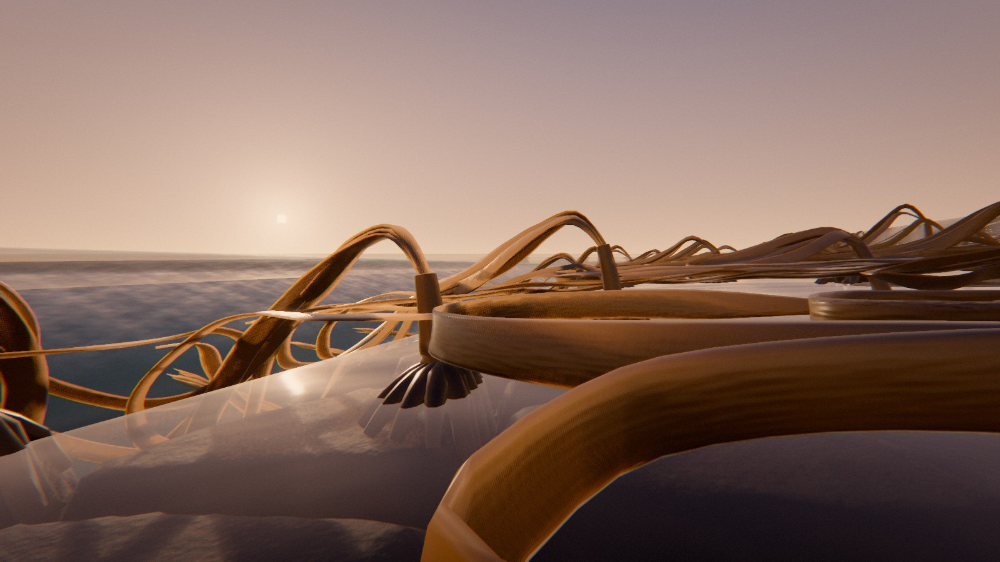

# Kelp

*le ressac.* Au ras d'un platier rocheux, une caméra à hublot-dôme filmée moitié au-dessus, moitié au-dessous de l'eau. Une série de trois vagues arrive du large : la mer se retire et couche les laminaires sur la roche, chaque vague les soulève et les peigne vers la côte à l'instant où son front les atteint, puis le retrait les recouche dans l'autre sens. La troisième vague, la plus grande, recouvre la caméra : dans l'eau laiteuse de bulles, la forêt est debout.

Le platier est découvert ; les laminaires couchées vers le large luisent sur la roche, une eau mince ruisselle entre les crampons. Au loin à gauche, une vague se lève, déferle en écume et court sur le platier : chaque plante se soulève quand le front l'atteint, et toutes partent vers la droite. L'eau s'arrête, revient : les lanières la suivent et retombent. Une seconde vague, plus grande, monte jusqu'au dôme — la ligne d'eau traverse l'image, on voit en même temps les lames couchées à l'air et la frange debout dans l'eau. Puis la mer se retire très loin ; la troisième vague nous recouvre, la forêt se dresse, se couche vers la côte, flotte, et le retrait l'entraîne. La ligne d'eau redescend, la roche pâlit en séchant.



Rendu physique en three.js (WebGPU, TSL). Tout est calculé : une graine produit une scène. La démarche (le thème exploré sous six angles, cinq clichés écartés, neuf pistes notées, les épreuves, les références) est dans [docs/concept.md](docs/concept.md) ; les défis techniques, avec des démonstrations interactives, dans [explainer.html](explainer.html).

## Utilisation

| Touche | Action |
| --- | --- |
| N | nouvelle scène (nouvelle graine) |
| Espace | pause / lecture |
| ← / → | avancer ou reculer dans la boucle |
| H | masquer l'interface |
| F | plein écran |

Sur écran tactile : une touche met en pause, deux touches tirent une nouvelle scène, un appui long masque l'interface.

Paramètres d'URL : `?seed=…`, `?mood=…` (ploumanach, couchant, etretat, ardoise, midi, noctiluque), `?family=…` (digitata, durvillaea, postelsia, egregia), `#r=…` (scène retouchée, « Copier le lien »), `?ui=0`, `?mobile=1` / `?mobile=0`, `?debug` (outils dans `window.kelp` : `shot(phase)`, `still(nom, phase, l, h)`, `film(préfixe, phases)`, `send(nom)`, `sheet(graines, phases)` — une graine peut s'écrire `graine:humeur:famille` —, `meter()`, `meters()`, `bench()`, `seam()`, `run()`).

Le panneau règle l'humeur et la laminaire (nouvelle scène de la même graine) ; la série de vagues (instant, hauteur au large et creux de chacune, obliquité, frottement, pente du platier — la mer et les laminaires sont alors recalculées) ; la densité et les couleurs de la frange ; la caméra (champ, cap, inclinaison, hauteur et rayon du dôme, travellings) ; le soleil, le ciel, l'eau (extinction par canal, noctiluques) ; le rendu. Export MP4 image par image (éventuellement accumulé) et PNG.

## Principe : une orbite périodique sous un forçage périodique

**La boucle est parfaite par construction.** Le forçage — la série de trois vagues qui entre au large — a la période T de la boucle (32 s). Le système, eau et laminaires, est dissipatif (frottement sur la roche, déferlement, traînée) : il oublie son état initial et converge vers une orbite périodique. On l'intègre jusqu'à ce que l'état à t + T égale l'état à t, et on enregistre une période.

- **La mer** se referme d'elle-même : après deux périodes, l'écart entre l'état à T et l'état à 0 est nul à 10⁻⁵ m près.
- **Les laminaires**, souples et en contact les unes avec les autres, gardent un peu de mémoire (une lanière couchée à gauche ou à droite de sa voisine). Deux passages sont simulés sous le même forçage : A, qui commence au grand retrait (le platier est à sec, les plantes couchées), et B, qui part de A(T) et fait la boucle entière. La boucle rendue est R(t) = (1 − w)·B(t) + w·A(t), où w passe de 0 à 1 pendant le retrait de la grande vague, quand tout bouge vite et dans le même sens : R(0) = B(0) = A(T) = R(T). Les images mélangées sont ramenées à des chaînes inextensibles posées sur la roche.

| Temps | Cause visible | Loi | Temps du film |
| --- | --- | --- | --- |
| la mer se retire | le creux de la vague qu'on voit se lever au large | Saint-Venant | réel |
| les laminaires se couchent | l'eau qui les quitte, le retrait qui les tire | poids hors de l'eau, frottement sur la roche mouillée | réel |
| le front court sur le platier | la vague arrivée du large | ressaut (choc de Saint-Venant), frottement de Manning | réel |
| chaque plante se soulève | le front l'atteint | poussée d'Archimède de la partie immergée, traînée de Morison | réel |
| l'eau blanchit puis s'éclaircit | le déferlement | bulles produites par le ressaut, qui se dissipent en ~1 s | réel |
| la roche fonce puis pâlit | l'eau qui l'a couverte | séchage des points hauts vers les creux | accéléré (quelques secondes au lieu de minutes) |
| la ligne d'eau traverse l'image | la mer sur le hublot | géométrie du dôme | réel |

## La mer (`src/gen/sea.js`)

Équations de Saint-Venant 1D sur le profil transversal du platier (fond du large à −1,4 m, tombant, platier qui monte en pente douce puis se relève vers la côte), en volumes finis du premier ordre, pas de 2,5 cm :

  ∂h/∂t + ∂(hu)/∂x = 0
  ∂(hu)/∂t + ∂(hu² + g h²/2)/∂x = −g h ∂b/∂x − g n² |u| u / h^{1/3}

- **Reconstruction hydrostatique** (Audusse et al., 2004) et **flux HLL** : la mer au repos reste au repos sur un fond quelconque, la hauteur reste positive, le front mouillé-sec avance et recule sans oscillation ; les vagues déferlées qui courent sur le platier sont des chocs que le schéma capture.
- **Bord du large générant-absorbant** : la vague incidente entre par l'invariant de Riemann montant u + 2c, la vague réfléchie sort par le descendant.
- **La série** : chaque vague est une crête précédée d'un creux (la mer qui se retire avant la vague), η_in(t) = A·[e^{−(t−t_k)²/τ_c²} − β e^{−(t−t_k+d)²/τ_t²}], périodique de période T ; trois vagues en crescendo.
- **Frottement de Manning** implicite (n = 0,035) ; **drainage** d'une lame de moins de 4 cm par le relief que le profil moyen ne voit pas (fissures, rigoles) : le platier se découvre entre les vagues.
- **L'écume** est produite là où la surface est raide et où l'écoulement converge (le ressaut), transportée par le courant, et se défait en 4,5 s ; **les bulles** dans l'eau, en 1 s. **L'enveloppe de séchage** M(x, t) = max(η, M − λ dt) dit jusqu'où la roche est encore mouillée.
- **Le champ 2D** est le champ 1D décalé par l'obliquité de la houle (un retard proportionnel à la distance le long de la côte), relevé à leur seuil dans les cuvettes (les flaques, calculées par inondation prioritaire sur la roche cuite). Au large, au-delà de la simulation, les mêmes vagues arrivent sous forme analytique.

Le tout est enregistré 60 fois par seconde (une texture x × t) et relu sur le GPU par la surface, le brouillard d'eau, la roche (mouillée) et le soleil (atténué sous l'eau).

## Les laminaires (`src/gen/kelp.js`)

Des chaînes de nœuds (stipe, lanières) ancrées au crampon, intégrées par XPBD à petits pas (100 sous-pas par seconde, deux itérations) :

- **Forces** : poids, poussée d'Archimède de la partie immergée (rapport de densité propre à la famille), traînée de Morison sur la vitesse relative à l'eau — intégrée implicitement, v_r ← v_r / (1 + k|v_r|h), stable quel que soit le pas —, et l'accélération de l'eau elle-même, qui emporte une lame presque neutre ; la masse ajoutée ralentit la montée d'une lame à plat ; profil de vitesse en puissance 1/7 (plus lent près de la roche).
- **Contraintes** : flexion (seconde différence pondérée, raideur EI/l d'une charnière), longueur, puis **inextensibilité exacte** de la racine vers la pointe (« follow the leader »), nœud par nœud avec le **contact et le frottement** sur la roche (la tranche du ruban compte s'il penche) ; les contraintes raides (stipe du palmier de mer, du cochayuyo) ont dix itérations de plus.
- **Contacts entre lanières** : rubans épais ; la séparation est prise sur l'axe de moindre recouvrement parmi la droite des points les plus proches et les normales des deux faces — couchée sur une autre, une lanière se pose dessus ; côte à côte, elles s'écartent par la tranche. Correction bornée par sous-pas (un recouvrement se résout sans lancer les nœuds).
- **Orientation du ruban** : un directeur le long de la largeur, transporté avec la lanière, couché à plat sur ce qui la porte, tourné dans le plan du courant quand l'eau la tire, lissé le long de la lanière.
- **Surface de contact** : l'enveloppe supérieure lissée du relief (dilatation puis flou, 3 cm) — une lanière passe par-dessus une fissure au lieu d'y tomber, et ne descend jamais sous la roche dessinée.

**Quatre familles**, quatre mouvements :

| Famille | Construction | Mouvement |
| --- | --- | --- |
| Digitée (*Laminaria digitata*) | stipe souple, main de 5 à 8 lanières soudées en paume | la main qui s'ouvre : couchée en faisceau, elle se soulève par le stipe et ses lanières s'écartent dans l'eau |
| Cochayuyo (*Durvillaea*) | crampon en disque, stipe court et raide, 3 à 5 lanières épaisses alvéolées (densité 0,78) | la corde lourde : couchée en anneaux, elle flotte d'un coup et s'étire à la surface |
| Palmier de mer (*Postelsia*) | stipe creux et raide, houppe de 14 à 20 lames | le ressort : toujours debout, la vague le plie, il se redresse ; la houppe pend à l'air et s'ouvre dans l'eau |
| Boa (*Egregia*) | longues lanières frangées de lamelles et de flotteurs (densité 0,86) | la plume : des guirlandes qui montent en arc et ondulent |

**À l'écran** (`src/scene/kelp.js`) : toutes les lanières et tous les stipes en un seul maillage ; le vertex shader lit, pour chaque sommet, les positions et les directeurs enregistrés des quatre nœuds de sa travée, trace la spline de Catmull-Rom qui les joint et pose la section — une ellipse très aplatie pour une lame (épaisse au milieu, fine au bord), un cercle pour un stipe —, avec un bord ondulé. Matière : brun mouillé, olive ou or ; translucide à contre-jour ; vernie de mucilage à l'air, mate dans l'eau ; sores sombres, pointes usées ; stries le long de la lame.

## Le rendu au ras de l'eau

- **Le hublot-dôme** : chaque rayon part du dôme, à 9 cm devant le centre optique. La ligne d'eau traverse donc l'image quand l'eau passe sur le dôme — une ligne nette, comme dans les photographies « over-under » —, au lieu de basculer d'un coup.
- **Le milieu** (`src/scene/water.js`) : un brouillard d'eau calculé pour chaque pixel sur la partie immergée de son rayon (le niveau de l'eau le long du rayon est pris linéaire entre ses deux bouts) — extinction par canal (le rouge d'abord), lumière diffusée qui décroît avec la profondeur, eau aérée qui blanchit sous le ressaut ; la nuit (Noctiluque), l'eau agitée s'allume.
- **La surface**, vue d'en dessus : reflet de Fresnel du ciel (jamais un miroir parfait au loin : les facettes regardent plus haut), reflet du soleil (GGX), écume entraînée par le courant (deux phases fondues, périodiques) ; vue d'en dessous : la fenêtre de Snell montre le ciel, la réflexion totale l'eau elle-même.
- **Le soleil sous l'eau** : atténué sur le chemin réfracté jusqu'au point, modulé par des caustiques, par `receivedShadowNode` (même atténuation pour la roche, les lanières, les crampons).
- **La roche** (`src/gen/rock.js`, `src/scene/terrain.js`) : relief cuit dans un worker (1 024² sur 16 × 16 m), déplacement des sommets et normal map ; granit en boules et diaclases, basalte en dalles polygonales, craie à silex, ardoise en feuillets, grès en gradins ; algue calcaire rose dans les creux bas et les flaques ; grain minéral et micro-relief au gros plan ; **mouillée** sous l'enveloppe de séchage (plus sombre, brillante), mate dans l'eau.
- **Le ciel** (`src/gen/sky.js`) : carte HDR calculée (dégradé, brume, auréole de Mie, nuages, lune et étoiles), dessinée comme une sphère de la scène.

## Les humeurs

| Humeur | Roche | Lumière | Valeur | Cadrage |
| --- | --- | --- | --- | --- |
| Ploumanac'h | granit rose en boules | soleil bas de côté | moyenne | dôme bas, le long de la côte |
| Couchant | basalte en dalles | soleil en face, contre-jour | sombre | vers le large |
| Étretat | craie à silex | ciel couvert lumineux | très claire | dôme haut, plongée |
| Ardoise | feuillets d'ardoise | heure bleue, sans soleil | basse, froide | dôme bas |
| Midi | grès rouge en gradins | soleil haut, caustiques | claire, contrastée | plan plus large |
| Noctiluque | granit sombre | lune, eau qui s'allume | très sombre | au ras de l'eau |

## Tests

```bash
node --test 'kelp/test/*.test.mjs'
```

Treize tests : la mer est une orbite périodique, sa hauteur n'est jamais négative, le grand retrait découvre le platier et la grande vague le recouvre ; aucun nœud de laminaire ne passe sous la roche, à aucun instant ; étirement borné (moins de 5 % après la mise en place ; des pointes transitoires, jusqu'à ~45 %, quand un nœud est repoussé par une marche de la roche dans un sous-pas) ; la dernière image rejoint la première sans saut ; à l'air, les lanières reposent sur la roche ; la caméra est périodique, lente, au-dessus de la roche ; les familles diffèrent par leur flottabilité et leur raideur ; la recette est déterministe et JSON, chaque humeur et chaque famille sont tirées, la série est un crescendo qui finit au calme, les humeurs sont des décors.

## Performances

Génération d'une scène (dans Node, un seul cœur) : ~1 s pour la mer, ~2 s pour la roche, 10 à 14 s pour les laminaires (64 plantes, ~3 400 nœuds, deux passages). Nettement plus lent quand l'onglet est en arrière-plan.

## Version mobile

Imposée par `?mobile=1`, ou choisie d'office sur téléphone : 36 plantes, 90 sous-pas par seconde, roche cuite en 640², grilles de la roche et de l'eau plus lâches, chaîne d'image allégée, résolution dynamique. Non vérifiée sur un appareil réel.
