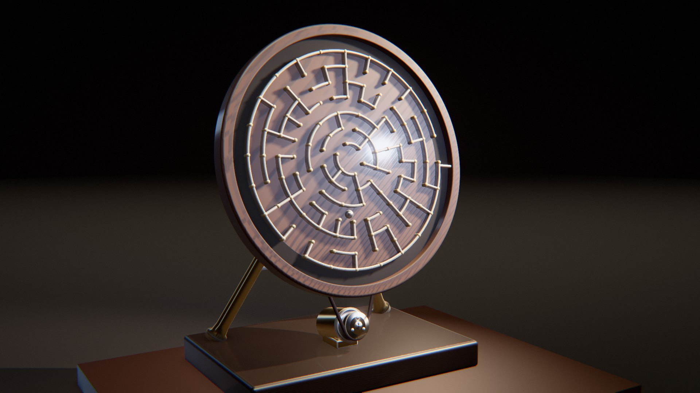

# Labyrinth

*le dédale qu'on retourne.* Ce labyrinthe se parcourt en le tournant. Un automate incline un plateau de quelques degrés, ou fait pivoter un disque dressé, et la gravité conduit une bille de 12 mm à travers les couloirs. Elle roule, bute au fond d'une impasse, tombe d'un couloir à l'autre et trouve la sortie. Une rigole (ou une poche de noria, comme un godet de roue à eau) la rend à l'entrée, l'appareil revient à sa pose, et tout recommence.



Rendu physique en three.js (WebGPU, TSL). La scène est entièrement procédurale : une graine produit un labyrinthe, un appareil, un décor et un film. La démarche est dans [docs/concept.md](docs/concept.md) : le thème exploré sous six angles, les clichés écartés, neuf pistes notées, les épreuves (crédibilité, variété, ambition, déclinaison, scénario, références).

## Utilisation

| Touche | Action |
| --- | --- |
| N | nouvelle scène (nouvelle graine) |
| Espace | pause / lecture |
| ← / → | avancer ou reculer dans la boucle |
| H | masquer l'interface |
| F | plein écran |

Sur écran tactile : une touche met en pause, deux touches tirent une nouvelle scène, un appui long masque l'interface.

Paramètres d'URL : `?seed=…`, `#r=…` (scène retouchée, « Copier le lien »), `?mood=…` (cabinet, carrare, laque, ardoise, beton, celadon), `?family=…` (plateau, cadran, roue), `?ui=0`, `?mobile=1` / `?mobile=0`, `?debug` (outils dans `window.labyrinth` : `shot(phase)`, `send(nom)`, `sheet(graines, phases)` (une graine peut s'écrire `graine:humeur:famille`), `meter()`, `meters()`, `bench()`, `seam()`, `run()`, `view(position, cible)`).

Le panneau règle l'humeur et la famille (nouvelle scène de la même graine), la vitesse de lecture (1 = temps réel, jusqu'au ralenti ×4) ; la caméra (champ, hauteur, azimut, remplissage, suivi de la bille, balancement, caméra libre) ; le labyrinthe (taille, impasses visitées, tour de la rigole ou sens du retour, parois rapportées ou taillées : toute retouche relance la simulation) ; les matières de chaque rôle (plateau, parois, bille, mécanisme, socle, support) ; la lampe, les contre-jours, le studio HDR ; le rendu. Export MP4 image par image (éventuellement accumulé) et PNG.

## Principe : la gravité comme moteur, l'appareil comme cause

Trois familles d'appareils, chacune avec sa façon de déplacer la bille :

| Famille | Appareil | Ce que fait la bille |
| --- | --- | --- |
| **Plateau** | plateau horizontal sur cardan, incliné (≤ 5,5°) par deux manivelles et deux bielles à rotules | Elle roule en longues courbes, freine avant les coudes, s'enfonce dans une impasse, bute au fond et en ressort. À la sortie, elle fait le tour de la rigole à vive allure et rentre. |
| **Cadran** | plateau carré dressé, penché de 12° vers l'arrière, qui pivote dans son plan par quarts et demi-tours, entraîné par une courroie | Elle chute d'un trait le long d'un couloir et rebondit sur la paroi d'en bas. Le cadran la retourne, elle chute ailleurs. |
| **Roue** | disque dressé à labyrinthe circulaire (anneaux et cloisons) | Elle reste en bas pendant que le disque tourne sous elle, et saute d'anneau en anneau quand une brèche passe dessous. |

Pour le Cadran et la Roue, une **poche** coupe la rigole juste derrière la porte d'entrée. Quand la bille est sortie, le disque tourne dans un seul sens et la poche la soulève comme une noria. Au sommet, où la gravité pointe vers le centre, elle retombe par l'entrée.

**La boucle.** Le film est la simulation d'un trajet complet, enregistrée à 120 i/s puis relue. Il commence et finit sur le même état : la bille au repos au même endroit, l'appareil à sa pose de départ (le disque à un nombre entier de tours près). Cet état s'obtient par un point fixe : l'état d'arrivée devient l'état de départ et l'on recommence, jusqu'à ce que l'écart passe sous 0,03 mm (Plateau) ou 0,05 mm (disques). L'écart qui reste, bille arrêtée, est fondu dans la dernière demi-seconde. L'orientation propre de la bille (une agate se voit tourner) est raccordée par une rotation résiduelle répartie sur toute la boucle. `seam()` mesure ainsi moins de 3·10⁻⁷ entre u = 0 et u = 1, le début et la fin de la boucle.

| Temps | Cause visible | Loi | Temps du film |
| --- | --- | --- | --- |
| le plateau s'incline | les manivelles tournent, les bielles poussent le bord | bielle-manivelle (longueur constante, résolue par Newton) | temps réel |
| la bille roule, freine | l'inclinaison du plateau | roulement sans glissement : a = 5/7·g·sin θ, résistance au roulement | temps réel |
| la bille bute, rebondit | la paroi | choc, restitution 0,38, frottement | temps réel |
| le disque tourne | la poulie du moteur et la courroie (rapport 5) | courroie sans glissement | temps réel |
| la bille chute, saute d'anneau | la gravité dans le plan du disque | roulement sur un plan qui tourne (ci-dessous) | temps réel |
| la bille remonte | la poche de la rigole la porte | contact contre la poche | temps réel |

## Génération (`src/gen/`)

**Labyrinthes** (`maze.js`) : arbres couvrants tirés uniformément par l'algorithme de Wilson (marches aléatoires à boucles effacées, greffées à l'arbre), sur une grille rectangulaire ou polaire. Un anneau polaire double son nombre de secteurs tant que chaque cellule garde au moins 0,92 × 22 mm d'arc à son rayon intérieur. Ainsi toute brèche laisse passer la bille entre ses deux poteaux. La chambre centrale fait 22 mm de rayon : avec 15 mm, la brèche faisait 9,6 mm pour une bille de 12. Les portes d'entrée et de sortie sont sur le bord, choisies pour allonger le chemin. S'y ajoutent des poteaux à chaque jonction, la rigole entre le labyrinthe et le cadre, et une butée (Plateau) ou une poche de noria (disques). La même liste de parois (segments, arcs, poteaux, cadre) sert à la physique, au maillage et aux tests.

**Physique** (`physics.js`) : une sphère pleine qui roule sans glisser dans le repère du plateau, au pas de 1/960 s. Pour un plan qui tourne à Ω autour de sa normale, l'équation de Weltner (1979), écrite dans le repère inertiel, dv/dt = 5/7·F/m + 2/7·(Ω̇ × x + Ω × v), devient dans le repère du disque :

  a = 5/7·(g∥ + Ω²·x − Ω̇·J·x) − 12/7·Ω·J·v

(J : rotation d'un quart de tour). La partie lisse est intégrée au point milieu (second ordre). En Euler semi-implicite, une bille lancée sur un plateau tournant revenait 25 mm à côté de son point de départ après un tour, contre 0,008 mm au point milieu. Contacts : distance signée aux capsules, arcs épaissis, poteaux et cadre, classés en cases de 14 mm ; restitution 0,38 au-dessus de 25 mm/s, contact au repos en dessous ; frottement contre la paroi (le point de contact équatorial glisse à la vitesse de la bille) ; résistance au roulement 0,0035. Sur les disques s'ajoute un amortissement de 0,9 s⁻¹, car la bille dans une gorge de bois est un pendule amorti.

**Le film** (`plan.js`) :
- *Plateau* : un pilote suit le chemin (la solution, plus une à trois impasses de 2 à 5 cellules, visitées jusqu'au fond), puis la rigole jusqu'à l'entrée. La vitesse visée tient compte du temps de bascule du plateau (0,16 s). Sans lui, la bille dépassait les coudes de 19 mm et s'engageait dans le couloir voisin. Près d'un arrêt, le pilote passe à un asservissement en position. Les angles du cardan sont tirés de la gravité voulue (g∥ = (g·sin β·cos α, −g·sin α)) et passent par des servomoteurs bornés à 40°/s.
- *Cadran et Roue* : une **recherche en largeur sur des rotations simulées**. Un état est la cellule où la bille s'arrête et l'angle du disque (au huitième de tour). Une transition est une rotation de ±90° ou 180° (±45° en plus pour la Roue), à secousse minimale, suivie de l'arrêt de la bille, simulée en entier, chute et rebonds compris. Le Cadran part d'un angle multiple de 90°, pour que la gravité soit alignée sur les couloirs : à 248°, la bille finissait dans les coins et la recherche ne trouvait que 5 états.
- Si un labyrinthe ne donne pas un bon film (bille bloquée, moins de 4 ou plus de 12 rotations, plus de 52 s, raccord non atteint), on essaie le suivant (`graine~1`, `graine~2`…). La scène reste déterminée par la graine.

**Maillages** (`build.js`), dans le worker. Les parois sont balayées le long des segments et des arcs, à flancs droits et dessus arrondi ; les parois « taillées » ont en plus un congé creux de 1,4 mm au pied, sous le point de contact de la bille. Les poteaux sont tournés, à calotte. Le cadre est balayé le long du contour (rectangle arrondi décalé, mêmes normales au même paramètre), le fond et la rigole sont triangulés entre contours appariés. Pièces mécaniques : cardan, manivelles, bielles à rotules, moteurs, volant à gorge, palier, chevalet, poulie, courroie (deux brins tangents extérieurs, sin a = (R − r)/D).

## L'appareil (`src/kin.js`)

- **Plateau** : R = Rx(α)·Ry(β) autour du centre du cardan (chape fixe sur la colonne, croisillon qui tourne de α, chape du plateau). Chaque bielle relie un maneton (manivelle de 15 mm, œil décalé de 7 mm le long du maneton) à une rotule 12 mm sous la dalle. L'angle de la manivelle est résolu par Newton pour que la bielle garde ses 66 mm. Pour 5,5° d'inclinaison, les manivelles tournent d'environ ±35°.
- **Disques** : le plateau penché de 12° vers l'arrière tourne autour de sa normale. Un volant à gorge derrière la dalle est relié par une courroie ronde à la poulie du moteur (rapport 5 : la poulie fait 5 tours par tour de disque, et revient à son angle à la fin de la boucle). Le palier est porté par un chevalet à deux jambes écartées, visibles de part et d'autre du disque.
- **Caméra** : elle vise un point d'attention entre le centre de l'appareil et la position de la bille, lissée par un noyau gaussien périodique (σ ≈ 1,6 s, interpolation de Catmull-Rom). Azimut et hauteur viennent de la recette, avec un balancement d'une période par boucle. Le Plateau est vu de trois quarts haut, les disques de trois quarts bas, pour que la colonne, la courroie et la poulie se lisent.

## Les décors

Le fond est neutre, une nappe mate qui se fond dans la brume. Chaque humeur se distingue par son support, sa lumière, sa valeur et ses matières :

| Humeur | Plateau / parois | Support | Lumière | Valeur |
| --- | --- | --- | --- | --- |
| Cabinet | noyer verni, filets de laiton ou de nickel, feutre dans la rigole | sous-main de cuir | lampe de bureau de côté, ombres longues | basse |
| Carrare | marbre taillé dans la masse | plâtre, cyclorama clair | haute et douce | très haute |
| Laque | laque noire et vermillon, ou os et laque noire, poteaux dorés | ébène | rasante et dure, d'un seul côté | très basse |
| Ardoise | ardoise adoucie, parois d'os | plateau de chêne | fenêtre au nord, douce et froide | moyenne |
| Béton | béton banché taillé | bloc de béton | ciel couvert | moyenne, froide |
| Céladon | céramique céladon craquelée, taillée | lin | soleil dur par une fenêtre | haute |

Les disques dressés sont toujours éclairés en lumière rasante de côté (la lampe à 55–75° de leur normale), pour que les parois portent leurs ombres sur la face. La bille tranche en valeur sur son fond, et un test le vérifie : obsidienne ou céramique noire sur les fonds clairs, porcelaine sur la laque, métal poli sur les fonds sombres. Une bille d'acier poli sur le céladon le reflétait et disparaissait.

**La bille est vermillon dans toutes les humeurs** (acier émaillé, vernis brillant) : c'est le fil rouge de la collection, et c'est elle que l'œil suit. Elle tranchait autrefois en valeur (obsidienne, porcelaine, acier poli selon le fond) ; elle tranche maintenant par la teinte, la saturation ou la valeur, et le test le vérifie sur chaque accord : un fond de laque rouge, où elle se perdait, est devenu de l'os.

**Matières** : finitions au F0 mesuré du dépôt, plus un motif bois (cernes ondulés autour d'un axe parallèle au fil, bois final plus sombre et plus mat, pores en traits fins) pour le noyer, le chêne, le frêne, l'ébène. S'y ajoutent feutre, cuir, lin, béton, ardoise (veinage discret : un relief de piqûres la faisait passer pour du métal martelé), laques, céladon, os.

## L'écran de chargement

Le calcul de la graine, rejoué (`src/app/loaderArt.js`). L'algorithme de Wilson creuse le labyrinthe de la scène : la marche aléatoire erre en ambre, ses boucles s'effacent, elle se greffe et devient couloir. Puis le front de la recherche en largeur part de l'entrée, et enfin le chemin s'allume et une bille le parcourt sans fin. C'est le même module (`gen/maze.js`) et la même graine que la scène.

## Tests

```bash
node --test 'labyrinth/test/*.test.mjs'
```

Vingt-deux tests : le labyrinthe est un arbre couvrant ; Wilson tire uniformément (les 4 arbres couvrants d'un carré 2 × 2, à parts égales sur 4 000 tirages) ; tout passage laisse passer la bille ; la bille ne traverse aucune paroi à aucun instant du film (distance au bord ≥ −0,06 mm sur chaque image, sept scènes des trois familles), avec un témoin qui doit échouer ; le congé des parois taillées reste sous la bille au contact ; la boucle se referme (position, appareil à un nombre entier de tours, orientation de la bille) ; continuité image par image ; inclinaison ≤ 5,5° et servomoteurs ≤ 40°/s ; la bille ne part pas tant que le plateau est à plat ; les bielles gardent leur longueur, la dalle passe au-dessus des moteurs ; le disque tourne loin du socle et de la poulie ; un film de disque est une suite de 4 à 12 rotations puis le retour ; caméra périodique, sous 25°/s ; recette déterministe et JSON ; humeurs et familles tirées ; lampes ≥ 4700 K ; métal chaud en accent ; au moins trois familles de matières ; la bille tranche sur son fond ; humeurs distinctes par le décor, la lumière et la valeur.

`node labyrinth/tools/film.mjs <famille> <topologie> <a> <b> [graines…]` planifie des scènes dans Node et imprime durée, chemin, rotations, résidu du raccord et temps de calcul.

## Performances

Génération d'une scène (dans un worker, sous l'écran de chargement) : 0,1 à 0,4 s pour un Plateau, 0,1 à 10 s pour un disque, mesuré dans Node. Pour un disque, la recherche en largeur simule chaque rotation et plusieurs labyrinthes peuvent être essayés ; l'écran de chargement montre l'avancement. Les maillages prennent 20 à 50 ms.

Temps d'image mesuré dans le panneau de navigateur de l'application (GPU d'un Mac, panneau masqué), qualité Haute, 1920 × 1080 (2,07 Mpx), phase 0,35 : Cabinet / Plateau 6,6 ms ; Carrare / Roue 7,1 ms ; Laque / Cadran 4,8 ms ; Ardoise / Plateau 9,3 ms ; Béton / Roue 7,5 ms ; Céladon / Cadran 5,1 ms.

## Version mobile

Imposée par `?mobile=1`, ou choisie d'office sur téléphone : chaîne d'image allégée (sans GTAO, SSR ni TRAA), une lumière de moins, studio en 512, résolution dynamique. La simulation et le labyrinthe sont les mêmes. Mesuré dans le panneau (Laque, Cadran, 1600 × 900) : 1,8 ms par image, 23 pipelines, console vide. Non vérifiée sur un appareil réel.
