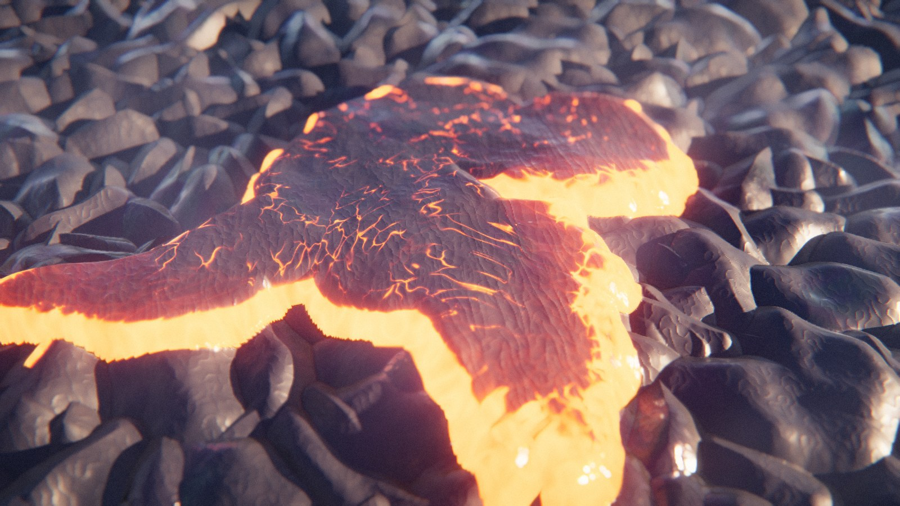

# Magma

*le front de pāhoehoe.* Un champ de lave refroidie, vu de près. Une fente s'ouvre en haut de l'image et la lave en sort : une nappe incandescente qui avance vers nous en poussant des langues, se couvre d'une peau grise, se fend, rougeoie dans ses fissures, puis refroidit. En refroidissant, elle se gonfle en lobes qui reforment exactement le motif de pierres du début, une nappe plus haut. Le film reprend alors au même point.



Rendu physique en three.js (WebGPU, TSL). La scène est entièrement procédurale : une graine produit une scène. La démarche est dans [docs/concept.md](docs/concept.md) : le thème exploré en largeur, les clichés écartés (la rivière de lave orange qui bouillonne, le volcan qui crache, la roche craquelée en Voronoï), huit pistes notées, la piste retenue avec ses références, puis dix révisions faites d'après les retours sur les rendus.

La pāhoehoe est la lave basaltique fluide d'Hawaï. Elle avance en petites langues, les « orteils », qui sortent l'un de l'autre : un orteil gonfle, sa peau durcit, elle cède au nez, et un orteil fils en sort. Des milliers d'orteils font un front qui couvre le terrain sans laisser de jour.

## Utilisation

| Touche | Action |
| --- | --- |
| N | nouvelle scène (nouvelle graine) |
| Espace | pause / lecture |
| ← / → | avancer ou reculer dans la boucle |
| H | masquer l'interface |
| F | plein écran |

Sur écran tactile : une touche met en pause, deux touches tirent une nouvelle scène, un appui long masque l'interface.

Paramètres d'URL : `?seed=…` (une scène), `#r=…` (une scène retouchée, produite par « Copier le lien »), `?ui=0` (sans panneau), `?mobile=1` / `?mobile=0` (version mobile imposée / interdite), `?debug` (outils dans `window.magma` : `shot(phase)`, `send(nom)`, `sheet(graines, phases)`, `film(u0, u1, n)`, `meter()`, `meters()`, `bench(phase, n)`, `seam()`).

Le panneau règle l'humeur et la famille (nouvelle scène de la même graine). Le dossier **Coulée** règle l'arbre des orteils (longueur, rapport largeur/longueur, épaisseur, épaisseur de la nappe, vitesse, ouverture des bourgeons, corrélation du cap, pente et son biais, instant de la seconde percée). Le dossier **Matière** règle les cordes, les dalles, les sulfates et les fumées. Viennent ensuite la caméra, la lumière et le rendu. L'export produit une boucle MP4 (H.264) rendue image par image, éventuellement accumulée, et une image PNG.

## Principe : la coulée qui se redessine

**La liberté** (la seule chose impossible du film) : chaque coulée redessine exactement la précédente, une nappe plus haut. Tout le reste suit ses lois : la croissance des orteils, la chaleur, la croûte, la lumière émise par la lave.

### Le geste et la boucle

La boucle dure 32 s de film pour une heure de temps physique.

| part de la boucle | ce qu'on voit | temps |
| --- | --- | --- |
| 0 – 0,04 | le champ au repos, encore tiède dans les fissures | accéléré qui ralentit |
| 0,04 – 0,86 | une fente s'ouvre en haut du cadre, la nappe en sort et descend vers la caméra en poussant des orteils ; une seconde percée s'ouvre sur un côté au bout de 2 minutes | ×10 à ×27 (selon la graine), réglé sur la couverture du cadre |
| 0,86 – 1 | tout refroidit : jaune, orange, rouge, puis le noir vitreux ; la nappe finit de gonfler en lobes | ×750 à ×1 100 |

La surface au temps t, en un point x du sol, est faite de deux couches :

- **l'ancienne nappe** R(x), le relief des orteils, le même à chaque boucle ;
- **la nouvelle**, d'épaisseur e(x, t) ≥ 0, qui arrive avec le front.

Le front est un seul corps continu. En chaque point, l'instant d'arrivée t_a(x) est le minimum, sur les orteils candidats, de leur instant de passage, pénalisé vers leur bord (la pénalité tend vers l'infini au bord de la zone d'un orteil : le minimum reste continu d'un orteil à l'autre). Derrière le front, la lave forme d'abord une nappe lisse, le relief flouté sur 12 cm plus h, puis gonfle en lobes jusqu'à R + h entre 20 s et 6 min après le passage :

cible(x, t) = R̃(x) + h + (R(x) − R̃(x)) · smoothstep(20 s, 360 s, t − t_a(x))

e = max(cible − R, 0), et la surface est S = R + e · C, où C est le bourrelet du front (un quart de sinus en distance derrière le front de chaque orteil, de rayon 9 cm + l'épaisseur de lave). À la fin de la boucle, tous les points sont couverts et gonflés : S = R + h exactement. Le monde descend de h pendant la boucle (3 mm/s, sans aucun glissement horizontal) et la scène à u = 1 est celle de u = 0. L'apparence ne dépend que de l'âge de la surface : l'ancienne nappe a, à u = 0, l'âge qu'a la nouvelle à u = 1. Un test vérifie l'égalité à 10⁻⁹ m près.

## Génération (`src/gen/`, dans des Web Workers)

1. **L'arbre des orteils** (`toes.js · growTree`). Chaque orteil part d'un point de son parent (un bourgeon) quand le front du parent y passe, après un court délai. Son cap suit une marche aléatoire corrélée tirée vers la pente (Baloga et Glaze 2003 ; corrélation 0,6 à 1, biais de pente 0,9 à 1,4). Ses dimensions viennent des mesures de Crown et Baloga (1999) : 0,4 à 1,2 m de long selon la famille, 7 à 9,5 cm d'épaisseur. Il avance à 8 à 12 mm/s (front en cosinus : il accélère puis ralentit). L'arbre pousse depuis deux percées (la première au bord haut du cadre, la seconde 110 à 160 s plus tard sur un côté) jusqu'à couvrir tout le champ de 8,4 m : 1 207 orteils pour la graine m2 (Orteils), 250 à 380 pour Cordée et Dalles. Le dôme d'un orteil a un bord en sinus (pente ≤ 40°) et un pied à 45°.
2. **Les listes de candidats** (`bakeLists`, 1 024² sur le champ, 8 orteils par texel). Pour chaque texel : les deux plus hauts orteils, puis ceux qui y arrivent le plus tôt (instant pénalisé). Garder seulement quatre orteils, rangés par hauteur, perdait celui qui arrive en premier et faisait des falaises de 15 à 22 cm. La cuisson se fait par bandes sur tout le pool de workers.
3. **Le relief flouté** (`bakeBlur`, 512², flou gaussien σ = 12 cm) : la nappe lisse qui précède les lobes. Il est lu en bilinéaire, de la même façon, par le shader et par la référence JS des tests.
4. **Le refroidissement** (`cooling.js · solveCooling`) : conduction 1D dans 30 cm de lave (pas de 0,25 mm, Euler implicite), rayonnement ε σ (T⁴ − T_ciel⁴) et convection en surface, chaleur latente de cristallisation entre 980 et 1 150 °C, porosité 30 % (d'après Keszthelyi et Denlinger 1996). Il en sort une table indexée par le logarithme de l'âge : température de surface (1 073 °C à 1 s, 920 °C à 10 s, 729 °C à 1 min, 464 °C à 10 min, 278 °C à 1 h), épaisseur de croûte (isotherme 1 070 °C : 5 mm à 1 min, 6,2 cm à 1 h, Hon et al. 1994 donnent 7,8 cm) et températures à 2, 6, 15 et 30 mm (le fond d'une fissure).
5. **Le corps noir** (`planck.js`) : la loi de Planck intégrée sur les fonctions colorimétriques CIE 1931, émissivité 0,95, de 700 à 1 500 K. Une lave à 1 150 °C donne ≈ 3 000 cd/m². L'unité de scène vaut 1 000 cd/m² : soleil, ciel et lave partagent la même échelle, et chaque humeur a son exposition fixe.
6. **Le ciel** (`sky.js`) : carte équirectangulaire en demi-flottants, ciel couvert CIE ou ciel clair, halo du soleil ; sous l'horizon, le champ éclairé par ce ciel (au moins un cinquième de l'horizon : plus sombre, il dessinait des traits noirs dans le reflet des lèvres raides).

Sur le processeur principal, la fenêtre de la coulée et la forme de l'accéléré se déduisent des instants d'arrivée sur une grille du cadre : la coulée se termine quand 95 % du cadre est couvert (+ 15 s), et l'accéléré suit la couverture (85 % couverture, 15 % temps régulier). Il ralentit quand beaucoup de lave entre dans l'image et accélère pendant les accalmies (`src/timeline.js`).

## Le champ et la peau (`src/scene/field.js`)

**Le champ, à chaque image.** Une passe de 2 048² (demi-flottants) recalcule la surface S, l'orteil du dessus, l'âge et l'épaisseur de lave neuve depuis les listes de candidats. L'épaisseur et l'âge sont deux grandeurs continues, lues en bilinéaire : la limite de la lave neuve est une courbe de niveau lisse, et le nez du front, la partie la plus jeune, est la plus chaude. L'instant d'arrivée, qui ne dépend pas du temps, est calculé une fois par scène dans une carte en flottants 32 bits (1 024²) : en demi-flottants, l'âge vers une heure n'était précis qu'à 2 s, et les cordes (une toutes les 4 s de front) scintillaient en fin de boucle.

**Le maillage** est fixe sous la caméra, resserré au centre (896² sommets, ~3,5 mm entre sommets au centre), déplacé par le champ dans le vertex shader.

**La peau de la lave**, dans un seul matériau physique :

- l'émission : la température de surface lue dans la table de refroidissement à l'âge du point, convertie par la table de Planck ; émissivité directionnelle (Fresnel) ; la peau, d'épaisseur variable, varie de ± 40 K ;
- **la croûte qui se fend** : les coutures d'un pavage cellulaire déformé à deux échelles (plaques de 4 à 10 cm, bords anguleux et dentelés), ouvertes par endroits seulement, de largeur et de profondeur inégales le long du tracé (± 50 K). Le fond d'une fissure a la température de la lave à quelques millimètres. La croûte est portée par la lave : elle dérive de 9 cm au plus dans le sens de l'écoulement (tiré du gradient de l'instant d'arrivée), puis s'arrête ; ses fissures s'ouvrent, se déforment et se figent en cinq minutes ;
- la croûte froide : plaques vitreuses à reflets nets et irisés (bleu et or) contre croûte mate, peau d'éléphant étirée, grain du verre ; rugosité plancher 0,2 ;
- **la lueur sur les voisins** : une carte de lueur (256², mipmaps) éclaire la croûte voisine et les fumées par en dessous.

**Les fumées** (`src/scene/fumes.js`) : un volume tracé en surimpression (16 pas, 8 en mobile), éclairé par la lueur ; le tremblement de l'air chaud au-dessus de la lave vive.

## Familles et humeurs (`src/recipe.js`)

| Famille | Mouvement |
| --- | --- |
| **Orteils** | bourgeonnement en arbre, petits lobes de 0,4 à 0,6 m |
| **Cordée** | peu de bourgeons, grands lobes (0,75 à 1 m) ; la peau se plisse en cordes le long des lignes d'égal instant de passage du front (une toutes les 4,5 s de front, par paquets interrompus), arquées vers l'aval ; les creux entre cordes rougeoient tant que la lave est jeune |
| **Dalles** | grands lobes ; la croûte étirée se rompt en plaques de 25 à 40 cm qui s'inclinent un peu, séparées de rifts incandescents qui s'ouvrent pendant deux minutes puis se figent |

| Humeur | Lumière | Valeur | Cadrage |
| --- | --- | --- | --- |
| **Argent** (d'après Edward Weston) | ciel couvert clair, la peau vitreuse reflète un ciel blanc | claire | plongée 55 à 64° |
| **Rasant** (Weston) | soleil bas et dur de côté (55 klux), ombres longues | moyenne, contrastée | 38 à 46° |
| **Nuit** | la lave seule, et la lueur d'autres coulées hors champ | sombre | rasant 30 à 36° |
| **Heure bleue** | crépuscule froid dans la peau vitreuse, lueur chaude | moyenne-sombre | 34 à 42° |
| **Vog** | brume volcanique, soleil voilé à contre-jour | très claire | 40 à 48° |
| **Soufre** | plein soleil vertical (45 klux) ; sulfates jaunes et blancs sur les croûtes de plus de 45 min | claire | plongée 64 à 72° |

Les expositions ont été réglées au posemètre (`meter()`), pour une roche vers 0,12 le jour et une lave qui dépasse nettement le blanc de la roche. **Averse** a été retirée : la croûte mouillée rendait les lobes lisses comme de la gelée.

## Rendu

Ombres du soleil 4 096², GTAO, SSR, TRAA, profondeur de champ (f/2,8 à 3 m), bloom, ACES, étalonnage par humeur, grain. Au raccord de boucle, l'anticrénelage temporel garde son historique avec des vitesses nulles pour une image (le réinitialiser donnait une image sans lissage, visible comme un changement de texture).

## Tests

```bash
node --test 'magma/test/*.test.mjs'
```

14 tests : la nappe couvre tout le champ ; boucle exacte (la nappe refroidie redessine le motif de départ à 10⁻⁹ m près) ; la lave ne creuse jamais l'ancienne nappe et ne dépasse pas trois épaisseurs ; le front passe en (s, v) à l'instant `passTime` ; refroidissement monotone, croûte et lueur plausibles ; corps noir (1 150 °C ≈ 3 000 cd/m², rien de visible sous 500 °C) ; temps du film (τ(u + 1) = τ(u) + P, monotone, la coulée tient dans sa fenêtre) ; causalité (chaque orteil sort d'un orteil dont le front a déjà passé son col) ; chaque point vu est atteint une seule fois, par le premier front ; pas de falaise de plus de 5 cm d'un point au voisin (4 mm) ; recette (déterminisme, JSON pur, humeurs tirées, percée dans le cadre).

Outils de mise au point (`tools/`) : `tree.mjs` (planche de l'arbre), `causal.mjs` (causalité des bourgeons), `visible.mjs` (couverture du cadre dans le temps), `cliffs.mjs` (sauts de hauteur).

## Performances mesurées

Graine m2 (Rasant, Orteils), u = 0,45, qualité Haute, `bench()` sur 20 rendus, panneau du navigateur masqué : ces mesures sont bruitées et probablement pessimistes.

| Configuration | Temps par image |
| --- | --- |
| 1 920 × 1 080, état livré | 31 à 34 ms |
| sans SSR | ≈ 29 ms |
| sans SSR ni GTAO | ≈ 22 ms |
| sans ombres du soleil | ≈ 23 ms |

Le GTAO coûte environ 7 ms et les ombres environ 8 ms. Aucune optimisation n'a été faite après ces mesures.

Génération, mesurée dans Node (un cœur) : arbre 1,1 s (m2, 1 207 orteils) ; listes de candidats 6,6 s au total, réparties en bandes sur le pool ; relief flouté 2,3 s, sur son propre worker en parallèle des listes ; refroidissement 0,04 s. Sur une machine à 6 workers, la génération prend donc ≈ 3,5 s avant la compilation des shaders. Dans le panneau masqué, où les workers sont ralentis, le chargement complet a pris 30 à 50 s.

## Version mobile

`?mobile=1` ou écran tactile : champ de 1 024² au lieu de 2 048², carte des instants d'arrivée 512², maillage 512² sommets (plus resserré au centre), fumées en 8 pas sans tremblement de l'air, ombres 1 024², ciel 512, chaîne d'image allégée (FXAA, sans GTAO ni SSR, ni profondeur de champ), rapport de pixels 1,25. 11,4 ms par image mesurées (graine m2, 1 185 × 1 019 points, panneau masqué), sans erreur.

## Ce qui n'est pas vérifié

- La fluidité en lecture directe : le panneau du navigateur était masqué pendant la mise au point. Le mouvement a été jugé sur des films rendus image par image et sur des écarts entre images consécutives (au raccord, l'écart est celui du grain : 2,2 à 2,6 / 255).
- Un téléphone réel.
- Le temps de chargement réel hors du panneau masqué.
- Les coussins sous-marins (Abysse), prévus au concept, ne sont pas faits.
