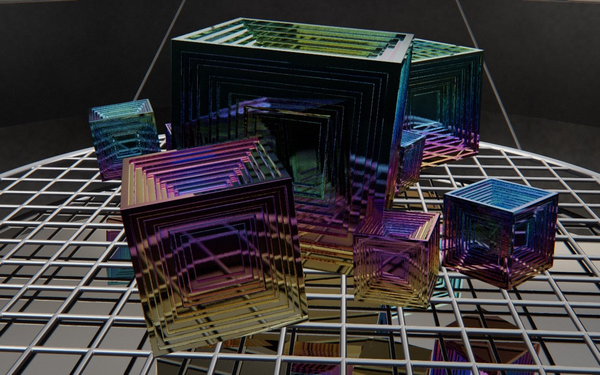

# Melt

*le bain de bismuth.* Dans un creuset de bismuth fondu, lisse comme un miroir, on vide le bain et l'on découvre des cristaux en trémie : des cubes aux faces creusées en escaliers. À l'air, le métal s'oxyde aussitôt, et les couleurs apparaissent, du haut vers le bas : or, magenta, bleu, vert. Puis le creuset chauffe par le bas. La croûte du fond fond sous la grappe, qui descend dans son propre bain. Le métal chaud attaque les cristaux à leur ligne de flottaison : les parois minces et les arêtes fondent d'abord, les gradins pendent en franges d'argent liquide, un cristal dont la taille a cédé se tasse. La peau d'oxyde de chaque cristal englouti s'étale un instant sur le miroir, puis se défait.



Rendu en three.js (WebGPU), entièrement procédural : une graine produit une scène. La démarche est dans [docs/concept.md](docs/concept.md), avec l'historique des versions abandonnées. L'essai d'image qui a décidé du sujet est dans `proto/b0`, celui de la fonte calculée dans `proto/s0`.

## Utilisation

| Touche | Action |
| --- | --- |
| N | nouvelle scène (nouvelle graine) |
| Espace | pause / lecture |
| ← / → | avancer ou reculer dans la boucle |
| H | masquer l'interface |
| F | plein écran |

Sur écran tactile : une touche met en pause, deux touches tirent une nouvelle scène, un appui long masque l'interface.

Paramètres d'URL :
- `?seed=…` ;
- `#r=…` (scène retouchée, « Copier le lien ») ;
- `?ui=0` ;
- `?mobile=1` / `?mobile=0` ;
- `?debug` (outils dans `window.melt`), avec `&sink=port` pour le collecteur d'images.

Le panneau règle l'humeur, le port des cristaux, la grappe, la gamme et la vitesse d'oxydation, la durée, le cadrage, la caméra et le rendu. Export MP4 image par image et PNG.

## Principe : la récolte, puis la fonte

Une seule horloge (`src/cycle.js`) :

| t | Ce qu'on voit | Cause |
| --- | --- | --- |
| 0 – 0,06 | le miroir ; les cristaux ont poussé dessous | le métal refroidit |
| 0,06 – 0,30 | on vide le bain : les cristaux sortent, le haut d'abord | la récolte (c'est ainsi qu'on récolte le bismuth) |
| 0,30 – 0,52 | le bain bas ; les couleurs mûrissent | l'air chaud |
| 0,52 – 0,86 | la grappe descend dans le bain, qui ne bouge pas, et fond à sa ligne de flottaison | le creuset chauffe par le bas : la croûte fond sous la grappe |
| 0,86 – 0,90 | les peaux d'oxyde des cristaux engloutis s'étalent et se défont | |
| 0,90 – 0,97 | le bain se remplit (rien ne dépasse) | |

La descente commune vaut D · x^1,5, avec x l'avancement de la fonte et D = LH − LL. La marée haute LH se règle sur la grappe : 0,14 cm au-dessus de son plus haut cristal. Chaque cristal y ajoute son propre tassement, calculé par la simulation.

- **L'oxyde naît à la sortie du bain.** Un point de hauteur y sort du bain à t_e(y). Son oxyde s'épaissit en racine du temps passé à l'air : e = r · 300 nm · √(t − t_e), plus un peu plus sur les gradins du fond. La chaleur du bain l'épaissit juste au-dessus de la ligne pendant la fonte : les couleurs défilent devant elle.
- **La fonte est calculée** (`src/melt/model.js`, `src/scene/melt.js`). C'est un problème de Stefan, résolu par la méthode de l'enthalpie sur une grille 3D par cristal, au chargement, sur le GPU. Dans le repère du cristal, le bain monte : sous la ligne, le métal brassé chauffe fort, au prorata de la part noyée d'une cellule. Au-dessus, un panache d'air chaud retombe vers l'air de l'atelier, sous le point de fusion. La croûte, plus froide, tient le pied. Une cellule qui a reçu la moitié de sa chaleur latente fond ; au-dessus du bain, le liquide s'égoutte.
- **Ce qui en sort sans réglage à la main** : les parois minces et les arêtes fondent d'abord, et une encoche se creuse à la ligne, comme à la ligne de flottaison d'un iceberg. Quand la section au ras du bain tombe sous 15 % de ce qu'elle était à cette hauteur, le bloc n'est plus porté et se tasse. Quand il ne reste plus que 20 % du solide qui a été hors du bain (des arêtes minces, le cadre d'une trémie creuse), ces restes ne tiennent plus : ils s'effondrent dans le bain en une seconde et demie, ce qui le ride. Sans cela, ces parois d'une ou deux cellules fondaient d'un coup, en l'air, d'une image à l'autre. Les petits cristaux fondent pendant qu'ils s'enfoncent.
- **On garde un seul champ par cristal** : l'instant τ où chaque point fond, et la vitesse du front v = 1/|∇τ|. Ce champ est lissé (la tension superficielle lisse les faces fondues) et rangé dans un atlas 3D. Le cristal à l'instant u de la fonte est { trémie } ∩ { τ > u }.
- **La peau d'oxyde** du cristal englouti s'étale depuis l'endroit où il a disparu. Le bain, chauffé par le bas, s'écoule en surface du centre vers les bords et l'emporte. Elle se fend, et ses plaques rapetissent jusqu'à rien avant la fin de sa vie : elle ne surgit pas d'un bloc, et aucune plaque ne disparaît encore visible.

**La boucle est parfaite par construction.** À t = 0 et t = 1, le bain couvre tout, et la grappe a repoussé sous lui. Un test vérifie, sur 200 graines, qu'aucun coin de cristal ne dépasse du bain à ces instants.

## Rendu

L'image est un lancer de rayons en shader de calcul WebGPU (`src/scene/tracer.js`). Il écrit l'image HDR dans une texture three.js, puis la chaîne d'image commune passe dessus.

- **Les trémies** sont des cubes dont chaque face est creusée en gradins, larges de 0,11 du demi-côté, chacun 0,75 fois plus profond que le précédent. Les variantes : en spirale (chaque gradin tourne de 0,07 rad) ou allongées.
- **Les couleurs sont la réflectance d'une couche mince** : formule d'Airy, oxyde d'indice 2,2 sur le bismuth d'indice 1,9 + 3,4 i, à six longueurs d'onde. Aucune couleur n'est peinte.
- **La fonte** : la distance au cristal est max(trémie, (u − τ) · v). Une face fondue est du métal liquide, sans oxyde.
- **Le bain** est un miroir qui mouille le cristal (un ménisque). La peau d'oxyde y flotte, une seule pellicule en dégradé fendue en plaques de Voronoï ; un cristal qui se tasse y fait des rides courtes et amorties.
- **Le studio** est un dôme : sombre près de l'horizon, pour que le bain, vu en rasant, reste un miroir noir, et clair en hauteur, pour que les faces des cristaux attrapent la lumière. Il est complété par des boîtes de lumière, propres à chaque humeur.

**Une distance juste pour les gradins.** La distance au cristal tient compte de la paroi du gradin extérieur voisin, pas seulement du fond du gradin. Sans elle, la marche traversait les parois, et les faces sortaient noires et piquées de points. Un rayon encore pris dans les gradins au dernier rebond voit le studio, pas le noir.

**L'anticrénelage.** Les arêtes des gradins, fines et brillantes, crénelaient. Chaque image est décalée d'une fraction de pixel (suite de Halton) et fondue dans un historique, borné par le voisinage 3 × 3 de l'image courante, pour que ce qui bouge ne laisse pas de traînée. La caméra et la grappe vont lentement : sans reprojection, l'historique converge vers une image suréchantillonnée. Il repart de zéro après un saut de temps, de position ou de taille.

**La performance.** L'essai d'image prenait environ 215 ms par passe en 1280 × 800. La scène prend environ 9 ms par image avant la fonte et 6 ms pendant, anticrénelage compris, pour trois raisons :
- tout ce qui bouge est calculé une fois par image en JavaScript, et la fonte une fois pour toutes ;
- chaque rayon ne visite que les cristaux dont la sphère englobante le croise ;
- un rayon qui ne croise aucun cristal touche le bain analytiquement, sans marche.

La simulation de la fonte prend une à trois secondes au chargement (au plus 2,5 · 10¹⁰ cellules × pas ; le pas de la grille grandit pour les grosses grappes).

## Variations

| Axe | Valeurs |
| --- | --- |
| Humeur | Studio, Forge, Tente claire, Heure bleue |
| Port | trémie, spirale, allongée |
| Gamme d'oxyde | or et magenta, arc-en-ciel, bleus et verts, presque argent |
| Grappe | grappe, druse dense, un grand cristal et ses satellites |
| Cadrage | plan large, au ras du bain, gros plan, plongée ; le cadre suit la taille de la grappe |

## Tests

```bash
node --test melt/test/*.test.mjs
```

Les tests vérifient :
- la recette (déterministe, JSON, tous les choix tirés) ;
- le bain et la descente (continus, périodiques, monotones ; le bain ne bouge pas pendant la fonte) ;
- le raccord : aucun cristal ne dépasse du bain au début et à la fin de la boucle, sur 200 graines ;
- la grappe : des cristaux posés, sans interpénétration franche ;
- la fonte : la grappe ne descend que pendant la fonte, de toute la marée, et la peau vient après ;
- le modèle thermique (en Node, sur une grille grossière) : le front suit la ligne de métal, et les parties minces fondent d'abord ;
- les grilles de fonte : elles contiennent chaque cristal et tiennent dans le budget ;
- la caméra, périodique, lente et toujours au-dessus du métal, même à marée haute ;

## Performances

Environ 9 ms par image avant la fonte et 6 ms pendant, en 1280 × 800, mesuré dans le panneau de navigateur de l'application. La simulation de la fonte prend une à trois secondes au chargement ; elle est plus grossière sur mobile. Ce n'est vérifié ni sur mobile, ni sur un autre GPU.

## Version mobile

`?mobile=1` : résolution réduite et dynamique, cadence plafonnée à 60 i/s. Elle n'a pas été vérifiée sur un appareil réel.
