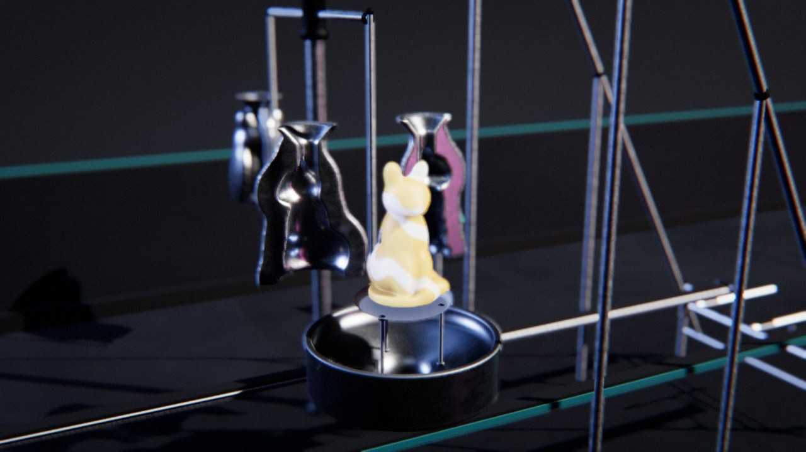

# Melt

*la refonte.* Une mini-usine refond sans fin la même cire. Sur un plateau de cuivre, un lapin de cire monte sous une lampe chauffante. Ses oreilles ploient, sa peau luit puis coule en lobes le long du corps, et la cire tombe du bord de l'assiette dans une cuvette. Par la buse, elle descend en filet dans un moule qui a la forme d'un canard. Le moule s'ouvre comme un livre : le canard est né de la même cire. Il prend l'ascenseur, et fond à son tour.



Rendu en three.js (WebGPU, TSL), entièrement procédural : une graine construit une usine. La démarche, et les cinq versions abandonnées avant celle-ci, sont dans [docs/concept.md](docs/concept.md). Les essais qui ont décidé de la fonte et de la machine sont dans `proto/h0` et `proto/h1`.

## État

Cette version est récente. Fait : la fonte, le cycle complet, les usines par graine, la chaîne d'image, une boucle entière contrôlée en lecture. Pas encore fait :

- la version mobile (la simulation demande une carte graphique de bureau) ;
- l'ombre de la machine sur la cire (la cire, elle, porte la sienne) ;
- les veines de l'objet neuf, qui ne reprennent pas celles de la cire fondue ;
- un contrôle de l'export vidéo et du saut dans la boucle.

## Utilisation

| Touche | Action |
| --- | --- |
| N | nouvelle scène (nouvelle graine) |
| Espace | pause / lecture |
| ← / → | avancer ou reculer dans la boucle |
| H | masquer l'interface |
| F | plein écran |

Paramètres d'URL : `?seed=…`, `#r=…` (scène retouchée, « Copier le lien »), `?ui=0`, `?debug` (outils dans `window.melt`, voir `shared/app/debug.js`), `?sink=<port>` (collecteur d'images).

Le panneau règle le lieu, la cire, la source de chaleur, le circuit et les deux objets de la boucle (nouvelle usine de la même graine), la caméra et le rendu.

## Le cycle (`src/cycle.js`)

La boucle enchaîne deux demi-cycles de 25 s, un par objet : 50 secondes. Un demi-cycle commence quand le moule s'ouvre :

| Temps (s) | Ce qu'on voit | Cause |
| --- | --- | --- |
| 0 – 1,8 | le moule s'ouvre comme un livre sur l'objet neuf | sa charnière |
| 1,8 – 6,8 | les deux plateaux échangent leurs places ; le moule se lève, se referme, le barillet pivote | lignes, ascenseurs, rampe |
| 6,8 – 8 | le moule suivant se pose, fermé, sur le plateau vide | |
| 8,2 – 22,6 | l'objet fond ; la cire coule dans le moule | la source de chaleur |
| 9,5 – 13,5 | les chariots des ascenseurs et de la rampe reviennent à vide à leur place d'attente | |
| 22,6 – 25 | la source s'éteint, la cuvette s'égoutte | |

Chaque ascenseur et chaque rampe a son chariot, à demeure : il attend au départ, emporte le plateau, le dépose, puis revient à vide pendant la fonte. Tout l'état de la machine est une fonction de la phase (`stateAt`). Les deux plateaux sont identiques : c'est l'ensemble de leurs places qui est continu et périodique.

## La fonte (`src/sim/mpm.js`)

Une simulation de matière par particules et grille (MLS-MPM) sur la carte graphique, d'après l'exemple `webgpu_compute_particles_fluid` de three.js, étendue :

- **Température.** Chaque particule a la sienne (1 = point de fusion). Sa surface est chauffée par la source, la cuvette du plateau est tenue chaude, et la chaleur se conduit par la grille.
- **Solide, pâte, liquide.** Un seul modèle, viscoélastique : une contrainte élastique qui se relâche d'autant plus vite que la matière est chaude. Froide, la cire tient ; tiède, elle flue (les oreilles ploient) ; chaude, elle coule.
- **La matière froide est figée.** Tant qu'elle est froide et qu'elle tient au plateau, de proche en proche, elle ne coûte qu'un dépôt par image. Ce qui ramollit ou ne tient plus devient libre.
- **Reproductible.** Les sommes sur la grille sont des entiers en virgule fixe : l'ordre des particules ne change pas le résultat. L'image de simulation ne dépend donc que de l'objet et du temps écoulé depuis le début du demi-cycle.

Environ 30 000 particules, une grille de 64 × 128 × 64 cellules attachée au plateau, quatre sous-pas par image. Tous les objets d'une usine ont le même volume (`src/objects.js`) : c'est la même cire.

## L'image

**La cire** (`src/scene/wax.js`) est une boîte dont le fragment marche dans les champs déposés par la simulation. Sa surface réunit l'objet d'origine, déplacé par la matière solide (net tant que rien n'a bougé), et la part liquide (lisse). Elle s'éclaire elle-même : deux lampes et la source de chaleur, avec l'épaisseur de cire traversée pour l'ombre propre et la translucidité.

**Son ombre portée** vient d'une seconde boîte, que seule la caméra d'ombre de la lampe principale voit : chaque rayon de lumière y marche dans les mêmes champs et écrit la profondeur du point de cire qu'il touche. L'assiette des plateaux est en émail, parce qu'un métal poli ne montre pas les ombres ; et l'ambiance des trois lieux est tenue basse, pour que ce soit la lampe qui dessine.

**Les moules** (`src/objects.js · mouldField, surfaceNets`) sont taillés au chargement d'après chaque figurine : une paroi qui suit l'objet, une bride au plan de joint, un canal de coulée et son entonnoir, le tout maillé puis lissé, en deux moitiés.

**L'usine** (`src/scene/factory.js`) est construite d'après la recette, dans un seul langage de pièces : des tubes fins de métal poli, une bague chanfreinée à chaque jonction, un pied tourné sous chaque montant, et la peinture réservée aux accents (liserés des convoyeurs, coulisseaux, abat-jour, pupitre). Convoyeurs étroits à bande et tambours, ascenseurs à deux colonnes de guidage et vis, rampe en tubes, mât à embase tournée, barillet de moules, source de chaleur au bout d'un col de cygne, sol dallé et mur à soubassement peint.

**La caméra** (`src/scene/stage.js · cameraAt`) accompagne la cire : gros plan sur la naissance, plan large pendant la montée, gros plan sur la fonte, puis descente le long du filet vers le moule.

## Tests

```bash
node --test 'melt/test/*.test.mjs'
```

Recette déterministe et tous les choix tirés ; figurines de même volume, dans leur boîte ; circuit refermé, moule levé sous la ligne haute ; demi-coques du moule fermées, hors de la figurine, moule refermé avant de pivoter ; cycle continu et périodique, plateaux en place pendant la fonte, barillet qui ne tourne que cloche levée ; chariots à demeure, aucun plateau sans chariot hors des lignes.

## Performances

Mesuré dans le panneau de navigateur de l'application (GPU d'un Mac), en 1280 × 720 : image seule 10 ms, dont 5 pour la cire ; simulation 3 à 7 ms par image selon la quantité de matière libre. En lecture sur une boucle entière (graine z0), 70 images par seconde ou plus dans le panneau. Environ la moitié des particules a passé la buse quand le moule s'ouvre ; le reste est un film trop mince pour se voir, et il arrive qu'une goutte reste près de la buse. La taille des deux moules ajoute environ une seconde au chargement. Non mesuré ailleurs.
