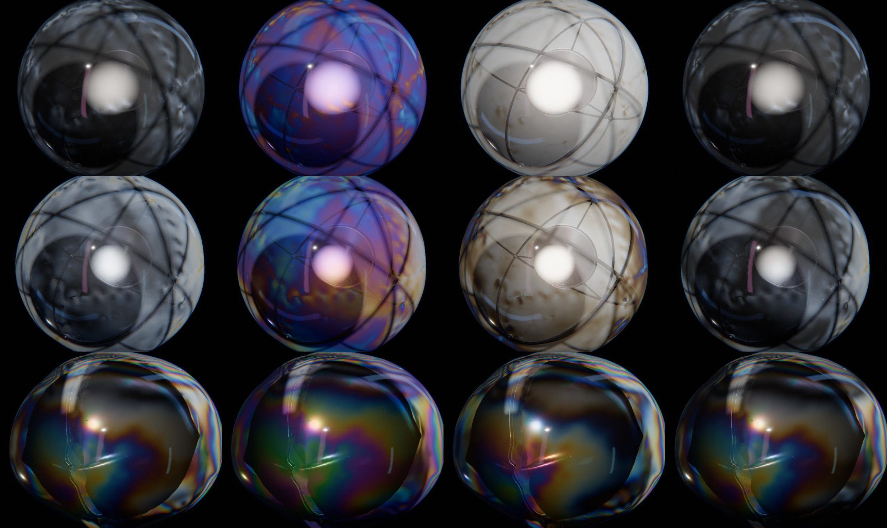
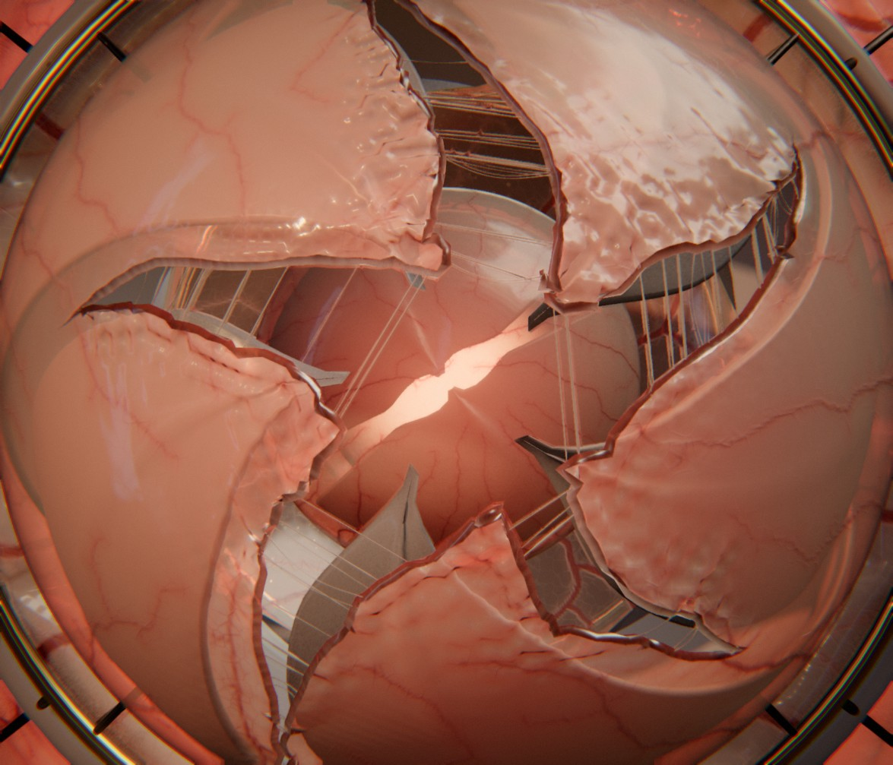

# Membrane

L'éclosion sans fin. Un solide géométrique dort dans une membrane translucide : vaisseaux, film humide, lumière qui la traverse. L'armature se déploie (sépales, lames, mâchoires, baleines, épingles ou polyèdre) et tend la membrane, qui s'amincit, blanchit puis se déchire. Les lèvres s'enroulent, des filaments s'étirent et claquent, les lambeaux se retroussent comme des pétales. La caméra plonge par l'ouverture vers l'œuf suivant, enveloppé lui aussi. Après quelques couches, la scène se retrouve identique à elle-même : la boucle est parfaite par construction.

Rendu physique en three.js (WebGPU, TSL). Scène entièrement procédurale : une graine produit une scène, et l'on peut en générer autant que l'on veut. Les déchirures sont simulées sur le GPU (dynamique par positions, shaders de calcul WebGPU), pas animées à la main. WebGPU est requis.

## Utilisation

| Touche | Action |
| --- | --- |
| N | nouvelle scène (nouvelle graine) |
| Espace | pause / lecture |
| ← / → | avancer ou reculer dans la boucle |
| H | masquer l'interface |
| F | plein écran |

Paramètres d'URL :
- `?seed=…` : une scène ;
- `#r=…` : une scène retouchée, produite par « Copier le lien » ;
- `?ui=0` : sans panneau ;
- `?debug` : outils dans `window.membrane`, dont `shot(u)` (une image fixe à une phase donnée) et `level(j, x)` (une couche seule, vue de l'extérieur, à la profondeur x) ;
- `?fast` : simulation grossière, pour la mise au point.

Le panneau règle tout :
- **Scène** : humeur, nombre de couches différentes, durée.
- **Plongée et chorégraphie** : rapport entre couches, début et fin de l'éclosion, respiration des œufs clos, ralenti au moment de la déchirure.
- **Caméra**.
- **Chaque couche** :
  - l'armature (nature, nombre de pièces, largeur, pointe, charnière, ouverture, vrille, gonflement, ordre d'ouverture, matériaux) ;
  - l'aspect de la membrane (couleurs diffusée et transmise, densité, netteté et flou au travers, réfraction, translucidité, film humide, lustre, irisation, feuille de métal, vaisseaux et capillaires, fibres, plis, blanchiment sous tension, lèvres, biréfringence sous tension) ;
  - son comportement (épaisseur, précontrainte, souplesse, résistance, hétérogénéité, enroulement des lèvres, viscosité, air, frémissement, fuite de la pression, adhérence, filaments, tracé des coupures, embranchements, retroussement, fatigue, dégrafage) ;
  - le mouvement.
- **Simulation** : finesse du maillage, images enregistrées, sous-pas, durée physique.
- **Lumière et fond** : studio HDR, lampe, contre-jour, cœur, brume, lumière polarisée (part polarisée, polariseurs croisés ou parallèles, linéaire, circulaire ou avec lame teinte sensible, angle, rotation, sensibilité).
- **Rendu** : qualité, anticrénelage, ombres, vue au travers des membranes, translucidité, tone mapping, bloom, occlusion, reflets en espace écran, flou de mouvement, profondeur de champ, traînées, halation, aberration chromatique, grain.

Une retouche d'aspect est immédiate. Une retouche de comportement ou d'armature relance la simulation de la couche, et l'ancienne version reste affichée jusqu'à l'arrivée de la nouvelle. L'export produit une boucle MP4 (H.264) rendue image par image, et une image PNG.

## Principe

**La plongée.** Une couche à la profondeur relative *x* a pour rayon D·qˣ, avec *x* = *d* − τ (*d* : indice de la couche, τ : l'avancée). La couche *d* utilise le modèle *d* mod N : la scène à τ + N est identique à la scène à τ. Tout ne dépend que de *x* : taille, orientation (les œufs lointains culbutent, puis présentent leur pôle à la caméra), instant de l'éclosion, visibilité.

**L'éclosion.** Elle se joue entre *x* = début et *x* = fin. La simulation, enregistrée image par image dans un tampon du GPU, et l'armature avancent avec *x*. Le ralenti autour de la déchirure est une déformation du temps τ(*t*) dont la vitesse reste positive et continue, et qui retombe sur ses pieds à chaque couche.

**La résistance.** Avant de céder, la membrane encaisse. L'armature mène de deux à quatre assauts, de plus en plus forts : elle pousse, recule, et repousse, sans à-coup (montée et retour en sinus carré). Pour la cage, ce sont des à-coups de pression. Pendant les assauts, la membrane se tend, bombe, blanchit, puis revient ; elle ne peut pas se rompre. Des à-coups de pression les accompagnent, si bien que toute la membrane respire sous l'effort. Les matières sont assez souples pour que la déformation se lise, même le vélin ou la feuille d'or, et la membrane blanchit dès qu'elle s'étire un peu. La rupture vient avec la poussée finale, quand la matière se fatigue. Les assauts sont écrits une seule fois et reproduits à l'identique dans la cinématique (JS), le vertex shader et la simulation GPU. Le ralenti de la chorégraphie tombe sur l'instant de la rupture.

**Pas de saut d'éclairage.** Une armature qui passe derrière la caméra s'efface en fondu, par un tramage renouvelé à chaque image et lissé par l'anticrénelage temporel. Son ombre s'efface avec elle : aucune ombre, aucune lumière vue au travers des membranes ne disparaît d'un coup. La luminance moyenne de l'image, mesurée sur toute une boucle, varie sans marche.

**Rien ne flotte.** Chaque œuf repose dans une coupe, au centre de l'armature de la couche précédente. Une tige relie cette coupe au pôle arrière de la membrane, que la coupe de la couche précédente reçoit à son tour. Des rayons relient la coupe à la couronne de charnières (ou aux sommets bas de la cage). Toutes les couches tournent à la même vitesse : leur orientation relative est fixe, rien ne glisse. Les pièces qui gonflent le font autour de leur charnière, et restent donc attachées. Un contrôle automatique vérifie, à plusieurs instants de l'ouverture, qu'aucune pièce ne pénètre une autre ni l'œuf suivant. C'est ce qui a conduit à monter les lames de l'iris en persienne, à les ouvrir ensemble et à limiter leur rotation.

**Les instances.** M emplacements, M multiple de N ; l'emplacement *j* montre toujours le modèle *j* mod N. Il ne change de couche qu'en passant de derrière la caméra au cœur lumineux, invisible aux deux bouts : jamais de changement de géométrie, jamais de saut visible.

## Simulation

**La préparation** (`src/gen/`, dans un Web Worker) :
- **le maillage** : une sphère géodésique, désordonnée puis détendue ;
- **le motif de déchirure** (`tear.js`) : chaque triangle reçoit l'étiquette du lambeau auquel il appartiendra (entre deux lames ; en spirale pour l'iris ; une perforation autour de chaque tête d'épingle et une cellule de Voronoï au-delà ; du centre de chaque face de la cage vers ses sommets). Les étiquettes sont calculées sur une direction déformée par un bruit fractal, et un réseau secondaire greffe des embranchements ;
- **le lissage des coupures** : chaque sommet d'un tracé glisse vers le milieu de ses voisins sur le tracé, puis les autres sommets se détendent autour. Le zigzag à l'échelle du maillage disparaît : la fissure est une courbe, l'irrégularité voulue demeure ;
- **les coutures** : sommets dédoublés le long des tracés, tenus par des liens ;
- **les tables de voisinage** de chaque particule (arêtes, flexion, liens, triangles), les lèvres, les fibrilles, la géométrie de rendu ;
- **la pose de l'armature** à chaque sous-pas.

**La dynamique** (`scene/gpusim.js`, shaders de calcul WebGPU). C'est de l'XPBD à petits pas, résolu particule par particule : chaque fil de calcul rassemble les corrections de toutes les contraintes qui touchent sa particule et les moyenne (Jacobi pondéré, deux tampons alternés). Pas d'atomiques, pas de coloration de graphe, résultat déterministe. Les contraintes :
- étirement, avec des longueurs au repos raccourcies (précontrainte) ;
- flexion ;
- pression intérieure, réglée pendant la mise en place, qui monte (cage) puis fuit dès la première rupture ;
- collisions avec l'armature et avec l'œuf suivant, avec frottement ;
- freinage de l'air (selon la normale, et quadratique : les grandes vitesses sont freinées, plafonnées) et frémissement des lambeaux.

Un fil par lien décide des ruptures : étirement autour du lien, seuil propre à chaque lien, fatigue, dégrafage de l'avant. La rupture se propage d'elle-même. Les lèvres s'enroulent, les lambeaux se relâchent et se retroussent.

Une couche de 20 000 particules (120 images, 16 sous-pas, 6 passes) se simule en moins de 3 s.

**L'enregistrement et la pose.** Le GPU enregistre la position de chaque particule à chaque image, quantifiée sur 16 bits (un demi-centième d'arête). À l'affichage, un autre shader de calcul pose chaque couche visible :
- positions interpolées par une spline de Catmull-Rom (au ralenti, la vitesse reste continue d'une image enregistrée à l'autre), et position à l'image précédente (vecteurs vitesse) ;
- normales soudées à travers les coutures encore intactes, puis lissées sur le premier anneau (le maillage simulé est volontairement désordonné : sans ce lissage, le reflet dessinerait ses arêtes) ;
- courbure, dont le matériau tire l'anticrénelage du reflet ;
- dilatation de surface J : la membrane s'amincit en 1/J ;
- endommagement près des déchirures ;
- déviateur de la déformation, pour la photoélasticité, et tenseur de compression, pour les plis (voir plus bas) ;
- sommets des lèvres : une demi-ellipse de cinq sommets autour du bord libre, repliée tant que la couture tient.

Une couche close ou finie (même image que la fois précédente) n'est pas reposée : ses tampons sont déjà justes. Le rendu lit ces tampons directement. Les instants de rupture et de claquage des fibrilles sont calculés une fois, sur le GPU.

**Les vaisseaux** (`vessels.js`). Ils sont obtenus par colonisation de l'espace à partir de racines près du pédoncule, et leur rayon suit le modèle des tuyaux. Le réseau est rastérisé dans une carte octaédrique de la direction au repos.

**L'armature** (`armature.js`, `kin.js`). Chaque pièce est rigide, à un facteur d'échelle près, et suit une loi de déploiement (gonflement, extension) puis d'ouverture autour d'une charnière. Les natures :
- **calice** : lames bombées en quartiers, éventuellement feuilletées (jusqu'à trois lames empilées, qui tournent autour de la même charnière et se déploient en éventail) ;
- **iris** : lames vrillées qui pivotent presque à plat, comme un diaphragme ;
- **gousse** : deux à quatre mâchoires nervurées ;
- **ombrelle** : des baleines le long des méridiens ;
- **couronne** : des épingles montées sur la couronne de charnières, qui coulissent (la tête perlée tend puis perce la membrane) puis s'inclinent ;
- **cage** : un icosaèdre, un dodécaèdre ou un octaèdre fixe, sous la membrane ; c'est la membrane qui gonfle et cède au milieu des faces ;
- **serres** : des cornes effilées et articulées (phalanges), dont la pointe se recourbe vers l'œuf comme une griffe.

Les épingles de la couronne portent une perle, un disque (tampon) ou une pointe. Le socle varie lui aussi : coupe lisse, cannelée ou ajourée (côtes et anneaux), couronne de charnières lisse ou perlée.

**Les allures.** Une armature s'ouvre de l'une de quatre façons : douce ; franche, avec un dépassement qui se pose ; par crans, comme un mécanisme ; ou élastique, en oscillant. L'allure est reproduite à l'identique dans la cinématique et le vertex shader.

**Deux jeux de matériaux.** Le socle (coupe, tige, rayons, couronnes) prend un second jeu de matériaux de l'humeur. Quand l'armature alterne, une pièce sur deux le prend aussi.

## Rendu (`src/scene/`)

**La membrane** (`membrane.js`, `gen/tess.js`). Chaque triangle simulé est découpé en n² triangles, que le vertex shader pose sur le patch cubique des triangles PN défini par les positions et normales de ses trois particules, normale quadratique comprise : les silhouettes et les lambeaux enroulés restent courbes. Deux niveaux de détail : ×16 pour les couches proches, ×4 pour les lointaines ; le passage de l'un à l'autre est invisible. La position à l'image précédente donne les vecteurs vitesse.

La matière est une couche mince diffusante :
- l'épaisseur relative vaut irrégularité × vaisseaux × fibres / J ;
- la transmission suit la loi de Beer-Lambert, avec l'absorption du sang (forte dans les gros vaisseaux, faible dans les capillaires) et un halo de sang diffus ;
- la membrane blanchit sous la tension et près des déchirures ;
- l'albédo est la part de lumière qui ne traverse pas.

**Lisibilité.** Une couche mince vue de biais est traversée sur une épaisseur h / cos : la silhouette d'une peau est plus dense que son centre, et l'on distingue la membrane de ce qu'elle contient. Le flou de ce qui est vu au travers dépend de la distance (une copie de la profondeur, propre à chaque couche) : une lame qui touche la membrane reste nette, le lointain se dissout. Seules deux ou trois couches profondes sont visibles à la fois.

Ce qui est derrière la membrane est une copie de l'image, propre à chaque couche et prise au moment où elle est dessinée. Les couches intérieures sont déjà là, et l'ordre de dessin le garantit : faces arrière de l'extérieur vers l'intérieur, puis faces avant de l'intérieur vers l'extérieur. La part non diffusée y est vue nette, la part diffusée floue (niveaux de mipmap), le tout réfracté selon la normale et l'épaisseur.

**Faces arrière sans copie.** Quand la caméra est hors d'une couche, sa face arrière n'est vue qu'au travers de sa face avant (ou au fond de la coupe ouverte). La face avant réfracte et floute déjà ce qu'elle laisse passer, si bien qu'une copie propre à la face arrière, avec ses mipmaps et sa copie de profondeur, ne servirait qu'à flouter deux fois. La face arrière se mélange alors directement à l'image, par le matériel : lumière propre + fond × transmission moyenne. Elle écrit vitesses et normales (alpha 1) et une réflectance nulle (alpha 0, pour la cible de réflectance). Le passage de l'une à l'autre ne se voit pas : en approchant du seuil, la version avec copie perd progressivement réfraction, flou, teinte, plis et reflets en espace écran, jusqu'à donner exactement l'image de la version mélangée, brume comprise. Mesuré de part et d'autre du seuil, l'écart est celui de deux images voisines. Gain : 3,5 ms par image.

Le modèle physique s'ajoute par-dessus :
- translucidité de la lumière venue de derrière : les lames se dessinent en ombres chinoises ;
- film humide, un vernis à sa propre normale ondulante ;
- lustre ;
- irisation, dont l'épaisseur du film suit 1/J : la couleur change quand la bulle s'étire ;
- feuille de métal : l'or battu, froissé en permanence, transmet une faible lueur verte, diffusée ;
- plis de compression (voir plus bas), fibres du vélin et de la soie ;
- anticrénelage spéculaire : la variance de la normale dans le pixel vient du relief et de la courbure par sommet, continue d'un triangle à l'autre (les dérivées écran de la normale interpolée, constantes par triangle, dessineraient les facettes dans le reflet).

**La photoélasticité** (`photo.js`, et `STRAIN` dans `gpusim.js`). Un film de polymère tendu devient biréfringent : entre deux polariseurs, la contrainte, invisible, se lit en franges colorées. La membrane le fait à partir de sa propre simulation :
- à chaque image, un shader de calcul tire de chaque triangle le gradient de la déformation F (du repos à la pose), puis le tenseur b = F·Fᵀ, ses étirements principaux λ₁ ≥ λ₂ et leurs directions. Il garde le déviateur logarithmique ½·ln(λ₁/λ₂)·(d₁d₁ᵀ − d₂d₂ᵀ), moyenné par aire autour de chaque particule, soudé à travers les coutures intactes, puis lissé. Une tension égale dans toutes les directions ne donne rien : un œuf gonflé reste noir entre polariseurs croisés. La déformation est mesurée depuis la forme au repos, et non depuis les longueurs relâchées : un lambeau étiré plastiquement garde sa biréfringence, comme un film plastique que l'on a tiré ;
- au pixel, le tenseur passe dans le repère de la vue et se projette sur le plan de l'image. On en tire l'écart Δ et l'axe θ, puis le retard Γ = C·Δ·h, où h est l'épaisseur traversée : amincie en 1/J et allongée en incidence rasante, d'où les franges serrées des silhouettes ;
- le calcul de Jones est fait pour 12 longueurs d'onde : polariseur, membrane (lame de retard), lame teinte sensible facultative (550 nm, à 45°), puis analyseur croisé ou parallèle. Les intensités sont intégrées avec les fonctions colorimétriques CIE 1931 (approximation de Wyman, Sloan et Shirley) et normalisées sur le blanc. On retrouve l'échelle de Michel-Lévy : gris, blanc, jaune, orange, pourpre à 550 nm, bleu, vert, rose… En polarisation circulaire, les bandes sombres de l'axe (isoclines) disparaissent et il ne reste que les franges de même retard (isochromes). Si les polariseurs tournent (un nombre entier de demi-tours par boucle), les isoclines balaient la membrane.

Seule la lumière qui traverse la membrane passe entre les polariseurs : ce que l'on voit au travers, et la translucidité du contre-jour. La diffusion dépolarise et le reflet reste blanc. On voit alors ce que la simulation sait et que l'œil ne voit pas : la contrainte qui s'accumule sous les lames pendant les assauts, en franges de plus en plus nombreuses, là où la membrane va céder ; les lobes autour du front de déchirure ; puis le relâchement en arrière de la fissure, et les lambeaux étirés qui restent irisés. Chaque couche est traitée comme si elle était seule entre ses deux polariseurs, ce qui est une approximation : les retards de couches successives ne se composent pas.

**Les plis** (`wrinkleSlope` dans `membrane.js`). Un film mince ne supporte pas la compression : il flambe en plis parallèles à la tension, comme un film étirable tiré entre deux doigts. Le maillage simulé est trop grossier pour les résoudre, mais il sait où la matière est comprimée, dans quel sens et de combien :
- la pose garde, dans le repère au repos (les plis restent attachés à la matière), le tenseur W = c·k·kᵀ, où k est la direction de compression (vecteur propre de C = FᵀF pour la plus petite valeur propre) et c = max(0, (1 − précontrainte) − λ₂) la compression au-delà de la longueur relâchée. Une membrane gonflée n'en a pas ; une membrane poussée par les lames en a autour d'elles, les lambeaux relâchés en ont partout ;
- la longueur d'onde suit la loi de Cerda et Mahadevan, λ ∝ √(t·L), où t est l'épaisseur de la membrane : la bulle plisse fin, la gélatine large. L'amplitude A = (λ/π)·√c fait passer dans l'ondulation le surplus de longueur de la matière comprimée ;
- les plis sont un bruit de phaseurs (Tricard et al., 2019) : des noyaux de Gabor orientés selon k, dont on ne garde que la phase. Les bandes ont un contraste constant et suivent l'orientation sans se rompre ;
- tout est analytique : le gradient de la hauteur, exprimé sur l'écran par les dérivées de la position au repos (prises hors de la branche), perturbe la normale. Seuls les pixels où la pente dépasse 2° évaluent le bruit, et une face mélangée n'en calcule pas. Coût : environ 0,6 ms par image.

**Les fibrilles.** Elles sont construites dans le vertex shader. Le filament s'étire et s'amincit à volume constant, ploie, puis claque. Chaque moitié se rétracte alors vers sa lèvre en oscillant, s'épaissit en goutte et se love. Un filament est fait de deux tubes, un par moitié : ils partagent leur anneau du milieu tant que le fil tient, puis se séparent au claquage, et la pointe de chacun se referme. Aucun tronçon n'enjambe l'écart entre les lèvres. Sur les matières humides, un fil qui s'amincit se résout en chapelet de gouttelettes (instabilité de Plateau-Rayleigh, au pas d'environ 9 rayons). Un fil plus fin qu'un pixel est dessiné à un pixel de large, et n'occupe qu'une part des pixels égale à sa couverture réelle : c'est un tramage renouvelé à chaque image, lissé par l'anticrénelage temporel. Il s'estompe au lieu de tracer une ligne dure. Six fils sur dix claquent tôt.

**L'armature.** Elle reprend les quarante finitions de Hollow et Tesseract : métaux au F0 mesuré, émail guilloché, damas, laque urushi, marbres, céramiques, nacre, carbone…

**Lumières.**
- **La lampe**, solidaire de la caméra, sans atténuation, avec les ombres de l'armature.
- **Le contre-jour**, derrière le nid, qui fait de chaque membrane un écran d'ombres chinoises.
- **Le cœur**, une lueur au centre d'où naissent les couches et que l'on devine au travers de toutes.

Le studio HDR fournit les reflets. Le post-traitement est repris de Tesseract.

## Membranes

- **Chorion** : amnios vascularisé, humide.
- **Cire** : pétale épais, très diffusant.
- **Latex** rouge ou noir : fortement précontraint, il claque et s'enroule.
- **Vélin** : fibreux et cassant, il libère beaucoup de fibres.
- **Gel d'agar** : épais et réfringent, il file en longs filaments.
- **Feuille d'or** : froissée, elle transmet le vert.
- **Bulle** : film lipidique irisé, dont le bord se rétracte en bourrelet.
- **Organza de soie** : avec son lustre, il s'effiloche.
- **Gélatine photoélastique** : la matière des modèles de photoélasticité, claire et très sensible. Elle s'étire beaucoup avant de céder, et les franges ont le temps de se multiplier.

Chaque matière a sa biréfringence sous tension. La gélatine et le caoutchouc sont très sensibles, le collagène (chorion, vélin) et la soie le sont moins. Le film liquide de la bulle et la feuille d'or ne le sont pas du tout.

## Humeurs

Chaque humeur favorise ses membranes, ses armatures, ses matériaux, son studio et ses lumières :
- Organique ;
- Clinique ;
- Abysses ;
- Joaillerie ;
- Atelier ;
- Irisé ;
- Rouge ;
- Polariscope : le nid entre deux polariseurs, devant une table lumineuse.

Une scène tire une matière dominante, parfois une seconde, et des armatures différentes d'une couche à l'autre.

## Performances

- **Préparation** d'une couche dans le worker : 0,4 s pour 20 000 particules (mesuré dans Node).
- **Simulation** sur le GPU (160 images, 16 sous-pas, 6 passes) : environ 5 s par couche ; une scène de trois couches est prête en 15 à 20 s, mesurée dans un panneau de navigateur masqué, donc ralenti.
- **Rendu** : environ 26 ms par image à 1,9 Mpx en qualité haute, plis compris, mesuré dans un panneau de navigateur (contre 32 avant les économies ci-dessous). Les postes, retirés un à un : copies de l'image environ 2,5 (6 avant les faces arrière mélangées), reflets en espace écran 3,4, occlusion ambiante 0,5 (8 échantillons, que l'anticrénelage temporel accumule d'une image à l'autre ; 1,6 avec 16), maillage fin des couches proches 1,1, bloom 0,7, plis 0,6.
- **Économies** : faces arrière sans copie (−3,5 ms), occlusion ambiante à 8 échantillons (−1,1 ms), poses des couches immobiles mises en cache.
- **Photoélasticité** : environ 3 ms par image (calcul de la déformation et intégration spectrale), et seulement si la lumière polarisée est allumée.
- **Mémoire** : les images enregistrées pèsent environ 25 Mo par couche différente.

