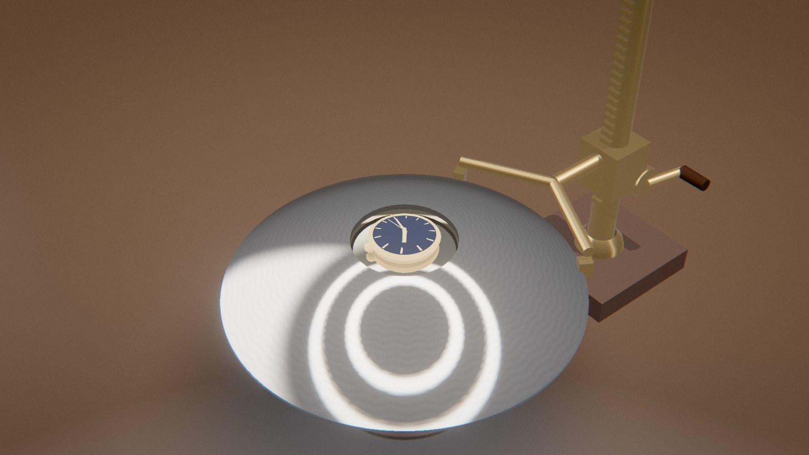

# Mirage

*l'objet qui n'est pas là.* Deux coupes d'argent poli posées l'une sur l'autre, sur un pied de bois tourné ; celle du haut est percée. Au fond, une toupie, une montre de poche ouverte ou une bougie chauffe-plat. On la voit posée dans l'ouverture, en relief, nette : la toupie y tourne, la montre y donne l'heure, la flamme y brûle. Mais l'objet est au fond, 5 cm plus bas, et ce qu'on voit est une **image réelle**, faite de rayons qui se croisent dans le vide. Une crémaillère soulève le couvercle : l'image s'enfonce dans la cavité et s'éteint, la caméra descend regarder par le jour entre les coupes et découvre l'objet là où il était. Le couvercle redescend, l'image revient.



Rendu physique en three.js (WebGPU, TSL), entièrement procédural : une graine produit une scène. Page technique : [explainer.html](explainer.html). La démarche est dans [docs/concept.md](docs/concept.md), avec ses deux concepts abandonnés : un horizon au très long foyer (une Fata Morgana au soleil de minuit), juste mais illisible, puis un cabinet de physique (une cuve de sirop, une plaque chauffée) où un milieu stratifié complétait une demi-figure — plus lisible, mais la seconde apparence n'était qu'une déformation. Le mirascope tient le thème au pied de la lettre : **on voit un objet, il n'est pas là** ; la cause est un appareil qu'on voit, et le geste qui la révèle est simple — lever le couvercle.

**Rien n'est dessiné qui ressemble à une image.** Chaque pixel suit son rayon entre les deux miroirs ; l'objet flottant sort de la géométrie des rayons, et disparaît de lui-même quand ils s'échappent.

## Utilisation

| Touche | Action |
| --- | --- |
| N | nouvelle scène (nouvelle graine) |
| Espace | pause / lecture |
| ← / → | avancer ou reculer dans la boucle |
| H | masquer l'interface |
| F | plein écran |

Sur écran tactile : une touche met en pause, deux touches tirent une nouvelle scène, un appui long masque l'interface.

Paramètres d'URL : `?seed=…`, `#r=…` (scène retouchée, « Copier le lien »), `?ui=0`, `?mobile=1` / `?mobile=0`, `?debug` (outils dans `window.mirage` : `still(nom, phase, l, h)`, `film([[graine, phases]])` — une graine peut s'écrire `graine:décor:objet` —, `shot`, `send`, `meter()`, `bench()`, `seam()`, `run()` ; `stage.raytrace.U.debug.value = 1` colore chaque pixel selon ce que son rayon a touché).

Le panneau règle l'objet et le décor, la durée ; **le mirascope** (finition des coupes, levée du couvercle, tours de la toupie ou heure de la montre) ; le cadrage ; le rendu. Export MP4 image par image (éventuellement accumulé) et PNG.

## Principe : deux paraboloïdes, chaque sommet au foyer de l'autre

Origine au sommet de la coupe du bas, y vertical, f = 5 cm, L la levée du couvercle :

- coupe du bas : y = r²/4f, pour r ≤ R = √2·f ;
- coupe du haut : y = f + L − r²/4f, pour 0,42·f ≤ r ≤ R (l'ouverture).

Fermées, elles se rejoignent à leur bord (y = f/2) et chaque sommet est au foyer de l'autre. Un point de l'objet, près du sommet du bas, est près du foyer du haut : ses rayons, réfléchis par la coupe du haut, redescendent presque parallèles à l'axe ; la coupe du bas les renvoie vers son foyer — dans l'ouverture. **L'image d'un point à la hauteur h se forme en y ≈ f + h, tournée d'un demi-tour autour de l'axe** ((x, z) → (−x, −z)) : la montre flotte avec son heure décalée de six heures, comme sur un vrai mirascope.

Couvercle levé, le sommet du haut quitte le foyer du bas : l'image descend (54 → 31 mm pour L de 0 à 3 cm) et surtout perd ses rayons (1 299 sur 2 000 fermé, 140 à 2 cm), qui s'échappent par le jour entre les coupes. On n'efface rien : l'image s'éteint parce qu'il n'y a plus de lumière pour la former.

| Objet | Ce qui flotte | Construction |
| --- | --- | --- |
| **Toupie** | une toupie de bois laqué qui tourne en l'air, un peu penchée | pointe d'acier au sommet de la coupe, corps tourné à bandes, tige |
| **Montre** | le cadran bleu nuit, ses index et ses aiguilles dorées ; la trotteuse fait deux tours par boucle | boîtier bombé, lunette, cadran, couronne ; posé sur l'arête de son fond |
| **Chauffe-plat** | une flamme qui brûle dans le vide, au-dessus de l'ouverture | godet d'aluminium, cire colorée, mèche ; la flamme vacille à des fréquences entières de la boucle |

### Le tracé

`src/gen/mirascope.js` (pur, pour les tests, les outils et le chargement) et `src/scene/raytrace.js` (le même calcul en TSL) :

- **Intersection rayon–paraboloïde** : un second degré en t, A = a(d_x² + d_z²), B = 2a(o_x d_x + o_z d_z) − d_y, C = a(o_x² + o_z²) + b − o_y ; forme stable q = −½(B + sgn B·√Δ), t₁ = q/A, t₂ = C/q (sinon, pour un rayon presque vertical, la racine utile se perd dans l'arrondi). Normale par le gradient (2ax, −1, 2az).
- **L'image d'un point** (`imageOf`) : 400 à 2 000 rayons en spirale de Fibonacci sur l'hémisphère ; on garde ceux qui sortent par l'ouverture après exactement deux réflexions, et l'on cherche le point le plus proche de toutes ces droites, (Σ I − d dᵀ) X = Σ (I − d dᵀ) p.
- **Le rendu** : un quad plein écran. Chaque pixel part de l'œil et teste cinq surfaces analytiques — intérieur et extérieur de chaque coupe (une coque de 2,5 mm), la table. Sur l'argent intérieur, il se réfléchit et repart (neuf rebonds au plus) ; sur l'extérieur guilloché, il lit le studio flouté selon la rugosité ; sur la table, sa matière et l'ombre douce de l'appareil. Dans la sphère qui contient l'objet, il avance par *sphere tracing* dans une SDF de révolution (les profils de `src/gen/profiles.js`). La flamme est une émission intégrée le long de chaque segment de rayon, au point le plus proche de son cœur.
- **Le mécanisme** est fait d'objets ordinaires dessinés par-dessus : pied tourné dont la coupelle épouse la coque, potence à crémaillère, pignon et manivelle (θ = L/r), bras à fourche qui pince le bord du couvercle et monte exactement avec lui. Le quad écrit la profondeur de son premier impact : tout s'emboîte.

### Posés, pas flottants

Un objet à fond plat dans une coupe concave ne touche pas le fond au centre : il repose sur l'arête de son pied, à la hauteur r²/4f du fond à ce rayon. Le godet (r = 9,3 mm) est donc 0,43 mm au-dessus du sommet, le boîtier de la montre (r = 11,8 mm) 0,70 mm ; la pointe de la toupie est au sommet.

### L'horloge et la boucle

Une seule horloge (`src/timeline.js`) : fermé (0–0,22), levée (0,22–0,38), ouvert (0,38–0,58), retombée (0,58–0,74), fermé. La caméra tourne lentement autour de la coupe, plonge pendant que le couvercle est levé (de 38–46° à 14–19° d'élévation) et remonte quand il redescend ; chaque temps est une marche douce, monotone. La toupie fait 24, 30 ou 36 tours par boucle, la trotteuse deux, la flamme vacille à des fréquences entières : **la boucle est parfaite par construction** (raccord mesuré : 10⁻⁹).

## Les décors

Un miroir ne montre que ce qui l'entoure : chaque décor est une pièce, pas un fond noir.

| Décor | Pièce | Lampe | Valeur | Finitions |
| --- | --- | --- | --- | --- |
| **Cabinet** | boiseries chaudes, une fenêtre froide | 3 400 K, de côté | sombre et chaude | argent, vermeil |
| **Atelier d'horloger** | murs gris clair, deux tubes au plafond | 5 200 K | moyenne | argent, étain, cuivre |
| **Salon de marbre** | pièce claire, deux hautes fenêtres, table de marbre | 5 600 K | claire | argent, vermeil, cuivre |
| **Nuit** | presque noire, une fenêtre bleue, une lampe chaude | 4 200 K, faible | très sombre | argent, étain |

## Tests

```bash
node --test 'mirage/test/*.test.mjs'
```

Les coupes se rejoignent à leur bord, chaque sommet au foyer de l'autre ; un rayon parallèle à l'axe repasse par le foyer ; l'image d'un point en f + h, au-dessus de l'ouverture, nette ; demi-tour autour de l'axe ; couvercle levé, l'image descend à chaque cran et garde moins de 15 % de ses rayons pour chaque graine ; un rayon de l'œil visé sur l'image rencontre l'objet après deux réflexions ; les objets reposent exactement sur le fond (aucun sommet ni arête dessous, contact à moins de 10 µm, couronne loin du fond, tout dans la sphère englobante) ; boucle refermée (levée, plongée, caméra, objets) ; temps monotones, la caméra ne plonge que couvercle levé ; caméra jamais sous la table ni dans les coupes, potence jamais devant la coupe ; recette déterministe, JSON pur, catalogue entier tiré, décors distincts.

## Performances mesurées

Graine m21 (montre, atelier), 1920 × 1080, mesuré panneau de navigateur masqué (20 rendus d'affilée puis `onSubmittedWorkDone`) : **≈ 4,6 ms par image couvercle fermé**, ≈ 2,2 ms couvercle levé (moins de rebonds). Au chargement : le studio HDR (≈ 0,17 s, calculé une fois par décor). Non vérifié : la fluidité en direct, un téléphone réel, l'export MP4.

## Version mobile

`?mobile=1` : six rebonds au lieu de neuf, 40 pas de sphere tracing au lieu de 64, studio de 512 × 256, chaîne d'image allégée (FXAA), résolution dynamique, cadence plafonnée à 60 i/s.
