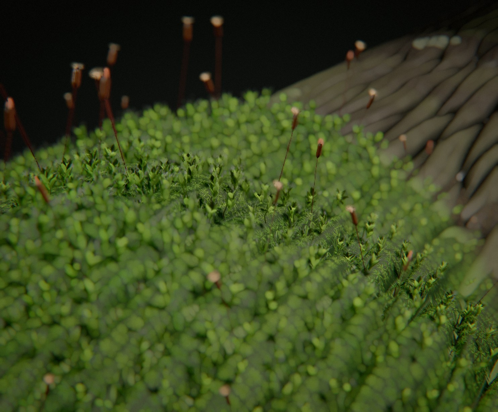

# Moss

*la reviviscence.* Une année de mousse sur sa pierre, en accéléré : elle se réfugie dans les fissures, reverdit à la première averse, s'étend en coussins sur la roche, puis se retire.

Au début, un plan large : une pierre de granit couverte de lichens, la mousse réduite à quelques îlots bruns dans ses fissures — les seuls endroits où l'eau reste pendant la sécheresse. Les pluies reviennent : on voit les averses passer en bandes, la roche foncer sous elles, et les îlots reverdir d'un coup. La caméra avance jusqu'au bord d'un îlot. Pendant toute la saison des pluies, la mousse **se propage** : un voile vert de protonéma avance sur la roche, les coussins s'épaississent derrière lui, leurs rosettes affleurent en étoiles serrées, les coussins se rejoignent. Puis la sécheresse : la roche pâlit, la mousse brunit et **se retire** dans ses fissures ; la caméra recule pour la voir partir.



Rendu physique en three.js (WebGPU, TSL). La scène est entièrement procédurale : une graine produit une scène. La démarche est dans [docs/concept.md](docs/concept.md) : le thème exploré sous six angles, les clichés écartés, dix pistes notées, les épreuves, puis la révision après les premiers rendus (la propagation, l'échelle des coussins, la roche cuite), d'après les retours et les photographies de référence.

## Utilisation

| Touche | Action |
| --- | --- |
| N | nouvelle scène (nouvelle graine) |
| Espace | pause / lecture |
| ← / → | avancer ou reculer dans la boucle |
| H | masquer l'interface |
| F | plein écran |

Sur écran tactile : une touche met en pause, deux touches tirent une nouvelle scène, un appui long masque l'interface.

Paramètres d'URL : `?seed=…`, `#r=…` (scène retouchée, « Copier le lien »), `?mood=…`, `?family=…`, `?ui=0`, `?mobile=1` / `?mobile=0`, `?debug` (outils dans `window.moss` : `shot(phase)`, `send(nom)`, `sheet(graines, phases)` — une graine peut s'écrire `graine:humeur:famille` —, `meter()`, `bench()`, `run()`).

Le panneau règle l'humeur et la famille (nouvelle scène de la même graine), la durée, le rayon de la pierre, la part de tiges à capsule ; la caméra ; les couleurs et la translucidité de la mousse ; le soleil, le contre-jour, la lumière du lieu, le ciel, la brume ; le rendu. Export MP4 image par image (éventuellement accumulé) et PNG.

## Principe : une propagation forcée par les saisons

Deux champs sur une grille de 64 × 64 posée sur la pierre (`src/field.js`) : **W**, l'eau de la roche, et **B**, la mousse ; une carte d'habitat **R** (la rétention), tirée de la roche elle-même : les fissures, les creux et le côté à l'ombre gardent l'eau.

  dW/dt = pluie(t, x)·(1 − W) − évap(t)·(1,2 − R)·W
  dB/dt = D∇²B + r·W·B·(1 − B/K) − m·(1 − W)·(1 − R)²·B,   B ≥ b₀·refuge(R)

C'est l'équation de **Fisher-KPP** : aux pluies, un front avance depuis les îlots à la vitesse 2√(rD) ; à la sécheresse, la mousse meurt d'abord là où la roche sèche vite et survit en fragments dans les fissures. La pluie passe en **bandes** (des averses qui traversent la pierre) puis s'installe ; l'évaporation suit la saison. La mousse ne pousse qu'à la saison des pluies, et aucune averse ne tombe pendant la sécheresse : le retrait est continu, du bord vers les fissures.

| Temps | Cause visible | Loi | Temps du film |
| --- | --- | --- | --- |
| les îlots reverdissent | une averse passe : la bande de pluie, la roche qui fonce | reviviscence : l'ouverture suit l'eau en quelques secondes | accéléré (une année en ~40 s) |
| les coussins s'étendent | la saison des pluies (ciel bas, roche mouillée) | Fisher-KPP : croissance logistique et diffusion | id. |
| la mousse se retire | la sécheresse (soleil haut et dur, roche pâle) | mortalité selon l'exposition, survie dans les fissures | id. |

**La boucle.** Le système est dissipatif : sous un forçage de période un an, il converge vers une orbite périodique ; on l'intègre jusqu'à ce que l'état à t + P égale l'état à t (deux à quatre périodes), puis on enregistre une année (30 états par seconde de film). L'image à u = 1 est l'image à u = 0, par construction. Le soleil suit les saisons (plus haut l'été, voilé aux pluies) sans jamais clignoter : l'accéléré garde l'heure de la prise de vue.

## Les coussins (`src/gen/colony.js`, `src/gen/build.js`)

- **Un coussin est un dôme.** Son épaisseur pleine est le maximum annuel de la mousse, adouci ; les tiges ne poussent que là où il y aura un coussin.
- **Les tiges** sont plantées dans la roche (sur son relief fin, fissures comprises) et suivent la **normale du dôme** : droites au sommet, couchées vers l'extérieur sur les flancs, où les rosettes débordent. Seule la rosette du sommet porte des feuilles ; le corps du dôme est un feutre de tiges serrées dans l'ombre.
- **Croître et se rétracter** : chaque tige s'allonge et raccourcit autour de son pied, et le feutre s'épaissit, par la même loi de la mousse locale — la rosette reste toujours à la surface du coussin, le bord du coussin avance et recule.
- **Rien ne se traverse** : chaque feuille est bornée à la cellule de Voronoï de sa tige ; une feuille serrée par une voisine s'écarte moins.
- **La feuille** : une lame épaisse à tranche arrondie dont la pose est calculée en forme fermée dans le vertex shader (même formule qu'en JS, `src/pose.js`) ; poil hyalin, nervure, translucidité qui croît avec l'eau, film d'eau brillant.

## La roche et l'écorce (`src/gen/rock.js`)

Un relief de 1 024² texels (0,27 mm), **cuit dans un worker**, puis lu deux fois sur le GPU : en **déplacement** des sommets d'un maillage de 720² (le vertex shader ; WebGPU n'a pas de geometry shader) et en **normal map** au pixel, avec un micro-relief procédural pour le macro, une carte de couleur minérale et de rugosité, et l'occlusion des creux.
- **Granit** : dalles séparées par des diaclases arrondies par l'usure, usure à trois échelles, mosaïque de cristaux (biotite, feldspath, quartz), lichens crustacés aréolés à apothécies noires, algues des creux humides.
- **Calcaire** : cupules de dissolution, cannelures, veines de calcite. **Grès** : lits ondulés, bandes ocre.
- **Écorce** (souches) : plaques en losanges étirés, sillons profonds, fibres, lambeaux arrachés qui montrent le bois.
- **Terre** (tourbière, sous-bois clair) : grumeaux, gravillons.

Ce même relief porte la mousse (les tiges sont plantées dessus) et fait l'habitat : **les fissures sont les refuges**, la propagation en part.

## Les décors

Le fond est **neutre** — un dégradé uni, sans paysage — pour ne mettre en valeur que la pierre ou la souche et sa mousse ; chaque humeur se distingue par son support, sa lumière et sa valeur.

| Humeur | Support | Lumière | Valeur | Cadrage |
| --- | --- | --- | --- | --- |
| Souche | souche couchée, écorce sillonnée | soleil de côté, contre-jour | fond sombre | ras, longue focale |
| Kokedera | granit à lichens | boîte à lumière douce | gris moyen | plongée |
| Lande | bloc de granit à lichens | soleil dur l'été, voilé aux pluies | fond très clair | ras |
| Muret | calcaire ou grès | soleil de midi | fond clair et chaud | contre-plongée |
| Tourbière | motte de tourbe, sphaigne | soleil bas à contre-jour | fond sombre bleuté | contre-jour |
| Rosée | motte de terre, aiguilles de pin | lumière froide | fond sombre et froid | plongée |

**Quatre familles** : la tortule (rosettes vissées au sec, étoiles argentées), le polytric (feuilles raides en ombrelle), la funaire (capsules penchées qui tournent sur leur soie), la sphaigne (capitules qui blanchissent au sec et rougissent mouillés).

**La caméra** : un plan large d'abord (toute la pierre — l'échelle), un travelling avant jusqu'au bord d'un îlot quand la pluie revient, le gros plan qui suit le front, puis un recul pendant le retrait ; trajectoire lissée (noyau gaussien périodique), pointe sous 25°/s.

## Tests

```bash
node --test moss/test/recipe.test.mjs moss/test/moss.test.mjs
```

Treize tests : la propagation est une orbite périodique et le raccord est exact ; la mousse se réfugie à la sécheresse, s'étend aux pluies (le front ne recule jamais pendant les pluies), se retire ensuite ; les refuges sont les fissures de la roche ; aucune feuille ne touche une feuille d'une autre tige ; les feuilles restent au-dessus de la roche, relief fin compris ; la caméra est périodique et lente ; recette déterministe et JSON ; humeurs, familles, eaux tirées ; matières des accords existantes ; humeurs différentes par le décor, la lumière et la valeur ; soleil presque blanc ; gestes des familles distincts.

## Performances

Génération d'une scène : 2 à 5 s pour les coussins et la propagation, 3 à 4,5 s pour la roche (dans Node, deux workers en parallèle pendant l'écran de chargement ; nettement plus lent quand l'onglet est en arrière-plan). Temps d'image mesuré dans le panneau de navigateur de l'application (GPU d'un Mac, panneau masqué), qualité Haute, 1,8 Mpx, graine b88 : **14 ms** en pleine saison (coussins étendus) ; graine s128 : 15 ms en pleine saison, 13,7 ms à la sécheresse. Les postes les plus lourds : les feuilles (~10 000 instances, pose calculée deux fois par sommet pour les vecteurs vitesse) et le maillage déplacé de la roche (720²).

## Version mobile

Imposée par `?mobile=1`, ou choisie d'office sur téléphone : moins de tiges, gabarit de feuille grossier, roche cuite en 640² sur un maillage de 360², une lumière de moins, chaîne d'image allégée, résolution dynamique. Non vérifiée sur un appareil réel.
