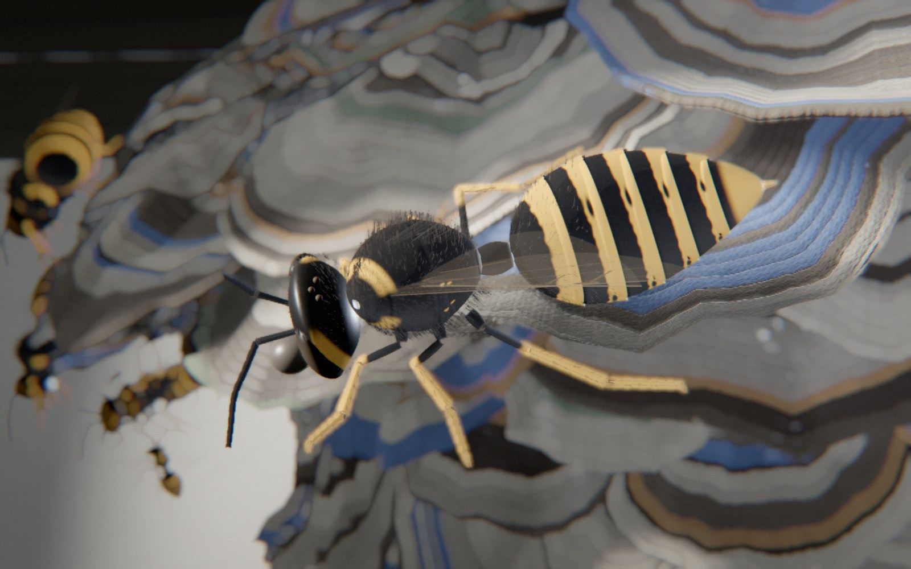

# Nest

*la saison de papier.* Un nid de guêpe sous une poutre, une saison entière en une boucle de 56 secondes. Au printemps, une reine se pose sur la tache grise qu'a laissée le nid de l'an passé, bâtit un pétiole, une dizaine de cellules, puis une première coupe de papier. Les ouvrières arrivent, et le nid enfle cloche après cloche : chaque nouvelle enveloppe descend comme une jupe par-dessus la précédente, écaille après écaille, bande après bande. Trois fois pendant l'été, le film ralentit jusqu'au temps réel : une ouvrière arrive avec sa boule de pâte et recule le long du bord d'une écaille en y posant une bande humide, chaque fois sur une autre cloche, avec la pâte d'une autre planche. Puis la colonie s'éteint, l'hiver fonce le papier, le givre prend sur les lèvres des écailles, le pétiole mouillé cède et le nid tombe. La poutre retrouve sa tache, la lumière du printemps revient.



Rendu physique en three.js (WebGPU, TSL). La scène est entièrement procédurale : une graine produit une scène. La démarche est dans [docs/concept.md](docs/concept.md) : le thème exploré en largeur, les clichés écartés (le nid gris vu de loin, le nid coupé en deux sur fond noir, l'essaim menaçant), huit pistes notées, la piste retenue avec ses références et ses épreuves.

## Utilisation

| Touche | Action |
| --- | --- |
| N | nouvelle scène (nouvelle graine) |
| Espace | pause / lecture |
| ← / → | avancer ou reculer dans la boucle |
| H | masquer l'interface |
| F | plein écran |

Sur écran tactile : une touche met en pause, deux touches tirent une nouvelle scène, un appui long masque l'interface.

Paramètres d'URL : `?seed=…` (une scène), `?mood=…`, `?family=…`, `?village=…` (imposer l'humeur, la famille, le village), `#r=…` (une scène retouchée, produite par « Copier le lien »), `?ui=0` (sans panneau), `?mobile=1` / `?mobile=0` (version mobile imposée / interdite), `?debug` (outils dans `window.nest` : `shot(phase)`, `send(nom)`, `sheet(graines, phases)`, `film(u0, u1, n)`, `meter()`, `bench(phase, n)`, `seam()` ; et `stage.only = k` pour ne montrer qu'une cloche).

Le panneau règle l'humeur, la famille et le village (nouvelle scène de la même graine), la durée de la boucle ; le dossier **Le nid** règle la forme (demi-largeur, demi-hauteur, bosses), la taille des écailles, la fidélité des ouvrières à leur source et les couleurs des sources. Viennent ensuite la caméra, la lumière et le rendu. L'export produit une boucle MP4 (H.264) rendue image par image, éventuellement accumulée, et une image PNG.

## Principe : une saison qui revient à la poutre nue

**La liberté** (la seule chose impossible du film) : les guêpes ne raclent que les volets, les portes et les bancs peints du village, si bien que chaque bande de papier garde la couleur de sa planche. Tout le reste suit ce qu'on sait des *Vespula* : le pétiole et le premier rayon de la reine, les coupes emboîtées du nid de fondation, l'enveloppe faite d'écailles en coquille, une bande par charge de pâte, la colonie qui croît puis meurt aux premières gelées, le nid jamais réutilisé, la chute du papier mouillé.

### La boucle

La saison s(u) est une fonction croissante de la phase u, avec s(0) = 0 et s(1) = 1 (`src/season.js`). L'état du nid ne dépend que de s : avant l'arrivée de la reine et après la chute, il ne reste que la cicatrice, une géométrie fixe qui n'a pas d'âge. Les guêpes sont absentes aux deux bouts, la lumière, l'humidité et le givre reviennent à zéro au printemps. L'état à u = 1 est donc exactement celui de u = 0 (`seam()` mesure 3·10⁻¹⁶).

### Le scénario

| Temps (u) | Ce qu'on voit | Cause | Convention de temps |
| --- | --- | --- | --- |
| 0 – 0,035 | la poutre nue, la tache de l'an passé, lumière de printemps | | accéléré |
| 0,035 – 0,066 | la reine arrive en vol, se retourne, se pose, râpe le bois | la reine | **temps réel** |
| 0,07 – 0,135 | le pétiole, puis le premier rayon : dix-neuf cellules ajoutées une à une autour du pétiole, un œuf blanc pondu au fond de chacune ; à partir de 0,122, la première coupe d'enveloppe descend autour du rayon et le referme | la reine (fantôme de l'accéléré) | accéléré |
| 0,1 – 0,65 | six cloches emboîtées, chacune bâtie du haut vers le bas | les ouvrières, de plus en plus nombreuses (jusqu'à 110), posées sur le front | accéléré (×3·10⁵), guêpes vues 12 fois par seconde |
| 0,196 – 0,274, 0,336 – 0,414, 0,476 – 0,554 | trois ouvrières, chacune sur sa cloche (2, 3, 4) : arrivée en vol avec sa boule de pâte, vol stationnaire, pose, bande posée par coups, vrombissement, envol ; entre deux, la caméra remonte voir le nid grandir puis redescend | l'ouvrière | **ralenti ×0,5** |
| 0,65 – 0,705 | la colonie s'éteint, le soleil d'automne baisse | | accéléré |
| 0,705 – 0,8 | le papier boit l'humidité, le givre prend | l'hiver | accéléré |
| 0,81 – 0,83 | le nid s'affaisse, penche et tombe hors du cadre | le pétiole mouillé cède, g = 9,81 m/s² | **temps réel** |
| 0,83 – 1 | la caméra revient vers la tache, le printemps revient | | accéléré |

Le nid fini ne tient qu'un cinquième du film (de 0,65 à 0,82) avant de se décrocher.

Une seule horloge commande tout : la croissance, la lumière (le soleil d'été monte et déplace sur le mur la tache de la fenêtre), l'humidité, le givre, la colonie et la caméra.

## Génération (`src/gen/`, dans des Web Workers)

**L'enveloppe** (`envelope.js`). Chaque cloche k, d'échelle λₖ ∈ {0,17 ; 0,3 ; 0,46 ; 0,63 ; 0,82 ; 1}, est une enveloppe complète :

- une **base** étoilée autour du centre, ρ(direction) : un ellipsoïde en bas et une superellipse en haut (|ρh/a|² + |ρy/b|^p = 1, résolue par Newton), si bien que le nid reste large jusqu'à la poutre ; de petites cloches en boule, pendues à leur pétiole ;
- des **racines** en semis de Poisson sur la base (espacement ∝ λ^0,75 : les petites cloches ont des écailles plus petites) ;
- chaque **écaille** est un demi-disque en superellipse (|X|^2,6 + Y^2,6 = 1 : un bord libre large et plat), posé dans le plan tangent à sa racine et projeté sur la base, puis soulevé d'autant plus qu'on va vers son bord libre (poche profonde, lèvre relevée et roulée), taille log-normale, biais et bord effrangé propres ;
- le **drapage** : les écailles sont posées de bas en haut ; chacune épouse ce qui est déjà posé, hauteur = max(profil, pile + jeu), où la pile est une grille (θ, φ) des hauteurs déjà posées, **prise au maximum sur un voisinage d'un pas de sommet**. Sans cette dilatation, la lèvre fine d'une écaille du bas tombait entre deux sommets d'une écaille du haut et la perçait (des traits blancs) ; un test la vérifie, avec un témoin sans dilatation qui doit échouer ;
- chaque écaille devient une **lame épaisse fermée** (dessus, dessous, tranche en demi-rond aux normales calculées), 0,3 mm de papier ;
- les **bandes** : 25 à 45 par écaille, une par charge (2 à 3 mm), dont la source est tirée par une chaîne de Markov (probabilité 0,3 à 0,45 de rester sur la même planche) ;
- les **naissances** : un front descend de l'attache vers le trou de vol ; une écaille ne naît que lorsque celle qui la recouvre a poussé jusqu'à sa racine (sinon son amorce flotterait sous le front), jamais avant celles nettement plus haut ; le corps (la feuille sous les écailles) paraît après la dernière écaille de sa rangée.

**La fondation** (`comb.js`) : un pétiole torsadé évasé sur la poutre, qui pousse de la poutre vers le bas, puis dix-neuf cellules hexagonales en spirale autour de lui, parois en lames épaisses qui s'allongent, leur intérieur assombri vers le fond (la carte d'ombres ne résout pas une cellule de 5 mm) ; dans chaque cellule à demi construite, un œuf blanc nacré collé au fond. La caméra regarde le rayon par en dessous, dans les cellules ouvertes.

**La cicatrice** (`buildScar`) : la plaque de papier délavée, déchirée, qui reste collée à la poutre ; la même aux deux bouts de la boucle.

**La guêpe** (`wasp.js`) : un modèle anatomique de *Vespula* — tête large et plate, resserrée vers le clypéus, dont les yeux sont un bombement de la capsule même, placés au bord de la face (contour réniforme échancré au bord avant, redessiné au pixel par la même formule que la géométrie, facettes hexagonales), orbites et échancrure jaunes, front noir au-dessus des antennes, tempes jaunes, trois ocelles, clypéus, mandibules dentées, antennes coudées (scape, flagelle de dix articles annelés), mésosome découpé (propodéum, scutellum, scutum en dôme, collerette du pronotum), gastre de six tergites distincts qui se recouvrent et aiguillon, six pattes (hanche trapue, fémur renflé et aplati, tibia qui s'évase, éperons, cinq articles de tarse, griffes), ~3 400 soies, chacune sa nuance (brun sombre sur la tête et le thorax, dorées sur le gastre) ; quatre ailes nervurées (cellules marginale et sous-marginales, ptérostigma), pliées en long au repos. Deux niveaux de détail : 39 500 sommets de près, 4 300 de loin (sans soies, sections deux fois plus grossières).

**Le squelette** (`skeleton()`) : douze chaînes — six pattes de quatre articulations (balayage à la hanche, fémur, genou, cheville), deux antennes, deux mandibules, la tête, le gastre — dont les pivots et les axes viennent du même module que la géométrie. Le vertex shader fait la cinématique directe, de l'articulation la plus lointaine à la plus proche ; antennes et mandibules suivent ensuite la tête. Chaque famille de chaîne a sa branche : un sommet ne calcule que les angles de la sienne.

## Scène (`src/scene/`)

- **Papier** (`paper.js`) : la coordonnée de croissance t = |(X, Y)|_2,6 / E est calculée **au pixel** à partir de coordonnées planes qui varient linéairement (une interpolation de t par triangle dessinait des anneaux polygonaux) ; bords de bande ondulés et fibreux, fibres couchées le long de la bande, crête de chaque bande et sillon entre deux, pâte humide plus sombre et plus brillante, humidité d'hiver par plaques, givre sur les lèvres ; translucidité (`MeshSSSNodeMaterial`, faible). Le masque de croissance (t ≤ g) se lit au pixel ; une écaille pas encore née est écrasée en un point dans le vertex shader.
- **Deux tracés par cloche** : les écailles finies, sans masque (le test de profondeur élimine les couches cachées), et le front, seul à porter le `discard`. À 1080p, la cloche pleine passait ainsi de 38 à 16 ms.
- **Le temps fort** : une écaille presque finie, tournée vers la caméra et dont le bord libre n'est recouvert par aucune autre (vérifié sur les sommets), reçoit un tiers de bande de plus, déposé le long du bord devant les mandibules de l'ouvrière, qui recule. L'ouvrière est enveloppée de quatre volumes (gastre, thorax, tête, ailes repliées) confrontés à tous les sommets du papier proches : pour chaque point de la course, le plus petit déplacement vers le dehors et vers le bord libre qui les dégage, calculé une fois puis interpolé. L'écaille et le placement sont choisis pour l'appui : parmi les douze meilleures écailles, celle où, sans aucun sommet dans l'ouvrière, le plus de tarses trouvent du papier à portée (au bord libre d'une écaille dont l'intérieur est recouvert, elle marchait à moitié dans le vide) ; un décalage vers l'intérieur de 3 mm au plus (ses mandibules restent sur la bande), le même sur tout le passage ; l'ouvrière peut se tenir à cheval sur deux écailles, chaque tarse cherchant le papier sur la couche la plus proche de lui. Chaque tarse est ensuite posé sur le papier (`legs.js`) : le squelette du shader refait en JavaScript donne le bout de chaque patte, la hauteur du papier dessous est lue sur la couche où se tient l'ouvrière (poids continus, sans marche), et une correction du fémur, trouvée en quelques itérations, l'y amène ; une patte au-dessus du vide balaie sa hanche (d'avant en arrière) et son fémur pour trouver du papier ou agripper la tranche ; s'il n'y a rien à portée, elle est relevée et tenue immobile (le balancement de la marche annulé à la hanche), au lieu de faire des pas dans le vide. Hanche et fémur tiennent dans un seul flottant par patte (les attributs d'instance sont presque tous pris). Les corrections sont calculées image par image sur toute la course, comblées dans le temps, résolues exactement à chaque image puis lissées légèrement, et une patte qui resterait dans le papier au bord d'une lèvre se lève jusqu'à en sortir. La boule de pâte qu'elle tient aux mandibules (le cou suit ses gestes) maigrit à mesure que la bande est posée : c'est la cause visible de la bande. Elle travaille par coups (six fois : un pas en arrière, puis une pause où la tête balaie le bord en mâchant et où les antennes s'abaissent sur le papier), et avant l'envol ses ailes vrombissent sur place (le battement suit le repli des ailes, pas le vol du corps).
- **Guêpes** (`wasps.js`, `flight.js`) : corps et ailes instanciés (32 flottants par guêpe : pose et gestes courants et précédents, pour les vecteurs vitesse) ; la pose est une fonction du temps physique t = s·T : arrivée en courbe de Bézier sur le front de construction ou au trou de vol, marche (trépied, balayage de ±0,42 rad, foulée de ~3,4 mm liée au chemin parcouru : les pieds ne glissent pas), envol ; antennes qui palpent, mandibules qui mâchent, gastre qui pompe. Les ouvrières se posent sur une carte du relief réel de la cloche (rayon maximal du dessus des écailles), pas sur un ellipsoïde. Dans l'accéléré, une prise de vue toutes les 1/12 s de film : chaque guêpe se lit, nette, entre deux prises. En vol, chaque aile est tracée à cinq instants du battement, à un tiers d'opacité : le flou d'une aile à 150 Hz, sans scintillement. Les seize guêpes les plus grandes à l'écran prennent le modèle complet, les autres le modèle allégé (squelette réduit, sans ombre).
- **La reine** : elle arrive en temps réel, du fond (jamais devant l'objectif), se retourne et se pose (le corps à la hauteur de ses pattes), fait quelques pas jusqu'au site et y râpe le bois, par coups de 1,1 s : elle recule de 1,6 mm en arrachant une fibre, la tête basse et les antennes sur le bois, marque une pause où la tête balaie, et revient d'un pas (la foulée compte l'aller et le retour). Le pétiole pousse ensuite de la poutre vers le bas, au bout de ses mandibules, jamais sous elle ; dans l'accéléré, elle se tient au bord du rayon, qu'elle suit à mesure qu'il s'élargit (un test confronte tous les sommets du chantier au corps de la reine, à chaque instant de la fondation).
- **Le shader de la cuticule** : le noir est lisse et lustré (reflet net, rugosité 0,3), la ponctuation mate ; creux et jointures (l'avant de chaque tergite sous le précédent, les sutures du mésosome, la base des articles) sombres et sans reflet ; le jaune varie (plus chaud au milieu d'une plage, plus citron sur ses bords) ; les soies sont mates (vues de biais, leur reflet montait vers son maximum et les allumait en traits blancs). Les guêpes ne reflètent que 35 % du studio (sous la poutre et contre le papier, presque tout ce qu'elles voient est sombre ; l'occlusion ambiante ne touche pas les reflets). Les ailes ne dessinent qu'une face par vue (repliées, leurs deux faces des deux côtés empilaient une douzaine de couches de membrane : un voile gris).
- **La caméra** (`camera.js`, `core.js`, `stage.js`) : une orbite autour du nid, une seule horloge (`cameraOrbit` : repères posés sur les temps du film, lissés par un noyau gaussien périodique, raccord exact) — un arc lent autour de la reine, qu'elle suit en translation une fois posée ; une spirale qui monte et tourne de ~50° pendant la croissance ; le retour lent du déclin ; la descente de l'hiver ; le retour au printemps. Au temps fort, la caméra quitte le film en grue : la visée part la première vers l'écaille, la direction de visée tourne en arc (sa vitesse est donc bornée par construction) et la distance change en échelle logarithmique ; si le chemin tombe dans l'enveloppe, la caméra recule le long de sa propre ligne de visée (l'image ne tourne pas). Elle suit l'ouvrière au vol stationnaire, puis glisse le long du bord pendant le travail (un travelling de ±0,2 rad en se rapprochant, ancré sur une progression continue : il ne suit pas les à-coups des pas) ; c'est l'envol qui la ramène en arrière. L'angle du gros plan est choisi dégagé sur tout l'arc et proche de la direction d'où arrive la caméra ; la descente dure d'autant plus que le détour est grand. Trois temps forts, chacun sur sa cloche, choisis dans l'ordre du film et du même côté du nid que le précédent : quand le retour de l'un chevauche la descente du suivant, la caméra les compose (un plan de transfert qui remonte voir le nid grandir, puis redescend). Mesuré image par image sur cinq graines : au plus 21°/s hors des temps forts, 45°/s pendant.
- **Décor** (`decor.js`) : poutre de chêne altéré (cernes, fibres, fentes de séchage, badigeon resté dans le fil), mur de chaux, rameau à écorce, fond de brume pour les humeurs du dehors.
- **Lumière** : une lampe (la fenêtre, dont le cadre et les croisillons sont projetés par un `colorNode` de la `SpotLight` ; ou le soleil, ou une lampe de porche), un contre-jour, un studio HDR calculé ; la lampe suit la saison.
- **Chute** : chute libre réelle (½·g·t², 1 unité = 10 cm), précédée d'un affaissement de 1,2 mm et d'une bascule autour de l'attache.

## Familles et humeurs (`src/recipe.js`)

- **Familles** : *boule* (Vespula sous une poutre : sphère d'écailles en coquille, large attache) et *lanterne* (Dolichovespula : poire allongée, attache étroite, feuilles plus grandes et plus plates, bandes plus larges).
- **Villages** (les sources de papier, le bois d'abord, la peinture en accent) : Provence (bleu de volet), Falun (rouge de Falun), Bois seul, Rivage (bleu outremer), Verger (vert).
- **Humeurs**, chacune un décor, une lumière, une valeur, un cadrage :
  - *Comble* d'après Hammershøi : poutre de chêne grisée, mur de chaux, la fenêtre hors champ et ses croisillons sur la poutre et le mur ;
  - *Midi* : avant-toit blanchi, mur ocre clair, soleil dur d'en haut, ciel bleu, forte contre-plongée ;
  - *Haie* : un rameau dans la brume vert-gris, ciel couvert, de trois quarts ;
  - *Contre-jour* : poutre sombre, la fenêtre derrière le nid ;
  - *Nuit* : lampe de porche chaude sur le côté, ombres bleues de la lune ;
  - *Givre* : poutre peinte au rouge de Falun, jour blanc de neige.

## Tests

```bash
node --test 'nest/test/*.test.mjs'
```

Tests (sur l'horloge de 56 s) : la recette (déterminisme, JSON, tirages, direction artistique : le papier est d'abord du bois, contraste de valeur des bandes, lampes presque blanches sauf la lampe de porche, six décors distincts) ; l'horloge (s croissant, raccord, ralentis au temps réel, plan ordonné, temps fort au milieu de sa cloche, colonie à une seule montée) ; la caméra (raccord, moins de 25°/s, aucun saut, à 120 i/s) ; les guêpes (absentes au raccord, quaternions unitaires) ; l'enveloppe (aucun NaN, **aucune écaille sous une écaille posée avant elle, et le témoin sans dilatation échoue**, naissances dans leur fenêtre, front qui ne remonte pas, corps jamais en avance) ; la cicatrice identique aux deux bouts.

## Performances mesurées

MacBook (Apple Silicon), Chrome, 1920 × 1080, qualité Haute (TRAA, GTAO, ombres 2048, profondeur de champ ; sans SSR) : **16 à 18 ms par image** mesurées sur une machine au calme (graine a1, phases 0,2 à 0,7). Les mesures suivantes, faites pendant que d'autres onglets occupaient le GPU, triplaient tout, scène vide comprise : elles sont à refaire.

| Poste | Mesure |
| --- | --- |
| génération des six cloches (workers en parallèle) | 0,8 à 1,8 s chacune (6,5 s de calcul en tout), ~2 s au chargement |
| géométrie | 2,4 M sommets (six cloches), deux visibles à la fois |
| cloche pleine, un seul tracé avec masque | 38 ms par image |
| cloche pleine, deux tracés (finies + front) | 16 ms |
| SSR (coupé par défaut : le papier est mat) | +16 ms |
| GTAO | ~6 ms |

**Passe d'optimisation** (2 268 × 1 400, soit la qualité Haute ×1,5 sur un écran Retina ; meilleur de trois passages alternés avec la version précédente, la carte graphique étant partagée) :

| Instant | Avant | Après |
| --- | --- | --- |
| nid entier (u = 0,6) | 47,8 ms | 18,6 ms |
| croissance (u = 0,3) | 67,4 ms | 18 ms |
| hiver (u = 0,8) | 45,7 ms | 15,8 ms |
| gros plan de l'ouvrière (u = 0,425) | 43,8 ms | 28,7 ms |

Trois causes, sans rien changer à l'image (écart moyen sous le bruit entre deux captures identiques) :

- **Les couches d'écailles** : elles se recouvrent en tuiles, et chaque pixel évaluait tout le shader du papier une fois par couche. Une pré-passe de profondeur (même sommet que la passe des écailles finies, décalée d'un rien vers l'arrière) ne laisse ombrer que la couche visible.
- **Les lectures du bruit sous le pixel** : le volume de bruit 3D commun n'a pas de mipmaps ; lu jusqu'à pos × 1 500 (fibres, grains, relief), il saturait le cache de textures, même quand le fondu effaçait le résultat. `scene/nz.js` (`nzIf`) saute la lecture quand son poids est nul : fondu sous le pixel, partie de l'objet (écaille ou corps), saison (humidité, givre).
- **La pré-passe de l'occlusion** redessinait toute la scène en pleine définition pour une occlusion calculée en demi-définition : elle est en demi-définition.

Le processeur ne compte pas (moins de 2 ms par image, guêpes et temps fort compris). Au gros plan, le papier vu de près (~10 ms), le corps des guêpes (4 à 9 ms) et la profondeur de champ restent les postes principaux.

## Version mobile

`?mobile=1` : écailles 1,25 × plus grandes (deux fois moins nombreuses), grille d'écaille 6 × 14, chaîne d'image allégée (FXAA, sans GTAO), résolution dynamique, 60 i/s plafonnés.

## Ce qui n'est pas vérifié

- La lecture fluide en direct dans un navigateur affiché (les vérifications ont été faites en images fixes et en mesures, dans un Chrome sans tête).
- Les temps d'image ont été mesurés sur une carte graphique partagée (d'un passage à l'autre, la même version varie du simple au double) : les gains sont des rapports entre meilleurs passages alternés, pas des temps absolus.
- L'appui des pattes (hanche et fémur, sans le genou) ne vaut que pour les ouvrières des temps forts : mesuré sur cinq graines, 0 à 4 % des tarses sans papier à portée (13 % au pire, relevés et immobiles), 1 à 12 % qui flottent de plus d'un demi-millimètre, et au bord d'une lèvre d'écaille un tarse peut s'enfoncer jusqu'à 1,1 mm sur une image isolée (1 % des tarses au-delà de 0,07 mm) ; le pied ne reste pas cloué au papier pendant l'appui ; les ouvrières de l'accéléré gardent la pose nominale. La caméra du temps fort monte jusqu'à 48°/s sur une graine (a1).
- L'humeur *Contre-jour* ne fait pas encore briller le papier comme un vrai contre-jour.
- Les familles *ombrelle* (Polistes) et *clocher* (Chartergus) du concept ne sont pas faites.
