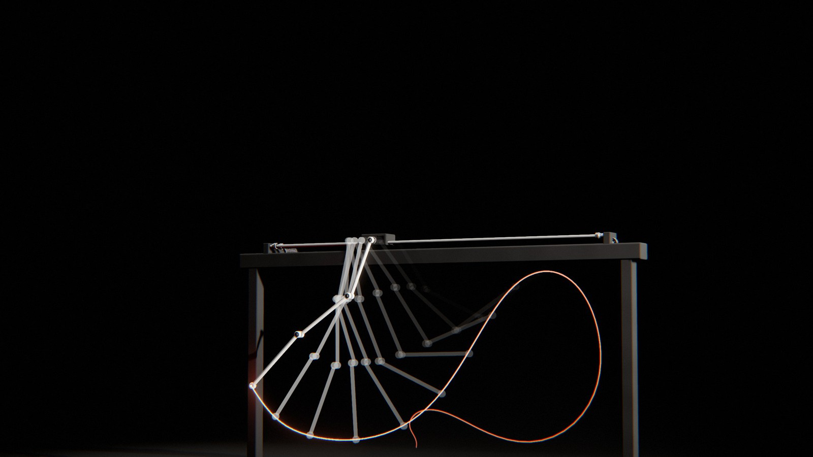

# Pendulum

*l'équilibre renversé.* Une chaîne de pendules pend, immobile. La machine qui la porte se met en mouvement — un chariot qui donne des à-coups sur son rail, un bras qui pivote autour d'une colonne, un coude qui se plie comme un gymnaste, un volant qui s'emballe — et la chaîne, qui n'a aucun moteur dans ses articulations, se met à balancer, de plus en plus haut, se dresse d'un coup de fouet et **reste debout, à l'envers, immobile**. Puis elle se replie dans une autre figure et revient pendre. Chaque manœuvre est une trajectoire calculée : un problème aux deux bouts, résolu sous l'écran de chargement.

Rendu physique en three.js (WebGPU, TSL). La scène est entièrement procédurale : une graine produit une machine, une suite d'équilibres, des trajectoires, un décor et un film. La démarche est dans [docs/concept.md](docs/concept.md) : le thème exploré sous six angles, les clichés écartés, neuf pistes notées, les épreuves (crédibilité, variété, ambition, déclinaison, scénario, références).

## Utilisation

| Touche | Action |
| --- | --- |
| N | nouvelle scène (nouvelle graine) |
| Espace | pause / lecture |
| ← / → | avancer ou reculer dans la boucle |
| H | masquer l'interface |
| F | plein écran |

Sur écran tactile : une touche met en pause, deux touches tirent une nouvelle scène, un appui long masque l'interface.

Paramètres d'URL : `?seed=…`, `#r=…` (scène retouchée, « Copier le lien »), `?mood=…` (cabinet, laboratoire, chrono, soleil, atelier, bleue, laque), `?family=…` (cart, rotary, acrobat, wheel), `?ui=0`, `?mobile=1` / `?mobile=0`, `?debug` (outils dans `window.pendulum` : `shot(phase)`, `send(nom)`, `sheet(graines, phases)` — une graine peut s'écrire `graine:humeur:famille` —, `meter()`, `meters()`, `bench()`, `seam()`, `run()`, `artShot()` ; `sink` : adresse du collecteur d'images).

Le panneau règle l'humeur et la machine (nouvelle scène de la même graine) ; la chorégraphie (durée de chaque tenue et du ralenti : le film seul change ; durée de chaque manœuvre : les trajectoires sont recalculées) ; la caméra (champ, distance, azimut, hauteur, balancement, avancée au sommet, montage en plans ou plan unique, caméra libre) ; chaque maillon (longueur, forme : nouveau calcul) et les matières par rôle (socle, bâti, guidage, maillons, chapes, accent, courroie) ; la lampe, les contre-jours, le studio HDR, le fond et la brume ; le rendu. Export MP4 image par image (éventuellement accumulé) et PNG.

## Principe : le redressement

Une machine **sous-actionnée** : un seul moteur, plusieurs articulations libres. Le moteur n'impose qu'une coordonnée — la position du chariot, l'angle du bras, l'angle du coude, l'angle du volant — et la chaîne suit les lois de la mécanique. Amener une chaîne pendante à l'équilibre debout, c'est trouver le mouvement de cette coordonnée qui y conduit et qui s'y arrête : c'est le *swing-up* des laboratoires d'automatique (Graichen, Treuer, Zeitz 2007 pour le double pendule sur chariot ; Glück, Eder, Kugi 2013 pour le triple).

**Quatre familles, quatre mouvements** :

| Famille | Machine | Le moteur impose | Mouvement |
| --- | --- | --- | --- |
| **Chariot** | banc sur colonnes, deux barres de guidage, chariot sur douilles à billes, courroie et poulies, moteur à ailettes et réducteur, butées | la position du chariot x(t) | le chariot donne des à-coups d'avant en arrière ; la chaîne (deux ou trois maillons) fouette et se dresse au-dessus de lui |
| **Tourniquet** (Furuta) | socle en fonte nervuré, colonne, carter du moteur, bras en caisson à contrepoids, palier de tête | l'angle du bras φ(t) | le bras pivote de grands angles autour de la colonne ; le pendule, dans le plan perpendiculaire au bras, monte sur un cône |
| **Acrobate** (Acrobot) | portique derrière la chaîne, axe de l'épaule en porte-à-faux ; moteur porté par le premier maillon, courroie jusqu'au coude | l'angle du coude α(t) | la chaîne se plie et se déplie au coude comme un gymnaste à la barre fixe : l'élan, le grand tour, l'appui renversé |
| **Roue** | potence, pendule au bout duquel tourne un volant à rayons mené par un moteur | l'angle du volant ψ(t) | le volant s'emballe et freine ; le pendule part en sens inverse (réaction) et monte par à-coups |

**La boucle** est une suite d'équilibres E₀ → E₁ → … → E₀ (chaque maillon pend, D, ou est debout, U) : DD → DU → UU → UD → DD, DDD → UUU, ou, pour un maillon seul, D → U → U (un **grand tour** : le pendule tombe par-dessus et se rattrape debout de l'autre côté) → D. Entre deux équilibres, une **tenue** : la chaîne immobile. Chaque transition part au repos et arrive au repos, la machine revenue à son point zéro ; le film est la somme des tenues et des transitions, et l'état à u = 1 est exactement celui de u = 0 : **la boucle est parfaite par construction**. Les angles ne comptent qu'à 2π près (le rendu ne lit que des rotations) : la fin d'une transition (−π, 3π…) raccorde exactement la tenue suivante (π). `seam()` mesure 2·10⁻⁷.

La suite est un **crescendo** : de l'exploit le plus petit (un maillon debout au bout de l'autre, qui pend) au plus grand (toute la chaîne debout), puis les figures qui le défont. La transition qui arrive au tout-debout est filmée en **ralenti de caméra rapide** (vitesse du film ×0,4 à ×0,6 pendant 0,7 s autour de l'instant où la chaîne se pose ; la montée et la descente de la vitesse en smoothstep, le temps physique en forme fermée, `film.js · physTime`) ; la tenue au sommet est la plus longue, et la caméra s'avance sur la chaîne debout.

| Temps | Cause visible | Loi | Temps du film |
| --- | --- | --- | --- |
| tenue (pendant) | la gravité | équilibre stable | temps réel |
| transition | le chariot, le bras, le coude ou le volant, mené par son moteur | équations de Lagrange de la chaîne, une coordonnée imposée | temps réel ; ralenti ×0,4–0,6 au temps fort |
| tenue (debout) | la machine sous la chaîne en équilibre, qui la rattrape sans cesse | équilibre instable : le rendu ajoute les corrections d'une boucle de rétroaction (quelques millièmes de radian, quelques millimètres de chariot, nulles aux raccords ; `film.js · tremor`) — sans elles, la chaîne debout se lit comme une image arrêtée | temps réel |
| la roue | le moteur sur le pendule ; le volant prend la réaction | conservation du moment cinétique | temps réel |

## Génération (`src/gen/`, dans des Web Workers)

**La dynamique** (`dynamics.js`). Chaîne plane de n maillons, chacun un pendule composé (masse, centre de gravité, inertie, d'après ses pièces : barre, chapes à roulement, lentille, moteur ou volant, `machines.js · linkMass`). Angles absolus θ comptés depuis la verticale descendante ; avec μ_k = m_k c_k + l_k Σ_{i>k} m_i et h_jk = l_j μ_k, la ligne j des équations de Lagrange s'écrit

Σ_k h_jk cos(θ_j − θ_k) θ̈_k + Σ_k h_jk sin(θ_j − θ_k) θ̇_k² + (g + ÿ) μ_j sin θ_j + μ_j cos θ_j ẍ = Q_j.

Toutes les familles s'écrivent θ = A·q + b·s (q : coordonnées libres, s : coordonnée imposée) ; le moteur ne travaille que le long de b, donc ses forces disparaissent de la projection par Aᵀ : (AᵀMA) q̈ = −Aᵀ(M b s̈ + reste). Le chariot impose ẍ ; le tourniquet impose ẍ = r φ̈ et ajoute le terme centrifuge −½ φ̇² ∂W/∂θ_j, W = ∫ w² dm (w : distance de la matière au plan vertical du bras) ; l'acrobate impose l'angle relatif du coude (A n'est plus l'identité) ; la roue ajoute l'inertie du volant I_w(θ̈_n + ψ̈) sur le dernier maillon. Sans commande, l'énergie se conserve à 10⁻⁶ près sur 2 s en RK4 au pas de 1 ms (test).

**Les transitions** (`shoot.js`). Inconnues : la commande u = s̈, affine par morceaux sur N intervalles (u₀ = u_N = 0 : le moteur part et s'arrête sans saut d'accélération), et l'état au début de chacun des S segments de tir. Contraintes : chaque segment, intégré en RK4 (6 pas par intervalle), arrive sur l'état du suivant ; le dernier, sur l'équilibre visé, au repos, la machine revenue à sa position. Coût : ½∫u² + ½β∫(s − s_réf)², qui garde la machine près de son point milieu. SQP : pas de Newton sur les contraintes et quadratique sur le coût (KKT dense de 150 à 330 inconnues), jacobienne par différences finies segment par segment (une commande ne touche qu'un ou deux segments), recherche linéaire sur un mérite ℓ1, puis un polissage (Newton de norme minimale sur les seules contraintes) jusqu'à un résidu sous 10⁻¹⁰. N = 60 et S = 12 (80 et 16 pour la chaîne triple et l'acrobate). Le tir multiple dompte l'instabilité : un pendule debout diverge en e^{λt} (λ = √(3g/2l) ≈ 6,5 s⁻¹ pour une barre de 35 cm, davantage pour une chaîne) ; intégré d'un bout à l'autre, un écart est multiplié par 10⁸ au moins en 3 s ; un segment de 0,25 s ne l'amplifie que d'un facteur 5 environ. La table d'une transition garde l'état et sa dérivée à chaque pas (N·K + 1 instants), relue en Hermite cubique.

**Les essais** (`plan.js`). Un ordre fixe d'essais (durée ×1 à ×1,9, sens de bascule inversé, poids de la course ×1 à ×8), déterministe : même recette, même trajectoire, quel que soit le nombre de workers. Un essai qui converge hors des limites (course du rail moins 6 cm, 45 m/s² pour le chariot ; 160 rad/s pour le volant), ou qui s'en approche, sert de **départ à chaud** au suivant (continuation en durée : u ∝ 1/T², vitesses ∝ 1/T). Sur quatorze graines de chariot (`tools/seeds.mjs 20 14 cart`), toutes les transitions à deux maillons réussissent, souvent au premier ou au deuxième essai.

**La chaîne triple** (`library.js`, `reference.js`, `tools/library.mjs`). Partir de rien n'y suffit pas (17 réussites sur 128 essais à T = 3,2 s). Une recherche large hors ligne (8 sens de bascule × 3 durées × 6 tirages initiaux) sur une machine de référence (barres d'aluminium de 30, 28 et 26 cm) garde 7 redressements et 6 descentes ; à l'exécution, on part du plus proche (même sens d'abord) et l'on suit une **continuation** : les masses, centres et longueurs glissent de la référence vers ceux de la graine en quatre pas, chacun partant du précédent. 24 transitions triples sur 24 réussies, 3 à 5 s chacune.

**Le grand tour** (maillon seul) : de debout à debout, chaque maillon fait un tour entier (θ + 2π) ; la manœuvre est un problème comme les autres, souvent résolu au premier essai.

## Les machines (`src/gen/build.js`, `src/gen/pose.js`, `src/scene/machine.js`)

Toutes les pièces sont usinées : plaques au contour convexe extrudées, bord arrondi en quart de cercle aux normales exactes (`slab`) ; pièces tournées dont chaque angle du profil est un congé (`turned` : colonnes en balustre pour les bois, carters à ailettes, paliers, axes, lentilles biconvexes, jantes) ; pavés arrondis. Les maillons sont des barres plates en stade, des tubes ou des tiges entre deux têtes, avec leurs chapes à roulement, leurs vis de blocage, l'axe et l'écrou du maillon suivant, parfois une lentille réglable par un écrou moleté.

**Montage en chapes alternées** (`pose.js · layoutOf`) : chaque maillon est dans un plan devant le précédent (demi-épaisseurs, lentilles comprises, plus 6 mm) ; le premier est à 2 cm devant la face de son support. Rien ne peut donc se croiser, sauf ce que la chaîne balaie : le sol, le bâti, les pièces mobiles. Le portique de l'acrobate est **derrière** la chaîne (un portique classique, montants devant et derrière, aurait barré le second maillon quand il se replie), et son axe d'épaule est en porte-à-faux.

**La même cinématique partout** : `poseOf` donne, pour un état du film, le pivot et le repère de chaque maillon ; elle pose la scène, nourrit le banc des contacts et l'écran de chargement. Le chariot porte la courroie et fait tourner ses poulies (ω = ṡ/r) ; le bras tourne autour de la colonne ; la poulie du coude suit le second maillon ; le volant tourne de θ + ψ.

**Chronophotographie** : dans cette humeur, dix poses passées de chaque maillon (toutes les 75 ms du film), en fantômes additifs qui s'effacent avec l'âge et disparaissent quand la chaîne ne bouge plus — une plaque de Marey.

## Les décors

Sept humeurs, chacune un décor (fond, sol, lumière, valeur, cadrage), pas une teinte :

| Humeur | Décor | Lumière | Valeur | Cadrage |
| --- | --- | --- | --- | --- |
| **Cabinet** | parquet à l'anglaise, mur vert sombre ; acajou, noyer ou poirier noirci, laiton, acier bleui | grande fenêtre à meneaux, de côté : son dessin projeté sur le mur, le sol et la machine | moyenne-sombre | profil un peu bas |
| **Laboratoire** | cyclorama blanc continu, sol compris (une seule peinture : pas de raccord à la gorge) ; peinture poudre, aluminium anodisé, une couleur d'accent | boîte à lumière au-dessus, bandes latérales | très claire | trois-quarts face |
| **Chronophotographie** | velours noir sans horizon (le velours piège aussi le reflet rasant : intensité spéculaire 0,08) ; machine noire, maillons émaillés blancs, poses passées | lumière dure rasante de côté | très sombre, sujet clair | profil strict, longue focale |
| **Plein soleil** | mur chaulé, terre battue ; chêne, vert machine, ocre | soleil dur et bas (ombres portées sur le mur), ciel en remplissage | claire | profil avec le mur |
| **Atelier** | halle sombre, béton taché ; fonte brute, chêne fumé, laiton | rai zénithal par une verrière : sa grille projetée au sol | sombre | légère plongée |
| **Heure bleue** | cyclorama gris froid, béton lissé, brume ; acier, chrome, cuivre | ciel froid diffus, contre-jour blanc | moyenne froide | trois-quarts arrière |
| **Laque** | feutre gris, fond gris moyen ; laques noire, rouge, ivoire, laiton | boîte à lumière, contre-jour | moyenne | plan serré |

Un décor « pièce » (Cabinet, Plein soleil, Atelier : sol et mur de matières différentes) a un angle franc au pied du mur ; les studios gardent une gorge de cyclorama. Au Plein soleil, le mur est à 1,1 m de la machine : l'ombre portée du soleil bas monte dessus. Les enduits, bétons et terres n'ont que des nuances larges et faibles (un mélange franc à 30 cm dessinait des taches de camouflage) ; le bois garde, de loin, un fil lisible (bandes larges étirées le long de la pièce) quand ses cernes s'effacent sous le pixel.

Les matières sont tirées par **accord** (socle, bâti, guidage, maillons, chapes, accent, courroie), composé à la main : trois familles de matières au moins, l'or en accent, des maillons qui tranchent sur leur bâti (tests). Nouveaux motifs de matière (`scene/materials.js`) : bois (cernes en onde triangulaire autour d'un axe décalé, pores le long du fil, que les pièces tournées suivent), fonte moulée au sable, peinture (peau d'orange), enduit, béton, parquet (lames décalées, joints, une nuance par lame), cuir, terre battue. Les lampes sont presque blanches (sauf le soleil) ; l'exposition de chaque humeur est réglée au posemètre (médiane du sujet de 0,08 au Cabinet à 0,75 au Laboratoire, sans brûlé ; la Chronophotographie garde un fond noir, le sujet clair).

**La lumière a une cause visible.** Au Cabinet et à l'Atelier, la lampe principale porte un gobo (`stage.js`) : une fenêtre à meneaux, une verrière. Le motif est lu dans les coordonnées de la carte d'ombre de la lampe (elle couvre alors tout le faisceau) ; ses barres d'ombre tombent sur la machine, le sol et le mur, et la chaîne qui balance les traverse. Hors de la fenêtre, presque rien. Tout est uniforme : changer de scène ne recompile rien.

**Le découpage** (`camera.js`). La boucle est filmée en plans, montés cut, un par manœuvre : chacun commence un quart de seconde après que la machine s'est mise en route (raccord dans le mouvement) et couvre la manœuvre puis la tenue qui suit. Le **plan large** (la machine entière, sur l'axe de la recette) est celui du retour à la chaîne pendante : il enjambe le raccord de la boucle. Avant le temps fort, un **plan moyen** de l'autre côté ; le temps fort, au ralenti, en **contre-plongée** à focale un peu plus longue, la caméra s'avançant sur la chaîne debout pendant la tenue au sommet ; après, le **contrechamp**. Au moins 30° d'axe entre deux plans qui se suivent. Chaque plan cadre ce que la chaîne balaie vraiment pendant sa durée (poses du film échantillonnées) et glisse lentement. À chaque raccord, l'historique de l'anticrénelage temporel repart de l'image neuve et le flou de mouvement est coupé (sans quoi l'ancien plan traînerait en fantôme) ; le rendu accumulé n'ouvre jamais l'obturateur à cheval sur un raccord ; la brume garde les distances du plan large. Sans montage (case du panneau) : un seul plan large qui se balance.

**Deux corrections d'ombrage.** Le brossage étire le reflet *en travers* de ses stries : la direction d'anisotropie est la bitangente du brossage (elle était la tangente, et une barre d'acier brossé en long, sous la verrière de l'Atelier, brûlait en néon sur toute sa longueur). Le gobo n'utilise pas `light.colorNode` de three : `SpotLightNode` l'applique par un `select()`, compilé en if/else, où des variables partagées de l'éclairage ne sont calculées que dans une branche — des quadrilatères à bords droits (le carré de projection de la lampe) apparaissaient sur les murs de toutes les humeurs, même sans motif. Une sous-classe (`GoboSpotLightNode`) multiplie l'atténuation du cône par le motif, sans branche.

Les paliers ont une face de roulement (bague extérieure, flasque en retrait, bague intérieure, bout d'axe) : un disque plein et sombre se lisait comme un trou noir au bout des maillons.

## L'écran de chargement

On regarde le solveur chercher : une plaque de chronophotographie par manœuvre, à la manière de Marey (poses blanches sur fond noir). Chaque plaque montre l'itéré courant — la chaîne à la fin de chaque intervalle de commande, chaque segment de tir repartant de son propre état : tant que les raccords ne sont pas refermés, les poses sautent d'un segment à l'autre ; quand le solveur converge, elles s'alignent en un seul geste, la chaîne qui se dresse. Sous chaque plaque, le résidu (log) descend. Une fois tout trouvé, chaque manœuvre est rejouée en or sur sa plaque. Le dessin est fait dans un worker (`src/app/loaderArt.js`), nourri par les messages d'avancement du solveur.

## Tests

`node --test 'pendulum/test/*.test.mjs'` (16 tests) :
- recette : déterminisme, JSON pur, chaque humeur et chaque famille tirées, toutes les finitions citées existent ; la suite part de la chaîne pendante, passe par le tout-debout, n'y revient que par un grand tour, le ralenti est sur la manœuvre qui arrive au dernier tout-debout et seulement elle ; accords (trois familles, l'or en accent, maillons distincts du bâti) ; lampes presque blanches, une humeur claire et deux sombres au moins ;
- dynamique : énergie conservée sans commande (quatre familles), chaque équilibre est un équilibre ;
- transitions (une graine par famille et une chaîne triple) : départ et arrivée au repos sur l'équilibre visé, la machine revenue, commande nulle aux deux bouts ; course dans le rail ;
- film : la boucle se referme (u = 0 et u → 1), continuité à chaque raccord tenue / transition ; ralenti continu, croissant, de vitesse ≤ 1, couvrant exactement la transition ; corrections d'équilibre seulement pendant une tenue debout, nulles aux raccords, de l'ordre du millimètre ; découpage : boucle exacte, aucun saut dans un plan, un raccord par plan, caméra calme (moins d'un quart de sa distance par seconde) et jamais sous 28 cm ;
- **contacts** (`gen/clearance.js`) : sur 240 instants de la boucle, aucun maillon (axe échantillonné tous les 4 mm, demi-largeur et demi-épaisseur, lentille, volant, moteur porté) ne touche le sol, le bâti, le chariot ou le bras, ni un autre maillon ; les obstacles sont les **vraies pièces** construites, ramenées à la boîte de chacune de leurs composantes connexes, et la scène est posée par la fonction du rendu. **Témoin négatif** : la même chaîne reculée de 6 cm dans son support est vue. `node tools/contacts.mjs 0 40` : 40 graines, aucun contact.

Bancs : `node tools/seeds.mjs [début] [nombre] [famille]` (taux de réussite et temps du solveur), `node tools/try.mjs [famille] [n]`, `node tools/library.mjs` (refait la bibliothèque de départs).

## Performances

Mesuré en qualité Haute, à 1 591 × 1 228 (1,95 Mpx), boucle arrêtée (`bench()`) : 7,1 à 8,3 ms (Chariot double, Plein soleil) ; 6,4 à 6,8 ms (Chariot triple et ses fantômes, Chronophotographie). Chargement : la résolution des transitions se fait en parallèle dans le pool (une transition par worker) : 0,2 à 1,5 s pour un chariot double, une roue, un tourniquet ou un acrobate, 3 à 5 s pour une chaîne triple ; de 51 (graine p114) à 204 pipelines (chaîne triple et fantômes) compilées sous l'écran de chargement, aucune après (vérifié sur 60 phases de la boucle).

## Version mobile

Choisie d'office sur téléphone et tablette (`?mobile=1` pour l'imposer). Mêmes machines, mêmes trajectoires ; chaîne d'image réduite (ni GTAO, ni SSR, ni TRAA, FXAA), une lumière de moins, ombres en 1 024, studio en 512, deux ou trois workers. Mesuré : 2,3 ms par image à 1 326 × 1 023 (Roue, Laque).
