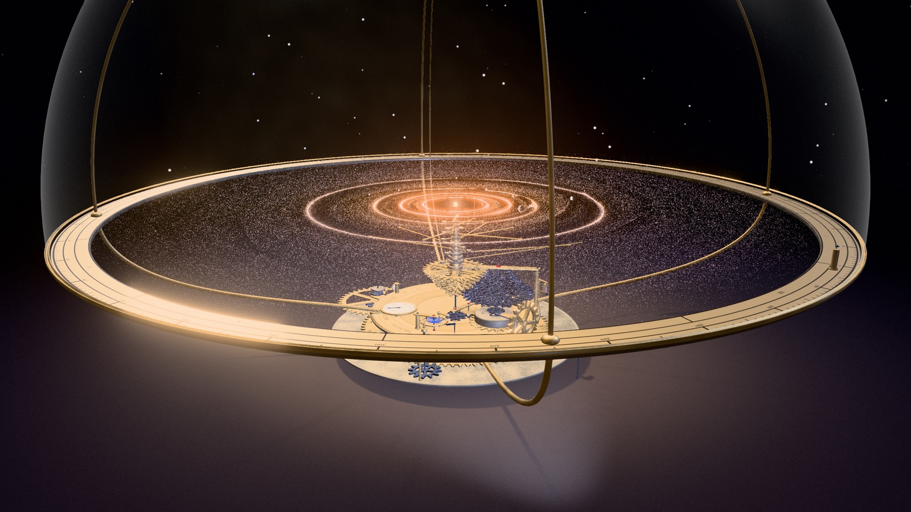

# Planétaire

La vie d’un système planétaire, du nuage de gaz à la supernova, simulée entièrement sur le GPU (WebGPU, three.js TSL). La simulation est présentée comme portée par un planétaire en laiton, sous une cloche de verre.

**Démo en ligne : [drschizzo.github.io/Codevember/planetaire](https://drschizzo.github.io/Codevember/planetaire/)** (navigateur compatible WebGPU requis)



## Lancer en local

Les modules ES exigent un serveur HTTP :

```sh
cd planetaire && python3 -m http.server 8000
# → http://localhost:8000
```

Navigateurs : Chrome ou Edge récents, Safari 26 et plus. Il n’y a pas de repli WebGL. three.js est chargé depuis un CDN (version figée dans `index.html`) ; aucune étape de construction n’est nécessaire.

## Interface

Le panneau donne la vitesse du temps, la frise des phases (avec une phrase par phase et sa durée réelle) et la liste des planètes, avec une ligne de fiche pour la planète sélectionnée. Le son est désactivé au démarrage (bouton « son » ou touche **M**).

Un écran d’accueil montre le cycle complet en 20 secondes (`src/intro.js`, Canvas 2D, indépendant de WebGPU). La simulation démarre au clic sur « Entrer ».

| geste | action |
|---|---|
| glisser / molette | tourner / zoomer |
| **Maj + glisser** | puits gravitationnel : remuer le disque |
| **double-clic** | semer un embryon de planète |
| clic sur une planète | la sélectionner · **A** : retour à la sélection automatique (la plus massive) |
| clic dans la liste | suivre la planète sur son orbite · **Échap** : vue d’ensemble |
| clic sur la frise, **[ / ]** | aller à une phase (avance rapide, ou nouveau cycle pour revenir en arrière) |
| **E** | une étoile vagabonde traverse le système |
| **P** | migration planétaire (type I) on/off |
| **C** | couleurs : provenance / roche-glace / température |
| **O** | afficher / masquer la machine |
| **+ / −**, Espace, **M**, **H** | vitesse (×¼ à ×8), pause, son, aide |

## Paramètres d’URL

| paramètre | effet |
|---|---|
| `?n=2097152` | nombre de grains (défaut 1 048 576) |
| `?auto` | sans écran d’accueil |
| `?warp=4` | avance rapide (multiplie le temps simulé par image) |
| `?nomeca` | démarrer sans la machine |
| `?sdr` / `?hdr` | forcer la sortie SDR ou HDR (défaut : HDR si l’écran le permet) |
| `?peak=4` | pic de luminosité HDR, en multiples du blanc de l’interface |
| `?starhdr=3.5` | éclat du disque stellaire en HDR (1 = comme en SDR) |
| `?exposure=1.45` | exposition globale |
| `?agx` | tone mapping AgX au lieu de Neutral (SDR) |
| `?nobloom` | sans bloom |
| `?nocine` | sans étalonnage, vignettage ni grain |
| `?nolens` | sans flou de mouvement ni profondeur de champ |
| `?dof` | profondeur de champ (désactivée par défaut) |
| `?streak` | traînée anamorphique sur les sources intenses (désactivée par défaut) |
| `?aa=msaa` / `?aa=0` | anticrénelage MSAA 4× (plus lent) ou aucun (défaut : SMAA) |
| `?prof` | chronométrage : `window.__prof` (GPU) et `window.__profJs` (JS, appels de rendu) |
| `?film` | mode tournage (voir plus bas) |

## Le cycle de vie

`src/lifecycle.js` fait avancer une horloge par phase et en déduit à chaque image les paramètres de l’étoile et du disque (masse, luminosité, gaz, ligne des glaces, fronts de dissipation, onde de choc). Les durées sont très comprimées, et de façon inégale ; la frise indique les durées réelles.

1. **Effondrement du nuage** : une sphère d’un million de grains, en rotation et turbulente. Chaque grain conserve son moment cinétique et rejoint le disque à son rayon centrifuge (modèle d’Ulrich / Cassen-Moosman), qui devient son lieu de naissance. Les grains proches de l’axe tombent sur l’étoile.
2. **Protoétoile** : rouge, elle brille par contraction et émet deux jets le long de l’axe.
3. **Formation des planètes** : la fusion démarre, la luminosité et la ligne des glaces montent. Les embryons naissent là où la poussière s’accumule, grossissent, se percutent et captent du gaz, qui se dissipe.
4. **Dissipation du disque** : sans gaz, la pression de radiation souffle les poussières fines et l’effet Poynting-Robertson fait spiraler les plus grosses vers l’étoile. Il reste une ceinture de débris, placée au-delà de la géante la plus lointaine.
5. **Maturité**.
6. **Supergéante rouge** : l’étoile enfle, rougit et perd de la masse ; les orbites s’élargissent, les planètes proches sont englouties, les glaces des planètes lointaines fondent.
7. **Supernova** : effondrement du cœur, puis explosion. Les grains retirés deviennent des éjecta en « doigts » de Rayleigh-Taylor, l’onde de choc balaie le disque et le système, devenu non lié, se disperse. Il reste un rémanent (filaments Hα et [O III]) et un pulsar. Un nouveau nuage commence le cycle suivant.

Une étoile comme le Soleil finit en naine blanche ; une supernova suppose plus de ~8 masses solaires et une vie de quelques dizaines de millions d’années. Le choix est fait ici pour boucler le cycle.

## Ce qui est simulé

- **Grains** : gravité de l’étoile et des embryons, traînée du gaz par relaxation exponentielle exacte (stable pour tout nombre de Stokes, distribués de 10⁻² à 2), turbulence, pièges de pression. Unités G·M★ = 1, distances en UA.
- **Provenance** : chaque grain garde son rayon de naissance et sa composition (roche en deçà de la ligne des glaces, glace au-delà), qui donnent sa couleur. La glace d’un grain qui dérive en deçà de la ligne se sublime.
- **Embryons** (64 au plus) : N-corps exact, amortissement par le gaz, migration de type I en option. La gravité des embryons est amplifiée (×25) pour que la formation se joue en quelques minutes ; ce facteur s’efface avec la masse (≈ ×1,2 pour une Jupiter).
- **Accrétion** : les grains capturés sont comptés de façon atomique ; masse, glace et rayon moyen de naissance s’accumulent dans chaque planète. Au-delà de la masse d’isolation, une planète crée un maximum de pression juste à l’extérieur de son orbite : les grains s’y accumulent en anneau (comme sur les images ALMA de HL Tauri) et elle n’en avale presque plus.
- **Gaz** : un réservoir qui se dissipe après l’allumage. Au-delà de 10 M⊕, un cœur capte du gaz (emballement limité par l’ouverture d’un sillon, très lent dans le disque interne chaud) et devient une géante gazeuse.
- **Impacts géants** : fusions qui conservent centre de masse et quantité de mouvement, rayon de fusion fondé sur les sphères de Hill. Éclair, ondes de choc, ralenti, secousse et nuage de débris incandescents.
- **Budgets de masse** : 700 M⊕ de solides au départ ; un grain avalé, tombé ou soufflé est retiré.
- **Surfaces** (`src/app/planets.js`) : une sous-simulation par planète pilote l’aspect de sa surface : chaleur interne (océan de magma, fissures), cratères sur les surfaces sans atmosphère, eau selon la provenance et la température d’équilibre (vapeur, océans, banquise), atmosphère au-dessus de ~0,2 M⊕, bandes des géantes qui se contrastent en refroidissant.
- **Rayons affichés** : relation masse–rayon de Chen & Kipping (2017), exagérée pour rester lisible.

## La machine

`src/orrery/` construit un planétaire en laiton qui lit l’état de la simulation et le rend tangible ; il ne simule rien lui-même.

```
BARILLET (ressort = énergie d'un cycle)
  ├─▶ pignon de l'ARBRE DE RENVOI ─▶ pignons ─▶ ROUES des tubes ─▶ BRAS ─▶ planètes
  │      (rapport roue / pignon = rapport des vitesses angulaires : Kepler)
  └─▶ ROUE DE CENTRE ─▶ ROUE D'ÉCHAPPEMENT ⇄ ANCRE ⇄ BALANCIER
```

- **Bras** : les 12 planètes les plus massives sont portées par un bras à contrepoids sur un tube concentrique. Un bras sort de sa bague quand une planète est prise en charge et rentre en poursuivant son orbite quand elle disparaît ; des seuils à hystérésis évitent le clignotement.
- **Engrenages** : l’arbre de renvoi tourne à la vitesse d’une orbite à 2,5 UA ; chaque roue de tube engrène un pignon dont le rapport suit ω ∝ a^−3/2. Toutes les dentures ont le même module (40 dents par étage, entraxe exact) et les phases sont calées pour que les dents tombent dans les creux.
- **Régulateur** : la roue d’échappement avance par à-coups, le balancier bat d’autant plus vite que le temps s’écoule vite et s’arrête à la pause.
- **Réserve de marche** : l’aiguille suit le ressort qui se détend pendant le cycle ; le cadran est gradué par phases.
- **Fin de cycle** : à la supernova, le levier d’arrêt bloque le balancier, la trémie aspire les débris et la couronne remonte le barillet (le cliquet claque sur le rochet). Puis la vanne s’ouvre et les grains remplissent le nouveau nuage de bas en haut ; chaque grain n’entre dans la dynamique qu’une fois à sa place.
- **Peigne de boîte à musique** : la tête de lecture du son. La pointe de chaque planète soulève la lame de son rayon. Le peigne sort quand le son est activé et se relève quand l’étoile enfle ; le curseur de la ligne des glaces glisse sur sa barre.
- **Galerie des automates**, autour du socle, entraînée par un poids moteur : régulateur à boules (vitesse du temps), tambour à cames et trois cadrans (luminosité, gaz, ligne des glaces), compteur à rouleaux (orbites à 1 UA, numéro du cycle), pompe à soufflet (aspiration de fin de cycle), cloche frappée à chaque impact géant.
- **Cloche de verre** : en présence de la machine, le nuage initial est resserré à 9,6 UA et la cloche retient grains, débris et planètes.
- **Éclairage** : lumière de l’étoile (ombres portées), projecteur de musée, projecteur froid rasant sur la galerie, contre-jours, environnement de studio HDR pour les reflets du métal.
- **Objectif** : flou de mouvement en post-traitement pour la machine ; pour les grains, qui n’écrivent ni profondeur ni vitesse, le flou de mouvement (et la profondeur de champ avec `?dof`) est appliqué grain par grain en conservant l’énergie lumineuse.

## Son

Le disque est lu comme un vinyle par une tête de lecture fixe (axe +X) ; la rotation képlérienne fait défiler la matière dessous. La hauteur dépend de la distance à l’étoile (aigu au centre, grave au bord, gamme pentatonique). Chaque planète sonne quand elle croise la tête : les planètes internes battent vite, deux planètes en résonance 3:2 forment un motif 3 contre 2. Timbre et durée suivent la masse. Les anneaux de poussière pincent leur note, et un bourdon s’assombrit à mesure que le disque s’épuise.

## Architecture

```
planetaire/
├── index.html, style.css
├── src/
│   ├── main.js          point d'entrée : création des modules, boucle d'animation
│   ├── config.js        paramètres d'URL
│   ├── util.js          fonctions mathématiques partagées
│   ├── sim.js           simulation GPU (noyaux compute TSL), lectures GPU → CPU
│   ├── lifecycle.js     phases du cycle → paramètres de l'étoile et du disque
│   ├── palette.js       couleur de provenance (même formule en TSL et en JS)
│   ├── audio.js         sonification (Web Audio)
│   ├── intro.js         film d'accueil (Canvas 2D)
│   ├── film.js          mode tournage
│   ├── app/             côté CPU
│   │   ├── kinematics.js  positions des planètes à l'instant présent
│   │   ├── planets.js     lecture de l'état, évolution des surfaces, libellés
│   │   ├── camera.js      vols, suivi d'une planète, secousse
│   │   └── ui.js          panneau HTML
│   ├── render/          rendu
│   │   ├── index.js       uniformes partagés, assemblage
│   │   ├── dust.js        poussière (sprites instanciés)
│   │   ├── sky.js         fond d'étoiles
│   │   ├── star.js        étoile, jets, pulsar, rémanent, étoile vagabonde
│   │   ├── planets.js     planètes à surface procédurale
│   │   ├── fx.js          impacts géants
│   │   ├── post.js        post-traitement
│   │   └── common.js      briques TSL partagées
│   └── orrery/          la machine
│       ├── index.js       construction et animation
│       ├── layout.js      cotes
│       ├── materials.js   laiton, acier, verre
│       ├── geometry.js    roues, pièces tournées, ponts
│       ├── textures.js    gravures, cadrans, environnement de studio
│       ├── builder.js     pose des pièces (vis, piliers, arbres, ponts)
│       ├── gallery.js     galerie des automates
│       ├── batch.js       fusion des pièces statiques
│       └── assembly.js    assemblage pièce à pièce (mode tournage)
├── tools/tournage.mjs   pilote le mode tournage dans Chrome
└── docs/capture.jpg
```

### Pipeline GPU

Tout l’état vit dans des storage buffers ; rien ne transite par le CPU dans la boucle, sauf de petites lectures asynchrones.

```
par sous-pas de grains (≤ 0,011 unité de temps, une seule soumission par image) :
  buildActive     1 thread    liste compacte des embryons actifs + paramètres précalculés
  stepParticles   N threads   gravité, traînée, turbulence, pièges de pression, capture atomique
  embryoForces    64 threads  N-corps exact, amortissement, migration     (×2 sous-pas)
  embryoIntegrate 64 threads
puis, une fois par image :
  embryoAccrete   64 threads  lit et remet à zéro les compteurs atomiques, capture du gaz
  mergeDetect     64 threads  candidats à la fusion, en parallèle
  embryoMerge     1 thread    fusions (impacts géants)
  clearGrid / depositGrid     histogramme polaire 192 × 256 (atomicAdd)
  opticalDepth    256 threads profondeur optique depuis l'étoile → ombre du disque
  readNeedle      192 threads densité sous la tête de lecture → son
```

Position et vitesse des embryons (2 ko) sont relues à chaque image. La lecture arrive avec quelques images de retard ; elle est datée et propagée jusqu’à l’instant présent (2 corps, saute-mouton), avec une erreur d’environ 10⁻⁵ UA. Caméra, effets et notes restent ainsi accrochés aux planètes dessinées par le GPU. Les autres lectures (état des planètes, impacts, profil radial) ont lieu toutes les 60 à 150 ms.

### Performances

Objectif : 120 images par seconde.

- Le temps simulé suit le temps réel, et le travail par image est plafonné en accéléré (pas de spirale « image lente → plus de pas »).
- Les grains lisent leurs paramètres dans une liste compacte des embryons actifs, reconstruite une fois par sous-pas.
- Sur écran haute densité, les grains sont plus petits en unités-monde, avec un éclat compensé : environ 2,8 fois moins de pixels à remplir, le poste dominant du rendu.
- Une résolution adaptative baisse la densité de pixels si l’image dépasse 1/55 s, et la remonte s’il reste de la marge.
- Les pièces de la machine qui ne bougent pas les unes par rapport aux autres sont fusionnées par matériau au chargement (`orrery/batch.js`). Au démarrage, une image demande environ 380 appels de rendu au lieu de 1 100 (passe principale et passes d’ombre comprises), et le temps JavaScript par image passe d’environ 7 ms à 3,7 ms (mesuré avec `?prof`).
- Géométries paramétrées, textures et tampons de bruit audio sont construits une seule fois.

## Mode tournage (`?film`)

`src/film.js` réalise un film d’environ 3 minutes, sans texte, qui boucle : la machine se pose pièce à pièce sur un velours, la trémie verse le nuage, le cycle se déroule, la supernova reste sous la cloche, la trémie aspire les débris, puis la machine est démontée dans l’ordre inverse. Entre deux plans, la simulation avance hors champ ; un impact géant interrompt le montage, au ralenti.

Chaque image est la moyenne de 4 sous-images (obturateur à 180°), chacune rendue en 2× ; le tone mapping est appliqué après la moyenne. Une sonde cube fournit des reflets réels au métal et au verre. L’encodage se fait par WebCodecs (H.264 en SDR ; VP9 10 bits BT.2020 / PQ en HDR) et `tools/tournage.mjs` pilote Chrome (puppeteer-core) pour écrire le fichier.

Paramètres : `w` (1920), `ss` (suréchantillonnage, 2), `tss` (sous-images, 4), `fps` (24), `mbps`, `hdr`, `peak`, `stills=12,40` (images fixes, pour prévisualiser).

```sh
npm i puppeteer-core                     # une fois
python3 -m http.server 8020              # dans planetaire/
node tools/tournage.mjs "w=1920&ss=2&tss=4&aa=0&hdr&peak=5&mbps=60" hdr.mp4
ffmpeg -i hdr.mp4 -pix_fmt yuv420p10le -c:v libx265 -crf 24 -tag:v hvc1 \
  -x265-params "hdr10=1:repeat-headers=1:colorprim=bt2020:transfer=smpte2084:colormatrix=bt2020nc:master-display=G(13250,34500)B(7500,3000)R(34000,16000)WP(15635,16450)L(10000000,1):max-cll=1015,180" \
  -color_primaries bt2020 -color_trc smpte2084 -colorspace bt2020nc planetaire-film-hdr.mp4
```

Variables d’environnement de `tournage.mjs` : `CHROME` (chemin de Chrome, défaut macOS) et `BASE` (URL de la page, défaut `http://localhost:8020/`).

## Déploiement

`.github/workflows/pages.yml` publie le dépôt sur GitHub Pages à chaque push sur `main` (page d’index à la racine et dossier `planetaire/`, sans `tools/` ni `docs/`). La source Pages du dépôt doit être réglée sur « GitHub Actions ».
