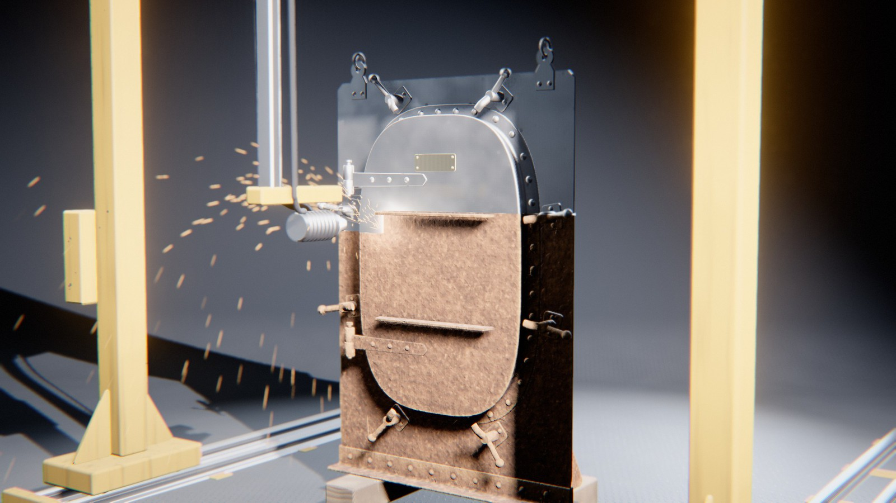

# Rust

*la remise à nu.* Une pièce de métal rivetée, boulonnée, rouille sous les averses d'une saison en accéléré. Puis une machine arrive et la décape, en temps réel, jusqu'à l'acier nu, et la rouille revient.

Au début, la pièce est nue : un nœud de treillis riveté, une vanne sur sa tuyauterie, une roue de locomotive sur son coupon de rail ou une porte étanche de navire, en acier gris clair qui accroche la lumière. Le ciel se voile, une averse passe : on voit tomber la pluie, la pièce fonce et luit, l'eau reste dans les angles. En séchant, un voile orange paraît là où l'eau est restée : au pied de chaque rivet, dans les angles des cornières, sous les têtes de boulon, sur les rebords tournés vers le ciel. À chaque averse, les taches s'étendent sur les plats, se rejoignent et coulent en traînées sous chaque source. La croûte s'épaissit, fonce, cloque et se fend en écailles. Puis la machine se met en place : un portique laser qui roule de derrière la pièce, une sableuse dont le bras à rampe de buses pivote au-dessus de la pièce posée sur un plateau tournant, ou un palan qui descend la pièce dans une fosse d'électrolyse. Elle la remet à nu, par une ligne d'éclair blanc qui balaie la pièce rangée après rangée en jetant ses étincelles, un rideau de grenaille qui descend en hélice dans un nuage de poussière, ou le bain dont la pièce ressort noire de boue avant qu'une rampe de rinçage, en descendant, découvre l'acier ruisselant. La machine repart, et la pièce est nue comme au début.



Rendu physique en three.js (WebGPU, TSL). La scène est entièrement procédurale : une graine produit une scène. La démarche est dans [docs/concept.md](docs/concept.md) : le thème exploré sous six angles, les clichés écartés, neuf pistes notées, les épreuves (crédibilité, variété, ambition, déclinaison, scénario, références).

## Utilisation

| Touche | Action |
| --- | --- |
| N | nouvelle scène (nouvelle graine) |
| Espace | pause / lecture |
| ← / → | avancer ou reculer dans la boucle |
| H | masquer l'interface |
| F | plein écran |

Sur écran tactile : une touche met en pause, deux touches tirent une nouvelle scène, un appui long masque l'interface.

Paramètres d'URL : `?seed=…`, `#r=…` (scène retouchée, « Copier le lien »), `?mood=…`, `?family=…` (`noeud`, `vanne`, `roue`, `porte`), `?machine=…` (`laser`, `sablage`, `bain`), `?climate=…` (`bruine`, `averses`, `embruns`, `brouillard`), `?phase=…`, `?ui=0`, `?mobile=1` / `?mobile=0`, `?debug` (outils dans `window.rust` : `shot(phase)`, `send(nom)`, `sheet(graines, phases)` (une graine peut s'écrire `graine:humeur:pièce:machine:climat`), `meter()`, `meters()`, `bench()`, `seam()`, `run()`).

Le panneau règle l'humeur, la pièce, la machine et le climat (nouvelle scène de la même graine), puis la durée ; les proportions de la pièce (longueurs, nombre de rivets, de boulons, de rayons, de taquets) ; la rouille (germes, épaisseur, écailles, cloques, coulures, teinte) et la pluie ; la machine (hauteur de la ligne du laser, tours du plateau, empreinte et inclinaison de la buse, durée d'immersion) ; la caméra ; la lumière et le fond ; le rendu. Export MP4 image par image (éventuellement accumulé) et PNG.

## Principe : une corrosion calculée sur la géométrie, un décapage en forme fermée

La rouille naît là où l'eau reste, et le programme calcule ces endroits d'après la forme de la pièce. Le passage de la machine, lui, est donné par une formule directe (une « forme fermée ») qui dit à quel instant l'outil atteint chaque point.

**La boucle** est un cycle de transformations à deux états, nu et rouillé, lu sur une seule horloge u ∈ [0, 1) :

| u | Temps | Cause visible | Loi | Temps du film |
| --- | --- | --- | --- | --- |
| 0 – 0,04 | le métal nu | — | — | — |
| 0,04 – 0,36 | les averses | la pluie qui tombe, le ciel qui se voile | temps d'humectation (ISO 9223), loi de dose (ISO 9224), aération différentielle, ruissellement | accéléré (une saison) |
| 0,36 – 0,44 | la mise en place | moteurs, rails, bras, palan | cinématique à accélérations bornées | temps réel |
| 0,44 – 0,86 | la remise à nu | la ligne du laser, le cône de grenaille, la rampe de rinçage du bain | ablation, abrasion, réduction cathodique | temps réel (le bain : accéléré pendant l'immersion) |
| 0,86 – 1 | le retrait | — | — | temps réel |

Le temps d'humectation cumulé τ(u) n'avance que sous les averses et pendant le séchage qui suit (la rouille éclair paraît en séchant) : 0 avant la première, 1 après la dernière, constant ensuite. La rouille visible en un point x de normale n vaut h(x, τ(u)) tant que l'outil ne l'a pas atteint (u < c(x, n)), et 0 ensuite. Un point que l'outil n'atteint jamais (dessous d'une tête, face cachée) garde sa rouille de fin de saison toute la boucle. À u = 0 comme à u = 1, τ = 0 : la pièce est nue, la machine au garage. La boucle est donc parfaite par construction, et la pluie, l'eau et le ciel, nuls hors des averses, se raccordent aussi.

### La corrosion (`src/gen/corrosion.js`)

La rouille a besoin d'eau. Sur ~200 000 points tirés uniformément sur toute la surface (rivets et boulons compris), dans un worker :

- **concavité** à deux rayons (1,2 et 4 cm) : hauteur moyenne des voisins au-dessus du plan tangent (l'autre face d'une tôle mince est écartée). Elle est positive dans les angles rentrants et au pied des têtes de rivet, où l'aération différentielle (Evans) fait une anode, et négative sur les arêtes, qui perdent leur protection en premier ;
- **ciel** : la part de 15 directions vers le haut (vent compris) que rien ne masque, par rayons dans une grille d'occupation de 2 cm. La pluie mouille ce qui voit le ciel, et l'abri sèche mal ;
- **stagnation** : faces tournées vers le haut et creuses ;
- **humectation** de chaque point, et son **instant d'apparition** local ;
- **front** : la rouille gagne de proche en proche le long de la surface. L'instant d'apparition final est la distance géodésique (Dijkstra sur les voxels occupés, 26 voisins) depuis les points précoces, à vitesse finie. Ce front fait s'étendre les taches depuis les rivets et les creux sur les plats ;
- **ruissellement** : chaque voxel rouillé et mouillé est une source. La charge descend la gravité de voxel occupé en voxel occupé (avec un léger évasement) et dessine les coulures sous chaque rivet, chaque boulon, chaque arête.

Le tout est écrit dans un volume RGBA 8 bits (~1 cm par voxel, dilaté autour de la surface) que le shader lit : instant d'apparition, concavité, coulure, humectation.

### La rouille (`src/scene/rust.js`)

- **Couverture** : la rouille paraît quand τ dépasse l'instant d'apparition, retardé autour de germes (Worley 3D exact : les piqûres) et d'un bruit à deux échelles. Les taches naissent aux germes et s'étendent en disques qui se rejoignent.
- **Épaisseur** : loi de dose h = k·(τ − t₀)^½, k croissant avec l'humectation.
- **Stratification** : voile de lépidocrocite orange (mince, le métal se voit au travers), brun de goethite, brun sombre, magnétite noire dans les creux, orange vif sur les arêtes. Des plaques plus orangées ou plus sombres varient à l'échelle de 5 cm. La fonte rouille plus grise et grenue, et les chlorures (embruns) donnent une rouille plus orangée.
- **Relief** (Pilling-Bedworth : la rouille gonfle, jusqu'à ~3 mm) : la croûte épaisse est une mosaïque d'écailles (Worley exact sur coordonnées déformées, avec l'identité de chaque cellule) séparées par des fentes, chacune un peu inclinée (chaque écaille prend la lumière à sa façon), aux bords relevés et orangés ; certaines sont tombées et découvrent la couche profonde, dense, rouge-noir et un peu lustrée, une petite falaise en contrebas ; la croûte ondule en tubercules (λ ≈ 3 cm), se soulève en cloques en dôme, porte un grain millimétrique. La couleur suit le relief (dessus clairs, creux presque noirs) et les creux occultent l'éclairage indirect. Perturbation de normale de Mikkelsen.
- **Coulures** : traînées verticales (bruit étiré selon la gravité) qui tachent l'acier et la rouille.
- **Eau** : la rouille mouillée fonce de moitié, un vernis d'eau (clearcoat) luit, et l'eau reste plus longtemps dans les creux tournés vers le haut.
- **Le décapage** : derrière l'outil paraît la finition de la machine (acier satiné strié par le balayage pour le laser, gris mat du métal blanc pour le sablage, gris plus sombre pour le bain), avec les piqûres laissées par la croûte, qui restent dans l'acier nu. Le laiton et le bronze (presse-étoupe, plaque, tige de vanne) ne rouillent pas : ils brunissent, et le décapage leur rend leur éclat.

### Les machines (`src/machines.js`, même formule dans le shader)

- **Laser** : un portique roule de derrière la pièce sur deux rails, tête relevée, puis la tête descend à la première rangée. Son miroir galvanométrique balaie une ligne verticale de hauteur w. La tête parcourt la pièce en rangées, de haut en bas, en boustrophédon (une rangée dans un sens, la suivante dans l'autre). Chaque rangée ne couvre que la largeur de la pièce à sa hauteur (lue sur la carte de profondeur), et sa durée est proportionnelle à cette largeur. L'instant de décapage d'un point est l'instant où la ligne passe sur lui. Un point masqué par une autre partie de la pièce (carte de profondeur, avec une tolérance qui croît pour les faces rasantes) n'est pas atteint. Éclair blanc, lumière ponctuelle, gerbe d'étincelles balistiques qui rebondissent sur le sol.
- **Sablage** : la pièce tourne sur un plateau (N tours entiers, vitesse constante adoucie aux bouts) pendant qu'une rampe de buses descend : un tube horizontal aussi large que la pièce, au bout du bras, avec une buse tous les 5 cm, dont les jets parallèles et inclinés vers le bas forment un rideau de grenaille ; l'hélice a un pas inférieur à l'empreinte des jets. Une face est décapée quand, en tournant, elle entre dans le rideau avec une incidence utile (cosinus > 0,45), au premier azimut de son passage où rien ne la masque (32 cartes de profondeur horizontales calculées dans le worker), et à la hauteur où le jet incliné la frappe (plus bas que la rampe, d'autant plus que la face est loin) : s* = s₁ + (±(φ_rampe − φ_entrée) − 2πN·s₁ mod 2π)/(2πN). À l'écran, chaque jet s'arrête sur la surface qu'il frappe vraiment (mêmes cartes) ou sur le plateau, et la poussière naît là : 86 à 87 % des impacts tombent sur de l'acier en train d'être décapé ou déjà nu. La rampe pivote au-dessus de la pièce. La colonne se place de profil par rapport à la caméra.
- **Bain** : la pièce pend au crochet d'un palan, sous un portique à pieds en A, au-dessus d'une fosse d'électrolyse dont le couvercle roule sur le côté. Elle descend tout entière sous le niveau et y reste : les bulles d'hydrogène se multiplient, le bain se trouble et se couvre d'écume. La croûte réduite en magnétite ne disparaît pas : la pièce remonte noire de boue, ruisselante. Une rampe de rinçage (un cadre de tubes à buses qui l'entoure, pendu à la poutre par deux câbles) descend alors de son sommet à son pied, ses jets éclatent en brume et chassent l'eau noire : le front visible est la ligne des buses. Un peu de boue reste dans les creux.

## Les pièces (`src/gen/pieces.js`, `src/gen/parts.js`)

Construites comme de vraies pièces, sans arête vive : tôles découpées à chants arrondis, cornières laminées à congé de racine et bouts d'ailes arrondis, corps de révolution, rivets à tête ronde avec leur bourrelet, boulons à six pans chanfreinés (les arcs du chanfrein sur les pans), rondelles, écrous, bouts de filet.

| Famille | Construction |
| --- | --- |
| Nœud | gousset découpé (enveloppe convexe des zones rivetées, congés), membrure en cornières jumelées, trois à cinq barres en cornières jumelées qui convergent sans se chevaucher, fourrures, rivets des deux côtés, pitons de levage ; sur deux cales de chêne |
| Vanne | conduite, brides à collerette, brides pleines, 8 à 16 boulons par bride, corps de fonte bombé à nervures de moulage, col, chapeau boulonné, presse-étoupe de bronze à deux goujons, arcade, tige filetée, volant à rayons ; sur deux sellettes |
| Roue | bandage à boudin (fretté sur la jante), jante en T, moyeu, 12 à 18 rayons elliptiques effilés, évasés aux bouts, contrepoids en croissant (deux plaques rivetées qui serrent les rayons, remplissage coulé entre elles), maneton porté par un rayon, essieu, écrou ; sur un coupon de rail, deux traverses, des cales et un chevalet ; levée par un palonnier et deux élingues en étrangloir, autour du maneton et de l'essieu |
| Porte | cloison percée de l'ouverture, hiloire en cornière balayée le long du contour (rectangle à grands congés ou ovale), battant raidi, taquets (patte rivetée, tourillon, bras, poignée à boule), charnières (penture à nœud, console rivetée, axe à tête), plaque de laiton ; pied en cornière, goussets ; oreilles de levage rivetées |

## Les décors

Le fond est neutre : un cyclorama (le sol se courbe en paroi derrière la pièce, sans horizon), dont la paroi est à l'opposé de la caméra. Chaque humeur se distingue par son sol, sa lumière, sa valeur et son cadrage :

| Humeur | Sol | Lumière | Valeur | Cadrage |
| --- | --- | --- | --- | --- |
| Atelier | béton lissé, joints sciés | grande boîte à lumière au plafond | moyenne | trois-quarts plongeant |
| Laboratoire | époxy clair | lumière enveloppante, ombres légères | très claire | face, un peu haut |
| Cale sèche | tôle larmée | contre-jour froid, lampe de côté | sombre | contre-plongée |
| Plein jour | dalles claires | soleil dur | claire | trois-quarts, de côté |
| Nuit d'usine | tôle d'usine | un projecteur haut, l'éclair de la machine | très sombre | proche, bas |
| Brume | ardoise | ciel couvert, sans ombre nette | moyenne, froide | large, de face |

Les sols mouillent sous les averses (ils foncent, l'eau reste dans les creux et luit). Quatre **climats** changent la pluie et la rouille : bruine (gouttes fines, germes serrés, longues coulures), averses (grosses gouttes, croûte épaisse), embruns (vent, rouille orangée, cloques), brouillard (gouttelettes, couverture plus uniforme).

**La caméra** : un plan large pendant les averses (toute la pièce, la pluie), un rapprochement lent qui se décale de côté quand la machine se met en place, le gros plan qui accompagne le front, puis le recul. La trajectoire est échantillonnée, lissée par un noyau gaussien périodique et interpolée en Catmull-Rom, avec une pointe sous 25°/s.

**L'écran de chargement** montre le calcul : la pièce vue de face, et la rouille qui s'y étend au rythme de l'instant d'apparition calculé : depuis les rivets, les creux, les arêtes, puis sur les plats.

## Tests

```bash
node --test rust/test/*.test.mjs
```

Treize tests : l'horloge (τ monotone, nul avant la première averse, 1 après la dernière ; pas de pluie ni d'eau pendant le décapage ; la pluie tombe quand le ciel est couvert ; raccord) ; la corrosion (la rouille commence dans les creux et au pied des rivets, plus tard sur les faces dégagées) ; le laser (chaque point atteint est décapé à l'instant exact où la ligne passe sur lui, pendant le décapage, et pas avant ; la tête ne saute jamais) ; le sablage (nombre entier de tours, pas de l'hélice sous l'empreinte, à l'instant du décapage le point entre dans le rideau avec une incidence utile, à la hauteur où le jet incliné le frappe ; la rampe pivote au-dessus de la pièce) ; le bain (la pièce descend tout entière sous le niveau, remonte, ressort décapée ; elle ne touche jamais le sol) ; la caméra (lente, lisse, périodique, jamais sous le sol) ; la recette (déterministe, JSON, toutes les humeurs, pièces, machines et climats tirés) ; la direction artistique (lampes presque blanches, un sol par humeur, une humeur très claire et une très sombre, lumières dures et douces) ; rien ne se traverse (machines et pièce à tous les instants) ; les liens partagés se relisent à l'identique ; aucun élément ne flotte (chaque composante du maillage touche le sol de proche en proche, sur trois graines par famille, et `node rust/tools/audit.mjs <famille> <graine>` en donne le détail) ; les élingues ne traversent pas la pièce.

## Performances

Génération d'une scène (dans un worker, pendant l'écran de chargement) : 30 à 80 ms pour la géométrie de la pièce, 2 à 4 s pour le champ de corrosion (~200 000 points, deux concavités, quinze rayons de ciel par point, Dijkstra, ruissellement, 32 cartes de profondeur), quelques dizaines de ms pour la machine. Temps d'image mesuré dans le panneau de navigateur de l'application (GPU d'un Mac, panneau masqué), qualité Haute, 1,8 Mpx, graine k3 (porte, sablage, atelier) : 15 à 16 ms (averses, rouille complète, décapage). Le poste le plus lourd est le matériau de la rouille (deux Worley exacts, pour les germes et les écailles, et plusieurs fBm lus dans le volume de bruit), puis la chaîne d'image.

## Version mobile

Imposée par `?mobile=1`, ou choisie d'office sur téléphone : moins de points pour le champ de corrosion (pas de 6 mm au lieu de 4,5), 60 % des gouttes de pluie, Worley lu dans le volume de bruit (germes et écailles moins nets de près), fBm à deux octaves, une lumière de moins, chaîne d'image allégée (ni occlusion, ni reflets en espace écran, ni anticrénelage temporel), résolution dynamique. Mesuré à 6,3 ms à 1,2 Mpx sur le même GPU (graine b7, laser). Non vérifiée sur un appareil réel.
