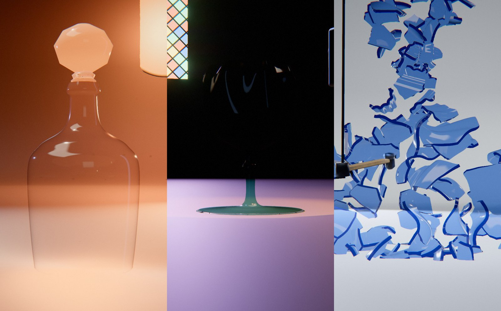

# Shatter

*sable, verre, éclats, bain.* Le calcin est le verre brisé que le verrier refond pour en faire du neuf.

Au centre d'une sole en cuvette, un bain de verre en fusion. Une paraison en monte, se gonfle en tournant sur le plateau et prend forme. C'est une pièce de verrier : verre à pied, flûte, coupe sur pied, carafe à anse et bouchon, amphore à deux anses, flacon, cloche… Elle est côtelée, torse, lobée, festonnée ou godronnée, parfois filigranée de fils blancs. Elle refroidit en passant du jaune orangé au rouge sombre, puis au verre clair et teinté. Le plateau s'arrête et une machine descend du portique : un pendule à bille d'acier, un haut-parleur qui fait chanter le verre, un marteau de percussion, ou un chalumeau. La pièce se brise, filmée en caméra rapide. Les éclats tombent sous une gravité vraie, frappent la sole, rebondissent à peine, glissent et se couchent. La sole chauffe, les éclats rougeoient, s'affaissent et coulent au fond de la cuvette : c'est le bain de la pièce suivante. Après deux à quatre pièces, la première renaît du dernier bain : la boucle se referme sans raccord.



Rendu physique en three.js (WebGPU, TSL). La scène est entièrement procédurale : une graine produit une scène. La démarche qui a conduit à ce concept est dans [docs/concept.md](docs/concept.md) : dix pistes notées, les clichés écartés, puis la révision après les premiers rendus (les trois épreuves : crédibilité, variété, ambition).

## Utilisation

| Touche | Action |
| --- | --- |
| N | nouvelle scène (nouvelle graine) |
| Espace | pause / lecture |
| ← / → | avancer ou reculer dans la boucle |
| H | masquer l'interface |
| F | plein écran |

Sur écran tactile : une touche met en pause, deux touches tirent une nouvelle scène, un appui long masque l'interface.

Paramètres d'URL : `?seed=…` (une scène), `#r=…` (une scène retouchée, produite par « Copier le lien »), `?ui=0` (sans panneau), `?mobile=1` / `?mobile=0` (version mobile imposée / interdite), `?debug` (outils dans `window.shatter` : `shot(phase)`, `send(nom)`, `meter()`, `bench()`, `seam()`, `run()`).

Le panneau règle tout :
- **Scène** : décor, nombre de pièces par boucle, durée d'une étape, caméra rapide (ralenti, durée, retour au temps réel) ;
- **Caméra** ;
- **Pièces**, une par une : forme, verre, déclencheur, proportions, modelé (côtes, torsion, lobes, festons, godrons), parties (anse, deux anses, bouchon, fil appliqué), filigrane, fracture, plateau tournant, feu ;
- **Lumière et fond** : lampe, contre-jours, incandescence, lumière noire, studio, fond, brume, sol ;
- **Rendu**.

L'export produit une boucle MP4 (H.264) rendue image par image, éventuellement en rendu accumulé (8 à 64 passes), et une image PNG.

## Principe : un cycle crédible

Chaque moment du cycle a une cause qu'on voit à l'écran et obéit à une loi physique. Seul le temps prend des libertés, comme au cinéma : il est réel pour les gestes, ralenti pour la rupture (caméra rapide), accéléré pour ce qui dure des minutes dans un vrai four.

| Part de l'étape | Ce qu'on voit | Cause | Loi | Temps |
| --- | --- | --- | --- | --- |
| 0 – 0,18 | la paraison monte du bain, se gonfle, prend forme ; anse, bouchon et fil sont posés chauds à la fin | souffle, plateau tournant | verre visqueux, incandescent | accéléré |
| 0,18 – 0,4 | la pièce refroidit du pied vers le bord ; le plateau ralentit et s'arrête | rayonnement | corps noir | accéléré |
| 0,28 – 0,5 | le déclencheur descend du portique et se met en place | portique | — | réel |
| 0,5 | rupture : impact, résonance, percussion, choc thermique ; front de fissure | la machine | front à vitesse finie | caméra rapide (×12 à ×20) |
| 0,5 – 0,75 | les éclats volent, tournoient, tombent, frappent la sole, rebondissent, glissent, se couchent | le choc | balistique (g vraie), choc inélastique, frottement, pente de la cuvette | ralenti puis retour au temps réel |
| 0,8 – 0,98 | la sole rougeoie ; les éclats s'affaissent et coulent au fond | la chaleur du four | verre qui ramollit et coule | accéléré |

**La caméra rapide.** Au moment du choc, le film ralentit comme s'il était tourné à haute vitesse. Il lit un temps physique τ_p(ℓ) = ∫ v(ℓ) dℓ, où ℓ est le temps du film et v la vitesse de lecture : 1 jusqu'au contact, 1/k dans les centièmes qui suivent, puis retour à 1. Le ralenti commence au contact et pas avant, sinon l'outil parcourrait ses derniers millimètres au ralenti et semblerait toucher bien avant que le verre casse (montée en smoothstep, une rampe adoucie aux deux bouts, dont l'intégrale a une forme fermée : r·(u³ − u⁴/2)). Pendant ce temps, la caméra garde sa vitesse, d'où l'impression de temps suspendu. La gravité reste vraie (78 u/s² : une pièce mesure 2 u ≈ 25 cm).

**La boucle.** Chaque pièce a son horloge, décalée d'une étape de durée Tₛ sur la précédente : la pièce k vit dans ℓ_k = mod(t − k·Tₛ, N·Tₛ). Le bain qui se forme à la fin de l'étape k est celui d'où monte la pièce k + 1, et la dernière nourrit la première. Chaque image se calcule à partir du seul temps t, sans état gardé d'une image à l'autre. Les formules sont écrites dans `src/cycle.js` (tests, fracture) et reprises dans les shaders.

## Les déclencheurs (`scene/apparatus.js`, `src/kinematics.js`)

Chaque appareil est porté par une tige qui descend d'un portique. Il se met en place, agit, puis remonte : rien n'apparaît ni ne disparaît. La cinématique est écrite dans un module pur, sur la vraie géométrie : la surface de la bille ou la face de la tête du marteau touche le point d'impact exactement à l'instant du choc, jamais avant, et un test le vérifie. Le plateau s'arrête en présentant le point d'impact de profil à la caméra (un peu tourné vers elle) : le pendule se lit dans son plan, le marteau de côté, la flamme et la membrane de profil. Au passage du front, des traits de fissure s'allument sur la paroi, en partant du point d'action.
- **Pendule** : une bille d'acier au bout d'un fil, tenue écartée par un électro-aimant, lâchée un quart de période avant le choc (ω = √(g/L)). Elle frappe à l'horizontale au bas de sa course, traverse la paroi et continue, amortie ; un bras la ramène sur l'aimant. Fracture en étoile et toile d'araignée, cône d'éclats dans le sens du choc.
- **Haut-parleur** : la membrane bat à la fréquence propre du verre, de plus en plus fort ; le bord de la pièce s'ovalise (mode (2,0)) jusqu'à céder. Fracture en lames qui partent du bord.
- **Marteau de percussion** : il se lève puis frappe une pièce trempée, qui se pulvérise en dés.
- **Chalumeau** : une flamme oxydante (dard bleu) chauffe un point jusqu'au rouge ; la pièce se fend par choc thermique, en quelques grandes pièces aux fissures sinueuses, qui s'écartent à peine.

## Les pièces (`gen/forms.js`)

Quatorze formes de verrier, dont trois à pied (verre à pied avec son bouton, flûte, coupe sur pied) et deux ouvertes vers le bas (cloche, dôme). Chacune est déformée par la graine. Le corps est un solide de révolution dont la coupe est modelée en six façons : lisse, côtes optiques, côtes torses, lobes, bord festonné ou ondulé, godrons. Les normales sont calculées par différences finies sur la surface modelée. Des **parties** y sont assemblées : anse (tube le long d'une courbe de Bézier, effilé au milieu), deux anses, bouchon (petit solide de révolution fermé), fil appliqué en spirale autour du col. Toutes forment une seule surface, que la fracture découpe d'un seul tenant : une anse se brise avec la pièce. Le **filigrane** (fils de verre blanc opaque pris dans la paroi, en spirale) est dessiné dans le shader.

## Fracture (`gen/fracture.js`, dans des Web Workers)

Les éclats sont les régions d'un diagramme de Voronoï calculé dans un espace propre au déclencheur :
- **pendule** : coordonnées log-polaires autour de l'impact. Les éclats grandissent avec la distance (loi de puissance) jusqu'à quelques centimètres, puis les fissures radiales se ramifient ; elles sont radiales et concentriques, avec une zone broyée ;
- **haut-parleur** : coordonnées angle × abscisse, très étirées : des lames ;
- **marteau sur verre trempé** : 130 à 210 dés ;
- **chalumeau** : 7 à 13 pièces dans un espace fortement gauchi.

Chaque triangle est découpé exactement (Sutherland-Hodgman sur les différences de distances). Une métrique projetée renvoie parfois deux zones disjointes de la coque au même germe : chaque région est découpée en ses composantes connexes, sinon un « éclat » en deux morceaux reposerait d'un côté et flotterait de l'autre. Pour que deux triangles voisins coupent leur arête commune au même endroit, chacun considère les germes proches de ses sommets et de leurs voisins, en ordre canonique. Chaque éclat est un solide fermé : paroi externe, paroi interne, chants le long des fissures et des bords. Le front de fissure se propage de proche en proche. Les vitesses sont physiques (u/s), et les petits éclats tournent plus vite. Pour chaque éclat, la fracture calcule aussi où il tombera (même formule que le shader), donc quand il fondra : ceux du centre d'abord.

**Éclats secondaires.** Un éclat primaire de plus de 0,09 u² (environ 14 cm²) est pré-découpé en deux à six morceaux collés (Voronoï euclidien sur les distances au carré : des fissures droites et exactes). Ils ne se séparent que si l'éclat heurte assez fort la sole ou un autre éclat.

## La chute (`gen/sim.js`, dans les Web Workers)

Les éclats sont des corps rigides simulés une fois, pendant le chargement, juste après la fracture. Chaque éclat est un nuage de sphères posé au milieu de sa paroi, et ses sommets extrêmes servent de palpeurs contre la sole en cuvette. Un éclat que le front n'a pas encore atteint reste un obstacle fixe, et la bille du pendule bouscule ceux qu'elle traverse. Deux éclats qui se touchaient le long d'une fissure s'ignorent jusqu'à ce qu'ils se soient séparés. Le solveur est à impulsions séquentielles (frottement de Coulomb, restitution 0,22 sur la sole), au pas de 1/480 s, et un éclat immobile s'endort. Quand un éclat pré-découpé frappe au-delà de son seuil (environ 0,9 m/s, moins pour un grand), il se brise : chaque morceau garde la vitesse du parent à l'endroit où il est, plus une petite détente. La pose de chaque éclat (centre, quaternion) est enregistrée 240 fois par seconde de temps physique, et le vertex shader la lit dans une texture au temps physique du film : le ralenti, le pas à pas et l'export restent des fonctions du seul temps. L'instant de fonte vient de l'endroit où l'éclat s'est arrêté. Enfin il fond : il s'affaisse, s'étale et coule vers le centre.

## Matériaux

- **Verre** : transmission physique, dispersion, absorption, ombres colorées. Dix verres : cristal, cobalt, ambre, émeraude, fumé, rubis à l'or, uranium (fluorescent sous lumière noire, par les chants et de biais), dichroïque, aigue-marine, obsidienne. Les chants sont plus denses et plus verts, avec des lignes de Wallner. L'incandescence suit un corps noir approché : jaune orangé à 1 100 °C, d'une intensité qui laisse lire la forme au lieu de la blanchir. Le verre chaud reste transparent et rayonne selon l'épaisseur traversée par le regard (1 − e^(−k/cos θ)) : plus fort sur les bords de la silhouette, ce qui modèle la paraison.
- **Ombres** : un matériau à transmission ne porte aucune ombre dans three.js (WebGPU). Chaque pièce est donc doublée d'un porteur d'ombre invisible (même géométrie, même déformation, matériau opaque, ombre teintée et dense, franche sous les chants), que seule la carte d'ombre voit. La carte d'ombre de la lampe est resserrée sur la sole quelle que soit l'ouverture du faisceau. Les contre-jours n'éclairent pas le sol, pour ne pas effacer les ombres.
- **Sole, bain et plateau** : la sole rougeoie quand elle chauffe. Le bain est une calotte de verre en fusion qui grandit avec la fonte et se vide pendant le soufflage. Le plateau tournant est en acier brossé, encastré.

## Les décors

Chaque humeur est un décor : fond, sol, lumière, valeur et cadrage changent ensemble.

| Décor | Fond, sol, accessoire | Lumière | Valeur | Cadrage |
| --- | --- | --- | --- | --- |
| Atelier | mur sombre, ouvreau de four rougeoyant (au tiers de l'image), sole d'acier mat | lampe haute, lueur du four dirigée vers la pièce | sombre, chaud | moyen, face au four |
| Stroboscope | noir, sole de graphite | un éclair dur de côté, contre-jours froids | très contrasté | gros plan bas |
| Laboratoire | cyclorama blanc, céramique | boîte à lumière au-dessus | très clair | moyen, au-dessus |
| Plein soleil | ciel pâle, sable | soleil dur et haut | clair | plongée |
| Lumière noire | noir violet | UV, néons | sombre, saturé | rapproché |
| Cathédrale | pierre, brume, fenêtre en lancette à vitraux | faisceau coloré d'en haut, lumière de la fenêtre | pénombre | large, bas |
| Givre | blanc bleuté | soleil levant rasant | moyen, froid | latéral |

Les contre-jours suivent la caméra (derrière la pièce, de part et d'autre) et dessinent les bords du verre sous tous les angles. Un fond clair n'accueille jamais de verre presque incolore (cristal, dichroïque). Deux pièces qui se suivent n'ont jamais la même forme, le même verre ni le même déclencheur, et une forme ne revient presque jamais dans une même boucle. Le cadrage contient toujours la plus haute pièce de la scène, et la caméra ne descend jamais sous le bord relevé de la sole.

## Tests

```bash
node --test 'shatter/test/*.test.mjs'
```

Dix tests : recette (déterminisme, JSON), humeurs, direction artistique sur 400 graines, décors (au moins deux clairs, deux sombres, aucun couple semblable par la valeur, la lumière, le cadrage, le sol et l'accessoire), pièces (toutes les parties et tous les modelés sortent ; une carafe à anse et bouchon est posée sur la sole, sans NaN), temps (ralenti ×k au choc, temps réel ailleurs, jamais de recul ; plateau arrêté avant le choc), fracture (éclats fermés, nombres par déclencheur ; près de l'impact, plus petits et plus rapides ; pendule horizontal), simulation (pose de repos exacte avant le choc, accélération g en vol, aucun sommet à plus de 1,2 cm sous la sole à aucun instant, presque tous les éclats au repos à la fin, pas d'interpénétration entre éclats au-delà du rayon d'une sphère, éclats secondaires au chalumeau, fonte après la chute), cause et effet (la bille et le marteau touchent le point d'impact exactement au choc et jamais avant ; le choc arrive en temps réel, le ralenti prend le relais).

## Performances

Mesuré dans le panneau de navigateur de l'application (GPU d'un Mac), qualité Haute, 1,8 Mpx : 15 à 17 ms par image. Le verre transmissif, les pièces plus détaillées (40 000 à 115 000 sommets) et les appareils pèsent plus que dans la première version (7 à 8 ms). Fracture : 0,5 à 0,9 s par pièce dans un worker, simulation des éclats : 1 à 2,5 s de plus. La lecture des trajectoires se fait dans le vertex shader (une texture par pièce, 2 à 5 Mo), avec un seul maillage par pièce.

## Version mobile

Choisie d'office sur téléphone ou tablette, imposée par `?mobile=1`, ou par la qualité « Mobile » du panneau. Verre composité (teinte, opacité de Fresnel, chants et filigrane plus opaques), une lumière de moins, chaîne d'image allégée (FXAA, sans SSR, sans occlusion ni flou de mouvement), résolution dynamique, 60 i/s au plus.
