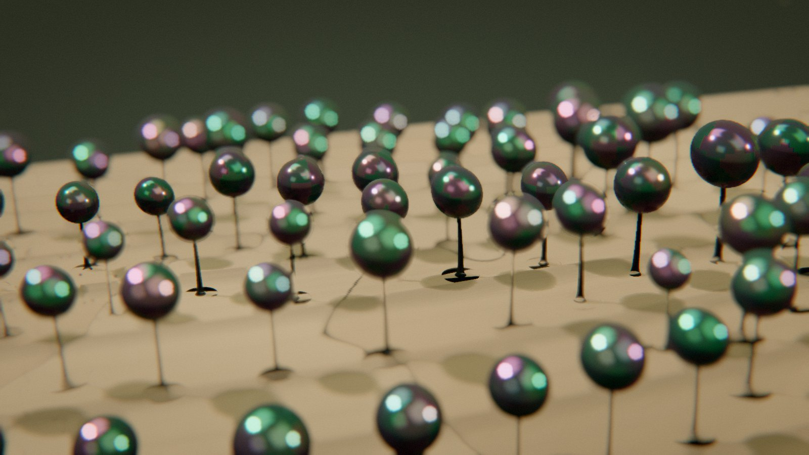

# Spore

*le relais.* Sur du bois mort, une génération de myxomycètes en une boucle : une poussière de spores se pose, germe en un plasmodium jaune qui s'étend en réseau pulsant, se condense en perles à l'aube, se dresse en une forêt de sporanges qui mûrissent puis s'ouvrent au souffle — et la caméra suit le nuage jusqu'au site suivant, où les spores germent à leur tour.

Au début, la caméra arrive en glissant le long du bois, ralentit ; une fumée brune descend en biais et poudre le bois nu. Dans la poudre, des gouttelettes jaunes naissent, gonflent et se rejoignent en une nappe ; la nappe s'étend vers l'aval en éventail, et derrière son bord elle se creuse en veines qui battent. La lumière monte : les veines se vident dans des perles alignées, et les perles se dressent sur leurs pieds, blanches, toutes ensemble. Elles foncent, se dessèchent ; un souffle passe, elles s'inclinent et s'ouvrent, et leurs spores partent avec lui. La caméra suit la fumée ; à gauche restent les sporanges vides, et la fumée se pose : c'est la première image.



Rendu physique en three.js (WebGPU, TSL). Tout est calculé : une graine produit une scène. La démarche (le thème exploré sous six angles, cinq clichés écartés, neuf pistes notées, les épreuves) est dans [docs/concept.md](docs/concept.md) ; les défis techniques, avec des démonstrations interactives, dans [explainer.html](explainer.html).

## Utilisation

| Touche | Action |
| --- | --- |
| N | nouvelle scène (nouvelle graine) |
| Espace | pause / lecture |
| ← / → | avancer ou reculer dans la boucle |
| H | masquer l'interface |
| F | plein écran |

Sur écran tactile : une touche met en pause, deux touches tirent une nouvelle scène, un appui long masque l'interface.

Paramètres d'URL : `?seed=…`, `#r=…` (scène retouchée, « Copier le lien »), `?ui=0`, `?mobile=1` / `?mobile=0`, `?debug` (outils dans `window.spore` : `shot(phase)`, `send(nom)`, `sheet(graines, phases)` — une graine peut s'écrire `graine:décor:famille` —, `meter()`, `meters()`, `bench()`, `seam()`, `run()` ; `?sink=…` : adresse du collecteur d'images).

Le panneau règle le décor et la famille (nouvelle scène de la même graine), l'espèce, la durée ; la caméra (champ, distance, plongée sur le réseau, hauteur sur la forêt, azimut) ; le plasmodium (forme du réseau, μ de Tero, exploration, points de germination, anisotropie, festons) ; la fructification (ordre de maturation, densité, étalement, penchant vers la lumière) et le vent (rafales, force, montée des spores) ; la lumière, le studio, le fond ; le rendu. Export MP4 image par image (éventuellement accumulé) et PNG.

## Principe : une translation, pas un retour

**La boucle est parfaite par construction.** Le bois est périodique de période L = 4,4 cm le long du vent : sa carte de relief est cuite avec un bruit périodique en x (un nombre entier de cellules sur L). Le site j vit son cycle à la phase locale s = u − j :

    état(site j, u) = S(clamp(u − j, 0, 2))

S(0) est le bois nu, S(0 → 1) le cycle (germination, réseau, condensation, forêt, dissémination), S(1 → 2) l'usure des sporanges vides. Les spores du site j se posent sur le site j + 1 à sa phase ~0 : ce sont elles qui germent. La caméra avance de L par boucle (`camera.js` : une vitesse faite d'une dérive et d'une bosse, le voyage). Le monde à u + 1 est donc le monde à u translaté de L, la caméra aussi : l'image à u + 1 est l'image à u. Dans le cadre, la gauche montre le passé (les sporanges vides, dans le flou), le centre le présent, la droite le bois nu qui attend.

**Une seule horloge** (`timeline.js`) : le jour (la lumière principale baisse la nuit, monte à l'aube), le vent, la croissance, la caméra lisent les mêmes bornes. À l'intérieur d'un temps, chaque grandeur est monotone (testé).

| Temps (part de boucle) | Cause visible | Loi | Temps du film |
| --- | --- | --- | --- |
| les spores se posent (0,90 → 0,05) | le nuage du site précédent | vent moyen intégré, tourbillons, chute de Stokes (≈ 0,3 cm/s) | temps réel |
| germination (0,04 → 0,20) | les spores posées, la nuit | gouttelettes qui croissent et fusionnent | très accéléré |
| le réseau (0,10 → 0,42) | le front qui avance | adaptation de Tero, navette péristaltique | accéléré |
| condensation (0,42 → 0,52) | l'aube : la lumière monte | perles le long des veines, volume conservé | accéléré |
| la forêt se lève (0,48 → 0,62) | les perles | pied sécrété, tête formée | accéléré |
| maturation (0,58 → 0,74) | le jour, le séchage | couleur, vernis qui s'éteint | accéléré |
| dissémination (0,74 → 0,93) | le souffle (les têtes s'inclinent) | flexion d'une poutre encastrée, geste de la famille | temps réel |
| le voyage (0,84 → 1,04) | le nuage | — | temps réel |

## Le plasmodium (`src/gen/plasmodium.js`)

1. **Germination et front.** Les spores posées germent à des instants tirés ; l'instant d'arrivée du plasmodium T(x, z) est une distance de Dijkstra multi-sources sur une grille de 0,11 mm à seize voisins (sans eux, les fronts seraient des octogones), au pas anisotrope (le front court plus vite le long du fil du bois) et à vitesse modulée par un bruit (les festons), bornée à un territoire au bord bruité, remappée pour que le front ralentisse en fin de course. La nappe est une courbe de niveau de T : son bord reste net à toute distance.
2. **Le réseau de Tero** (Tero et al., 2007) sur un treillis triangulaire de 0,45 mm qui couvre le territoire : à chaque pas, le protoplasme part du corps (les nœuds âgés) vers quelques nœuds tirés au front ; pressions par Kirchhoff, Σ_j D_ij/l_ij (p_i − p_j) = b_i (gradient conjugué préconditionné, bilan nul dans chaque composante connexe : les gouttelettes avant leur fusion), flux Q = D/l Δp, puis dD/dt = f(|Q|) − D avec f(q) = q^μ/(1 + q^μ). Les tubes traversés s'épaississent, les autres s'effacent : μ ≈ 1,8 donne un arbre, μ ≈ 1 des mailles. Quand le front s'arrête, les puits sont tirés au bord (exploration). Rayon des veines par Poiseuille (D ∝ r⁴). Enregistré en 32 instantanés, relus dans le vertex shader.
3. **La condensation.** Les perles (futurs sporanges) sont placées selon l'espèce : en grappes autour des nœuds les plus chargés (*Arcyria*), en touffes (*Stemonitis*), le long des veines à l'espacement de Plateau-Rayleigh (λ ≈ 9 r ; *Lamproderma*, *Comatricha*), ou nulle part (*Hemitrichia* : les veines maîtresses deviennent le fruit). Chaque veine verse son volume à la perle la plus proche (Σ perles = réseau, testé), et se vide d'autant plus tôt qu'elle en est loin. Deux têtes ne se traversent pas : une perle trop proche d'une autre y est fondue, sinon les deux rétrécissent juste assez.

À l'écran (`scene/plasmodium.js`), la nappe est un gel jaune translucide qui remplit les creux du bois (sa surface suit le bois lissé, jamais sous le bois), épaisse au front (0,28 mm), film de 50 µm derrière, striée de canaux dans le sens de l'avancée ; les veines sont des tubes posés, à section en demi-ellipse, lissés le long de chaque brin ; des granules coulent dans le sens du flux et une onde péristaltique court de l'arrière vers le front (Alim et al., 2013).

## Les sporanges (`src/gen/sporangia.js`, `src/fruit.js`, `scene/sporangia.js`)

Un gabarit usiné par espèce (solides fermés : hypothallus, pied évasé, calice à lèvre roulée, péridium, capillitium, columelle), dans sa forme mûre ; le vertex shader le replie en perle (sphère de même volume), le dresse (le pied s'allonge, la tête prend forme), l'ouvre selon la famille, le fléchit sous le vent (poutre encastrée chargée en bout, ∝ U²) et le pose sur la même surface de bois que tout le reste. L'état de chaque sporange (perle, levée, maturité, ouverture, usure, flexion) est calculé par une seule fonction (`fruitState`) sur le CPU et envoyé au GPU dans des tableaux d'uniformes (courant et précédent : vecteurs vitesse).

**Quatre familles, quatre gestes :**
- ***Arcyria*** : des coupes serrées ; à l'ouverture, le haut du péridium tombe et le filet comprimé **se détend** vers le haut (2 à 3,6 fois sa hauteur, avec un rebond), ses mailles s'ajourent ; *A. obvelata* retombe.
- ***Stemonitis*** : de hautes colonnes en touffes qui **plient** sous le souffle et **fument** : la masse de spores s'amincit du sommet vers le pied et laisse la cage claire autour de la columelle ; *Comatricha* en semis le long des veines.
- ***Hemitrichia*** : pas de pieds, **le réseau devient le fruit** : les veines maîtresses gonflent en tubes dorés, les petites se vident en elles ; mûrs, les tubes se fendent et **moussent** d'élatères.
- ***Lamproderma*** : des sphères sur pieds fins, **iridescentes** (interférences dans une couche mince, Inchaussandague et al., 2010) ; le péridium **s'écaille** en plaquettes qui tombent, la masse sombre s'effrite.

## Les spores (`src/gen/spores.js`, `scene/spores.js`)

Trente mille particules (douze mille en mobile) par site, chacune une bouffée de spores qui s'étale en vol (rayon ∝ √τ, densité ∝ 1/r²) et s'allume à contre-jour (diffusion de Henyey-Greenstein, g = 0,6). Trajectoire analytique (même formule en JS et en TSL) : vent moyen intégré (table), montée dans le tourbillon de l'ouverture, chute de Stokes, dispersion qui croît depuis zéro. Chaque spore se pose sur le bois (instant calculé par pas puis dichotomie) et y reste ; le plasmodium suivant l'absorbe. **Les points de germination du site suivant sont des points de chute de spores réelles** : pour chacun, la spore dont la chute naturelle tombe le plus près reçoit une petite correction, pleine à son instant de chute (testé : chaque graine est à moins de 0,1 mm de sa spore).

## Le bois (`src/gen/wood.js`, `scene/wood.js`)

Un relief de 1 024² texels sur une période (43 µm × 51 µm par texel), **cuit dans un worker**, lu deux fois : en déplacement vertical d'un maillage dense du dessus de la bûche (cylindre de 6,5 cm de rayon, plus dense au sommet) et en normal map, avec un micro-relief procédural pour le gros plan, une hauteur lissée (le niveau du gel) et l'occlusion des creux. Tout le bruit est périodique en x.
- **bois flotté** : le fil relevé par l'érosion (cernes d'été debout, bois de printemps creusé), fibres, gerces effilées ;
- **tronc gris** : id., plus de gerces, fibres arrachées par plaques ;
- **charbon** : une croûte en Voronoï anisotrope fortement déformé (plus large en travers du fil), dessus bombés luisants, fentes fines secondaires ;
- **pourriture cubique** : petites cellules, fibres, humide ;
- **bois échauffé** : lignes noires de zone (une courbe de niveau), une teinte par zone ;
- **cèdre débité** : cernes en cathédrales (courbes de niveau de la distance au cœur, qui s'enfonce et remonte le long de la planche), traits de scie, rayons.

## Les décors

Le fond est neutre (une brume de la teinte du lieu) ; chaque décor se distingue par son support, sa lumière, sa valeur et son cadrage.

| Décor | Support | Lumière | Valeur | Cadrage |
| --- | --- | --- | --- | --- |
| Grève | bois flotté | soleil rasant et dur | très claire, fond pâle | plongée |
| Brûlis | bois carbonisé | douce d'en haut, fort contre-jour | très sombre, fond noir | ras du bois |
| Humus | bois pourri mouillé | lampe frontale, la nuit | sombre, flaque de lumière | rapproché, plongeant |
| Brume | tronc gris | brouillard laiteux à contre-jour | claire et douce | contre-jour rasant |
| Sous-bois | bûche échauffée | ciel couvert, de côté | moyenne | trois-quarts |
| Cèdre | planche de cèdre | soleil bas de trois-quarts arrière | contrastée, fond sombre et chaud | contre-plongée légère |

**La caméra** voyage avec le vent : elle s'attarde au-dessus du site (dérive lente) en plongée sur le réseau, descend au ras du bois quand la forêt se lève (sa distance passe à l'échelle des sporanges), puis suit le nuage jusqu'au site suivant. Trajectoire échantillonnée, partie périodique lissée par un noyau gaussien périodique (σ = 0,8 s), relue en Catmull-Rom ; la translation est ajoutée ensuite, exacte.

## L'écran de chargement

Le plasmodium de la scène pousse en direct, calculé dans le worker du chargement par le vrai modèle, en plus petit : les spores tombent et germent, le front s'étend, le réseau de Tero s'organise (un pas de Kirchhoff par image) ; quand la scène est prête, le réseau se vide en perles.

## Tests

```bash
node --test spore/test/*.test.mjs
```

La boucle (la caméra à u + 1 est la caméra à u translatée de L) ; la caméra lente et lisse (pointe < 25°/s, accélération bornée à 120 i/s) ; Kirchhoff et conservation des volumes du réseau aux perles ; le front qui couvre le territoire avant l'aube ; chaque germination part d'une spore posée ; les spores tombent, se posent et restent sur le bois ; l'horloge monotone (le jour boucle, l'aube monte, le soir baisse, le souffle précède l'ouverture) ; les têtes ne se traversent pas ; la recette déterministe et JSON ; les décors différents par le support, la lumière et la valeur ; les lampes presque blanches ; quatre familles aux gestes distincts ; la variété sur 400 graines.

## Performances

Génération d'une scène : 2 à 4,5 s pour le site (front, réseau de Tero, perles, gabarit, trente mille spores et leurs chutes), 0,4 à 1 s pour le bois, en parallèle dans deux workers (mesuré dans Node ; nettement plus lent quand l'onglet est en arrière-plan). Temps d'image mesuré dans le panneau de navigateur de l'application (GPU d'un Mac, panneau masqué), qualité Haute, 1,8 Mpx, graine e5 : **11,7 ms** pendant le réseau (u = 0,3), **8,7 ms** pendant la dissémination (u = 0,82). Version mobile, graine p6, 1,2 Mpx : 3,9 ms. Les postes les plus lourds : le maillage déplacé du bois (≈ 390 k sommets) et les veines (60 k à 220 k sommets, deux lectures de la table des instantanés par sommet).

## Version mobile

Imposée par `?mobile=1`, ou choisie d'office sur téléphone : bois cuit en 640², maillage plus lâche, douze mille spores par site, chaîne d'image allégée (sans profondeur de champ), résolution dynamique. Vérifiée dans le navigateur de l'application (console propre, 3,9 ms par image), pas sur un appareil réel.
