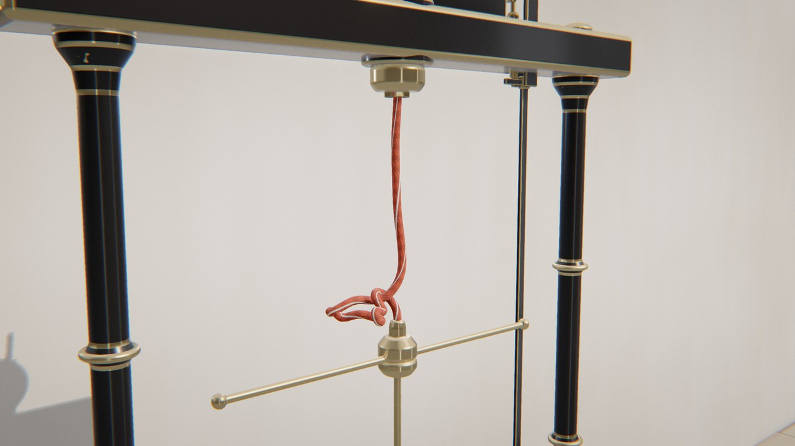

# Tangle

*le tour de trop.* Une corde qu'on tord jusqu'à ce qu'elle s'emmêle d'elle-même.

Un banc d'essai de torsion, pièce d'instrument de cabinet de physique : socle sur quatre pieds, deux colonnes tournées à bagues, une traverse qui porte le mandrin à trois mors, sa poulie, la courroie ronde et le moteur debout, et la roue-programme du compte-tours. Une corde pend du mandrin. À son bout est pendu un balancier (un moyeu lourd et un bras à boules, pendule de torsion à la Coulomb), dont la tige coulisse dans la douille du socle. Une glissière tient le bout du bras : le balancier peut monter, mais non tourner.

Le moteur tourne, et la rayure tissée dans la gaine de la corde s'enroule en hélice. La corde reste droite. Au seuil, elle cède d'un coup sur le côté en une boucle qui s'enroule sur elle-même en torsade, et remonte le balancier. Quand le mandrin a fait son compte, une came de la roue-programme abaisse le poussoir, qui écarte la glissière. Libéré, le balancier tourne, la torsade se défait, il redescend, oscille et se pose. La glissière revient quand le moteur repart. Trois cycles en crescendo : la rayure seule, une boucle, la torsade.



Rendu physique en three.js (WebGPU, TSL). La scène est entièrement procédurale : une graine produit une scène. La démarche est dans [docs/concept.md](docs/concept.md) : le thème « tangle » exploré sous six angles, les clichés écartés (la pelote et le chat, les écouteurs emmêlés, le nœud qui se fait seul, les spaghettis), dix pistes notées, puis les épreuves (crédibilité, variété, ambition, déclinaison, scénario).

## Utilisation

| Touche | Action |
| --- | --- |
| N | nouvelle scène (nouvelle graine) |
| Espace | pause / lecture |
| ← / → | avancer ou reculer dans la boucle |
| H | masquer l'interface |
| F | plein écran |

Sur écran tactile : une touche met en pause, deux touches tirent une nouvelle scène, un appui long masque l'interface.

Paramètres d'URL : `?seed=…` (une scène), `#r=…` (une scène retouchée, produite par « Copier le lien »), `?mood=…` et `?family=…` (imposer une humeur, une famille), `?ui=0` (sans panneau), `?mobile=1` / `?mobile=0` (version mobile imposée / interdite), `?debug` (outils dans `window.tangle` : `shot(phase)`, `send(nom)`, `film(liste)`, `sheet()`, `meter()`, `bench()`, `seam()`, `run()`).

Le panneau règle :
- **Scène** : humeur, famille, durée (fixée par la simulation) ; pour chaque cycle, les tours du mandrin, la vitesse du moteur et le temps de retour au repos ; l'amortisseur du balancier ; le pli naturel de la corde (qui choisit où naît la boucle) ;
- **Caméra** : champ, distance, hauteur du regard, côté, balancement, caméra libre ;
- **Corde et matières** : gaine et rayure (dix palettes ; la corde qui se tord est toujours vermillon, le fil rouge de la collection), second brin de la paire, lustre, une ou deux rayures ; bâti, métal, balancier, accent, cadran, courroie (jeu de matériaux, couleur et curseurs du modèle physique) ;
- **Lumière et fond** : lampe ou soleil, lumière du lieu, contre-jours, studio HDR, brume ;
- **Rendu**.

L'export produit une boucle MP4 (H.264) rendue image par image, éventuellement en rendu accumulé (8 à 64 passes), et une image PNG.

## Principe : tordre, flamber, lâcher

Tordre une corde tendue y accumule de la torsion. Passé un seuil, elle cède sur le côté : c'est le **flambage**. La boucle qui naît alors s'enroule sur elle-même en torsade, un plectonème, et range dans cette vrille une partie de la torsion. Chaque temps a une cause visible et une loi. Le temps du film est celui d'une caméra : réel, ralenti de caméra rapide au flambage et au lâcher, accéléré pendant les longs retours au repos.

| Temps | Cause visible | Loi | Temps du film |
| --- | --- | --- | --- |
| la rayure s'enroule | le moteur, la courroie (son agrafe court), la poulie, le mandrin ; l'aiguille de la roue-programme avance | torsion d'une tige élastique, couple C·τ | réel |
| la corde reste droite | le poids du balancier | stabilité d'une tige tendue | réel |
| la boucle naît | trop de torsion | flambage (Greenhill, τc = 2√(BF)/C) : la torsion passe dans la vrille, Lk = Tw + Wr | ralenti ×2,5 |
| la torsade grandit, le balancier monte | chaque tour de plus | le plectonème absorbe la longueur ; le balancier est freiné par son amortisseur à huile | réel |
| la glissière s'écarte | la came de la roue-programme abaisse le poussoir, qui abaisse le levier | levier et pivot ; la levée de la came est l'ouverture même de la glissière | réel |
| le balancier tourne, la torsade se défait | le couple de torsion stocké | pendule de torsion freiné par l'air et son pivot | ralenti ×2 à ×3 au lâcher |
| le balancier redescend et se pose | la gravité ; l'amortissement | oscillation amortie | réel puis accéléré ×1,7 |
| la glissière revient | le moteur repart, la came quitte le poussoir ; son entrée en V recentre le bras | ressort de rappel, butée en V | réel |

**La boucle.** Le mandrin tourne de K₁ + K₂ + K₃ tours entiers. À chaque lâcher, le balancier tourne jusqu'à annuler la torsion, soit au total le même nombre de tours, et la glissière le recentre exactement en revenant. La roue-programme, menée au rapport 1 : (K₁ + K₂ + K₃), fait un tour par boucle. La simulation est intégrée sur la boucle entière en temps physique, enregistrée, puis relue. À la fin, la corde est droite et le balancier a tourné de N tours entiers : c'est l'état initial, à quelques dixièmes de millimètre près (mesuré). Cet écart est réparti sur la dernière seconde de repos, comme une correction de position, sans fondu d'images. Le film lit le temps physique τ(t) par une vitesse v(τ) faite de bosses lisses en log (ralentis, accélérés), avec τ(t + T) = τ(t) + P.

## La corde (`src/gen/rod.js`)

Une **tige de Cosserat discrète** (Kugelstadt et Schömer 2016) : 64 à 72 segments par brin, chacun portant un repère matériel (quaternion), intégrée par XPBD à petits pas (3 000 pas par seconde physique, une itération par pas ; Macklin et al. 2019).

- **Étirement et cisaillement** : (pᵢ₊₁ − pᵢ)/l = d₃(qᵢ). Le cisaillement est borné à 3° (au-delà, dans un claquement, les repères décrocheraient de l'axe).
- **Flexion et torsion** : vecteur de Darboux par le logarithme exact de la rotation relative. Le rappel croît avec l'angle jusqu'au tour complet, si bien qu'un demi-tour de torsion entre deux voisins ne fait pas « sauter » un tour. Souplesse ½·l·(B Ω₁² + B Ω₂² + C Ω₃²). Une courbure naturelle légère (le pli d'une corde sortie de sa bobine) choisit où naît la boucle.
- **Inextensibilité** : le balancier pèse des centaines de fois plus qu'un segment, et un passage de Gauss-Seidel laisserait la corde s'allonger de moitié. Le système tridiagonal des longueurs est donc résolu exactement à chaque pas (Thomas), balancier compris.
- **Encastrements** : le premier et le dernier segment sont pris dans les mors du mandrin et dans la pince du balancier (rigides). Le balancier a deux degrés de liberté (sa hauteur, son angle).
- **Contacts** : capsules de rayon r, grille de hachage, frottement de position. Si deux segments se sont croisés pendant un pas, on les ramène du bon côté d'après la normale du pas précédent. Un rayon de courbure minimal est imposé. Obstacles : nez du mandrin, pince et moyeu du balancier, glissière (qui pivote), colonnes.
- **Inertie de rotation ×100** : avec elle, le seuil de flambage ne dépend plus du pas de temps et rejoint la théorie dès 1 500 pas/s (6,0 à 6,6 tours mesurés pour 6,3 prédits).

**Invariant topologique.** Le théorème de Călugăreanu-White : Lk = Tw + Wr. Lk est la différence des tours du mandrin et du balancier ; Tw, la torsion (angles entre repères transportés parallèlement) ; Wr, la vrille de l'axe (intégrale de Gauss exacte de Klenin et Langowski, l'axe fermé par deux demi-droites verticales). Tant que la corde ne se traverse pas, Lk est conservé. Un test le vérifie pendant deux cycles (une traversée ferait un saut de 2). Pendant la mise au point, cet invariant a révélé trois fautes : des repères qui décrochaient, une articulation qui glissait d'un tour au-delà d'un demi-tour, une boucle qui passait par-dessus l'extrémité de la corde à travers la pince.

Trois familles, chacune avec son geste :
- **Cordon** (corde ronde tressée, 1 cm, tendue par 110 g) : il reste droit pendant que sa rayure tourne. Au seuil (6,5 tours), une boucle naît et s'enroule sur elle-même en torsade (plectonème), qui s'allonge à chaque tour. Cycles de 4, 7, 8 tours.
- **Paire** (deux brins écartés de 2,8 cm, tendus par 160 g) : les brins s'enroulent l'un autour de l'autre en hélice serrée et se commettent comme les torons d'un cordage. La paire se raccourcit sans boucle. Cycles de 3, 5, 7 tours.
- **Spirale** (cordon peu tendu, 25 g) : il se love tout entier, d'un bout à l'autre, en ressort. Cycles de 2, 5, 6 tours.

Un ruban et un fil d'acier ont été essayés et écartés : le ruban se traversait avec un contact de capsules, le fil montrait une instabilité de torsion locale (voir le concept).

## La machine (`src/gen/bench.js`, `src/plan.js`)

- **Le plan** : pour chaque cycle, le mandrin tourne de K tours avec une vitesse en trapèze aux rampes lisses (intégrée en forme fermée), puis s'arrête pendant le retour. La barre est une fonction de l'angle du mandrin : elle s'écarte pendant le dernier tiers de tour et revient pendant le premier tiers du cycle suivant.
- **La came** est calculée d'après le plan : son rayon à l'angle ψ de la roue est R + course·ouverture(ψ). Le poussoir appuie au point bas de la roue, et le levier (4 cm) tourne la glissière de 8° au plus. Un test vérifie que la levée de la came usinée (720 points) suit l'ouverture de la glissière à chaque instant, à 3 % près.
- **La butée en V** : quand la glissière revient, l'écart permis au bras du balancier se referme avec elle. Un test vérifie que le balancier est dans l'entrée en V (± 4°) quand elle commence à revenir, et en place (± 0,5°) quand elle est fermée.
- **Le banc** : profils tournés à congés (pieds, colonnes à bagues, palier, mandrin, poulies à gorge, moyeu, douille), boîtes arrondies (socle à moulure, traverse, chapes, carter de vis sans fin), mors et vis de serrage, ressort de rappel en hélice, cadran émaillé gradué d'un trait par tour, bobinage de cuivre visible par les fenêtres du moteur.

## Matériaux

- **La gaine tressée** : seize fuseaux, deux familles d'hélices qui se croisent dessus-dessous (sergé 2/2), chaque fil en relief avec ses fibres, deux tons. La **rayure de repère** est un fuseau d'une autre couleur tissé dans la tresse (une ou deux rayures), et c'est elle qui rend la torsion lisible. Lustre textile (sheen). La paire a deux brins de couleurs différentes, ce qui montre l'hélice.
- **Le tube** est déformé dans le vertex shader d'après une petite texture mise à jour à chaque image : la courbe dense en Catmull-Rom (trois points par segment) et le vecteur matériel d₁ en chaque point. La pose de l'image précédente y est aussi, pour les vecteurs vitesse. Un shader par corde.
- **Le banc** : fonte laquée noire (noir du Japon), fonte vert machine ou grise martelée, émail crème ou sang-de-bœuf, noyer verni, chêne ciré, frêne ; laiton poli et brossé, nickel, acier tourné ; cadran de porcelaine ; courroie de cuir ; bobinage de cuivre. Motif bois (cernes le long de la pièce, pores), usure des arêtes qui montre la tranche, traces de doigts.

## Les décors

| Décor | Fond, sol, accessoires | Lumière | Valeur | Cadrage |
| --- | --- | --- | --- | --- |
| Corderie | longue halle de briques, fenêtres en plein cintre, parquet, rouleaux de cordage | soleil rasant par les fenêtres | moyenne, chaude | de trois quarts, bas |
| Cabinet | boiseries de noyer à cadres, cimaise, planche encadrée | lampe de bureau basse et dure, de côté | très sombre | légèrement plongeant |
| Épure | cyclorama de plâtre, socle blanc | grande source douce d'en haut | très claire | frontal, de trois quarts |
| Muybridge | mur noir quadrillé de blanc (5 cm), sol noir | lumière dure et étroite, rasante | low key graphique | de profil, plan moyen |
| Mercerie | casiers à tiroirs, étagères de bobines de fil | lumière de vitrine douce et large | moyenne, saturée | longue focale |
| Salle d'essais | béton, mur peint à mi-hauteur, tuyauteries, tubes au plafond | lumière froide d'en haut | moyenne, froide | contre-plongée |
| Midi | mur chaulé, dallage de pierre | soleil dur et haut ; l'ombre du banc sur le mur | très claire, dure | plan large |

Lampes presque blanches (≥ 4 700 K), sauf la lampe de bureau du Cabinet (4 300 K). Le décor ne reçoit que la lampe et la lumière du lieu, pour que les contre-jours n'effacent pas les ombres.

**La caméra** est une grue lente qui encadre la partie active de la machine, du moteur au balancier. Elle est centrée en partie sur le désordre de la corde (les sommets pondérés par leur écart à l'axe), se rapproche quand le balancier remonte et se balance d'un seul mouvement par boucle. Sa trajectoire est échantillonnée à 30 images par seconde de film et lissée par un noyau gaussien périodique (σ = 1,2 s). Elle pointe sous 25°/s (testé à 120 i/s).

**Le plan serré** (`camera.close`, 0,75 à 1) : la corde est le sujet, pas le banc. Le cadre descend sous la traverse du moteur (on garde le mandrin qui tourne, la cause) et remonte au-dessus du bas du balancier ; son centre suit davantage le désordre de la corde (0,25 + 0,3 × close au lieu de 0,25). Une recette ancienne, sans `close`, garde le plan du banc entier. La corde principale est vermillon (deux tons, rayure noire ou ivoire, albédo #c4370c, plus orangé, que le lustre de la gaine éclaircit et désature vers le vermillon de la collection) ; le second brin de la paire prend une couleur du décor.

## Tests

```bash
node --test 'tangle/test/*.test.mjs'
```

Vingt-cinq tests :
- recette : déterminisme, JSON, humeurs et familles tirées, accords existants, crescendo des cycles, métal chaud en accent, au moins trois matières, lampes ≥ 4 700 K, décors qui diffèrent par le décor, la lumière et la valeur, gestes des familles distincts ;
- plan : nombres entiers de tours, rotation monotone, barre continue, fermée pendant la torsion et ouverte pendant le retour, came égale à l'ouverture de la barre, temps du film périodique et monotone ;
- simulation : Lk = Tw + Wr pendant deux cycles. Pour chaque famille, la boucle se referme (résidu, N tours entiers du balancier, raccord), la corde ne touche ni la glissière, ni les colonnes, ni le mandrin, ni le moyeu, à aucune image, et la glissière se referme sur un balancier aligné ;
- caméra : périodique, pointe < 25°/s, accélération bornée, au-dessus de la table.

## Performances

Mesuré dans le panneau de navigateur de l'application (GPU d'un Mac), qualité Haute, 1,8 Mpx : 5,4 ms par image pendant la torsade (graine b5), 4,5 ms au repos. Les 55 shaders sont tous compilés sous l'écran de chargement, aucun après. Version mobile : 2,1 ms à 1,2 Mpx (graine b2).

La simulation d'une boucle (40 à 50 s physiques, 3 000 pas par seconde) tourne dans un worker pendant l'écran de chargement. Mesurée dans Node, elle prend 6 à 8 s pour un cordon ou une spirale et ~25 s pour une paire (deux brins et leurs contacts). Elle est plus lente quand l'onglet est en arrière-plan. Le rendu ne relit que l'enregistrement (30 images par seconde de film, ~5 Mo) : courbe dense et repères calculés sur le CPU, envoyés dans une texture de 217 × 4 texels par brin.

## Version mobile

Choisie d'office sur téléphone ou tablette, imposée par `?mobile=1`, ou par la qualité « Mobile » du panneau. Une lumière de moins, cartes d'ombre en 1 024, chaîne d'image allégée (FXAA, sans SSR, occlusion ni flou de mouvement), résolution dynamique, 60 i/s au plus. La simulation est la même, aussi le chargement d'une paire est-il long sur un téléphone.
