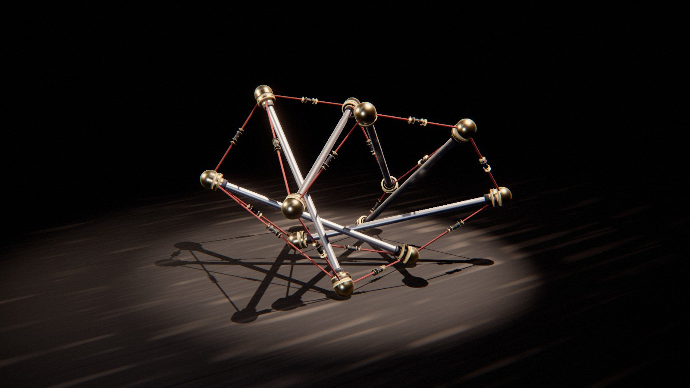

# Tension

*ce qui tient ne pousse pas.* Des sculptures de tenségrité avancent sur un sol nu, sans roue ni pied. Une tenségrité est un assemblage de barres d'acier qui ne se touchent pas, tenues en l'air par des câbles tendus. Ici, de petits treuils enroulent ces câbles pour faire marcher la structure. Un prisme se penche jusqu'à basculer, une chenille fait courir une onde de contraction de la queue à la tête, une roue de vélo laisse tomber son moyeu vers l'avant et roule après lui. Puis la structure se repose, intacte, un pas plus loin.



Rendu physique en three.js (WebGPU, TSL). La scène est entièrement procédurale : une graine produit une sculpture, une allure, un décor et un film. La démarche est dans [docs/concept.md](docs/concept.md) : le thème exploré sous six angles, les clichés écartés, huit pistes notées, les épreuves (crédibilité, variété, ambition, déclinaison, scénario, références).

## Utilisation

| Touche | Action |
| --- | --- |
| N | nouvelle scène (nouvelle graine) |
| Espace | pause / lecture |
| ← / → | avancer ou reculer dans la boucle |
| H | masquer l'interface |
| F | plein écran |

Sur écran tactile : une touche met en pause, deux touches tirent une nouvelle scène, un appui long masque l'interface.

Paramètres d'URL : `?seed=…`, `#r=…` (scène retouchée, « Copier le lien »), `?mood=…` (galerie, ardoise, midi, labo, crepuscule, scene, brume), `?family=…` (culbute, chenille, cerceau), `?ui=0`, `?mobile=1` / `?mobile=0`, `?debug` (outils dans `window.tension` : `shot(phase)`, `send(nom)`, `sheet(graines, phases)` (une graine peut s'écrire `graine:humeur:famille`), `meter()`, `meters()`, `bench()`, `seam()`, `run()`).

Le panneau règle l'humeur, la famille et le sol (nouvelle scène de la même graine) ; la caméra (champ, distance rapportée à la taille de la structure, azimut, hauteur, avance du cadre, balancement, caméra libre) ; l'allure (modules, contraction, nombre d'ondes, durées, durée du tour, décalage du moyeu : toute retouche relance la simulation) ; les matières par rôle (tube, viroles, embouts ; rotules et moyeu ; treuils ; câbles) ; la lampe, les contre-jours, le studio HDR et la brume ; le rendu. Export MP4 image par image (éventuellement accumulé) et PNG.

## Principe : la tenségrité qui marche

Trois familles de sculptures, chacune avec sa façon d'avancer :

| Famille | Sculpture | Mouvement |
| --- | --- | --- |
| **Culbute** | un prisme de tenségrité à six barres (douze embouts, dix-huit câbles, chacun avec son treuil en ligne), couché sur le flanc | Il bascule. Deux câbles raccourcissent et le prisme s'écrase vers l'avant. Quand son centre de gravité sort de l'arête d'appui, il tombe sur la face suivante (ralenti de caméra rapide), rebondit, frémit, puis les câbles se relâchent. Huit culbutes par boucle. |
| **Chenille** | une chaîne de quatre ou six prismes carrés à rotules communes, couchée dans son axe | Elle rampe. Une onde de contraction des câbles axiaux court le long du corps, une fois de la queue à la tête, une fois de la tête à la queue. Ses patins glissent vers l'avant et accrochent vers l'arrière (frottement anisotrope), si bien que chaque onde avance le corps d'un pas. Quatre ondes par boucle. |
| **Cerceau** | une roue de vélo : jante en échelle (deux polygones de douze tubes, barreaux, croisillons de câbles), moyeu lourd suspendu par vingt-quatre rayons | Il roule. Le moyeu enroule les rayons de l'avant et descend en avant du centre. La jante « tombe » après lui et fait un tour entier, puis le moyeu se recentre et freine, et elle se pose sur un plat. |

**La boucle** est un pas complet, qui commence et finit au repos. Sa fin est son début déplacé : une translation, plus une petite rotation sur place (un lacet résiduel de 0 à 1,6°). Pour le Culbute, la fin est aussi ré-étiquetée par une symétrie du prisme, dont toutes les barres se ressemblent. Ce pas qui se répète s'obtient par un point fixe : l'état d'arrivée, recalé sur l'état de départ par la symétrie et le déplacement plan qui les superposent le mieux, devient le départ du pas suivant. On recommence jusqu'à ce que l'écart quadratique entre les deux tombe sous 2·10⁻⁴ u, ce qui prend deux ou trois itérations. Le reste du raccord (au plus 0,2 mm) est réparti sur toute la boucle, d'abord sa part rigide, interpolée, puis ce qui reste.

Le sol ne change pas d'un pas à l'autre : ses motifs se répètent le long de la marche, avec une période égale à la longueur du pas. Le petit lacet résiduel est réparti sur la boucle par une rotation d'ensemble imperceptible (quelques millimètres aux extrémités). Si un réglage du panneau fait tourner le pas franchement (rayon de courbure sous 6 m), le sol passe en coordonnées polaires autour du centre de la rotation, avec pour période angulaire l'angle du pas. La caméra et les lumières suivent le pas. L'image à la phase u = 1 est donc exactement celle de u = 0 : `seam()` mesure 10⁻⁷ u.

| Temps | Cause visible | Loi | Temps du film |
| --- | --- | --- | --- |
| les câbles raccourcissent | le barillet du treuil tourne (deux têtes de vis), la corde s'y enroule | longueur au repos qui décroît | temps réel |
| la structure se déforme, se penche | les câbles raccourcis, les autres qui mollissent et pendent | équilibre des barres rigides et des câbles élastiques sous la gravité | temps réel |
| le Culbute bascule | le centre de gravité sort de l'arête d'appui | gravité, contact, frottement | ralenti ×3,5 (caméra rapide), centré sur la chute |
| il rebondit, frémit | le choc | contact inélastique ; vibration propre de la structure | ralenti qui remonte |
| la Chenille avance | l'onde de contraction, les patins | frottement de Coulomb anisotrope (μ = 0,06 vers l'avant, 1,2 vers l'arrière) | temps réel |
| la roue roule | le moyeu décalé vers l'avant | couple du poids du moyeu ; commande en angle | temps réel |

## Génération (`src/gen/`, dans des Web Workers)

**Topologies** (`topology.js`) : prisme tordu à n barres ; chaîne de prismes carrés à anneaux partagés (torsion alternée d'un module à l'autre) ; roue en échelle et moyeu. **Recherche de forme** (`sim.js · formFind`) : sans gravité, câbles raccourcis de 4 % (précontrainte), forte viscosité, jusqu'au repos. Un prisme régulier converge vers la torsion d'équilibre classique α = π/2 − π/n (30°, 45°, 54°, 60°), vérifiée à 0,15° près en partant d'une torsion fausse de 20°.

**Dynamique** (`sim.js`) : XPBD à petits pas, 1/4000 s, et 1/8000 s pour la roue, dont le moyeu porte vingt-quatre câbles raides. Les nœuds sont les embouts. Ils portent la masse, puisque moteurs et bobines y sont logés comme sur les robots réels. Les barres gardent leur longueur exacte (quatre passes par pas). Les câbles sont unilatéraux, de raideur 2 500 N/m. Au sol, le contact se prend au rayon de l'embout et le frottement de Coulomb passe par la pénétration du pas (Müller), anisotrope pour les patins. Trois amortissements, chacun pour une raison : visqueux léger pour l'air (0,7 s⁻¹ au Culbute, 0,8 à la Chenille, 1,5 au Cerceau) ; dans les câbles tendus, sur la vitesse relative le long du câble, à 40 s⁻¹ (le frottement de la tresse) ; structural, sur la vitesse de *déformation*, c'est-à-dire l'écart au mouvement rigide le mieux ajusté (quantité de mouvement, moment cinétique, tenseur d'inertie), freinée à 6 s⁻¹. Sans ce dernier, les modes mous de la tenségrité (des mécanismes infinitésimaux, que rien n'étire) oscillaient sans fin. Comme il laisse le mouvement d'ensemble intact, une chute n'en est pas ralentie.

**Allures** (`gait.js`) :
- *Culbute* : un basculement est une paire de câbles raccourcie de la part k (montée lisse en 1,5 s, maintien 0,3 s, relâche 0,75 s, repos 0,8 s). Depuis la pose de départ, on essaie toutes les paires et l'on garde celles qui font basculer d'une face entière, chacune à la plus petite contraction (dichotomie, plus 12 %). Ce sont les **primitives**, notées avec leur déplacement et leur changement de cap. À chaque basculement, la pose courante est ramenée sur la pose de départ par la symétrie du prisme (le groupe diédral D₆ : 12 permutations, recalage de Horn). On choisit la primitive qui avance vers +x et ramène le cap vers 0, et on la joue sur les câbles images. On garde le nombre de basculements (entre 6 et 14) dont le cap final, modulo 2π, est le plus proche de 0 : huit, cap final 2,3°. Primitives et séquence sont précalculées (`tools/precompute.mjs` → `culbuteTable.js`), car la recherche complète prend une minute.
- *Chenille* : une onde. Les câbles axiaux du module k raccourcissent de 34 % puis reviennent, profil sin², chaque module décalé de 0,45 s. Les modules sont des prismes tordus alternativement à gauche et à droite, et la chaîne est donc chirale. Une onde qui part toujours de la queue la faisait tourner de 6 à 10° par boucle, et ni plus de frottement latéral ni une contraction plus forte d'un côté n'y changeaient rien. Une onde sur deux part donc de la tête. Le lacet tombe alors sous 0,8° et la chenille avance deux fois plus (38 cm par boucle avec quatre modules, 50 cm avec six). Les nombres de modules impairs gardent un lacet de 2 à 3°, et le catalogue ne tire que 4 ou 6.
- *Cerceau* : commande en angle. Le moyeu est placé, par la longueur de ses rayons, à un décalage du centre de la jante (proportionnel-dérivé sur l'angle de la jante, filtre du premier ordre de 0,22 s, car les bobines ont une vitesse finie). La consigne fait un tour en 8 s en smoothstep. À la fin, le moyeu se recentre et freine. La longueur de consigne d'un rayon se calcule sur la **géométrie nominale** de la jante tournée de l'angle courant, jamais sur ses positions déformées. Sinon le rayon suit sa propre déformation et n'a plus de raideur : la roue s'effondrait sous son moyeu.

**Le film** (`film.js`) relit les images enregistrées à 240 Hz en Catmull-Rom, avec des ralentis au noyau K₇ (`τ(t) = t − Σ a·w·K((t − t_k)/w)`, d'intégrale nulle, donc sans changer la durée), puis applique le raccord et le passage au monde. **Câbles mous** (`cable.js`) : un câble plus court que sa longueur au repos pend en arc de parabole dans le plan de la corde et de la verticale. Sa flèche f est celle pour laquelle la longueur d'arc ½√(d² + 16f²) + d²/(8f)·asinh(4f/d) vaut la longueur au repos (dichotomie). Le vertex shader utilise la même formule.

**Maillages** (`build.js`) : barres tournées (calotte sphérique de l'embout centrée sur le nœud, la seule partie qui touche le sol, fût à gorge, épaulement à congé, virole, tube), rotules à gorge, treuils en ligne (barillet, tambours, joues, deux têtes de vis qui montrent la rotation, dont l'angle est la longueur enroulée sur le rayon du tambour), moyeu à flasques et carter. Les profils sont lisses, avec des normales calculées sur le profil, et trois rôles de surface (tube, viroles et bagues, laiton). Les câbles sont un seul tube instancié, posé dans le vertex shader sur le repère exact de la parabole, avec un rayon apparent plancher de 0,7 pixel et une tresse en hélice dans la rugosité.

## Les décors

Le fond est neutre. La brume prend sa couleur et se compte depuis le sujet, pour ne jamais le noyer. Chaque humeur est un sol, une lumière, une valeur et un cadrage :

| Humeur | Sol | Lumière | Valeur | Cadrage |
| --- | --- | --- | --- | --- |
| Galerie | parquet de chêne à lames longues | grande lampe haute et douce | très claire | trois quarts, hauteur de hanche |
| Ardoise | dalles d'ardoise adoucie, rares micas | projecteur dur à contre-jour, appoint froid côté caméra | très sombre | ras du sol |
| Midi | béton ciré à joints | soleil haut et net, ciel en remplissage | plein jour | plongée légère, plan large |
| Labo | linoléum moucheté (semis sur une grille hachée) | deux bandes diffuses latérales, froides | moyenne | profil strict, téléobjectif court |
| Crépuscule | briques sur chant en panneresse | soleil rasant de face, ombres traînées | sombre, chaude | ras du sol, de face |
| Scène | plancher de théâtre peint, usé aux passages | poursuite étroite d'en haut, contre-jour chaud | très sombre | trois quarts arrière |
| Brume | dalle mouillée, flaques qui reflètent | ciel couvert, sans ombre franche | moyenne, sans contraste | téléobjectif, plan large |

**Matières** : accords composés à la main par humeur `[tube, virole, embout, câble, treuil]` (acier poli, aluminium diamanté, carbone, titane bleui, acier noirci ; laiton, cuivre, bronze ; Dyneema noir ou blanc, fil d'acier tressé, tresse colorée, chanvre ciré). Une seule couleur d'accent par scène : la corde quand elle est colorée, sinon l'anodisation. Lampes ≥ 4 800 K.

## L'écran de chargement

Le calcul rejoué (`src/app/loaderArt.js`) : la topologie de la graine part d'un tas de barres en désordre, câbles lâches, et une petite relaxation (le même `sim.js`, sans gravité) tend ses câbles jusqu'à la forme précontrainte. On voit le prisme se tordre, la chaîne s'aligner, la roue s'arrondir, pendant que le worker cherche l'allure et le cycle limite. Quand le pas est calculé, sa chronophotographie à la Marey (vingt-quatre poses de profil, en traits fins) se dessine sous la structure.

## Tests

```bash
node --test 'tension/test/*.test.mjs'
```

Recherche de forme (torsion π/2 − π/n à 0,15° près depuis un départ faux) ; câble mou (longueur d'arc exacte) ; symétries du prisme. Pour chaque famille : le pas avance et le point fixe est atteint ; raccord exact (l'ensemble des nœuds à u = 1 est celui de u = 0 déplacé par le pas, à 10⁻⁴ u) ; barres rigides, rien sous le sol, aucune barre n'en traverse une autre (400 instants, distance segment–segment moins les rayons, corps des barres compris) ; caméra sous 25°/s et sous 40 u/s² d'accélération, mesurées à 120 i/s. Enfin, recette déterministe, accords et humeurs (`recipe.test.mjs`).

`node tension/tools/walk.mjs <famille> <taille> [json]` simule un pas dans Node et imprime le déplacement, le lacet, les résidus du point fixe et la courbe du centre.

## Performances

Simulation d'une scène (worker, sous l'écran de chargement ; mesuré dans Node) : Culbute 1,5 s (table précalculée), Chenille 1,4 à 3 s, Cerceau 3,4 s. Durée des pas : Culbute 29,7 s (8 culbutes, 1,07 m), Chenille 13,3 s (4 modules, 38 cm) à 16,3 s (6 modules, 50 cm), Cerceau 10,9 s (1,37 m).

Temps d'image mesuré dans le panneau de navigateur de l'application (GPU d'un Mac), qualité Haute, 1536 × 1152 (1,8 Mpx) : Scène / Culbute 7,0 ms ; 39 pipelines, toutes compilées sous l'écran de chargement (aucune après une boucle complète).

## Version mobile

Imposée par `?mobile=1`, ou choisie d'office sur téléphone : chaîne d'image allégée (sans GTAO, SSR ni TRAA), une lumière de moins, studio en 512, résolution dynamique ; simulation identique. Mesuré dans le panneau (Galerie, Cerceau) : 2,7 ms par image, 18 pipelines, console vide, raccord 1,6·10⁻⁷. Non vérifiée sur un appareil réel.
