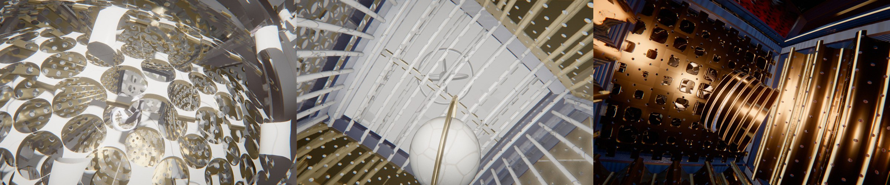

# Tesseract

Le cabinet replié. Un écrin de huit cubes, couché à plat en patron (la croix du *Corpus Hypercubus* de Dalí, ou une autre forme), se replie dans une direction qui n'existe pas. L'hypercube tourne d'un quart de tour en 4D : le cube intérieur passe à l'extérieur. Puis il se déplie à nouveau. Le patron est le même, mais les cellules ont changé de place. Après quelques étapes, chacune a retrouvé la sienne : la boucle est parfaite par construction.

Puis la caméra entre. L'œil 4D se pose sur l'hypersphère, l'espace se referme sur lui-même, et le cube du centre devient une pièce où l'on se tient. Vue de l'intérieur, chaque rotation 4D de la boucle est un voyage : l'univers glisse, une paroi s'ajoure, et l'on passe dans la pièce voisine. Huit pièces, chacune accolée à six autres ; on va de l'une à l'autre sans jamais revenir sur ses pas, et l'on se retrouve au point de départ. Avec quatre quarts de tour dans le même plan, on marche tout droit et l'on fait le tour de l'univers.

Rendu physique en three.js (WebGPU, TSL). La scène est entièrement procédurale : une graine produit une scène, et l'on peut en générer autant que l'on veut.

## Utilisation

| Touche | Action |
| --- | --- |
| N | nouvelle scène (nouvelle graine) |
| Espace | pause / lecture |
| ← / → | avancer ou reculer dans la boucle |
| L | afficher / masquer les légendes des étapes |
| A | afficher / masquer l'analogie 3D |
| H | masquer l'interface |
| F | plein écran |

Paramètres d'URL :
- `?seed=…` : une scène ;
- `#r=…` : une scène retouchée, produite par « Copier le lien » ;
- `?ui=0` : sans panneau ;
- `?debug` : outils dans `window.tess`, dont `shot(phase)` (une image fixe à une phase donnée), `at('travel', 1, 0.5)` (la phase d'un moment du voyage) et `send(nom)` (l'image rendue, envoyée à un collecteur local sur le port 8099).

Le panneau règle tout :
- **Voyage intérieur** : activé ou non, durées (plongée, halte dans chaque pièce, traversée, remontée), écart de la caméra à l'axe de la traversée, rayon de son tour autour de l'objet, champ, lampe, ajourage des parois vues de l'intérieur, taille des objets, brouillard.
- **Scène** : humeur, durée, patron, séquence de rotations 4D.
- **Chorégraphie** : durée de chaque temps, décalage entre cellules, anticipation et rebond.
- **Projection 4D** : distance de l'œil 4D, gonflement stéréographique, écart entre cellules, ajourage, cadrage, inclinaison.
- **Caméra**.
- **Ossature** : profil, épaisseur, chanfrein, nœuds, matériaux.
- **Chaque cellule** : archétype, nature de chaque face, perforations, persiennes, grille, matériaux des trois faces, verre, objet exposé.
- **Lumière et plateau**.
- **Rendu**.

L'export produit une boucle MP4 (H.264) rendue image par image, et une image PNG.

## Principe

**Les cellules.** Le tesseract est [-1, 1]⁴. Ses huit cellules sont des cubes, repérés par leur normale ±eₖ. Chaque pièce (ossature, panneaux, verre, objet) est construite une fois, en coordonnées locales de sa cellule. Une matrice 4D propre au maillage, recalculée à chaque image, l'emmène dans l'espace à quatre dimensions. Cette matrice compose le plongement de la cellule dans son hyperplan, le dépliage, la rotation 4D et la rotation de l'objet exposé.

**La projection** (`src/scene/project.js`, dans le vertex shader) :
1. un gonflement facultatif vers la 3-sphère, qui courbe les arêtes en arcs ;
2. une perspective depuis l'œil 4D (0, 0, 0, d).

La normale est transportée par la jacobienne de la projection (n' = cof(J)·n). Une cellule vue « de l'autre côté » en 4D se projette en miroir. Ses triangles changent alors de sens, et le sens de la face (matériaux double face) retourne la normale une seconde fois : elle sort toujours de la matière. Le même calcul, avec les paramètres de l'image précédente, donne les vecteurs vitesse (flou de mouvement, anticrénelage temporel). La carte d'ombre reçoit la même déformation.

**Le patron** (`src/math4.js`). Un patron est un arbre couvrant des cellules, de racine −W. Chaque cellule pivote autour du carré qu'elle partage avec son parent, dans le plan de leurs deux normales. À π/2, toutes sont couchées dans l'hyperplan w = −1. Un patron tiré au hasard est vérifié : deux cellules n'y tombent jamais au même endroit. Il existe 261 patrons du tesseract à symétrie près.

**La boucle.** Chaque étape fait un quart de tour dans un plan contenant w, éventuellement doublé d'un quart de tour dans le plan orthogonal (rotation isocline). C'est une symétrie de l'hypercube. La séquence est tirée de façon que le produit des mouvements soit l'identité, sans aller-retour ni retour à un état déjà vu. Chaque étape suit le même déroulé :
1. pause dépliée ;
2. pliage échelonné, les feuilles de l'arbre d'abord ;
3. pause ;
4. rotation ;
5. pause ;
6. dépliage.

Les courbes ont de l'anticipation et du rebond (le mouvement recule un peu avant de partir, et dépasse un peu avant de se poser).

**L'ajourage.** Plié, le tesseract est enveloppé par sa cellule extérieure et par les faces des cellules latérales qui la touchent : elles cacheraient tout. Les panneaux se percent de trous ronds, sur une trame à 45°, qui grandissent avec la coordonnée w du centre de leur face. La coque tournée vers l'œil 4D s'efface, les faces latérales s'ajourent à moitié et le cube intérieur reste plein. Tout se referme quand les cellules reviennent se coucher dans le patron. L'objet exposé de la cellule extérieure se rétracte : projeté, il se superposerait à celui de la cellule intérieure.

**Lisibilité** (`src/scene/guides.js`, `src/app/overlay.js`). Une rotation dans un plan qui contient une quatrième direction ne se représente pas : on donne au regard des prises.
- **Le fantôme** (désactivé par défaut) : la silhouette du tesseract plié, en arêtes fines et lumineuses, à l'endroit exact où les cellules vont se poser. Déplié, on voit déjà la destination.
- **Les liserés appariés**, comme les languettes d'une maquette en papier : chaque face porte un cadre lumineux de la couleur de la face qu'elle rejoindra (une couleur par paire, 24 paires). Il s'avive à mesure que la distance 4D entre les deux faces diminue, et s'éteint au contact. Les faces jointes par une charnière du patron ne s'allument jamais.
- **La profondeur 4D en couleur** : froid loin de l'œil 4D, chaud tout près, sur le fantôme et (discrètement, pendant le quart de tour) sur l'ossature.
- **Les légendes** de chaque mouvement (« Le repli », « Quart de tour dans le plan y–w », « Le dépliage »). Chacune apparaît quand le mouvement commence et s'efface à la fin de la pause qui le suit : le texte ne change jamais sur une image immobile.
- **L'analogie 3D**, en encart : la même histoire une dimension plus bas. Une croix de six carrés se replie en cube, que l'on voit de face (un carré dans un carré, comme le tesseract est un cube dans un cube). Le cube fait un quart de tour : le carré du fond passe devant.

Légendes et encart sont masqués par défaut et s'affichent à la demande (touches L et A, ou le dossier « Lisibilité et intérieur »). Ce choix est mémorisé et ne change pas d'une scène à l'autre. Quand ils sont affichés, ils sont aussi composés sur chaque image de la vidéo exportée.

**Vue sur l'intérieur.**
- **Coupe côté caméra** : les panneaux tournés vers la caméra s'ajourent aussi (même trame de trous ; la carte d'ombre voit la même coupe).
- **Lumières d'écrin** : une petite source au cœur de chaque cellule éclaire la doublure, fait briller l'objet et filtre par les ajours. Elle s'éteint quand la cellule passe à l'extérieur.
- **Rapprochement** : la caméra s'approche quand le tesseract est plié.

**Le cadrage.** L'objet reste centré, à une taille qui ne suit qu'en partie l'étendue du patron (déplié, il est bien plus grand que plié). Il est soulevé au besoin pour ne jamais traverser le sol.

## Le voyage intérieur (`src/scene/voyage.js`)

**L'idée.** Gonflé jusqu'au bout, le tesseract devient la 3-sphère de rayon 2, pavée par ses huit cellules. Quand l'œil 4D se pose sur cette sphère (d = 2), la perspective devient une projection stéréographique. Celle-ci envoie le pôle opposé à l'œil (le centre du cube intérieur) à l'origine, et les grands cercles qui y passent sur des droites. Une caméra placée à l'origine voit donc chaque point de l'hypersphère dans sa vraie direction : c'est la vue d'un habitant de cet univers. La projection et le reste du rendu ne changent pas ; seuls deux réglages bougent (gonflement 1, distance 2).

**Une rotation est un voyage.** Un quart de tour dans un plan qui contient w déplace l'univers le long d'un grand cercle passant par la caméra. Vue du centre, la pièce voisine arrive par une droite, traverse la paroi commune et vient se poser autour de la caméra : on a changé de pièce. Une rotation double y ajoute un roulis autour de la direction du voyage (un tire-bouchon). La séquence de mouvements a pour produit l'identité, donc le voyage revient à la première pièce. En mode « un seul plan », on traverse quatre pièces en ligne droite avant de revenir au point de départ.

**La boucle.**
1. pause dépliée, pliage, pause ;
2. la plongée : l'œil 4D se pose sur la sphère (la coque extérieure enfle et passe derrière la caméra), puis la caméra entre dans le cube du centre ;
3. pour chaque mouvement, une halte puis une traversée ;
4. une dernière halte dans la première pièce, la remontée, le dépliage.

La durée de la boucle suit : environ 35 à 45 s.

**La caméra.** Pendant une traversée, elle se tient à l'écart de l'axe, sur une diagonale de la porte (le plus loin possible des barres de l'ossature), tirée au hasard. Chaque traversée a son allure, jamais deux fois la même de suite, et sa durée :
- *avant* : droit devant, l'objet de la pièce suivante arrive et passe sous la caméra ;
- *arrière* : on regarde s'éloigner la pièce que l'on quitte, l'objet suivant entre dans le champ par derrière ;
- *côté* : le regard sur l'axe, l'objet suivant traverse le champ en frôlant la caméra ;
- *tonneau* : un tour complet autour de l'axe ;
- *spirale* : un quart de tour autour de l'axe, regard plongeant. Pendant une halte, elle tourne autour de l'objet de la pièce (sens et ampleur propres à chaque halte) : son repère passe de celui de la traversée précédente à celui de la suivante (interpolation sphérique), et son regard va de la porte d'arrivée à l'objet, puis à la porte de départ. **Entrer sans rien traverser.** La projection ne fait que multiplier (x, y, z) par un nombre positif : la direction d'un point du tesseract, vue de l'origine, ne dépend que de lui. Or toutes les arêtes ont deux coordonnées de même valeur absolue, et chaque objet exposé est sur un axe. Un rayon issu de l'origine dans la direction (1 ; 0,38 ; 0,38), ou l'une de ses images par symétrie, ne croise donc aucune barre, quelle que soit la projection, et il passe loin des objets. Pour entrer, la caméra rejoint ce rayon en glissant sur une sphère qui englobe tout, puis elle le suit jusqu'au cube du centre en regardant son objet. Elle ressort de la même façon. Les parois qu'elle traverse s'ajourent à l'échelle de leur face projetée. Le champ s'élargit à l'intérieur, et chaque pièce a désormais son objet.

**Les portes.** La paroi entre la pièce où l'on se tient et la suivante se perce à la fin de la halte (même trame de trous que l'ajourage, qui grandissent jusqu'à l'effacer). On voit déjà où l'on va. Elle reste ouverte pendant la traversée et se referme derrière soi. Toute paroi que la caméra s'apprête à traverser s'ouvre de la même façon (distance de la caméra au plan de la face). De l'intérieur, il n'y a plus de coque à effacer : toutes les parois s'ajourent un peu, d'autant plus qu'elles sont loin.

**La lumière.** Il n'y a pas de sol dans l'hypersphère : le plateau s'éloigne et les contre-jours s'éteignent. Chaque pièce garde sa lumière d'écrin, réglée à sa taille projetée (les pièces voisines, plus loin de la caméra, sont projetées plus grandes). On les voit donc éclairées avant d'y entrer. Cette lumière est décalée vers le « plafond » de la pièce et légèrement teintée, d'une nuance propre à chaque pièce. Le projecteur principal glisse jusqu'à la caméra et devient une lampe qu'elle porte. Sa carte d'ombre voit les mêmes parois ajourées : leurs trous se projettent dans les pièces suivantes. Le brouillard se resserre à l'échelle des pièces, et le studio ne se reflète presque plus.

## Géométrie (`src/gen/`, dans des Web Workers)

- **Ossature** : barres profilées balayées le long des arêtes, subdivisées pour que la projection gonflée puisse les courber. Cinq profils :
  - carré chanfreiné ou à congés polis ;
  - rond ;
  - tube à bagues ;
  - cornière, dont les ailes portent les panneaux ;
  - profilé d'aluminium rainuré.

  Nœuds d'angle en boîte arrondie, sphère ou pommeau, affleurants (ils ne débordent jamais sur la cellule voisine du patron). Sans nœuds, les barres s'assemblent bout à bout.

  **Fusion des ossatures.** Plié, chaque arête de l'hypercube est partagée par trois cellules et chaque sommet par quatre : huit ossatures complètes s'y empileraient (96 barres, 64 nœuds). À la toute fin du pliage, une seule cellule garde chaque arête (celle de plus petit axe) et chaque sommet (les cellules ±X). Sa barre se recentre sur l'arête exacte, le retrait entre cellules s'annule, et les doublons se rétractent dans leur axe. Il reste un squelette d'hypercube unique, de 32 barres et 16 nœuds. Les panneaux se resserrent un peu dans leur plan et flottent dans l'ossature. Pendant le voyage intérieur, chaque pièce reprend son ossature, pour garder ses colonnes dans les douze angles. Les chanfreins et congés reçoivent la finition polie, les plats la finition brossée (brossage le long de la barre).
- **Panneaux** : plaques (faces externe et interne, chant), verre teinté, persiennes inclinées, grille de joncs tissés dessus-dessous, pointes de diamant, clous ou caissons, tôle ondulée, vitrail serti de plombs (losanges ou carreaux), barreaux à traverse, cible d'anneaux concentriques, et tôle perforée. Cette dernière a des trous en superellipse (rond, carré, losange, étoile, fente) ou hexagonaux, à chanfrein poli et paroi usinée. Leur taille suit un motif : centre, bord, diagonale, vague ou hasard. Les carreaux voisins partagent exactement leurs points de bord.
- **Objets exposés** (un par cellule) : perle, pierre taille brillant, gyroscope à trois anneaux, cube, Saturne, nœud de trèfle, icosaèdre, dodécaèdre, pile de jetons, et un petit cube d'ossature en mise en abyme. Chacun tourne d'un nombre entier de tours par boucle.

## Matériaux (`src/scene/materials.js`)

Ce sont ceux de Hollow : une quarantaine de finitions et vingt-six jeux. On y trouve des métaux au F0 mesuré, de l'émail grand feu guilloché, de l'acier damassé, des marbres, de la laque urushi saupoudrée d'or, de la nacre, du titane bleui au feu, du film de savon, du velours et du carbone sergé.

Chaque pièce porte trois finitions (externe, interne, tranche). Les motifs sont calculés dans le repère de la pièce et restent attachés à la matière pendant le pliage 4D : chaque face a son propre veinage, et chaque barre ou latte sa nuance. Le modèle physique est exploité en entier : vernis, lustre, irisation, anisotropie, transmission avec dispersion et absorption, usure. Le verre et les pierres projettent des ombres colorées.

**Reflets et réfraction à l'intérieur des cellules.** Un objet exposé est enfermé : il ne voit du studio que ce que laissent passer les ajours. Son reflet de l'environnement est donc atténué (« Studio vu de l'intérieur »). Ce qu'il reflète vraiment, ce sont les parois de sa cellule, ses voisins et le plateau, grâce aux réflexions en espace écran (post-traitement) :
- le reflet est un miroir sans bruit, adouci par un flou selon la rugosité, et laissé à l'environnement au-delà d'une rugosité moyenne ;
- son intensité suit le Fresnel de chaque surface (fort pour un métal, rasant pour un diélectrique) ;
- il prend la couleur du métal : l'or reflète doré.

Les cristaux massifs (cristal, saphir, quartz fumé) sont tirés pour environ un objet sur trois, indépendamment du reste de la scène. Ils ont une épaisseur optique à leur taille : ils réfractent, inversée et teintée, la paroi qui se trouve derrière eux.

Le sol est procédural : laque satinée anthracite (reflets adoucis), béton ciré, damier de marbre, parquet de chêne verni, velours ou cyclorama.

## Scène

- **Humeurs** : chacune favorise ses jeux de matériaux, ses archétypes de cellules, son sol et sa lumière.
  - Atelier ;
  - Studio ;
  - Écrin (or, guilloché, pierres) ;
  - Clinique (céramique blanche sur cyclorama) ;
  - Nuit ;
  - Surréaliste (damier de marbre, patron de Dalí) ;
  - Irisé.
- **Archétypes de cellule** : vitrine, écrin, moucharabieh, persiennes, grille tissée, squelette, cage à barreaux, vitrail, pointes de diamant, tôle ondulée, cible, et cabinet composite (chaque face tirée à part).
- **Lumière** : un projecteur avec ombres douces et deux contre-jours, fixes dans le monde (la caméra tourne, les ombres restent), et un studio HDR pour les reflets.
- **Post-traitement** (repris de Hollow) :
  - réflexions en espace écran ;
  - occlusion ambiante ;
  - anticrénelage temporel ;
  - flou de mouvement ;
  - profondeur de champ ;
  - bloom, halation, traînées anamorphiques ;
  - poussière sur la lentille ;
  - aberration chromatique, grain.

## Performances

Environ 24 ms par image à 2,4 Mpx (≈ 760 000 triangles, ombres, anticrénelage temporel, huit lumières d'écrin), dont environ 2,5 ms pour les réflexions en espace écran à demi-résolution. La tôle perforée est plafonnée à dix-huit faces par scène. Le voyage intérieur coûte environ 1,5 ms de plus par image (mesuré à 1,8 Mpx : 11 ms dehors, 12,5 ms dedans).
