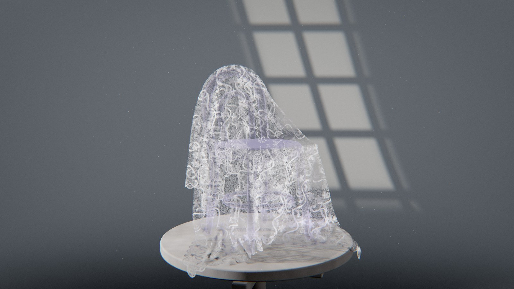

# Veil

*la statue absente.* Une dentelle humide posée sur un socle de musée dessine un buste à travers ses jours : le crâne, les orbites, le nez, les épaules, comme sur les voiles de marbre napolitains. Puis la statue s'efface : elle se resserre et s'enfonce, et le linge mouillé qui lui colle s'affaisse avec elle en un tas sur le socle. **Le socle est vide.** Quatre cordons reprennent les coins, ouvrent le tas au ras du socle et le soulèvent en hamac. Le hamac redescend, son ventre se pose sur quelque chose qu'on ne voit pas, les cordons lâchent les coins, et le linge tombe autour d'une autre statue : un chat assis, une théière, une amphore, un torse. Sur le socle, un cartel de laiton nomme l'œuvre, « momentanément absente ». Après deux ou trois statues, le voile se repose exactement sur la première, et la boucle se referme.



Rendu physique en three.js (WebGPU, TSL). La scène est entièrement procédurale : une graine produit une scène. La démarche est dans [docs/concept.md](docs/concept.md) : le thème exploré en largeur, les clichés écartés (le voile de mariée au vent, le drap de fantôme, le rideau qui respire, le *Christ voilé* recopié), huit pistes notées, la piste retenue avec ses références et ses épreuves.

## Utilisation

| Touche | Action |
| --- | --- |
| N | nouvelle scène (nouvelle graine) |
| Espace | pause / lecture |
| ← / → | avancer ou reculer dans la boucle |
| H | masquer l'interface |
| F | plein écran |

Sur écran tactile : une touche met en pause, deux touches tirent une nouvelle scène, un appui long masque l'interface.

Paramètres d'URL :
- `?seed=…` : une scène ;
- `#r=…` : une scène retouchée, produite par « Copier le lien » ;
- `?ui=0` : sans panneau ;
- `?mobile=1` / `?mobile=0` : version mobile imposée / interdite ;
- `?debug` : outils dans `window.veil`, dont :
  - `shot(phase)`, `send(nom)`, `sheet(graines, phases)`, `film(u0, u1, n)`, `meter()`, `bench(phase, n)`, `seam()` ;
  - `look(graine, { mood, lace, color, forms })` : une scène imposée ;
  - `clothCheck()` : l'enregistrement chargé aux critères des tests (étirement, socle, raccords) ; `fineCheck()` : l'étage fin du GPU contre sa copie JS.
- `?cpu` : la simulation dans les workers au lieu du GPU (mise au point : `?gsiter=`, `?sub=`, `?adh=`, `?nolimit`, `?noself`, `?noadh` ; et, pour comparer avec l'ancien solveur : `?nonorm` (Gauss-Seidel sans pas exact), `?stack` (socle en pièces empilées), `?stict=0` (sans adhérence statique)).

Le panneau règle :
- **Scène** : l'humeur (nouvelle scène de la même graine).
- **Le voile** :
  - sans nouvelle simulation : la dentelle (son dessin, le pas du dessin, le nombre de festons par côté), le fil du réseau, le fil du motif et le lustre ;
  - en relançant les simulations : le côté, l'orientation, le vent (à 0 par défaut), les temps du geste (descente, repos, montée, pendaison) et la finesse de la simulation.
- **Les statues absentes** : la forme, la rotation, l'inclinaison et le penché de chacune, puis le socle.
- Viennent ensuite la caméra, la lumière et le rendu.

L'export produit une boucle MP4 (H.264) rendue image par image, éventuellement accumulée, et une image PNG.

## Principe : couvrir, découvrir

**La liberté** (la seule chose impossible du film) : les statues n'existent que sous le voile, et s'effacent dès qu'on les a vues. Tout le reste est exact :
- un tissu presque inextensible, pesant, freiné par l'air, qui frotte, se plie et ne se traverse pas ;
- un cordon qu'on voit, tenu par une main hors champ, comme au dévoilement d'une statue ;
- un linge humide, plus lourd, plus souple, qui glisse sur le marbre (l'eau lubrifie) et s'y colle par capillarité, à la façon des voiles de marbre napolitains (Sanmartino, Corradini). C'est aussi un geste d'atelier : le sculpteur couvre la terre de linges humides pour qu'elle ne sèche pas.

Une forme invisible est un vrai corps, qui porte le tissu. Elle n'a ni ombre ni reflet : seul le voile la montre.

Le regard est celui de Magritte (*Les Amants*) : un fond plat et coloré, une lumière égale, l'étrangeté tenue avec calme. En contrepoint, la photographie de sculpture des musées : un socle entier, une lumière de verrière.

### La boucle

Pour N formes, le film enchaîne des morceaux simulés :

```
descente 0 (depuis la pose) → montée 0 → descente 1 → montée 1 → … → montée N−1 → descente 0 (jusqu'à la pose)
```

Les morceaux s'enchaînent, chacun partant de la fin du précédent (positions *et* vitesses), sauf la dernière montée :
- **H**, la pendaison : le voile tenu par ses quatre coins sur un cercle de 42 cm de rayon, en hamac, immobile au-dessus du socle vide. Il est calculé une fois, à partir du carré à plat dont les coins rejoignent le cercle en une seconde, fortement amorti. La descente 0 en part.
- **descente k** : les coins descendent jusqu'à ce que le ventre du hamac se pose sur le sommet de la forme k (3 cm plus bas, sans tension), puis sont lâchés ; le linge tombe autour de la forme et s'y colle. Au bout du repos, la forme s'efface (voir plus bas) et le linge s'affaisse sur le socle.
- **montée k** : les coins sont repris là où ils reposent, tirés au ras du socle, puis montés en s'écartant vers le hamac. La descente k + 1 part de sa fin.
- **la dernière montée** seule est ramenée sur H : un rappel étalé sur toute la pendaison (de 0,05 % à 3 % par sous-pas, croissant comme le carré du temps), puis X = H au dernier sous-pas. L'écart restant est de l'ordre du centimètre sur quelques points. Avant, chaque montée était ramenée sur H, et son rappel se resserrait sur les derniers 15 % : le voile se recalait d'un coup avant chaque descente (l'utilisateur : « il se repositionne de manière non naturelle avant de retomber »).

Chaque raccord est donc exact : chaque morceau part de la fin du précédent, et la boucle se referme sur H. `clothCheck()` le vérifie dans la page. Le film à u = 1 est le film à u = 0, et u = 0 tombe à l'instant où les cordons lâchent les coins au-dessus de la première forme. La forme invisible change pendant la pendaison, quand le voile passe au-dessus de toutes les formes (8 cm au-dessus du point le plus haut de la plus haute).

### Le scénario (une forme, ≈ 12 à 13 s)

| Temps | Ce qui se passe |
| --- | --- |
| repos (3,6 à 4,4 s) | Le linge humide s'est collé à la statue : le visage, les oreilles du chat, le bec de la théière se lisent. Rien ne bouge, sauf la caméra, qui glisse lentement. |
| effacement (1,8 s) | La statue se resserre vers son axe et s'enfonce dans le socle ; le linge mouillé la suit et s'affaisse en tas. |
| reprise (≈ 0,8 s) | Les cordons redescendent, reprennent les coins et ouvrent le tas au ras du socle. |
| montée (≈ 1,6 s) | Les coins montent en s'écartant ; l'ourlet quitte le socle en dernier. La caméra recule pour tenir le socle et les prises. |
| pendaison (1 à 1,2 s) | Le voile pend en hamac, se balance et s'apaise. Le socle est vide. |
| descente (1,8 à 2,6 s, selon l'étoffe) | Le hamac descend de 10 à 20 cm. Son ventre touche le vide et s'y pose ; les cordons lâchent les coins, le linge tombe autour et la statue suivante naît de haut en bas. |

Les durées sont des durées réelles : un drapé se lit à sa vitesse.

## Simulation (`src/gen/cloth.js`, dans des Web Workers)

**Le modèle.** Le voile est un carré de 0,95 à 1,05 m, en n × n particules : 81 × 81 sur le GPU (un pas de 1,25 cm), 53 × 53 au plus dans les workers, 41 × 41 en version mobile. La dynamique est celle des positions étendue (XPBD), en « petits pas » : deux passes de Gauss-Seidel par sous-pas, 450 sous-pas par seconde. Les contraintes :
- longueur des fils de chaîne et de trame ;
- biais : les diagonales, souples, laissent l'étoffe épouser une forme ;
- flexion : liens à deux mailles, qui ne résistent qu'à la compression.

L'air freine le voile : traînée quadratique selon la normale. Un amortissement interne de 1,2 s⁻¹ fait qu'un linge posé ne frémit plus.

**Le linge humide.** L'eau alourdit l'étoffe (×2,2 trempée), l'assouplit et réduit son frottement de moitié sur le marbre : le linge y glisse. Chaque point à moins de 5 cm de la statue y est attiré (capillarité), d'au plus 60 m/s² et jamais au-delà de l'écart qui l'en sépare. L'humidité dépend de l'étoffe : 0,8 pour la mousseline, 0,7 pour le satin, 0,6 pour le tulle et 0,75 pour la dentelle. Mesuré au repos, sur un buste : la part du voile à moins de 3 cm de la statue passe de 47 % (portée de 2,2 cm, 30 m/s²) à 83 %.

**Le vent, essayé puis retiré.** Un vent venu de la caméra plaquait l'étoffe sur la forme. Mais il la faisait aussi battre et glisser sans cause visible, et l'utilisateur ne comprenait plus les mouvements du voile. Le réglage reste au panneau, à 0 par défaut.

**Les contacts** : la forme invisible et le socle (champs de distance), le sol, et l'étoffe elle-même (grille de hachage ; particules non voisines à plus de 0,6 pas). Le frottement est de Coulomb.

**Ce qui a fait la stabilité** (chaque point a été mesuré par `tools/drape.mjs`) :
- **Attaches à longue portée** (Kim, Chentanez et Müller, 2012) : aucun point ne s'éloigne de la bague au-delà de sa distance sur l'étoffe à plat. Sans elles, à 65 × 65, la pendaison décrochait au bout d'une seconde : l'étirement se propageait en chaîne autour de la bague.
- **L'ordre de résolution** : les contraintes sont rangées de la bague vers le bord. Une passe vers l'extérieur transmet la tension d'un seul balayage, comme on résout une chaîne pendue de haut en bas, et la passe suivante revient.
- **Le frottement avant les fils**. Appliqué après, il défaisait leurs corrections : les points collés à la forme ne suivaient plus leurs voisins, et un fil se distendait de 92 %. Le sous-pas fait donc, dans l'ordre :
  1. les auto-collisions ;
  2. les contacts avec frottement ;
  3. les fils ;
  4. les attaches ;
  5. une projection hors de la matière, sans frottement.
- **La rosette** (abandonnée) : tenir à plat les 3 × 3 particules du centre étirait davantage l'étoffe, à cause du pli vif au bord du disque.

**Les formes invisibles** (`src/gen/forms.js`) sont des champs de distance sculptés (ellipsoïdes, capsules effilées, tores, profils tournés, unions et soustractions douces), à 1,1 à 1,55 fois nature selon la forme, et aux reliefs du visage accentués de 20 %. Les objets qui se lisent de profil sont tournés vers la caméra : la théière et l'amphore montrent bec et anses en silhouette, le chat est de trois quarts. Chacune est cuite sur une grille de 5 mm : exacte jusqu'à 6 cm de la surface (la portée de l'adhérence), repérée par une passe grossière, interpolée au-delà. La lecture est trilinéaire, avec un gradient exact par cellule. La cuisson prend de 0,1 à 0,4 s et l'écart près de la surface reste sous 2 mm. Elle a divisé par deux le temps de la descente : les contacts prenaient 42 % du calcul.

**L'enregistrement** : 30 images par seconde, quantifiées sur 16 bits (pas de 0,04 mm), transférées au fil principal sans copie. La pendaison et les formes se calculent en parallèle sur le pool de workers, puis les morceaux l'un après l'autre, puisque chacun part de la fin du précédent.

## La simulation sur le GPU (`src/scene/gpucloth.js`)

Avec WebGPU, la simulation grossière tourne sur le GPU, en shaders de calcul. Tout l'enregistrement est calculé au chargement, bien plus vite que le temps réel, puis relu : la boucle ne dépend toujours que de la phase. Le solveur des workers (`src/gen/cloth.js`) reste la référence des tests Node, et le chemin sans WebGPU (`?cpu` l'impose). Il reprend le même modèle, avec ce que le parallélisme a demandé (le chemin CPU garde l'ancienne pose : une bague au centre, un seul cordon) :
- **Gauss-Seidel colorié** : 9 couleurs (i mod 3, j mod 3), puisque deux sommets de même couleur ne partagent aucun lien. On fait 3 passes par sous-pas, à 450 sous-pas par seconde. Le Jacobi moyenné, essayé d'abord, laissait l'étoffe s'étirer de 12 % (centile 99), avec des pointes à 75 %.
- **Une limite d'étirement après la projection** : un fil tendu au-delà de 8 % y est ramené. Sans elle, un point aspiré dans un creux (orbite, narine) et tenu contre la paroi distendait son fil voisin jusqu'à 98 %.
- **Des auto-collisions seulement quand le voile bouge.** Elles passent par une grille de hachage à listes chaînées atomiques, et la répulsion est moyennée. Elles agissent pendant la chute, la tension et la montée, et jusqu'à 0,8 s après la pose. Une fois l'étoffe posée, elles se disputaient les couches avec les fils et l'adhérence, et le voile frémissait sans fin (1,5 mm/image² en moyenne au repos, des pointes à 30). Il est maintenant immobile (0,00 en fin de repos).
- **Plus d'aspiration.** Le linge humide était attiré vers la statue (60, puis 50, puis 30 m/s², sur 5 cm). Elle tirait une couche extérieure à travers celle du dessous, et le voile posé se traversait (l'utilisateur : « pas mal d'interpénétration »). Plus courte, elle faisait diverger le satin. Elle est retirée sur le GPU (`?adh=30` la remet, pour comparer) ; le chemin CPU la garde. Au repos, les paires de points non voisins à moins de 3 mm passent de 355 à 50 à 90 (graine k5), et la forme se lit toujours, par le frottement et la marque du linge plaqué.
- **Le repos se calme** : l'amortissement interne croît avec l'imbibition (×7 1,5 s après la pose), puis retombe quand la statue s'efface ; un collage visqueux à basse vitesse retient le linge posé. Sans ce collage, le voile glissait lentement de la statue avant qu'elle ne s'efface.
- **Une maille par passe, au plus.** Dans le Gauss-Seidel colorié, chaque point additionne les corrections de ses douze liens sans les moyenner. Dans un pli froissé, elles poussaient toutes du même côté et s'emballaient : un point du satin mouillé tombé sur le chat partait à 98 km en une image, et tout le film suivant devenait NaN. C'était le « bug » du tissu sur les oreilles. La correction d'un point est bornée à une maille par passe (`?noclamp` l'enlève). Les oreilles du chat, elles, restent pointues : ce sont elles qui retiennent l'étoffe ; arrondies, le voile glissait du crâne.
- **Le frottement de l'étoffe elle-même** (μ de 0,6 pour la mousseline et le satin), réduit d'un cinquième par l'eau puis relevé de moitié pour le linge mouillé. Un coefficient commun de 0,14 laissait glisser toutes les étoffes ; à 0,25 puis 0,4, le satin, lourd, coulait de la tête puis du socle.
- **Les couches qui se croisaient.** Un point posé sur une autre couche d'étoffe n'adhère pas à la statue, mais au repos, sans auto-collisions, on ne le savait plus : les deux couches s'aspiraient l'une dans l'autre, et le rendu montrait des taches où les deux dessins se mêlaient (signalées par l'utilisateur). Le dernier verdict des auto-collisions est maintenant gardé par point.
- **Un garde-fou** : aucune particule ne dépasse 6 m/s. Une charge de frottement minimale appliquée hors contact faisait diverger le satin mouillé sur le chat, et comme les morceaux s'enchaînent, une seule divergence emportait tout le film.
- **Le marbre retient le linge mouillé** : une charge de 5 m/s² compte dans le frottement contre le socle. Sans elle, un voile affaissé dont un pan pendait au bord glissait entier jusqu'au sol, comme une nappe. Le frottement du linge mouillé (×1,5) est compté côté JS, dans μ.
- **Le pas exact du Gauss-Seidel.** Chaque sommet additionne les corrections de ses douze liens, et chacune suppose qu'il ne répond qu'à elle. Deux fils opposés font ensemble un pas exact, mais le biais et la flexion s'y ajoutent : le gain atteint 1,85 pour le tulle (le plus raide en biais) et dépasse 2 dans un pli froissé, où les liens se replient du même côté. Au-delà de 2, l'erreur croît à chaque passe : le tulle divergeait dès la pendaison, à toutes les graines, et les autres étoffes par moments. Le pas est ramené au pas exact le long de la correction (gain = âᵀ (Σ g d dᵀ) â, jamais plus de 1) ; la limite d'étirement reçoit la même règle. La borne d'une maille par passe reste, en second rideau.
- **Une faute reste locale.** Aucun point ne parcourt plus de 12 m/s × dt en un sous-pas, et une valeur non finie est remplacée par la position du début du sous-pas (test sur les bits : une comparaison flottante peut être simplifiée par le compilateur). À la relecture, chaque morceau est mesuré sur les flottants, avant la quantification où un NaN vaut 0 et ne se voit plus : valeur non finie, point hors de la boîte, plus grand étirement d'un fil. Un morceau malsain est repris une fois, plus amorti ; un état final non fini ne se transmet jamais au morceau suivant.
- **Le socle des contacts est l'aplomb du plateau**, d'un seul bloc. Le minimum des distances aux pièces empilées (corniche, moulure, dé) n'est pas une distance à l'intérieur : un point enfoncé de plus d'une demi-corniche en sortait par le bas, restait pris dans le dé ou en était chassé de 26 cm d'un coup, et le pan qui pendait sous le surplomb traversait la corniche à la montée. Un linge mouillé pend de toute façon à la verticale du bord.
- **La pince tourne.** À la reprise, les neuf points d'un coin passent de la pose où ils reposent à la pince à plat. Mêlées en ligne droite, deux poses tournées l'une de l'autre passent par une pince rétrécie de moitié, et les fils du bord s'étiraient de trois mailles. La pince tourne donc de l'une à l'autre (repère ajusté par moindres carrés sur les neuf points), et seul le froissé se défait en ligne droite. Les coins sont aussi remontés au-dessus du plateau pendant qu'on les écarte : tenus plus bas, ils tiraient le linge posé à travers l'arête du socle.
- **L'adhérence statique du linge mouillé.** Le frottement de Coulomb ne retient que le déplacement d'inertie du sous-pas ; la dérive que les fils imposent ensuite lui échappe. Un linge mal centré rampait puis glissait d'un bloc, jusqu'au sol pour une théière sur trois, et du buste ou du torse dès la pose dans une scène sur quatre. Un point au contact que tout le sous-pas ne déplace pas plus vite que 0,4 m/s (dosé par l'imbibition) ne bouge pas le long de la surface. Ce qui tombe, ce qu'on tire et ce qui pend restent libres.
- **La chaise garde son dossier.** Le linge ne restait que sur l'assise : la forme était centrée sur son point le plus haut, le dossier, épais de 2 cm, et le linge posé dessus le traversait rang après rang. Le dossier porteur est maintenant l'arceau de la chaise, en 4 cm (trois mailles du voile), et la chaise reste au milieu du socle. Une fois les bouts des montants retirés (ils perçaient le linge), il retombait encore quatre fois sur six : la limite d'étirement, passée après l'adhérence, déplaçait quand même les points tenus. Un point qui adhère est désormais un ancrage pour elle aussi, et l'adhérence est pleine dès le tiers de l'imbibition. Six scènes sur six tiennent.
- **Le raccord de la boucle.** La dernière montée finit comme les autres : le hamac balance et se calme de lui-même, sans rappel. Il ne s'arrête pas exactement sur la pendaison de référence d'où part la première descente (un pli tombe 1 ou 2 cm à côté). Ramener sur elle le linge pendu se voyait, quelle que soit la douceur du rappel : une étoffe au repos qui se recale sans cause. L'écart est maintenant porté par le début de la première descente, qui part de la vraie fin de la montée (même position, même vitesse) et le résorbe pendant que le hamac descend. Écart au raccord : 0,06 mm.
- **Le film d'une nouvelle scène repart de la pose.** La phase gardait celle de l'ancienne scène : tombée dans un morceau pas encore calculé, elle y restait figée, voile invisible, puis l'on ne voyait que la fin du geste, d'un coup. Les tranches du calcul fait pendant la lecture sont aussi plafonnées à 28 sous-pas par image (elles montaient à 150, soit 100 ms de GPU, et le retard s'emballait dès que l'affichage passait sous 60 i/s), et la mesure de santé d'un morceau est étalée image par image. Mesuré après un changement de scène en pleine lecture : pire image 36 ms, aucune image sans voile, la phase n'attend jamais.
- **Une scène demandée arrête le calcul de l'ancienne** au sous-pas près. Avant, le morceau en cours allait au bout, à la cadence de la lecture, et la nouvelle scène attendait derrière lui : après une divergence, « nouvelle scène » semblait ne plus répondre. Elle est prête en 4 s quel que soit le moment.

**L'effacement.** Au bout du repos, la statue se resserre vers son axe (jusqu'à 35 % de sa largeur) et s'enfonce dans le socle, en 85 % de la durée de chute ; ce qui est passé sous le dessus du socle ne touche plus rien. L'adhérence demeure pendant ce temps : le linge mouillé suit la statue vers le centre du socle. Deux essais écartés : une disparition d'un coup laissait le linge tomber librement et glisser hors du socle, et une statue qui s'enfonçait sans se resserrer entraînait le linge par ce qui dépassait du socle (le bec de la théière).

**Le hamac.** Chaque coin est tenu par une pince : ses 3 × 3 mailles, à plat, autour de la prise. Un seul point portait tout le voile, et ses mailles voisines s'étiraient de 62 %. Avec la pince et des attaches à longue portée depuis chaque pince tenue (aucune maille ne s'éloigne d'un coin tenu au-delà de sa distance au repos), l'étirement tombe à 32 % sur la maille qui borde la pince. Les attaches ne servent qu'à la pendaison et à la descente : à la montée, le linge enveloppe encore la statue, et une attache en ligne droite le tirait au travers. À la reprise, chaque pince se referme peu à peu, de la forme où le coin reposait jusqu'à plat. Refermée d'un coup, elle faisait sauter ses mailles de 2 cm en un sous-pas, et la simulation divergeait.

Deux essais écartés en route : des coins descendus jusqu'à 18 cm sous le sommet avant d'être lâchés tendaient le linge comme une peau, qui traversait le buste ; relevés à la verticale, des coins restés sous l'épaule de la statue la traversaient.

**Le film progressif.** Le film commence dès que la pendaison et la première descente sont calculées. Les morceaux suivants se calculent pendant qu'il joue, par tranches de quelques sous-pas, une par image affichée, sans attendre la fin de chacune (au plus trois en vol). Le débit est celui qu'il faut pour que ce morceau et tous les suivants soient prêts 1 s avant que la lecture ne les atteigne, plus 50 %. À la fin d'un morceau, l'enregistrement est relu en place et quantifié quelques images à la fois. Avant, des lots de 150 sous-pas (≈ 90 ms de GPU) et une relecture de 30 Mo d'un bloc faisaient saccader le début de la boucle (l'utilisateur). Mesuré sur un écran à 120 Hz : 5 images sur 8 s au-delà de 25 ms pendant le calcul, aucune attente du film ; avant, jusqu'à 36 images sur 7 s au-delà de 33 ms, avec des pointes à 88 ms. Si le film les rattrapait, la page le retiendrait sur l'image en cours ; mesuré, il ne les rattrape jamais (cadence 0,92 à 1,08 pendant le calcul, 1,00 ensuite). L'export et les outils de mise au point attendent le film entier.

Coût, pour trois statues à 81 × 81 et 450 sous-pas par seconde : 11 s de calcul (1 à 2 s de pendaison, 2,5 à 3 s par descente, 1 à 1,3 s par montée), contre 14 s à 53 × 53 sur le CPU. Le coût tient au nombre de lancements de shaders, pas au nombre de particules : passer de 53² à 81² n'a ajouté que 0,7 s. Le navigateur bride le GPU d'un onglet caché : en arrière-plan, le chargement s'étire beaucoup.

## L'étage fin (`src/scene/fine.js`, sur le GPU)

D'après Huamin Wang, *GPU-Based Simulation of Cloth Wrinkles at Submillimeter Levels* (SIGGRAPH 2021). À chaque image, une grille 2 fois plus fine que la simulation (161 × 161 sommets, 6 mm de pas) est posée sur sa surface (le patch de Catmull-Rom), puis amenée à l'équilibre en 24 itérations de Jacobi, dans un shader de calcul :
- **fils et biais à la longueur de la vraie étoffe** : le surplus fait les plis fins ;
- **flexion**, liens à deux mailles, en compression ;
- **attache à la surface simulée**, tangentielle seulement, et 1,2 cm au plus hors d'elle ;
- **contact** avec la statue (son champ cuit, deux projections) et avec le socle.

Le solveur part chaque image de la surface simulée, sans état gardé : l'image ne dépend que de la phase. Il n'emploie aucune opération atomique, donc il est déterministe. Une version JS ligne pour ligne (`src/gen/fineRef.js`) sert aux tests ; en `?debug`, `veil.fineCheck()` compare les deux sur l'image affichée. Coût : moins d'1 ms par image.

**Essayé puis retiré : l'aspiration dans l'étage fin.** Avec une simulation à 53 × 53, c'est elle qui faisait apparaître le visage, en collant la grille fine à la statue. Mais elle montrait la peau lisse de la forme, découpée de bords nets. Et d'une image à l'autre, des zones basculaient entre collée et libre (l'utilisateur : « un total changement de rendu entre deux images »). À 81 × 81, la simulation elle-même porte le détail, et l'étage fin n'est plus qu'un lisseur avec contact.

## Scène (`src/scene/`)

- **Le voile** (`veil.js`). À chaque image, les positions grossières s'interpolent dans le temps (Catmull-Rom sur les images voisines du même morceau) et vont à l'étage fin, qui écrit la grille que le vertex shader lit ; la grille de l'image précédente donne les vecteurs vitesse. En version mobile, sans étage fin, le vertex shader tire lui-même une surface bicubique de Catmull-Rom des particules grossières. L'ourlet roulé est un tube de 1,3 mm qui suit le bord de la même surface.
- **La matière** : une dentelle de fil retors, mate, au lustre léger ; le cordonnet, plus lisse, brille un peu plus que le réseau.
- **La fibre** : un relief sous le pixel, filtré par la taille du pixel sur l'étoffe : les irrégularités du fil, la froissure d'un linge déjà plié, le tissage du toilé et la saillie du cordonnet. De près, la lumière rasante accroche le grain ; de loin, il s'efface en sa moyenne.
- **Le linge mouillé plaqué** : l'étage fin note, pour chaque sommet, s'il touche la statue (à moins d'1,2 cm). Là, l'étoffe fonce, se lisse (un film d'eau) et laisse passer plus de lumière : la marque du contact dessine la forme. Elle s'estompe en 0,8 s quand la statue s'efface.
- **La translucidité** ne garde que la lumière qui traverse depuis l'autre face ; un reste ambiant uniforme aplatissait les plis. La translucidité d'une couche mince : la lumière de la lampe qui éclaire l'autre face traverse le voile, teintée par l'étoffe, si bien que l'intérieur du drapé s'allume. La trame du tulle est hexagonale, de 3,2 mm ; la dentelle porte des rosaces de 5,5 cm sur un fond de tulle. Les jours passent par un tramage que l'anticrénelage temporel lisse : aucun tri de transparence.
- **La dentelle** (aspect seul, la simulation l'ignore). Trois couches, dessinées en coordonnées de l'étoffe et filtrées sous le pixel : le réseau (un tulle à mailles hexagonales de 2,6 mm, à fil fin de largeur constante), le toilé (une toile tissée à petits jours, qui remplit les motifs) et le cordonnet (le fil de contour, les nervures, les pleins brodés, opaques et en saillie). Sept dessins, un seul évalué par fragment (branche sur un uniforme : on en change au panneau sans recompiler ni resimuler). Le bord est festonné dans la matière, avec un galon et un œillet par lobe ; il n'y a plus d'ourlet roulotté. L'ombre portée est tramée elle aussi : le réseau laisse passer la lumière, le motif la retient.
- **Le cartel** : une plaque de laiton brossé vissée à la corniche du socle (dé et bloc), sur la face tournée vers la caméra. Elle nomme l'œuvre du moment, sa matière et son numéro d'inventaire, et précise « œuvre momentanément absente », comme on l'affiche dans les musées quand une pièce est prêtée. Elle reste quand la statue s'efface.
- **La fenêtre** : une haute fenêtre à petits bois, hors champ, dont la lumière tombe en biais sur la paroi du fond, adoucie par la distance, du côté de la lampe principale ; la nuit, un clair de lune à peine ; aucune à contre-jour.
- **La poussière** : 380 grains en suspension autour du sujet (au loin, sur le fond, elle se lisait comme du bruit), visibles seulement dans le faisceau de la lampe principale. Chacun tourne sur une petite boucle fermée (un et deux tours par film) : la boucle reste exacte.
- **Les quatre cordons** suivent les coins tant qu'ils les tiennent, et remontent hors champ quand ils les lâchent. Ils tranchent sur le fond : chanvre clair dans la nuit, brun sur un fond clair. Invisibles sur le noir, ils laissaient le hamac flotter. Sur le chemin CPU, un seul cordon et une bague suivent la particule du centre.
- **Le socle** (`gen/plinth.js`) est construit avec les mêmes cotes que son champ de distance : le tissu touche ce qu'on voit.
- **Le cyclorama** : un sol qui se relève en paroi, sans horizon, tourné vers la caméra. Le fond lointain garde la valeur de l'humeur quelle que soit la lumière.
- **Les lumières** sont placées par rapport à la caméra, et dosées selon la clarté du voile : une même lampe brûlerait une mousseline blanche et laisserait un satin noir dans le noir.
- **La caméra** suit le geste par une « ouverture » o(t), la hauteur du point le plus haut du voile (les prises du hamac, ou la bague) ramenée entre la pose et la pendaison, lissée par un noyau gaussien périodique. Au repos, elle est de trois quarts à hauteur de visage. Quand le voile monte, elle recule pour tenir le dessus du socle, le hamac et ses prises, calculés depuis la vraie hauteur de pendaison.

## Familles et humeurs (`src/recipe.js`)

**Une seule étoffe : la dentelle** (60 g/m², humide). C'était la plus réussie des quatre (mousseline, satin, tulle, dentelle) ; les trois autres sont retirées. Ce qui varie, c'est son dessin et ses fils.

| Dentelle | Dessin | Fond |
| --- | --- | --- |
| Chantilly | fleurs à cinq pétales nervurés, en quinconce, brins de deux feuilles | tulle |
| Guipure | marguerites ajourées reliées par des brides | aucun : à jour |
| Filet brodé | carreaux reprisés en losanges et croisettes | réseau carré |
| Plumetis | semis de pois brodés | tulle fin |
| Cluny | treillis de tresses en biais, araignées, quatre-feuilles | tulle lâche |
| Écailles | éventails qui se recouvrent, rangs décalés | tulle |
| Rinceaux | tige qui ondule, fleur à chaque crête, feuilles aux nœuds | tulle |

**Quatorze fils** : blanc, ivoire, écru, gris perle, rose thé, bleu poudre, vieil or, vermillon, ardoise, bordeaux, vert bouteille, bleu nuit, prune, noir (le noir et les blancs dominent). Une dentelle sur six a un second fil pour le cordonnet (or sur noir, blanc sur ivoire, perle sur bleu nuit), accords posés à la main.

**Sept statues absentes tirées** : le buste, le chat qui fait le gros dos, la verseuse, le cratère à volutes, la chaise, les trois blocs et la lyre. Une machine à coudre sur sa table, essayée, a été retirée (trop massive et trop compliquée à côté des autres). Le torse et les trois sphères, qui ne donnaient qu'une boîte et une cloche, restent au panneau avec les anciennes formes.

**Ce que le voile montre d'un objet.** Un linge posé ne garde que l'enveloppe du dessus : les creux (cou, taille, anses plaquées) disparaissent, et des pointes rapprochées se fondent en une tente. Restent lisibles des paliers larges d'au moins 20 cm séparés par des chutes franches (la chaise), deux pointes très écartées avec un creux entre elles (le cratère, la lyre), ou une ligne tête, épaules, chute (le buste, élargi et coupé droit comme un hermès : étroit, il faisait un fantôme). Le chat assis n'offrait que deux pointes au sommet d'un cône ; il fait maintenant le gros dos, de profil : queue dressée, dos en arche, oreilles. Rien n'est plus mince que trois mailles du voile (4 cm), sinon le linge passe au travers.

**L'hologramme** (idée de l'utilisateur). La statue absente luit sous le linge qui vient de la couvrir, 0,35 s après la pose et pendant 2,6 s, par à-coups comme un signal instable (hésitant au début et à la fin, presque tenu au milieu, avec des tranches qui se décalent), puis s'éteint bien avant de s'effacer. On reconnaît l'objet, et le drapé prend son sens.
- **Ce qu'il montre** : un modèle détaillé de l'objet (`show`, dans `gen/forms.js`), distinct de la forme épaissie qui porte le linge — la chaise de bistrot à deux arceaux, le chat et ses coussinets, la verseuse à bec en col de cygne, la lyre et ses sept cordes. Il est cuit dans un worker en champ de distance (volume de 4 mm, 8 bits codés en racine pour être fins près de la surface) et marché par rayon dans sa boîte.
- **Seulement sous le voile** : le fragment écrit la profondeur du point touché et ne passe que si quelque chose est devant lui. Une doublure du voile, pleine et qui n'écrit que la profondeur, est dessinée pendant l'apparition, pour qu'il passe aussi à travers les jours de la dentelle.
- **La bande** qui le parcourt une fois de haut en bas éclaire la dentelle qu'elle longe : la matière du voile lit le même volume, et reçoit la lumière selon sa distance à la statue (portée de 5 cm).
- **Une teinte par objet**, jamais deux fois la même dans une scène : six teintes pâles sur fond sombre, six soutenues devant un mur clair. Réglages au panneau : intensité (0 l'éteint) et teinte de chaque statue.
- Les modèles montrés restent sous l'enveloppe de la forme qui porte le linge (mesuré colonne par colonne), sinon ils le perceraient : c'est ce qui arrivait aux deux bouts des montants de la chaise.

**Cinq socles** : le dé à corniche, la colonne, le bloc, le guéridon et la selle de sculpteur.

**Six humeurs**, un décor chacune :

| Humeur | Décor | Lumière | Valeur |
| --- | --- | --- | --- |
| Galerie | mur gris-bleu, béton clair | verrière haute | claire, froide |
| Atelier | plâtre gris froid, sol de ciment | fenêtre de côté, dure | moyenne |
| Nuit de musée | noir, marbre noir | douche étroite d'en haut | sombre |
| Les Amants | ciel bleu de Magritte | jour couvert, frontal | moyenne, colorée |
| Contre-jour | fond laiteux | lampe derrière le voile | claire en fond |
| Plâtre | blanc sur blanc | boîte à lumière | très claire |

Le fil du réseau est tiré parmi ceux qui tranchent sur le fond : un écart de luminance d'au moins 0,3. Le second fil doit trancher lui aussi (0,25) : le réseau est si léger que c'est le motif qui donne sa valeur au voile, et un noir à cordonnet ivoire devant un mur clair se lisait blanc.

## Tests

`node --test 'veil/test/*.test.mjs'`. Les tests de la simulation tournent sur une grille de 25 × 25 : mêmes lois, dix fois plus vite.
- **Raccords exacts** : la descente part de H, la montée finit sur H et part de la fin de la descente.
- **La vitesse au raccord descente → montée** ne se distingue pas de celle des images voisines.
- **La pendaison passe au-dessus de la forme** : aucun contact pendant le changement de forme.
- **La bague** (solveur CPU) se pose exactement sur le sommet de la forme à la fin de la descente, et pas avant.
- **Aucune traversée** du socle ni du sol, à aucune image. Aucune traversée du voile par lui-même : les particules non voisines restent à plus de 0,4 rayon.
- **L'étirement** : 99 % des fils à moins de 8 %, aucun au-delà de 35 %.
- **La quantification** : le voile reste dans sa boîte.
- **Le programme du film** couvre la boucle sans trou, et u = 0 tombe sur la pose.
- **L'étage fin** (`test/fine.test.mjs`, sur sa version JS, avec les réglages de la page) : il ne traverse ni la statue ni le socle. Il est déterministe. Son accélération d'une image à l'autre suit celle du grossier : centile 99 au plus 1,3 fois le sien plus 1 mm, et moins de 12 mm/image² au repos (le témoin, l'adhérence en tout-ou-rien, sautait de 19 mm).
- **La recette** est déterministe et du JSON pur. Chaque humeur, dentelle, fil, forme et socle est tiré ; le voile est toujours une dentelle, à un ou deux fils, à festons entiers. Le voile tranche sur son fond (400 graines). Les lampes sont presque blanches.

## Performances mesurées

Sur un MacBook récent (Apple Silicon), dans le navigateur intégré, panneau masqué :

| Étape | Où | Coût |
| --- | --- | --- |
| Pendaison de référence (53 × 53, 3,5 s simulées) | worker | ≈ 1,4 s |
| Cuisson d'une forme (grille de 5 mm) | worker | 0,1 à 0,4 s |
| Pendaison, descente, montée (simulation sur le GPU, 81 × 81, 450 sous-pas/s) | GPU, au chargement | 1 à 2 s, 2,5 à 3 s et 1 à 1,4 s |
| Une descente sur le CPU (≈ 9 s simulées, sans WebGPU ou `?cpu`) | worker, en parallèle par forme | ≈ 5 s |
| Une montée (≈ 3,5 s simulées) | worker | ≈ 2,5 s |
| Étage fin (161 × 161, 24 itérations) | GPU, chaque image | < 1 ms |
| Chargement, de la recette à la première image (graine k5, trois statues) | page | 5,5 s (14,4 s avant le film progressif) ; le film entier est calculé 9 s plus tard, pendant qu'il joue |
| Image à 1920 × 1080, qualité Haute (`bench`), étage fin compris | GPU | 5,7 à 7,7 ms |
| Mémoire du film (images quantifiées, 3 formes) | page | ≈ 20 Mo |

Avant la cuisson des formes, une descente coûtait le double. Avant l'ordre de résolution et les attaches, le voile à 65 × 65 ne tenait pas.

## Version mobile

`?mobile=1` (ou un écran tactile) donne un voile plus grossier, de 37 × 37 à 360 sous-pas par seconde : environ trois fois moins de calcul, 5,5 s de chargement sur la même machine. Il n'a pas d'étage fin : le visage s'y lit moins bien. La chaîne d'image est allégée (pas d'occlusion ni de reflets en espace écran, pas de vecteurs vitesse), avec une résolution dynamique et une cadence de 60 i/s au plus. Le drapé diffère de celui du bureau, puisque la grille n'est pas la même ; la boucle reste exacte.

## Ce qui n'est pas vérifié

- **La fluidité en direct** : le panneau du navigateur était masqué pendant la mise au point. Toutes les images ont été rendues une à une, et le film n'a pas été regardé en temps réel.
- **Un vrai téléphone** : la version mobile a été mesurée sur un Mac.
- **L'export MP4 long** : non essayé.
- **Le visage** se lit selon le drapé que la simulation trouve : chaque graine donne le sien, et certains plis de l'étoffe le cachent en partie.
- **La pose** : pendant la seconde et demie où le linge se dépose et s'imbibe, il reste des à-coups (jusqu'à 57 mm/image² sur quelques points). Le repos, ensuite, est immobile.
- **La simulation GPU n'est pas couverte par les tests Node** (ils vérifient le solveur CPU, qui garde la bague). Elle se vérifie dans la page avec `clothCheck()` (graines k4, k5, k6) : étirement de 8,5 à 10 % au centile 99, raccords exacts ; un point du linge affaissé peut s'enfoncer de 2 mm dans le socle. Au pire, la maille qui borde une pince s'étire de 32 % pendant la pendaison, et jusqu'à 120 % pendant une fraction de seconde quand la pince reprend un coin.
- **La pose en hamac et l'effacement** ont été jugés sur les graines k4, k5 et k6 et sur une suite imposée des nouvelles formes, image par image. Le film n'a pas été regardé en temps réel. Le chemin CPU n'efface pas les statues : le linge y reste posé pendant la durée de l'effacement.
- **Le chemin CPU** (sans WebGPU) garde l'ancienne pose (la bague au centre) et l'ancienne adhérence, pleine dès la pose : il frémit davantage au repos.
- **Un accroc à la montée** : quand le linge affaissé est tiré par-dessus l'arête du socle, un fil s'étire encore de deux à trois mailles pendant deux ou trois images, dans une scène sur six environ. Cela se lit comme un linge qui accroche ; ce n'est plus une divergence.
- **Le test « le voile ne se traverse pas »** du solveur CPU échoue de peu (9,7 mm pour 10) ; il échouait déjà avant cette passe.
- **La simulation GPU n'est pas déterministe** d'un chargement à l'autre (ordre des listes de la grille de hachage) : les mesures de cette passe sont des statistiques sur 12 à 16 graines, pas des valeurs reproductibles au bit près.
